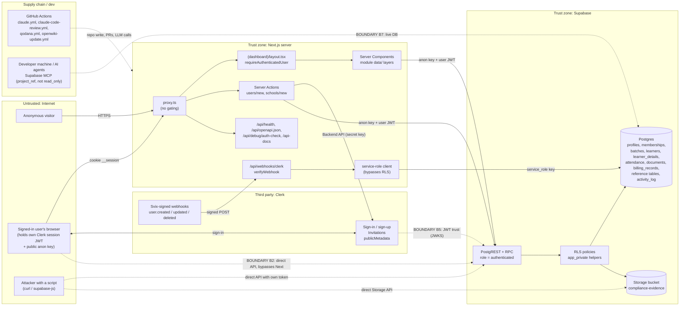

# TVI-CAMS Threat Model (OWASP audit, Phase 2)

Author role: Senior Security Architect. Scope: the repository as checked in on 2026-11-17 (HEAD `986ea82`).
Method: read-only code and migration review. No live database, Clerk or Supabase dashboard was queried. Anything that depends on hosted settings is marked "not visible from the repo".

How to read this document:

- A **hypothesis** (T-01, T-02, ...) is a suspected weakness. Each one is "needs audit". A micro-auditor should confirm or refute it.
- **Confidence** means how sure I am that the weakness is real, based on what I traced:
  - **High**: I read the exact policy or code path and saw nothing that blocks it. Only a hosted setting or an object outside the repo could change the answer.
  - **Medium**: the code path looks open, but one link (a Clerk or Supabase behaviour, or a caller I did not trace) is unconfirmed.
  - **Low**: plausible, but speculative or minor.
- File references are `path:line` or `path:start-end`. Migration paths are shortened as follows:
  - `M0` = `supabase/migrations/20260528160300_create_tenant_scoped_schema.sql` (canonical schema + RLS)
  - `M-UA` = `supabase/migrations/20260904120000_add_user_admin_write_policies.sql`
  - `M-PA` = `supabase/migrations/20260906114735_add_school_registry_and_platform_admin.sql`
  - `M-EM` = `supabase/migrations/20260906120000_ensure_invitation_membership_atomic.sql`
  - `M-BD` = `supabase/migrations/20260910120000_add_adr001_billing_domain.sql`
  - `M-T2` = `supabase/migrations/20261111120000_add_t2mis_terminal_report_fields.sql`

Terms used once and explained here:

- **RLS (row-level security)**: Postgres rules attached to a table. They decide, per row, whether the current caller may read or write it. In this app RLS is the only real security boundary.
- **PostgREST**: the REST API Supabase puts in front of Postgres. Anyone with the public anon key and a valid token can call it from a browser or `curl`. Every table in the `public` schema with a grant is reachable.
- **Security definer function**: a Postgres function that runs with its owner's rights, not the caller's. Used here for the `app_private.*` helpers so they can read membership tables.
- **BOLA / BOPLA / BFLA**: OWASP API Security terms. BOLA = broken object-level authorization (you can touch an object you should not). BOPLA = broken object *property* level authorization (you can read or write a *column* you should not). BFLA = broken function-level authorization (you can call an operation reserved for another role).

---

## 1. System overview and data flow

TVI-CAMS is a single Next.js 16 App Router app. It has no separate backend. Server Components and two Server Actions talk to Supabase Postgres and Storage. Clerk provides identity (sign-in, sessions, invitations). Supabase is configured to accept Clerk session tokens directly ("third-party auth"), so the same token works from the Next server and from the browser.

The request chain for a normal page:

1. Browser sends the Clerk `__session` cookie to Next.
2. `proxy.ts:4-8` (Clerk middleware) only adds context and an `x-pathname` header. It does **not** block anyone.
3. `app/(dashboard)/layout.tsx:13` calls `requireAuthenticatedUser()` (`modules/auth/data/auth.ts:18-22`), which redirects signed-out users to `/sign-in`. This is the only page gate.
4. Data functions build a Supabase client with the anon key and the caller's Clerk token (`lib/supabase/server.ts:40-68`). The token is sent as the bearer token.
5. Supabase validates the Clerk JWT (hosted third-party auth setting, not visible from the repo) and sets the Postgres role `authenticated`.
6. RLS policies call `app_private.current_clerk_user_id()` (`M0:339-351`) which reads `sub`, then `current_profile_id()` (`M0:353-365`) and `current_role()` (`M0:367-378`) from `public.profiles`, and `can_access_tenant()` (`M0:380-395`) from `public.profile_tenant_memberships`.

Writes that exist today:

- Server Action `createUserAction` (`app/(dashboard)/users/new/actions.ts:129-164`): sets a role and a school on an existing profile through RLS, or sends a Clerk invitation (no RLS behind it).
- Server Action `createSchoolAction` (`app/(dashboard)/schools/new/actions.ts:134-166`): calls the `create_school` RPC (`M-PA:390-443`) through RLS.
- Clerk webhook (`app/api/webhooks/clerk/route.ts:19-52`): writes `profiles` and memberships with the **service-role** client (`lib/supabase/service.ts:16-33`), which bypasses RLS.
- Written but not wired to any route yet: `uploadEvidence` / `getSignedEvidenceUrl` (`modules/documents/data/evidence.ts:138-200`) and `importLearnersCsv` (`modules/import-export/data/learnerImport.ts:175-218`).

The key fact for this audit: **the Next server is not a chokepoint.** Any signed-in Clerk user can copy their own token and call PostgREST, RPC and Storage directly. So every check that lives only in Next (role checks in actions, `redirect('/trainer')`, DTO shaping, `hideBilling`) is usability, not security. Every threat below is judged against RLS first.

### Data-flow diagram with trust boundaries

---

## 2. Assets, ranked by sensitivity

| Rank | Asset | Where it lives | Why it matters |
|---|---|---|---|
| 1 | **Learner PII**: ULI, names (`learners`), and T2MIS personal fields: contact number, email, address, date of birth, civil status, employer, salary range (`learner_details`) | `M0:156-170`, `M-T2:69-101` | Personal data of scholars, many from vulnerable groups. Philippine Data Privacy Act exposure. ULI is the permanent national learner key, so a leak is permanent. |
| 2 | **Identity mapping** `profiles.clerk_user_id → profile id`, plus `profiles.role`, `is_active` | `M0:72-81` | RLS trusts this mapping above everything else. Whoever can rewrite `clerk_user_id` or `role` can become anyone or anything. |
| 3 | **Role and membership**: `profile_tenant_memberships`, `platform_admins` | `M0:83-90`, `M-PA:65-71` | Decides which school's data a person can see. `profiles.role` is global, so one role applies in every school a person belongs to. |
| 4 | **Billing and financial data**: `billing_records` (amounts, scholar snapshot), `batches.total_amount`, cost snapshots, NTP data, `billing_deadline` | `M-BD:230-246`, `M-BD:287-311`, `supabase/migrations/20261024110000_add_dashboard_operational_fields.sql` | Generates official TESDA billing documents with peso amounts. Rule 5 says trainers must not see these. Tampering causes wrong claims. |
| 5 | **Evidence files** (signed attendance sheets, NTP, billing reports) | Storage bucket `compliance-evidence`, `M0:837-872`, `M-BD:614-621` | Compliance evidence an auditor relies on. Contains PII and signatures. Overwrite or deletion destroys the audit trail. |
| 6 | **Attendance records** | `M-BD:185-200` | Drive dropout eligibility (ADR-007) and allowance amounts. Integrity matters more than confidentiality. |
| 7 | **National reference data**: `scholarship_programs`, `program_document_requirements`, `program_billing_rules`, `program_modules`, `scholarship_cost_schedule`, `qualifications` | `M0:92-129`, `M-BD:109-150`, `M-PA:169-201` | Shared by every school. Billing rates and dropout thresholds come from here. One bad write affects all tenants. |
| 8 | **Activity log** | `M0:253-264` | The compliance audit trail. Must not be forgeable or deletable. |
| 9 | **Tenant settings** (signatories, letterhead) | `M-BD:261+`, policies `M-BD:551-562` | Appear on generated official documents. |
| 10 | **Secrets**: `SUPABASE_SERVICE_ROLE_KEY`, `CLERK_SECRET_KEY`, `CLERK_WEBHOOK_SIGNING_SECRET`, CI secrets (`CLAUDE_CODE_OAUTH_TOKEN`, `OPENAI_COMPATIBLE_API_KEY`, `QODANA_TOKEN`, LangSmith keys), developer Supabase MCP access | env vars; `.github/workflows/*`; `.mcp.json:1-8` | Service role = full database. Clerk secret = mint invitations with any grant and edit any user's metadata. |
| 11 | Committed dev artifacts: a Clerk dev session cookie in `requests/http-client.env.json:4` (expired 2026-09-16; contains a user id), real Clerk user ids and email addresses in `supabase/seeds/*.sql` | repo | Low today, but shows the private-env convention (`requests/api.http:9-10`) is not always followed. |

---

## 3. Trust boundaries

| ID | Boundary | What crosses it | Controls today |
|---|---|---|---|
| B1 | Browser ↔ Next server | Clerk cookie, page requests, Server Action POSTs (form data) | Clerk middleware parses the session (`proxy.ts:4-8`) but does not gate. Page gate is `requireAuthenticatedUser` in `app/(dashboard)/layout.tsx:13`. Server Actions do their own checks (`users/new/actions.ts:56-81`, `schools/new/actions.ts:73-85`). Next's built-in Server Action origin check (CSRF) is assumed, not configured (`next.config.ts:1-9`). No security headers (CSP, frame-ancestors) are set in `next.config.ts`. |
| B2 | Browser ↔ Supabase **directly** | The user's own Clerk JWT + public anon key → PostgREST, RPC, Storage | RLS only. Table grants are broad: `grant select, insert, update, delete on all tables in schema public to authenticated` (`M0:466-467`), and per-table grants in `M-PA:188,245`, `M-BD:457-462`, `M-T2:109`. So column-level protection does not exist; RLS policies are the whole story. |
| B3 | Next server ↔ Supabase with the user JWT | Same token as B2, sent by `lib/supabase/server.ts:47-60` | Missing token throws (`lib/supabase/server.ts:55-57`), so the server never silently queries as `anon`. Gives no extra authority over B2. |
| B4 | Clerk webhook ↔ service-role client | Svix-signed JSON (`user.created/updated/deleted`) → writes `profiles`, memberships | `verifyWebhook` (`app/api/webhooks/clerk/route.ts:22`). After verification, `public_metadata` and `email_addresses[0]` are trusted (`route.ts:30-38`, `modules/auth/data/provisioning.ts:58-106`). The membership RPC is service-role only (`M-EM:32-35`). |
| B5 | Clerk ↔ Supabase third-party auth | Clerk session JWTs | Hosted setting (not visible). Local config trusts the Clerk **dev** instance domain (`supabase/config.toml:325-339`). RLS reads `sub`, with fallbacks (`M0:346-350`). Supabase native Auth is also enabled locally (`supabase/config.toml:151,186`, confirmations off at `:191`). |
| B6 | CI / GitHub Actions / AI agents ↔ repo | PR code, issue comments, LLM prompts, generated PRs | `claude.yml:15-19` runs on any `@claude` comment; `openwiki-update.yml:9-11` has `contents: write` and opens PRs that edit `CLAUDE.md`, `AGENTS.md` and its own workflow file (`:89-93`). Actions are mostly pinned by tag, not SHA (`claude.yml:30,35`, `qodana.yml:21,27`, `openwiki-update.yml:87`). |
| B7 | Developer machine ↔ live DB | Supabase MCP (`.mcp.json:3-6`, no `read_only=true`), CLI, `psql` | `.claude/settings.json` deny list blocks `execute_sql`, `apply_migration`, `db push/reset`, `psql` for Claude sessions (RULES.md §10, rule 36). Nothing stops a human or a non-Claude tool. There is one hosted project and no staging (RULES.md:136-138). |

---

## 4. Entry points

### 4.1 Pages (all under the `(dashboard)` group are behind `requireAuthenticatedUser`)

| Route | Gate beyond sign-in | Notes |
|---|---|---|
| `/`, `/sign-in/[[...]]`, `/sign-up/[[...]]` | none | Public. `redirect_url` sanitized by `modules/auth/domain/redirectUrl.ts:12-24`. |
| `/t/[tenantCode]/dashboard` and `/t/[tenantCode]/(sections)/{batch-cards,table-view,documents,billing,analytics,report,activity-log}` | `requireScope` (`app/(dashboard)/tenant-scope.ts:63-69`) builds a scope only from the caller's memberships (`modules/tenancy/domain/scope.ts:47-51`) | `?state=` override on dashboard (`app/(dashboard)/t/[tenantCode]/dashboard/page.tsx:79,85`) and billing (`.../billing/page.tsx:73`). `?role=` presentation override on billing (`.../billing/page.tsx:67`). Trainer redirect at `dashboard/page.tsx:77` and `billing/page.tsx:56-59`. |
| Legacy unscoped `/dashboard`, `/batch-cards`, `/billing`, ... | redirect to default scope (`tenant-scope.ts:78-93`) | Re-appends all query params to the redirect (`tenant-scope.ts:87-92`). |
| `/overview`, `/profile`, `/report` | sign-in only | not traced in detail |
| `/trainer`, `/trainer/classes`, `/trainer/classes/[batchId]/{attendance,documents}` | sign-in only | `/trainer` calls `getBatchesSnapshot()` with no tenant scope and passes metrics with `hideBilling` (`app/(dashboard)/trainer/page.tsx:16-20`). The `[batchId]` pages are placeholders today. |
| `/users/new` | page + action check `profiles.role = admin` | Action: `users/new/actions.ts:56-81`. |
| `/schools/new` | platform-admin RPC | Action: `schools/new/actions.ts:73-85`. |
| `/api-docs` | sign-in only (`app/api-docs/page.tsx:4-7`) | Outside `(dashboard)`; any Clerk user, even with no profile or school, can load Swagger UI. |

### 4.2 API routes

| Route | Auth | Notes |
|---|---|---|
| `GET /api/health` | none | Static `{status:"ok"}` (`app/api/health/route.ts:3-5`). |
| `GET /api/openapi.json` | Clerk sign-in only (`app/api/openapi.json/route.ts:5-11`) | Serves `docs/openapi/openapi.json` to any signed-in Clerk user. |
| `GET /api/debug/auth-check` | none; returns 404 when `NODE_ENV === 'production'` (`app/api/debug/auth-check/route.ts:24-27`) | In any non-production build it returns raw Postgres error code and message (`:63-64`). |
| `POST /api/webhooks/clerk` | Svix signature (`app/api/webhooks/clerk/route.ts:22`) | Writes with service role. |

### 4.3 Server Actions

- `createUserAction` (`app/(dashboard)/users/new/actions.ts:129-164`). Inputs: `fullName`, `email`, `role`, `tenantId`.
- `createSchoolAction` (`app/(dashboard)/schools/new/actions.ts:134-166`). Inputs: school fields + program rows.

Server Actions are public POST endpoints. The action ID can be found in the client bundle, so any signed-in user can call them with crafted form data.

### 4.4 Direct Supabase surface (reachable by every signed-in Clerk user, bypassing Next)

- **PostgREST tables** (all granted to `authenticated`): `tenants`, `profiles`, `profile_tenant_memberships`, `scholarship_programs`, `program_document_requirements`, `program_billing_rules`, `program_modules`, `scholarship_cost_schedule`, `qualifications`, `tenant_qualifications`, `batches`, `learners`, `learner_details`, `documents`, `attendance_records`, `batch_trainer_assignments`, `billing_records`, `tenant_settings`, `lamr_reports`, `lamr_outcomes`, `lamr_activities`, `lamr_entries`, `activity_log`, `trainer_credentials`. `learner_identities` and `platform_admins` have RLS on and no policy (deny all).
- **RPC** (functions in exposed schema `public`, `supabase/config.toml:16`): `current_user_is_platform_admin()` (`M-PA:115-126`), `create_school(...)` (`M-PA:390-443`, security invoker). `ensure_profile_tenant_membership` is revoked from `authenticated` (`M-EM:32-35`). `app_private.*` is granted to `authenticated` (`M0:448-449`) but `app_private` is not in the exposed schema list, so it should not be callable over REST (needs a hosted check).
- **Storage**: bucket `compliance-evidence`, private (`M0:837-841`). Policies: select/insert/update for any tenant member (`M0:843-872`), delete for admin/coordinator (`M-BD:614-621`). Storage `list` uses the select policy.
- **Supabase Auth endpoints** (`/auth/v1/signup` etc.): enabled locally (`supabase/config.toml:151,186`). Hosted setting not visible.

### 4.5 CI workflows

- `.github/workflows/claude.yml` (issue / PR comments containing `@claude`).
- `.github/workflows/claude-code-review.yml` (every PR).
- `.github/workflows/qodana.yml` (PRs and pushes; `contents: write`, checks out PR head, `:14-24`).
- `.github/workflows/openwiki-update.yml` (daily cron; sends repo content to a third-party LLM router; opens PRs that edit agent instruction files).
- `.github/workflows/stale.yml` (manual only).

---

## 5. Threat actors

| Actor | What they hold | Realistic goal |
|---|---|---|
| A1 Anonymous internet | Public anon key (it ships in the client bundle), Supabase URL, Clerk publishable key | Read anything open to `anon`; create a Supabase-native account; probe debug routes. |
| A2 Signed-up user with no school | Own Clerk session (self sign-up gives a `viewer` profile with no membership, `provisioning.ts:90-103`) | Read global data; get a membership by any side door. |
| A3 Viewer | Membership in one school, role `viewer` | Write anything (rule 4 says viewer is read-only, server-denied). |
| A4 Trainer | Membership + assigned batches | Read billing/financial data or PII outside their batches; tamper with attendance; read or overwrite other batches' evidence. |
| A5 Coordinator | Manage rights in their school | Affect other schools; change global rates; forge audit trail. |
| A6 School admin of another school | Admin role, user-admin RLS policies | Reach into school B; take over accounts; become platform admin. |
| A7 Platform admin | `platform_admins` row | Reach compliance data (ADR-006 P3 forbids it). |
| A8 Compromised dependency / CI / AI agent | Code execution in build or CI, LLM prompt input | Steal secrets; push malicious code or agent instructions. |
| A9 Insider developer | Repo access, maybe service-role key, Supabase MCP | Bypass RLS; run statements on the only (production) database. |

---
## 6. Abuse cases (STRIDE)

STRIDE letters: **S**poofing, **T**ampering, **R**epudiation, **I**nformation disclosure,
**D**enial of service, **E**levation of privilege.

Each row is a **hypothesis**, written as "which control is supposed to stop this, and is it
there?". Rows deliberately stay at the level of the missing control. They are not step-by-step
instructions. The result of checking each one is in `FINDINGS.md`.

| ID | STRIDE | Actor | Entry point | Asset | What could go wrong | Control that should stop it (where) | Confidence |
|---|---|---|---|---|---|---|---|
| T-01 | E, S | A6 | Direct REST, `profiles` update | Identity mapping, platform admin | The admin update policy says *who* may update a profile, not *which columns*. Profiles with no school are editable by any school admin, and the platform admin sits outside every school by design (ADR-006). | Column limits on `profiles` (none: `M-UA:64-88`, grant `M0:467`) | High |
| T-02 | E, S | A6 | Direct REST, `profiles` update | Identity, other school's data | An admin can change login link, role or active flag of a co-member. Role is global, so the change also applies in any other school that person belongs to. | Same as T-01, plus per-school roles (none: `M0:397-406`) | High for the column gap, Medium that multi-school users exist |
| T-03 | E | A6 | Direct REST, membership insert | Role, other school | The membership insert policy checks the school, not the person being added. Adding someone makes them a "co-member", which opens T-02. | Target-profile check on insert (none: `M-UA:98-105`) | High |
| T-04 | E | A2 | Clerk profile edit, then `user.updated` webhook | Membership | The invitation grant may be applied again on later `user.updated` events when the profile has no membership, which could undo an admin's removal. | Apply-once rule (`modules/auth/data/provisioning.ts:73-87`) | Medium |
| T-05 | I | A4 | Direct REST, `batches` select | Billing and NTP data | RLS filters rows, not columns. A trainer who may read a batch row may read every column of it, including money and deadline fields. | Column separation (none: `M0:408-428`, `M-BD:287-311`) | High |
| T-06 | I, T | A3, A4 | Direct Storage API | Evidence files | Storage read, upload and update check school membership only. Role, batch assignment and document audience are not checked. | Role-aware storage policies (none: `M0:843-872`) | High |
| T-07 | T | A5 | Direct REST, reference tables | National reference data | Any school's admin or coordinator may write tables shared by all schools (rates, thresholds, required documents). | Platform-level write policy (none: `M0:506-537`, `M-BD:574-592`) | High |
| T-08 | T, I | A5, A4 | Direct REST, child-table insert | Other school's batch data | Child rows carry their own `tenant_id` and a separate `batch_id`. Nothing forces the two to agree, so a row could be attached to another school's batch. | Composite foreign keys or matching `with check` (mostly none: `M0:156-264`, `M-BD:468-503`) | Medium |
| T-09 | R, T | A3 to A5 | Direct REST, `activity_log` insert | Audit trail | Any member, including a viewer, may insert log rows and choose the actor and action freely. | Actor pinned to caller, viewer excluded (none: `M0:754-764`) | High |
| T-10 | T, E | A4 | Direct REST, `documents` update | Document verification | The trainer write policy does not restrict `status`, `verified_by`, `verified_at`. | Status limits in `with check` (none: `M0:597-619`) | High |
| T-11 | T, D | A5, A4 | Direct REST, deletes | Billing records, attendance, LAMR | Deleting a batch cascades into records described as append-only. Trainers may delete LAMR reports. | Restrictive foreign keys and delete policies (`M-BD:232-233`, `M0:558-562`) | High |
| T-12 | S, E | A1 | Supabase Auth sign-up endpoint | Any `authenticated`-only data | If native Supabase sign-up is enabled on the hosted project, a caller could get an `authenticated` token without Clerk. `current_clerk_user_id()` has claim fallbacks. | Hosted auth settings (not visible), `M0:339-351` | Low to Medium, cannot verify from repo |
| T-13 | I | A2 | Direct REST | Reference data, tenant list, profiles | A signed-up user with no school may still read whatever policies open to every `authenticated` caller. | Policies using `using (true)` or missing membership checks | Medium |
| T-14 | I | A4 | `/trainer` pages | Billing metrics | Billing figures may be computed and sent to the browser, then hidden in the UI (`hideBilling`). | Server-side DTO shaping (`app/(dashboard)/trainer/page.tsx:16-20`) | Medium |
| T-15 | E | A3 to A5 | Server Actions | Users, schools | Server Actions are public POST endpoints. Each must re-check the caller, and must not accept a role or school wider than the caller's own. | `users/new/actions.ts:56-81`, `schools/new/actions.ts:73-85` | Medium |
| T-16 | S | A1 | Clerk webhook | Profiles, memberships | The webhook writes with the service-role key. Everything depends on signature verification and on trusting only fields a user cannot set. | `verifyWebhook` (`app/api/webhooks/clerk/route.ts:22`) | Low (control present), needs confirmation |
| T-17 | I | A1, A2 | `/api/debug/auth-check`, `/api-docs`, `/api/openapi.json` | Internal detail | Diagnostic surfaces expose error detail or the API map to people who do not need it. | `NODE_ENV` guard, sign-in check | Low |
| T-18 | I | A1 | Repo contents | Session identifiers, real emails and ids | Development artefacts with real identifiers are committed. | `.gitignore`, private env file convention | Medium (seen), Low impact |
| T-19 | T, E | A8 | GitHub Actions | Repo, CI secrets | Workflows run with write permission or secrets on pull-request code, use actions pinned by tag, and one opens PRs that edit agent instruction files. | Workflow permissions and pinning (`.github/workflows/*`) | Medium |
| T-20 | T, D | A9 | Supabase MCP, CLI | Live database | One hosted project, no staging. The MCP entry is not read-only. Only Claude sessions are blocked by the deny list. | `.mcp.json:3-6`, `.claude/settings.json` | Medium |
| T-21 | I, T | any | Browser | Session, page content | No Content-Security-Policy, frame protection or other security headers are set. | `next.config.ts:1-9` | High (seen), Medium impact |
| T-22 | T | A5 | CSV import, XLSX export | Learner data, office staff machines | Imported cells may reach exports unescaped (spreadsheet formula injection). Import may lack size limits. | `modules/import-export/`, `modules/reports/` | Low, needs audit |
| T-23 | D, I | A3 to A5 | Deactivated school or user | All tenant data | `can_access_tenant` may not check `tenants.is_active`, so a switched-off school keeps access. | `M0:380-395` | Medium |

---

## 7. Assessment of the authentication design

**The chain:** Clerk session token, accepted by Supabase third-party auth, then
`auth.jwt() ->> 'sub'`, then a lookup in `profiles`. Role and school come from database
tables, never from token claims.

What is sound:

- Role and school are looked up in the database (`M0:353-395`). A user cannot change them by
  editing a token or Clerk metadata they control.
- A missing token throws (`lib/supabase/server.ts:55-57`). The server never quietly queries
  as `anon`, which would look like "no data".
- The service-role key is read in one file (`lib/supabase/service.ts`) and used only by the
  webhook's provisioning code.
- The webhook verifies the signature before doing anything (`app/api/webhooks/clerk/route.ts:22`).
- `app_private` helpers set `search_path = ''` and are not in an exposed API schema.
- Tenant scope from the URL is built only from the caller's own memberships
  (`modules/tenancy/domain/scope.ts:47-51`).

What is weak or unknown:

1. **Identity is one editable column.** `profiles.clerk_user_id` is the whole link between a
   login and a person. Any policy that lets someone else update that column lets them
   re-point the identity (T-01, T-02). This is the single most important design point.
2. **Role is global.** One `profiles.role` for all schools means a role granted in one school
   is active in every school the person belongs to (T-02, T-03).
3. **Supabase native auth.** Local config has sign-up on and confirmations off
   (`supabase/config.toml`). If the hosted project matches, there is a second way to get an
   `authenticated` token (T-12). Hosted settings must be checked in the dashboard.
4. **Claim fallbacks.** `current_clerk_user_id()` falls back to other claims (`M0:346-350`).
   Harmless with Clerk only, but it widens what counts as an identity if T-12 is real.
5. **Invitation metadata.** The webhook trusts `public_metadata`. Clerk allows only the
   backend to set it, so a user cannot forge it. The remaining questions are who may *create*
   an invitation with which grant (T-15) and whether a grant can be applied twice (T-04).
6. **Email matching.** `email_addresses[0]` may not be the primary or a verified address.
7. **Preview overrides.** `?state=` and `?role=` change what a page shows. They must only
   narrow, never widen, and should not exist in production.
8. **Gate placement.** `proxy.ts` does not block. A new route group outside `(dashboard)` is
   open until it adds its own check. `/api-docs` shows this pattern.
9. **Debug route.** Guarded by `NODE_ENV` only. A preview deployment built in non-production
   mode would expose it.

---

## 8. Mapping to OWASP categories

| OWASP Top 10 | Hypotheses |
|---|---|
| A01 Broken Access Control | T-01, T-02, T-03, T-05, T-06, T-07, T-08, T-10, T-11, T-13, T-14, T-15, T-23 |
| A02 Cryptographic Failures | T-18 (secrets and tokens at rest in the repo) |
| A03 Injection | T-22 |
| A04 Insecure Design | T-02 (global role), T-05 (no column separation), T-11 (cascade over append-only data) |
| A05 Security Misconfiguration | T-12, T-17, T-20, T-21 |
| A06 Vulnerable and Outdated Components | covered by the dependency micro-audit (no hypothesis yet) |
| A07 Identification and Authentication Failures | T-01, T-04, T-12, T-16 |
| A08 Software and Data Integrity Failures | T-16, T-19 |
| A09 Security Logging and Monitoring Failures | T-09 |
| Mishandling of Exceptional Conditions | covered by the error-handling micro-audit (fail-open checks, swallowed errors) |

| OWASP API Security Top 10 | Hypotheses |
|---|---|
| API1 Broken Object Level Authorization (BOLA) | T-03, T-06, T-08 |
| API2 Broken Authentication | T-12, T-16 |
| API3 Broken Object Property Level Authorization (BOPLA) | T-01, T-02, T-05, T-10, T-14 |
| API4 Unrestricted Resource Consumption | T-22, plus query and upload limits |
| API5 Broken Function Level Authorization (BFLA) | T-07, T-09, T-11, T-15 |
| API8 Security Misconfiguration | T-12, T-17, T-21 |
| API9 Improper Inventory Management | T-17 (debug and docs routes), repo-versus-live drift |

---

## 9. Micro-audit tasks

The tasks that check these hypotheses are listed in `SECURITY_AUDIT_PLAN.md`, one lane per
agent, with the hypothesis IDs each lane covers.

---

## Authorship note

Sections 1 to 5 were written by the security architect agent (Opus). Its run was stopped by
an automated safety check part-way through section 6, because the scenario table was drifting
into step-by-step detail. The orchestrator rewrote section 6 at the level of missing controls
and wrote sections 7 to 9 from the architect's hypotheses. The architect reviewed the
consolidated findings in Phase 4.
