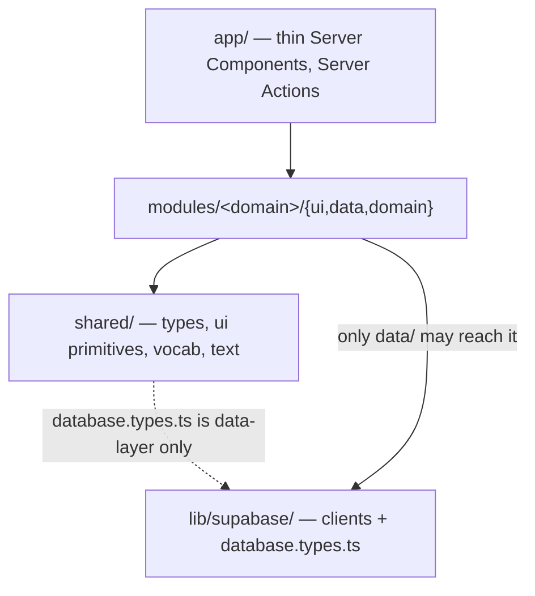
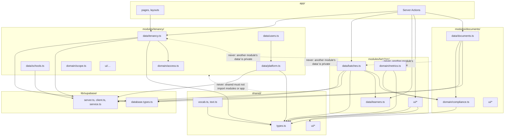

# Module Boundaries and the Data Layer Pattern

Code in this repository is grouped **by domain, not by file type** — a DDD-influenced layout introduced with TES-68. Every feature lives in a `modules/<domain>/` folder split into three sub-layers (`data/`, `domain/`, `ui/`), and everything sits inside a four-layer hierarchy with a strictly one-way import direction: `app → modules → shared → lib/supabase`. [`CLAUDE.md`](/CLAUDE.md) §Architecture explains the *why*; [`RULES.md`](/RULES.md) §2–§3 states the *what* as checklist rules, each tagged with its enforcement level (`[lint]`, `[types]`, `[review]`). Where the two documents disagree, `RULES.md` wins and the drift gets fixed. The request path those rules protect is described in [overview.md](/openwiki/architecture/overview.md).

The rules that matter most for day-to-day work:

- **No business logic in `app/`.** Routes are thin Server Components: they fetch via a module's `data/` layer and compose module `ui/` + `shared/ui/` primitives (RULES rule 11, `[review]`).
- **A module's `data/` is private to that module.** Another module imports its `domain/` or `ui/` surface instead; only `app/` may fetch from any module's `data/` (RULES rule 8, `[lint]`).
- **`domain/` is pure** — business rules with no I/O (RULES rule 14, `[review]`).
- **`shared/` must never import `modules/` or `app/`** (RULES rule 9, `[lint]`).
- **No index barrels** — deep imports are the convention everywhere, including `shared/` (RULES rule 13, `[review]`; no `index.ts` exists in the tree).
- **Only module `data/` layers may import `lib/supabase/database.types.ts`** (besides `lib/supabase` itself); components import domain types from `shared/types.ts` or a module's `domain/` (RULES rule 10, `[lint]`).
<!-- openwiki: broken internal link [#the-four-state-snapshot-contract] heading anchor "the-four-state-snapshot-contract" does not exist in /openwiki/architecture/module-boundaries-and-data-pattern.md. Fix the href or restore the target, then delete this comment. -->
- **Every entity contract returns a discriminated snapshot** — four states, no fabricated data (RULES rule 19). See [The four-state snapshot contract](#the-four-state-snapshot-contract).

## Layer model

Four layers, one direction. The full zone matrix (with the "never" edges spelled out) is below.

## The four zones

| Zone | Holds | May import |
|---|---|---|
| `app/` | App Router routes, layouts, Server Actions | any `modules/` surface, `shared/`, `lib/supabase` |
| `modules/<domain>/{data,domain,ui}` | one module per PRD FR | its own layers, other modules' `domain/` + `ui/`, `shared/`, and — from `data/` only — `lib/supabase` |
| `shared/` | leaf-level types, presentational primitives, vocabulary, text helpers | `shared/` itself, `lib/supabase` clients (never `database.types.ts`) |
| `lib/supabase/` | the external data boundary | external packages only |

The rules are not stylistic preferences. Each one closes a specific failure:

- **A module's `data/` is private.** `modules/tenancy/data/tenancy.ts` reaches the `profiles` table through a mapper no other module can see, and screens import `getBatchesSnapshot` from `modules/batches/data/batches.ts` but never `mapBatchRow`.
- **`shared/` is leaf level.** A primitive in `shared/ui/` that starts reading module data or encoding a module rule has crossed the boundary and belongs in the owning module.
- **Raw DB types stay in `data/`.** `modules/batches/data/batches.ts` imports `Database` and defines `BatchRowWithProgram` privately, so no component depends on a column name.

These restrictions are enforced in [`eslint.config.mjs`](/eslint.config.mjs) with `import/no-restricted-paths` (RULES rule 7) and reviewed in PRs. A violation surfaces as a lint error naming the offending import.

Solid arrows are allowed import directions; dashed arrows are rejected by `import/no-restricted-paths` in [`eslint.config.mjs`](/eslint.config.mjs). The tenancy/batches/documents trio illustrates the cross-module rule with real modules — `BO1 → DD2` shows a batches domain file reaching documents' public `domain/` (compliance) but never its `data/`.

## The layer rules in detail

### `data/` — the fetch layer and the raw-type boundary

`data/` is the only layer that talks to Supabase and the only one allowed to import `lib/supabase/database.types.ts` (RULES rule 10). Its job: issue a typed query whose rows RLS has already scoped, map them to UI domain objects, and return a discriminated snapshot instead of throwing.

The shape every data function follows, from `modules/batches/data/batches.ts`:

1. `if (!isSupabaseConfigured()) return { status: 'unconfigured' }` — checked **first**, so a missing env var never masquerades as a query failure.
2. `try { … }` around `createSupabaseServerClient()` and the query; both the client construction and the query can throw.
3. On success, map rows and return `{ status: 'ok', … }` with the mapped rows plus a freshness pair.
4. On a Postgrest `error`, return `{ status: 'sync-failed', error }` with the raw message **kept server-side**.
5. On a thrown error, return `{ status: 'sync-failed', error: String(err) }`.

No branch ever returns fixture data. `selectBatchesForDisplay` is the display adapter (below); it turns the union into an array.

### `domain/` — pure rules, the only cross-module surface

`domain/` holds functions and types with no I/O — input in, output out, no `await` (RULES rule 14). `modules/tenancy/domain/access.ts` maps a profile snapshot to an access verdict; `modules/batches/domain/metrics.ts` maps `Batch[]` to `DashboardMetrics`; `modules/documents/domain/compliance.ts` maps document records plus a catalog to compliance figures.

`domain/` is what other modules may import (rule 8) and what `data/` layers import for shaping. It is also the natural hoist target: when two modules need the same rule, it moves into one of their `domain/` layers and the other imports it — never into `shared/`, which cannot import modules.

### `ui/` — components that know their domain

`ui/` renders domain types and may read domain helpers, but performs no queries. Server Components in `app/` may compose another module's `ui/` freely; `ui/` may import its own module's `domain/` and `shared/ui/` primitives, never a `data/` layer.

### `shared/` — leaf level, never module-aware

`shared/` holds four things and nothing else:

- `shared/types.ts` — the single hand-written UI domain type file (`Batch`, `Tenant`, `DocRecord`, `DashboardMetrics`, …).
- `shared/ui/` — props-only presentational primitives.
- `shared/vocab.ts` — closed TESDA vocabulary (employment statuses, EGACE stages).
- `shared/text.ts` — pure string shaping (`pluralize`, `initials`).

`shared/` imports no module and no `database.types.ts` (RULES rule 9, rule 10). The dependency direction is total: everything may import `shared/`, `shared/` imports only itself.

`shared/` also carries no data access and no accessibility knowledge beyond generic props. It does **not** re-export module code — that is the rule that keeps `shared/` a leaf (rule 9) — and a primitive that grows module-specific behaviour moves out.

The two remaining `shared/` files describe a world with no data layer: `vocab.ts` records that the closed TESDA terms stay here because the consumers live in two modules, and `text.ts` carries copy shaping. Neither substitutes for a `data/` layer, because `shared/` cannot query.

No `shared/ui/` primitive imports `modules/`, so one always renders from props.

## The never edges

Four edges are forbidden outright, each for a concrete reason (RULES rules 7–10):

| Edge | Why it is forbidden | Signature |
|---|---|---|
| `modules/*/data → another module's data/` | the other module's mapper is an internal detail; a copy kept in sync by hand beats coupling two private layers | `import/no-restricted-paths` zone per domain |
| any layer other than `data/ → lib/supabase/database.types.ts` | raw columns must not leak outside the mapper, or a rename ripples through components | same, restricted to `data/` |
| `shared/ → modules/` | `shared/` would stop being a leaf and start a cycle | same |
| `shared/, modules/ → app/` | `app/` is the composition root; anything under it is a leaf-ward violation | same |

The reverse (allowed) edges exist so every layer has a legitimate way to get what it needs without bending the private-`data/` rule. Cross-module data needs are met with a `domain/` import or a parameter the caller passes; `app/` may call two modules' `data/` layers side by side because it is allowed to see both.

## The snapshot union: `ok` | `sync-failed` | `unconfigured` (plus `no-tenant-access`)

Every data function returns a discriminated union the caller must narrow before touching rows. The three always-present members and the fourth route-folded one:

- `ok` — mapped rows, plus the freshness pair below.
- `sync-failed` — the query errored or the client threw; `error` retained for logging only.
- `unconfigured` — no Supabase env; not an error, just "nothing wired yet".
- `no-tenant-access` — **never returned by a query**, because RLS answers an unattached caller with a *successful empty read*. The route folds it in via `withTenantAccess`, which rewrites only an `ok` snapshot so a real failure is never masked, and leaves an access verdict of `unknown` ("could not check") untouched.

Because three of the four states carry no rows, **the display adapter always collapses to `[]`** — `selectBatchesForDisplay(snapshot)` returns the rows for `ok` and `[]` for everything else — and the route must therefore inspect the *status* before deciding which empty-looking screen to render. That is the ordering trap [below](#guard-ordering).

`ok` also carries freshness: `dataAsOf` (the newest `updated_at`) and `fetchedAt` (the moment of the read, which is what the "Data as of" label prints, since edit recency is not staleness). `BatchesSnapshot` documents both.

### Guard ordering

A screen holds only its narrowed rows by the time it renders, so guarding wrongly is silent: a `sync-failed` and a `no-tenant-access` both look identical to "zero rows". The fixed order is:

1. **denied** — forced role screens first; nothing else matters.
2. **`sync-failed` with zero rows** — the retry banner must win over "no batches yet".
3. **`no-tenant-access`** — an import action is useless to a caller with no school.
4. **empty** — a real fact about a reachable school.
5. **no-results** — the client island's filtered-to-nothing state, which is not a snapshot fact at all.

`…/batch-cards/page.tsx` destructures the two statuses into booleans and returns the sync-failed callout before the `NoTenantAccessState` before the `EmptyState`; `…/dashboard/page.tsx`'s `guardState` runs denied → `syncFailed && batchCount === 0` → `noTenantAccess` → empty.

### Verify before display

`modules/tenancy/domain/access.ts` also exports `deriveTenantAccess(profileSnapshot)`, which differs from the snapshot union's state set: an unconfigured or failed profile read yields `unknown` rather than the caller being told they have no school. Callers pass the result into `withTenantAccess`, which is the only thing that ever writes `no-tenant-access`.

## The freshness pair

`ok` snapshots carry `dataAsOf` and `fetchedAt` (`BatchesSnapshot`, `ActivitySnapshot`, and the dashboard's metric input all use the pair). `dataAsOf` is the newest `updated_at` in the loaded set — *when the data was last edited*; `fetchedAt` is *when it was read*. Because every request is a live read, screens print `fetchedAt` as "Data as of" and reserve `dataAsOf` for edit recency. A non-`ok` snapshot carries neither, so the label degrades to "not available" rather than printing a stand-in time.

## Writing data: discriminated result unions

Writes cannot return an `ok` snapshot with rows because there are no rows to return, so write paths use a *result union* with the same discipline: an outcome discriminant plus a payload, never a throw. Representative cases:

- `UserAssignmentSnapshot` — `assigned`, `not-registered`, `denied`, `sync-failed`, `unconfigured`. The `denied` state is what keeps an RLS refusal from being reported as a broken connection.
- `UserLookupSnapshot` — `found`, `not-registered`, `sync-failed`, `unconfigured`.
- `LearnerImportSnapshot` — `ok`, `validation-failed`, `sync-failed`, `unconfigured`; validation happens before any Supabase client exists.

The `CreateUserFormState` in `app/(dashboard)/users/new/actions.ts` wraps the same distinction for a Server Action: it distinguishes `denied`, `failed`, `unconfigured`, `invalid`, and the success outcomes so the form can show the right message.

## The enum bridge and the total-map rule

Every database `Row` field that a domain type names differently is translated in the mapper through a **total (non-`Partial`) map**, so a new DB enum variant fails compilation until its UI treatment is chosen (RULES rule 18). `DB_TO_UI_STAGE` in `batches.ts` is the canonical example: `training`/`assessment`/`billing` → `train`/`assess`/`bill`, `entre` is UI-only with no DB column, and `completed`/`blocked` map to `null` because `deriveLifecycle` treats them as special cases rather than a pipeline position. `normalizeStatus` surfaces DB `blocked` as UI `pending`.

The total-map rule holds for `DB_TO_UI_ROLE` and `UI_TO_DB_ROLE` (tenancy), `ACTION_TO_TONE` (activity), and `ASSESSMENT_RESULT_TO_UI` (learners). The one deliberate exception is `DOCUMENT_ICONS` in `documents.ts`, a `Partial` map with a generic fallback, because `document_key` is per-program configured data rather than a closed enum.

## The reference implementation

`modules/batches/data/batches.ts` is the file to copy. Its shape, in order:

- A private `BatchRowWithProgram` type built from the generated `Database` type, plus the embedded-join `as` casts the stub `Relationships` still force.
- `mapBatchRow` — pure, no I/O, the only place a column name appears. Gaps get `TODO(contract)` defaults and an `orEmpty`/`orZero` guard so a runtime null cannot put `NaN` into a progress bar.
- `deriveLifecycle`, `daysUntil`, `toDisplayDate` — date and lifecycle helpers, with `daysUntil` returning `Number.POSITIVE_INFINITY` as the explicit "no known deadline" sentinel.
- `BatchesSnapshot` and `getBatchesSnapshot` — union type and `cache()`-wrapped fetch, the `unconfigured` check first.
- `selectBatchesForDisplay` — the display adapter.

Three things make this file the reference rather than an example: the state union is exhaustive, the mapper is exported for tests, and the fetch is `cache()`d (below).

## Testing the pattern

`tests/unit/batches.test.ts` exercises the reference implementation end to end. Its value lies in the assertions, not the coverage number:

- `mapBatchRow` gets a fully populated fixture and asserts each field, including that snake_case columns become camelCase and enum strings become UI lifecycle entries.
- `selectBatchesForDisplay` is asserted to return `[]` for `unconfigured`, `sync-failed`, and `no-tenant-access`, and to return the rows for `ok` — including an `ok` snapshot with zero rows, which stays authoritative.
- The `ok` path is asserted not to touch mock data.

`tests/unit/documents.test.ts`, `tests/unit/doc-compliance.test.ts`, `tests/unit/doc-blockers.test.ts` and `tests/unit/evidence-path.test.ts` cover the document rules. `tests/unit/evidence-path.test.ts` asserts that a path containing a separator in any segment is rejected, and that the tenant segment is checked first.

Real-Supabase RLS/tenant-isolation integration tests are still outstanding; the current suite is pure function-in/function-out against fixtures.

## Extending the pattern

**A new read contract:**

1. Add the type to `shared/types.ts`.
2. Create `modules/<domain>/data/<entity>.ts` following the batches reference: `unconfigured` first, `try/catch` around the client and query, raw error retained, mapper exported, `select*ForDisplay` returning `[]` for non-`ok`.
3. Add a member to the snapshot union only if it is genuinely distinct in kind (`not-found`, `validation-failed`), and omit `no-tenant-access` where the data is not tenant-scoped.
4. Write the unit tests against a fixture typed with `Parameters<typeof map…>[0]`.

**A new enum column:** add a total map in the mapper, and let the compiler drive every call site.

**A write path:** return a result union, keep the raw error server-side, and check `denied` distinctly from `sync-failed`.

**A new module:** create `modules/<name>/{data,domain,ui}` and add the name to the `domains` array in `eslint.config.mjs`, which generates the per-domain `data/`-privacy zones. A module added to the folder tree but not to the array has no enforced boundary.

## Failure modes recap

| Failure | Symptom | Guard |
|---|---|---|
| `empty` checked before `sync-failed` | retry banner swallowed behind "no batches yet" | status checked first, rows collapsed to `[]` |
| `empty` checked before `no-tenant-access` | caller told to import with no school | fold runs before rendering |
| `withTenantAccess` rewriting a non-`ok` snapshot | real failure hidden behind "no school" | fold rewrites `ok` only |
| `unknown` access rendered as `none` | "you have no school" when the check merely failed | `unknown` untouched |
| throwing from a data function | digest-only error, nothing to render | union instead of throw |
| raw error string printed | SQL text and table names in the UI | `error` retained, fixed copy shown |
| a fake row on `unconfigured` | UI that looks live but is not | no fixtures anywhere |
| a `Partial` enum map | new DB variant silently `undefined` | total maps, compile error |
| a raw column read in a component | rename ripples past the mapper | `database.types.ts` restricted to `data/` |

## Related

- [Data model and RLS](/openwiki/architecture/data-model-and-rls.md) — the schema, the RLS functions the snapshot states depend on, and the generated-type regeneration contract (RULES rule 20).
- [Architecture overview](/openwiki/architecture/overview.md) — where these layers sit in a request.
- [`RULES.md`](/RULES.md) §1–§2 — the boundary rules and their enforcement levels quoted above.
