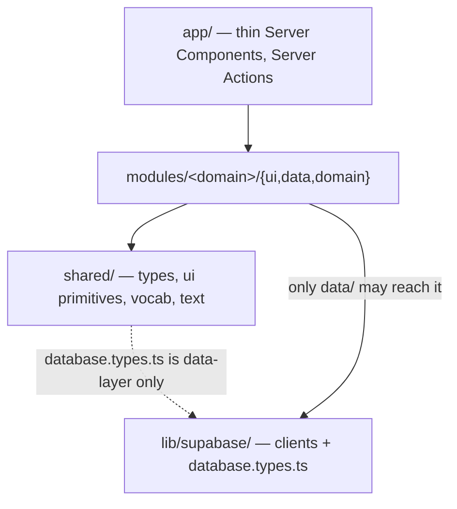
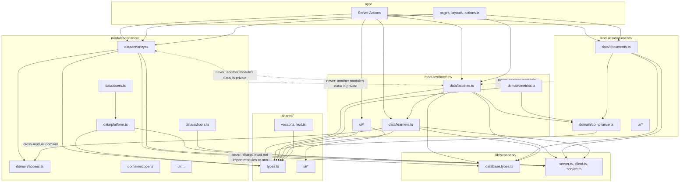

# Module Boundaries and the Data Layer Pattern

Code in this repository is grouped **by domain, not by file type** — a DDD-influenced layout introduced with TES-68. Every feature lives in a `modules/<domain>/` folder split into three sub-layers (`data/`, `domain/`, `ui/`), and everything sits inside a four-layer hierarchy with a strictly one-way import direction: `app → modules → shared → lib/supabase`. [`CLAUDE.md`](/CLAUDE.md) §Architecture explains the *why*; [`RULES.md`](/RULES.md) §2–§3 states the *what* as checklist rules, each tagged with its enforcement level (`[lint]`, `[types]`, `[review]`). Where the two documents disagree, `RULES.md` wins and the drift gets fixed. The request path those rules protect is described in [overview.md](/openwiki/architecture/overview.md). How a `ui/` layer must look once a screen exists is `RULES.md` §4 (rules 21–26); this page stops at the boundary.

The rules that matter most for day-to-day work:

- **No business logic in `app/`.** Routes are thin Server Components: they fetch via a module's `data/` layer and compose module `ui/` + `shared/ui/` primitives (RULES rule 11, `[review]`).
- **A module's `data/` is private to that module.** Another module imports its `domain/` or `ui/` surface instead; only `app/` may fetch from any module's `data/` (RULES rule 8, `[lint]`).
- **`domain/` is pure** — business rules with no I/O (RULES rule 14, `[review]`).
- **`shared/` must never import `modules/` or `app/`** (RULES rule 9, `[lint]`). `shared/` is the only zone in the matrix below with no legitimate upward edge at all — the check is symmetric, so this page's own `shared/` convention still holds.
- **No index barrels** — deep imports are the convention everywhere, including `shared/` (RULES rule 13, `[review]`; no `index.ts` exists in the tree).
- **Only module `data/` layers may import `lib/supabase/database.types.ts`** (besides `lib/supabase` itself); components import domain types from `shared/types.ts` or a module's `domain/` (RULES rule 10, `[lint]`).
- **Every entity contract returns a discriminated snapshot** — four states, no fabricated data (RULES rule 19). See [The snapshot union](#the-snapshot-union-ok--sync-failed--unconfigured-plus-no-tenant-access).

## Layer model

Four layers, one direction. The full zone matrix (with the "never" edges spelled out) is below.

## The four zones

| Zone | Holds | May import |
|---|---|---|
| `app/` | App Router routes, layouts, Server Actions | any `modules/` surface, `shared/`, `lib/supabase` |
| `modules/<domain>/{data,domain,ui}` | one module per PRD FR | its own layers, other modules' `domain/` + `ui/`, `shared/`, and — from `data/` only — `lib/supabase` |
| `shared/` | leaf-level types, presentational primitives, vocabulary, text and date helpers | `shared/` itself; nothing under `modules/` or `app/`, and nothing from `lib/` in practice |
| `lib/supabase/` | the external data boundary | external packages only |

The rules are not stylistic preferences. Each one closes a specific failure:

- **A module's `data/` is private.** `modules/tenancy/data/tenancy.ts` reaches the `profiles` table through a mapper no other module can see, and screens import `getBatchesSnapshot` from `modules/batches/data/batches.ts` but never `mapBatchRow`.
- **`shared/` is leaf level.** A primitive in `shared/ui/` that starts reading module data or encoding a module rule has crossed the boundary and belongs in the owning module.
- **Raw DB types stay in `data/`.** `modules/batches/data/batches.ts` imports `Database` and defines `BatchRowWithProgram` privately, so no component depends on a column name.

The lesson generalizes past readability. `database.types.ts` stubs every table's `Relationships` as `[]`, which leaves supabase-js unable to infer embedded joins, so six long-standing `as unknown as` row casts survive across `activity.ts`, `batches.ts`, `learners.ts` (twice), `tenancy.ts` and `users.ts`. The casts are a boundary seam, not a hole in it: all of them live in `data/`, and the file header records adopting the generator's real `Relationships` as the way to retire them.

One thing the zones cannot see: each `data/`-privacy zone is written with `modules/!(${d})/**` as the *target*, and a single zone's target set is evaluated as "path is any module except `d`, **and** a `data/` folder is imported". A module's own `data/` file importing a sibling `data/` file therefore matches the can-except-`d` half, so same-module `data/` → `data/` imports (e.g. `learners.ts` importing a helper from `batches.ts` would) pass lint and relying on the rule to catch them would not. Same-module `data/` → its own `domain/` is legal anyway.

The zone targets are also enumeration-by-path, not authorization. The one `app/**` target sits in the `database.types.ts` zone — the *blocked* side — which is exactly why `app/` may read a module's `data/` (no zone names it as a target) but may not read a raw row type. Each per-domain zone's target list contains `./modules/!(${d})/**` only, so nothing outside `modules/` is ever the target of a `data/`-privacy zone, and nothing under `shared/` may reach a `data/` folder. The matrix is therefore exactly what the file spells, and a zone that is absent is a boundary that is absent.

These restrictions are enforced in [`eslint.config.mjs`](/eslint.config.mjs) with `import/no-restricted-paths` (RULES rule 7) and reviewed in PRs. The `domains` array at the top of that file generates one `data/`-privacy zone per module, so the enforcement is only as complete as the array: a folder added under `modules/` but not to the array has no enforced boundary at all. Because each zone is generated from the array entry, `data/**` is private *without a hand-written per-module exception* — the thirteen names in the array are the whole policy. A violation otherwise surfaces as a lint error naming the offending import.

That lint error is the diagnostic, not an obstacle: it means a feature needs another module's rows, and the fix it names is "import its `domain/` or `ui/` surface, or fetch in `app/`". The wrong fix is to paste the mapper into the second module or to widen the zone.

Solid arrows are allowed import directions; dashed arrows are rejected by `import/no-restricted-paths` in [`eslint.config.mjs`](/eslint.config.mjs). The tenancy/batches/documents trio illustrates the cross-module rule with real modules — `BO1 → DD2` shows a batches domain file reaching documents' public `domain/` (compliance) but never its `data/`, and `BD2 → TDO1` shows an `import-export` `domain/` helper (`ageOn`) reached from `batches/data`, the same one-way move across a module boundary rather than a copy. The three `R1 →` arrows are the composition-root privilege: only `app/` may reach three modules' `data/` in one feature.

One arrow is mislabelled above: the zone at rule 8 targets `modules/*/domain/**` too, so a `data/` → `domain/` import is only legal **inside the same module**. What crosses a module boundary from `data/` is a *domain* file of the other module (`BD2 → TDO1`, `BO1 → DD2`) — never that module's `data/`.

## The layer rules in detail

### `data/` — the fetch layer and the raw-type boundary

`data/` is the only layer that talks to Supabase and the only one allowed to import `lib/supabase/database.types.ts` (RULES rule 10). Its job: issue a typed query whose rows RLS has already scoped, map them to UI domain objects, and return a discriminated snapshot instead of throwing. RLS, not the mapper, does the trainer omission — `mapBatchRow` stays unaware of the caller's role and hands full batch records to whoever asked; the billing fields are kept off a trainer's screen by redirecting the route, which is why every trainer-facing route resolves `resolveTrustedRole` before fetching. The learner roster is a separate file in the same module for the adjacent reason (see [the roster split](#two-loading-routes-and-why-the-roster-is-separate)).

The shape every data function follows, from `modules/batches/data/batches.ts` (RULES rule 17 names it the reference):

1. `if (!isSupabaseConfigured()) return { status: 'unconfigured' }` — checked **first**, so a missing env var never masquerades as a query failure.
2. `try { … }` around `createSupabaseServerClient()` and the query; both the client construction and the query can throw.
3. On success, map rows and return `{ status: 'ok', … }` with the mapped rows plus a freshness pair.
4. On a Postgrest `error`, return `{ status: 'sync-failed', error }` with the raw message **kept server-side**.
5. On a thrown error, return `{ status: 'sync-failed', error: String(err) }`.

No branch ever returns fixture data. `selectBatchesForDisplay` is the display adapter (below); it turns the union into an array. `shared/mocks/` was removed entirely by the mock-data retirement, so nothing stands between a snapshot and the screen: the `?state=` overrides that remain are hand-set booleans and `forcedState` strings folded in by the route, never a second dataset.

### `domain/` — pure rules, the only cross-module surface

`domain/` holds functions and types with no I/O — input in, output out, no `await` (RULES rule 14). `modules/tenancy/domain/access.ts` maps a `Profile` to an access verdict (not a snapshot — `deriveTenantAccess`, which does take one, sits in tenancy's `data/` because it needs the profile union); `modules/batches/domain/metrics.ts` maps a `Batch[]` to `DashboardMetrics`; `modules/documents/domain/compliance.ts` maps document records plus a catalog to compliance figures.

`modules/batches/domain/metrics.ts` is also where the boundary shapes a design: its `deriveDashboardMetrics` needs document compliance, which lives in the documents module, so metrics sits in `domain/` — the only layer allowed to reach another module's `domain/` (it imports `summarizeOwnCatalogCompliance` from `modules/documents/domain/compliance`). `domain/` is where the derivation lives for a second reason too: it is pure over a `Batch[]` the caller already loaded, so the dashboard route, the trainer page's metrics row and `modules/batches/domain/overview.ts` (per school, for the cross-school view) all call the same function and cannot disagree.

The trainer page shows the other half of the rule. `app/(dashboard)/trainer/page.tsx` fetches through `batches/data` with **no** tenant filter at all — RLS already limits batches to those assigned to the caller (`can_read_batch`) — then runs `deriveTrainerMetrics`, which strips the billing keys from the object itself rather than typing them away (rule 5). Scope is a selection parameter, present or absent, never authorization.

Routes also compose the *other* modules' private `data/` layers on the write side, and that composition is why some files live in `app/` rather than in a module. `app/(dashboard)/t/[tenantCode]/actions.ts` is the model: it composes three modules' `data/` layers (tenancy's scope resolution, batches' `setBatchRqmCode`, activity's `appendActivity`), which cannot import each other, so the join has nowhere else to live. Its header states the four-part shape: validate through a module's `domain/`, write through its `data/`, return a discriminated state, never throw. Two details in it are the pattern rather than the specific field: the school is re-resolved on the server from the URL code against the caller's own memberships (no tenant id is ever read from the form), and the role comes from `profiles.role` via `resolveTrustedRole`, never the `?role=` preview override — both are defence in depth, while the `batches` UPDATE policy remains the boundary. `app/(dashboard)/tenant-access.ts` and `app/(dashboard)/tenant-scope.ts` are the same join on the read side (auth's `getAuthUserId` with tenancy's `getProfileSnapshot`), each encoding no rule: the scope rule lives in `modules/tenancy/domain/scope.ts`, the write validation in the module's `domain/`. `tenant-scope.ts`'s `requireScope` carries the one refusal worth knowing about: it redirects a trainer to `/trainer` on an `ok` scope only, and returns `null` on everything else so the segment layout can render the state.

`domain/` is what other modules may import (rule 8) and what `data/` layers import for shaping. It is also the natural hoist target: when two modules need the same rule, it moves into one of their `domain/` layers and the other imports it — never into `shared/`, which cannot import modules.

### `ui/` — components that know their domain

`ui/` renders domain types and may read domain helpers, but performs no queries. Server Components in `app/` may compose another module's `ui/` freely; `ui/` may import its own module's `domain/` and `shared/ui/` primitives, never a `data/` layer — and never `database.types.ts`, which is the lint zone's explicit reason for naming `./modules/*/ui/**` alongside `app/` and `shared/` (rule 10). A `ui/` file that starts typing props with a `Database['public']['Tables']…Row` has re-exported the schema to every caller.

### `shared/` — leaf level, never module-aware

`shared/` holds a fixed set and nothing else:

- `shared/types.ts` — the single hand-written UI domain type file (`Batch`, `Tenant`, `ScholarRow`, `DocRecord`, `DashboardMetrics`, …). `ScholarRow` is shaped as the T2MIS terminal-report row and `BatchT2misFacts` as the batch-level facts the export repeats on each line, both fed from `learner_details` and `tenant_qualifications`; `Batch` is the hub referencing shapes from several other domains. It is a UI-report shape, not an entity model of its own — `LearnerRow` in `database.types.ts` remains the DB row, and `mapLearnerRow` is the only bridge.
- `shared/ui/` — props-only presentational primitives.
- `shared/vocab.ts` — closed TESDA vocabulary (employment statuses, EGACE stages).
- `shared/text.ts` — pure string shaping (`pluralize`, `initials`).
- `shared/dates.ts` — pure ISO parsing and display formatting, each display form carrying the year.
- ~~`shared/mocks/`~~ — removed by the mock-data retirement; it used to back the `unconfigured` fallback rather than being throwaway fixtures.

`shared/` imports no module, no `app/` and no `database.types.ts` (RULES rule 9, rule 10), and — despite the `shared → lib/supabase` arrow in the layer model — it needs nothing from `lib/` either: no file under `shared/` imports a Supabase client. The dependency direction is total: everything may import `shared/`, `shared/` imports only itself.

`shared/` also carries no data access and no accessibility knowledge beyond generic props. It does **not** re-export module code — that is the rule that keeps `shared/` a leaf (rule 9) — and a primitive that grows module-specific behaviour moves out.

`text.ts` and `dates.ts` are the two functions-only files and both encode a display convention rather than a rule: `pluralize`/`initials` shape copy, `parseIsoDate` pins a date-only string to UTC so it never shifts a day west of UTC, and every display form carries the year. None substitutes for a `data/` layer, because `shared/` cannot query, and `vocab.ts` is fixed terminology — an input to fixtures, not an output of them.

Note that removing `mocks/` also removed rule 16's blocker: `shared/types.ts` no longer needs to stay a single file for the seed dataset's sake, though nothing has split it yet.

No `shared/ui/` primitive imports `modules/`, so one always renders from props.

## The never edges

Never means never, and the two documents agree on the list: nothing under `shared/` imports a module or `app/`, nothing outside `data/` (or `lib/supabase` itself) imports `database.types.ts`, nothing under `modules/` imports `app/`, and no module reaches another module's `data/`. A fourth zone per module is not needed because the per-domain `data/` zone already covers every non-owning target, `app/` included; the `app/**` target appears only in the `database.types.ts` zone, which is exactly why `app/` may read one and not the other.

Four edges are forbidden outright, each for a concrete reason (RULES rules 7–10):

| Edge | Why it is forbidden | Signature |
|---|---|---|
| `modules/*/data → another module's data/` | the other module's mapper is an internal detail; a `domain/` import or a caller-passed parameter beats coupling two private layers | `import/no-restricted-paths` zone per domain (same-module `data/` removal is not caught — see above) |
| any layer other than `data/ → lib/supabase/database.types.ts` | raw columns must not leak outside the mapper, or a rename ripples through components | same, restricted to `data/` |
| `shared/ → modules/` | `shared/` would stop being a leaf and start a cycle | same |
| `shared/, modules/ → app/` | `app/` is the composition root; anything under it is a leaf-ward violation | same |

The zones cover `database.types.ts` explicitly: the first zone in the file targets `./app/**`, `./shared/**`, `./modules/*/ui/**` and `./modules/*/domain/**` with `from: './lib/supabase/database.types.ts'`, so `data/` and `lib/supabase` are exactly what remains. Components import domain types from `shared/types.ts` or a module's `domain/` — never a generated row (rule 10).

The reverse (allowed) edges exist so every layer has a legitimate way to get what it needs without bending the private-`data/` rule. Cross-module data needs are met with a `domain/` import or a parameter the caller passes — `batches/data/learners.ts` importing `ageOn` from `import-export/domain/t2mis` is the working example, and its whole import list is `lib/supabase`, `shared/types` and that one `domain/` file; `app/` may call two modules' `data/` layers side by side because it is allowed to see both, which is exactly how the report route pairs the batch snapshot with the roster.

The alternative, for pure logic that both modules genuinely own half of, is duplication kept in sync by hand: [`modules/batches/data/batches.ts`](/modules/batches/data/batches.ts) re-implements `modules/documents/data/documents.ts`'s document mapper and says so in its header, because two private `data/` layers may not import each other.

## The snapshot union: `ok` | `sync-failed` | `unconfigured` (plus `no-tenant-access`)

Every data function returns a discriminated union the caller must narrow before touching rows. Three members are always present and the fourth is route-folded:

- `ok` — mapped rows, plus the freshness pair below.
- `sync-failed` — the query errored or the client threw; `error` retained for logging only.
- `unconfigured` — no Supabase env; not an error, just "nothing wired yet".
- `no-tenant-access` — **never returned by a query** (RULES rule 19 names only three), because RLS answers an unattached caller with a *successful empty read*. The route folds it in via `withTenantAccess`, which rewrites only an `ok` snapshot so a real failure is never masked, and leaves an access verdict of `unknown` ("could not check") untouched. The fold lives in `modules/tenancy/domain/access.ts` — a *module's* `domain/`, not the route's own helper — precisely so any module's contract consumer may import it: another module's `data/` is private (rule 8), and only `domain/` crosses a module boundary. It is also why the verdict is a separate argument rather than something a `data/` layer computes: the entity contract owning the rows does not know about membership, and tenancy's `data/` may not be reached from it.

Because three of the four states carry no rows, **the display adapter always collapses to `[]`** — `selectBatchesForDisplay(snapshot)` returns the rows for `ok` and `[]` for everything else — and the route must therefore inspect the *status* before deciding which empty-looking screen to render. That is the ordering trap [below](#guard-ordering).

`ok` also carries freshness: `dataAsOf` (the newest `updated_at`) and `fetchedAt` (the moment of the read, which is what the "Data as of" label prints, since edit recency is not staleness). `BatchesSnapshot` documents both.

Membership is never a new union member. `BatchesSnapshot` and `LearnersSnapshot` both declare `no-tenant-access` in their own type even though neither query can return it, so the fold's result type-checks against the contract it is folded into. A genuinely different *kind* of answer does earn one — `not-found` on a profile snapshot, `validation-failed` on an import, `partial` on a write that saved some rows. `getBatches()` also survives beside the snapshot for callers that cannot render a state; it narrows and throws, discarding the distinction the union was built to keep.

### Guard ordering

A screen holds only its narrowed rows by the time it renders, so guarding wrongly is silent: a `sync-failed` and a `no-tenant-access` both look identical to "zero rows". The fixed order is:

1. **denied** — a route with a hard role redirect resolves that first; `/report` sends training staff to `/trainer` on `resolveTrustedRole` (the trusted `profiles.role`, never the `?role=` preview override), and nothing else matters.
2. **`sync-failed` with zero rows** — the retry banner must win over "no batches yet".
3. **`no-tenant-access`** — an import action is useless to a caller with no school.
4. **empty** — a real fact about a reachable school.
5. **no-results** — the client island's filtered-to-nothing state, which is not a snapshot fact at all.

`…/t/[tenantCode]/(sections)/batch-cards/page.tsx` folds the verdict first — `withTenantAccess(await getBatchesSnapshot(scope.tenantId), tenantAccessOf(profile))` — then destructures the two statuses into booleans and, inside its zero-row branch, returns the sync-failed `InfoCallout` **before** `NoTenantAccessState` **before** the `EmptyState`; the sync-failed `InfoCallout` is deliberately inside the zero-row branch so a stale-but-populated screen keeps its rows. `…/t/[tenantCode]/dashboard/page.tsx`'s `guardState` runs the `?state=denied` preview → `syncFailed && batchCount === 0` → `noTenantAccess || forcedState === 'no-tenant-access'` → empty. `(sections)/billing/page.tsx` and the report route both already hold the profile snapshot they needed for their trainer redirect, so they call `deriveTenantAccess` on it rather than fetching membership twice. Billing returns its denied preview first, then a `syncFailed && batches.length === 0` retry state, then the access state, and derives `syncFailed` as `snapshot.status === 'sync-failed' || forcedState === 'sync-failed'` so the preview cannot outrun the real status. The report route resolves its hard trainer redirect before either snapshot exists, then folds the derived verdict into the batch snapshot and turns the two snapshots it holds into one boolean — `syncFailed = snapshot.status === 'sync-failed' || rosterSnapshot.status === 'sync-failed'` — so a failed roster still raises the banner even though the banner's own copy only mentions batch data; its zero-row branch then picks the access state before the `EmptyState`.

Every one of these routes satisfies rule 19 by *wrapping* the fetch in the fold rather than by ordering alone. That is why the guard order is exactly what rule 19 warns about: the fold guarantees a real sync failure survives as `sync-failed` even for a caller with no school, and the guard order is the only remaining barrier between that status and a "no batches yet" screen. A guard clause list trimmed to `EmptyState` first would swallow the banner in every one of them.

The remaining pages in the segment are the same identity and the same lesson: `requireScope` first (its `null` return is the segment's own prerequisite — no scope, no page body, and the segment layout renders why), then `withTenantAccess` over the fetch, then a branch that tests the status before rendering. `table-view` repeats `batch-cards`' zero-row order, `analytics` renders its sync-failed callout and its access state as separate conditions and withholds the chart grid on both, and `documents` and `activity-log` branch on their own contracts the same way.

`app/(dashboard)/tenant-access.ts` and its sibling `tenant-scope.ts` are the two read-side joins, and they exist in `app/` for the reason the write action does: each composes `modules/auth`'s identity read with `modules/tenancy`'s profile read, and one module's `data/` may not import another's. `resolveTenantAccess()` yields the verdict alone; `resolveRouteScope` yields the four-way scope and backs `requireScope`. Both are `cache()`-backed, so a layout and its page pay one profile read.

The `/t/<school>` segment layout is the same branch on `resolveRouteScope`'s four statuses, in the order `ok` → `no-tenant-access` → `unknown` → `not-a-member`: a caller with no school is told so, a failed profile read gets its own "Couldn't verify your school access" retry state, and a code that is not theirs gets "School not available" with a link to a school they do have. Only the `unknown` branch renders as a temporary failure, which is the point — folding it into `no-tenant-access` would tell an assigned coordinator they were never assigned.

The ordering is a convention, not a type constraint: nothing stops a screen writing the `EmptyState` first, and a reviewer is the only thing that catches it — which is why it heads the failure modes. Because the access check runs *after* the failure check, a caller who both has no school and hit a query error is told the read failed, which is why `withTenantAccess` never rewrites a non-`ok` snapshot.

### Verify before display

A data-driven screen never derives the verdict itself. Two helpers convert a profile read into one without inventing a fact: `tenantAccessOf(profile)` in `modules/tenancy/domain/access.ts` (pure, and what a page holding an already-resolved scope uses) and `deriveTenantAccess(profileSnapshot)` in `modules/tenancy/data/tenancy.ts` (what a route or join holding a profile *snapshot* uses, mapping `not-found` to `none` but `sync-failed`/`unconfigured` to `unknown`). Either result is passed into `withTenantAccess`, which is the only thing that ever writes `no-tenant-access`. Note the asymmetry: `tenantAccessOf` cannot return `unknown` at all — a scope exists only for a caller who already has a membership — so a page using it is trusting `requireScope`, while a caller of `deriveTenantAccess` is computing the verdict on the same snapshot it already needed.

## The freshness pair

The pair is optional in practice: a mapper computes `dataAsOf` from whatever `updated_at` values it has and returns `null` when the set is empty. `ok` snapshots otherwise carry `dataAsOf` and `fetchedAt` (`BatchesSnapshot`, `ActivitySnapshot`, and the dashboard's metric input all use the pair). `dataAsOf` is the newest `updated_at` in the loaded set — *when the data was last edited*; `fetchedAt` is *when it was read*. Because every request is a live read, screens print `fetchedAt` as "Data as of" and reserve `dataAsOf` for edit recency. A non-`ok` snapshot carries neither, so the label degrades to "not available" rather than printing a stand-in time. `LearnersSnapshot` and `TenantRosterSnapshot` are the exceptions: the roster is ordered by name and carries no `updated_at` back, so they expose no pair and the route takes its stamp from the batch snapshot alone.

## Writing data: discriminated result unions

Writes cannot return an `ok` snapshot with rows because there are no rows to return, so write paths use a *result union* with the same discipline: an outcome discriminant plus a payload, never a throw. Representative cases:

- `UserAssignmentSnapshot` — `assigned`, `not-registered`, `denied`, `sync-failed`, `unconfigured`. The `denied` state is what keeps an RLS refusal from being reported as a broken connection: `writeFailureSnapshot` in `modules/tenancy/data/users.ts` classifies Postgres `42501` as `denied` and anything else as `sync-failed`, and an update that matches **zero rows** (the policy's `using` clause excluded the row) is also `denied` rather than a silent success. `modules/tenancy/data/schools.ts` draws the same `42501` → `denied` line and adds `duplicate-code` for a unique violation, so "that school code is taken" never reads as a broken write.
- `UserLookupSnapshot` — `found`, `not-registered`, `sync-failed`, `unconfigured`.
- `PlatformAdminSnapshot` — `ok { isPlatformAdmin }`, `sync-failed`, `unconfigured`. There is no `denied`: "not an operator" is a legitimate `ok` answer, which is why the boolean helper `isPlatformAdmin()` collapses the two failure states to `false` and the two callers that need to tell them apart (`schools/new`'s page and its action) call `getPlatformAdminSnapshot` directly.
- `LearnerImportSnapshot` — `ok { inserted, updated, skipped[] }`, `partial { …, error }`, `validation-failed { errors[] }`, `sync-failed { error }`, `unconfigured`; every validation branch runs before any Supabase client exists.

The `CreateUserFormState` in `app/(dashboard)/users/new/actions.ts` wraps the same distinction for a Server Action: it distinguishes `denied`, `failed`, `unconfigured`, `invalid`, and the success outcomes so the form can show the right message. `CreateSchoolFormState` in `schools/new/actions.ts` is the third instance, and `authorizePlatformAdmin` returns each rejection as a form state rather than a throw — with the unconfigured and failed cases kept distinct from `denied`, because an operator who cannot be checked is not an operator who was refused.

### The write-side form for an ordinary field

`app/(dashboard)/t/[tenantCode]/actions.ts` (`setBatchRqmCodeAction`) is the shape to copy when a form edits one field on an existing row, and it is worth reading as the mirror image of `getBatchesSnapshot`. Its header states the pattern and its rationale in four clauses: **validate through a module's `domain/`, write through its `data/`, return a discriminated state, never throw** — and it sits in `app/` *because* it composes three private `data/` layers (`tenant-scope`'s resolution, `batches`, `activity`), which cannot import each other. Contrast `importLearnersCsv` below: a single-module write can live in the module, and moving it to `app/` only buys the entry-point convention.

Concretely: the school is re-resolved server-side from the URL code via `resolveRouteScope`, never from a form field; `unknown` profile resolution returns a save failure while any other non-`ok` resolution returns `denied`, so "we could not check" is never reported as a refusal; the trusted role is re-checked; the typed value goes through `checkRqmCode` in `modules/batches/domain/rqm.ts`, which is where an invalid code becomes `{ status: 'invalid', message }`; only then does `setBatchRqmCode` write. `RqmFormState` carries `denied` / `error` / `invalid` / `saved` so the island can render each distinctly — `SetRqmResult`'s five outcomes are folded into those four by `failureState`, which is the boundary where a module's result union becomes the form's.

The load-bearing detail is what a zero-row update means. `setBatchRqmCode` writes with `eq('tenant_id', …).eq('batch_code', …)` plus a stored-value guard (`is('rqm_code', null)` or `eq('rqm_code', expectedPrevious)`), and a `select('id')` that returns no row becomes `{ status: 'conflict-or-denied' }` — **one status for two causes**, a concurrent edit and an RLS refusal, deliberately indistinguishable because both are resolved by reloading. The action's user copy names both possibilities rather than guessing. So a policy that matched nothing surfaces as a state the form explains, never as an error or a silent success. `duplicate` comes from Postgres `23505`, not from a pre-check. The activity-log append happens *after* the write and its own failure degrades to `logFailed` on the success state instead of failing the save.

Note the two `tenant_id` uses here, which is rule 2's line exactly. `resolveRouteScope` validates the code against the caller's own memberships and yields `scope.tenantId`; the `.eq('tenant_id', …)` then narrows the update to that school. Neither grants anything — an admin of another school who guessed the code gets `conflict-or-denied` from the policy, not from the filter. The stored-value guard is the second half: without `is('rqm_code', null)` / `eq('rqm_code', expectedPrevious)`, a concurrent edit would be silently overwritten instead of reported as the same `conflict-or-denied`.

`tests/unit/rqm-action.test.ts` pins the action's own ordering rather than the database: a non-member is `denied` with no write attempted, an unreadable profile is `error` (not `denied`), a viewer is `denied`, and a failed activity append degrades to `logFailed` on a `saved` state.

### The import write path, in full

`importLearnersCsv` in `modules/import-export/data/learnerImport.ts` (line 175 opens it) is the fetch → map → derive pattern run backwards: **fetch** the existing teaching rows, **reconcile** them in `domain/`, then **write** explicitly. An import has nothing to render at all, so it is also where the `unconfigured` state changes meaning: not "render an empty state" but "disable the importer rather than pretend the import ran". The file's header says so — and nothing in `app/` calls it yet: `ImportCsvModal` says importing is not available, with no upload or sample picker, so there is nothing standing in for it either.

In order (lines 176–217):

1. `unconfigured` first, then the `parseLearnerCsv` / `validateRows` gates, so a bad file never reaches the network. A file spanning more than one batch is rejected here too.
2. `fetchBatchTenant` re-reads the batch's `tenant_id` through an RLS-scoped `select`, so inserted rows can only target a tenant the caller could already read.
3. `fetchExistingLearners` reads `id, uli` for the batch; `reconcileWithExisting` (a `Map` on `uli`) splits the validated rows into inserts and updates by `existingId`.
4. `insertLearners` puts all unmatched learners in one statement, then upserts each one's `learner_details` on `learner_id` (skipped when the file filled no details, so a names-only CSV never touches that table).
5. `updateLearners` issues one `learners` update plus one details upsert per matched row — supabase-js has no "many rows, many values" update.
6. `summariseWrites` (pure, and unit-tested) decides the status: `ok` when neither step errored, `sync-failed` when nothing was saved, `partial` otherwise, with the real counts carried forward so a half-applied file reports exactly how much landed.

Every mutation is built from a narrow, fixed identity set — `learner_no`, the four name columns, `assessment_result` — and the detail columns reach `learner_details` only. The domain parser is what makes that safe: `details` is a `Partial` keyed by `learner_details` column name, populated only from non-blank T2MIS cells, so the detail write can never carry a key the file did not fill. That is the "names-only re-import must not blank earlier detail" guard, and it is why the parser lowercases and rewrites the sheet's headers into column keys (`DETAIL_COLUMNS`, dates normalised to ISO, sex normalised to Male/Female) instead of the write layer guessing.

Two invariants matter more than the mechanics. **ULI is the only reconciliation key**, not `learner_no`, which is unique only per batch and is not guaranteed to appear in a source report; a row whose `uli` repeats *inside the same file* is rejected in validation so the unique index is never what fails.

There is no transaction and no rollback: the two tables are written in separate requests, and a failure stops the step (an insert failure skips the update step entirely, and `inserted.error ? { saved: 0 } : …` in the caller is what enforces the skip) while the counts already saved are preserved. `partial` is the state that exists for exactly this: it carries the real `inserted`/`updated` counts plus the error, so a half-applied file is reported as half-applied rather than as a clean save or a clean failure. Re-importing the same file is safe because rows match on ULI and details upsert per learner.

Raw Postgres messages are accepted on this path: `sync-failed` and `partial` carry table, column and constraint names, and the header records a `TODO` to map them to user copy at the action boundary (RULES rule 6) — work that has to happen before a UI calls this. `modules/import-export/README.md` states the current status plainly: `importLearnersCsv` is typechecked but has never executed against a live database, and the outstanding work is to give `ImportCsvModal` a real file input and wire it to the importer.

## The enum bridge

Every database `Row` field that a domain type names differently is translated in the mapper through a **total (non-`Partial`) map**, so a new DB enum variant fails compilation until its UI treatment is settled (RULES rule 18). The property to preserve is totality, not the map itself: the compiler, not a runtime lookup, is what forces the decision.

`DB_TO_UI_STAGE` in `batches.ts` (typed `Record<DbLifecycleStage, LifecycleStageKey | null>`) is the canonical example and the one RULES rule 18 names — every DB stage must appear, and `null` is itself a decision: `deriveLifecycle` reads it as "not a pipeline position" and lets `completed` and `blocked` take all-done / none-active treatment instead. The map's own comment says so. Do not re-list the mapping here; what matters is that adding a `current_stage` variant lands as a type error at that one declaration, next to the decision it forces.

The same discipline is broader than batches and comes in three flavours:

- **DB → UI label/role maps** — `ASSESSMENT_RESULT_TO_UI` in `learners.ts`, `DB_TO_UI_ROLE` in `tenancy.ts`, and the action→tone map in `activity.ts`, each a `Record<Db…, …>` that makes a new enum variant a compile error until someone decides how it reads. `ASSESSMENT_RESULT_TO_UI` also shows that a total map may be total over the *mapping*, not over visible content: `pending` maps to `''` quite deliberately, because "not yet assessed" is an absent cell in the terminal report and not a word.
- **UI → DB maps on the write side** — `UI_TO_DB_ROLE` in `users.ts`, a `Record<AssignableRole, DbProfileRole>` so a role with no DB value fails at compile time rather than the write failing at runtime.
- **Coverage maps inside `domain/`** — `EVIDENCE_REJECTION_COPY` in `documents/domain/evidencePath.ts` is a total map over the rejection union, so a new rejection reason cannot ship without copy.

Note that a total map over an enum is only as good as the enum: `batch.status` is normalized by a hand-written ternary (`normalizeStatus`), not a map, and its `TODO(contract)` asks for the two status unions to be aligned instead. The deliberate exception to totality is `DOCUMENT_ICONS` in `documents.ts`: a `Partial` map with a generic fallback, because `document_key` is per-program configured data rather than a closed enum. The same instinct makes `Record<string, …>` (not an enum-keyed map) the right type for the qualification-keyed tables in `modules/billing/domain/rates.ts` and for `buildPackets`' `schoolCodes` map.

The direction of the map is a decision too, not a style: a total DB → UI map accepts the enum as the contract's own vocabulary, while a total UI → DB map puts the burden on the *new UI role* and is why `owner` — a `UserRole` with no DB value — simply cannot be written through `UI_TO_DB_ROLE` until the DB gains it. A `Partial` in the UI → DB direction would silently drop such a value at the boundary instead.

## ULI is a key by value, not by row

"ULI is the permanent learner key" (RULES, locked domain facts) is a statement about **identity**, and the schema only backs the part a wrong write would corrupt in place. `learners` stays tenant-scoped: the same person enrolled at two schools is two `learners` rows that merely carry the same `uli`, so cross-school double-enrollment detection is *not* a feature of this data model, and TESDA's own systems remain the authoritative lifetime record.

What `20261111120000` adds is narrower — a partial unique index `learners_tenant_batch_uli_key` on `(tenant_id, batch_id, uli) where uli is not null`, i.e. one learner appears once **per batch**, alongside the canonical `(tenant_id, batch_id, learner_no)` uniqueness. `learner_identities` (`uli` primary key, no policies, no grant, deliberately unpopulated) is the planned seam that would span tenants; nothing joins to it today.

Two consequences reach the data layer. The import reconciles inside one batch, so the same ULI elsewhere in the school inserts rather than colliding, and a ULI repeated within the file is rejected during validation so the index is never what fails. And because the index is partial it is not a legal `on conflict` target for a supabase-js upsert — which is why reconciliation is application code rather than a database upsert.

## The reference implementation

`modules/batches/data/batches.ts` is the file to copy. Its shape, in order:

- A private `BatchRowWithProgram` type built from the generated `Database` type, plus the embedded-join `as` casts the stub `Relationships` still force.
- `mapBatchRow` — pure, no I/O, the only place a column name appears. Gaps get `TODO(contract)` defaults and an `orEmpty`/`orZero` guard so a runtime null cannot put `NaN` into a progress bar.
- `deriveLifecycle`, `daysUntil`, `completedSessions` — date and lifecycle helpers, with `daysUntil` returning `Number.POSITIVE_INFINITY` as the explicit "no known deadline" sentinel and `completedSessions` returning `null` unless both a `total_sessions` and at least one attendance row exist.
- `BatchesSnapshot` and `getBatchesSnapshot` — union type and `cache()`-wrapped fetch, the `unconfigured` check first. `tenantId` is optional: supplied, it is scope *selection* on top of RLS for one school; omitted, the query spans every school RLS allows, which is what the admin overview and trainer routes use.
- `selectBatchesForDisplay` — the display adapter.
- `setBatchRqmCode` and `SetRqmResult` — the write half, in the same file so the column name and its guard stay beside the mapper that reads it.

Four things make this file the reference rather than an example: the state union is exhaustive, the mapper is exported for tests, the fetch is `cache()`d, and the write beside it (`setBatchRqmCode`, with `SetRqmResult`) is the write-side counterpart. The caching matters because `app/(dashboard)/overview/page.tsx`, the trainer page and every office page call `getBatchesSnapshot` for the same request in which a layout may also resolve the same facts, so `cache()` scopes one Supabase round-trip to that request and a later navigation re-queries. The same treatment covers the other contract a single request reaches twice: `getProfileSnapshot` is `cache()`d because the dashboard layout reads one snapshot and then derives three separate things from it — `isAdmin`, via the trusted role from `profileSnapshot.profile.role`; `fullName` for the Sidebar user card; and `tenants`/`defaultTenantId` for the school switcher — while `tenant-scope.ts` caches its own `getSignedInProfile` so the `/t/[tenantCode]` segment layout and its page resolve one scope from one profile read.

`getPlatformAdminSnapshot` is the interesting case, because the same request-scoped cache is asked at two different resolutions. The layout wants only the boolean, through the polymorphic `isPlatformAdmin()` helper that folds both failure states to `false` — a failed check should hide the "Add school" row rather than render a link into a denial. `schools/new`'s page and its Server Action need the *status*, because `sync-failed`, `unconfigured` and "not a platform admin" are three different screens there, so they call `getPlatformAdminSnapshot` directly and branch on it; the helper's own docblock forbids using the boolean form in those two places. The platform check is also a different axis from `profiles.role`: the layout runs the profile snapshot and the platform RPC in one `Promise.all` and derives `isAdmin` from the trusted role, never from the platform flag. `cache()` keeps this from being three RPC round-trips.

Neither cache makes the answer trustworthy for a write: `schools/new`'s action re-reads through `authorizePlatformAdmin`, `/t/<school>` actions re-resolve through `resolveRouteScope`, and RLS remains the boundary under both.

## Two loading routes, and why the roster is separate

The learner roster is its own contract in the same module, `modules/batches/data/learners.ts`, and its later additions changed where screen data comes from: the report's scholars are no longer assembled from `Batch` fields a component reads; they are `ScholarRow`s only this file maps (`Batch` gained `scholars_list` / `t2mis` to carry them).

- `getBatchLearnersSnapshot(batchId)` fetches one batch's roster ordered `last_name, first_name, id`. The ordering is not cosmetic — `seq` is a 1-based position with no column behind it, so an unstable tiebreak would reshuffle `seq` between identical queries. It returns every learner regardless of `is_active`, leaving dropout policy to callers.
- `getTenantRosterSnapshot(tenantId)` is the school-wide form the report uses. It pages the `learners` table 1000 rows at a time in `fetchRosterRows` (the API caps a response and would otherwise shorten a large export in silence), and takes a **separate** second `batches` query for the `tenant_qualifications` and training-calendar facts so the qualification embed stays out of the learner rows. It then maps with `todayInManila()`, not a UTC date, since a date computed in UTC is a day behind in the schools' timezone until 08:00. A not-yet-migrated error code (`42703`, `PGRST200`, `PGRST204`) is **not** handled specially here any more — either query's error returns `sync-failed`, so a missing column fails the snapshot rather than blanking cells that would be indistinguishable from "not recorded". The roster is keyed by `batch_code`, not `id`: `mapTenantRoster` first checks `row.batches` and skips a learner whose batch embed is null, then groups under `batch_code` and fills `t2mis` from the facts rows matching that code.
- `attachRoster` hangs each batch's `scholars_list` and `t2mis` onto the matching `Batch` from the batch snapshot, **keyed by `Batch.id`** — the same value `mapBatchRow` puts there (the human `batch_code`, e.g. `BAT-2`). A batch with no roster entry passes through untouched. The `Batch.scholars` count still comes from the batch row; the scholar data now comes from the roster. That key choice is load-bearing: because stats group by `batch_code` while `attachRoster` looks up by `Batch.id`, a batch code that ever stopped being equal to `Batch.id` would silently attach nothing.

Both mappers share `mapLearnerRow`'s two conventions: a null column and a not-yet-migrated column both read `''` through `orEmpty` (the report renders blank rather than failing), and `age` is computed by `ageOn(dob, asOf)` from `modules/import-export/domain/t2mis` — a cross-module `domain/` import — against an `asOf` the caller supplies so the mapper stays pure. `employmentStatus`, the post-training outcome, is not a T2MIS terminal-report column and stays `''` with a `TODO(contract)`.

The split is deliberate and the delivery route (`app/(dashboard)/t/[tenantCode]/(sections)/report/page.tsx`) says why: the roster carries contact and employment columns no other screen should load, and the route is trainer-denied on `resolveTrustedRole`. So the batch snapshot stays the source of the batch *list* and of the "Data as of" stamp, `attachRoster` feeds the per-scholar data onto those batches, and the route treats a failed roster as its own banner condition rather than letting it read as an empty report.

## Testing the pattern

`tests/unit/batches.test.ts` exercises the reference implementation end to end. Its value lies in the assertions, not the coverage number:

- `mapBatchRow` gets a fully populated fixture and asserts each field, including that snake_case columns become camelCase and enum strings become UI lifecycle entries.
- A separate block asserts that an unavailable value is `null`, never a fabricated zero — the same rule the snapshot union states. Both halves of the session-progress contract are pinned: no attendance rows and no `total_sessions` each report `completedSessions: null`, and an absent `billing_deadline` column reads as `null` / `Infinity` rather than a bogus date.
- `selectBatchesForDisplay` is asserted to return `[]` for `unconfigured` and `sync-failed`, and to return the rows for `ok` — including an `ok` snapshot with zero rows, which stays authoritative. (`no-tenant-access` is not exercised here; `tenant-access.test.ts` covers the fold that produces it, not the adapter.)
- The `ok` path is asserted not to touch mock data.

No test currently pins the guard *order*, and no test renders the page components that implement it — only `tests/unit/sidebar.test.ts`-style render tests exist for shells. `withTenantAccess`'s own behaviour is pinned, but the clause order inside a page is not, so a mis-order is a real risk rather than a hypothetical one.

`tests/unit/documents.test.ts`, `tests/unit/doc-compliance.test.ts`, `tests/unit/doc-blockers.test.ts` and `tests/unit/evidence-path.test.ts` cover the document rules. `tests/unit/evidence-path.test.ts` asserts that a path containing a separator in any segment is rejected, and that the tenant segment is checked first.

`tests/unit/dashboard-domain.test.ts` is the domain-tier counterpart: it drives `deriveDashboardMetrics`, `attentionItems`, `sessionProgress` and `schoolSummaries`/`crossSchoolExceptions` from fixed as-of dates, so the "anything without a source is `null`" rule and the active-population rule are pinned without a database.

`tests/unit/tenant-access.test.ts` pins the fold's two silent failure modes directly: `deriveTenantAccess` must read `not-found` as `none` but `sync-failed`/`unconfigured` as `unknown`, and `withTenantAccess` must leave a real failure untouched.

`tests/unit/learner-import.test.ts` is the write-side counterpart and tests the `domain/` half plus the pure summariser: CSV quoting, header aliasing, the empty and missing-column gates, a blank assessment result defaulting to `pending`, rejection of a missing name / malformed ULI / duplicate ULI in the file, `reconcileWithExisting` marking a ULI match as an update while leaving the rest as inserts, and `summariseWrites` choosing `ok` / `partial` / `sync-failed` from the saved counts. The Supabase-facing query-and-write flow of `importLearnersCsv` has no test yet.

`tests/unit/rqm-action.test.ts` is the one test that drives a Server Action, mocking each module's `data/` at the import boundary. It pins the action's refusal ordering (non-member → `denied`, unreadable profile → `error`, viewer → `denied`, none of them writing) and the `logFailed` degradation, but it stubs `setBatchRqmCode` itself — the zero-row `conflict-or-denied` classification is exercised only through that mock.

Real-Supabase RLS/tenant-isolation integration tests are still outstanding; the current suite is pure function-in/function-out against fixtures, plus action tests with mocked data layers.

## Extending the pattern

**A new read contract:**

1. Add the type to `shared/types.ts`.
2. Create `modules/<domain>/data/<entity>.ts` following the batches reference: `unconfigured` first, `try/catch` around the client and query, raw error retained, mapper exported, `select*ForDisplay` returning `[]` for non-`ok`.
3. Add a member to the snapshot union only if it is genuinely distinct in kind (`not-found`, `validation-failed`), and keep any freshness pair on `ok` only. Never produce `no-tenant-access` from the query, but declare it on the contract type so the fold type-checks (the batches and learners snapshots do) and fold it in at the route with `withTenantAccess`.
4. Write the unit tests against a fixture typed with `Parameters<typeof map…>[0]`, and guard the failure-before-empty ordering in each consuming route.

**A new enum column:** add a total map in the mapper, in the direction the data moves, and let the compiler drive every call site. If a column is configured data rather than a closed enum, say so in a comment and use a `Partial`/`Record<string, …>` map with a fallback instead — the totality claim on an enum-keyed map is only honest while the key really is one.

**A write path:** return a result union, keep the raw error server-side, and check `denied` distinctly from `sync-failed`. Where an RLS refusal is indistinguishable from a concurrent change, name the combined state (`conflict-or-denied`) rather than guessing which it was, and let the user copy offer both readings. Validate through the owning module's `domain/` before the write, re-resolve the school and role on the server (never from the form), and put the action in `app/` if it touches more than one module's `data/`. If the write can match an existing row, decide the match key in `domain/` (as `reconcileWithExisting` does for ULI) and materialise it as separate parse / validate / reconcile / insert / update steps — do not expect a partial index to serve as a conflict target. A partial-success `ok` carries the rejected rows so the caller can show them.

**A new module:** create `modules/<name>/{data,domain,ui}` and add the name to the `domains` array in `eslint.config.mjs` — the array entry is what generates that module's `data/`-privacy zone, so a folder it omits has no enforced boundary at all.

## Failure modes recap

| Failure | Symptom | Guard |
|---|---|---|
| `empty` checked before `sync-failed` | retry banner swallowed behind "no batches yet" | status checked first, rows collapsed to `[]` |
| `empty` checked before `no-tenant-access` | caller told to import with no school | fold runs before rendering |
| `withTenantAccess` rewriting a non-`ok` snapshot | real failure hidden behind "no school" | fold rewrites `ok` only |
| `unknown` access rendered as `none` | "you have no school" when the check merely failed | `unknown` untouched |
| throwing from a data function | digest-only error, nothing to render | union instead of throw |
| raw error string printed | SQL text and table names in the UI | `error` retained, fixed copy shown; import carries a `TODO` to map it at the action |
| a fake row on `unconfigured` | UI that looks live but is not | no snapshot branch returns fixtures |
| a `Partial` enum map | new DB variant silently `undefined` | total maps, compile error |
| a raw column read in a component | rename ripples past the mapper | `database.types.ts` restricted to `data/` |
| `isPlatformAdmin()` used on a route or action | `sync-failed` and "not an operator" collapse into one "denied" screen | call `getPlatformAdminSnapshot` and branch on the status there; the boolean is for the nav only |
| reconciling on `learner_no` | same person re-imported as a second row; pairing lost when the source report omits it | reconcile on `uli` only, reject in-file duplicates |
| an update built from every column | a names-only re-import blanks earlier T2MIS detail | detail columns go to `learner_details` only, as an upsert of the filled keys |
| treating a failed write as one transaction | silent partial state on a mid-file failure | `partial` carries the real counts and the error |
| relying on the partial ULI index as an upsert target | `on conflict` never fires; duplicate rows per batch | reconcile in JS, index as backstop only |
| trusting the `data/`-privacy zone for same-module imports | a `data/` → sibling `data/` import lints clean | treat the zone as cross-module only; `domain/` is the public surface |
| a new module missing from `eslint.config.mjs`'s `domains` array | its `data/` is importable from every other module, silently | add the name with the folder; the zone is generated from the array |
| a `shared/` file reaching for a Supabase client | it lints clean (the `shared → lib` arrow is documented but unenforced) yet `shared/` has started to acquire a data layer | keep `shared/` to types, vocabulary, text and dates; query in `data/` |

## Related

- [Tenant isolation and RLS](/openwiki/architecture/tenant-isolation-and-rls.md) — the schema, the `learners_tenant_batch_uli_key` index and `learner_identities` in full, the RLS functions the snapshot states depend on, and the `database.types.ts` regeneration contract (RULES rule 20).
- [Architecture overview](/openwiki/architecture/overview.md) — where these layers sit in a request.
- [Domain vocabulary](/openwiki/architecture/data-model-and-rls.md) — the TESDA and lifecycle terms the mappers bridge.
- [Tenant scoping and role authority](/openwiki/workflows/tenant-scoping-and-role-authority.md) — the rendering side of the guard ordering and `NoTenantAccessState`.
- [Verification and test strategy](/openwiki/operations/verification-and-test-strategy.md) — how the mapper and fold tests are run.
- [`RULES.md`](/RULES.md) §1–§3 — the boundary and data-layer rules and their enforcement levels quoted above.
- [`RULES.md`](/RULES.md) §4 (rules 21–26) — the design-system rules a `ui/` layer is held to.
