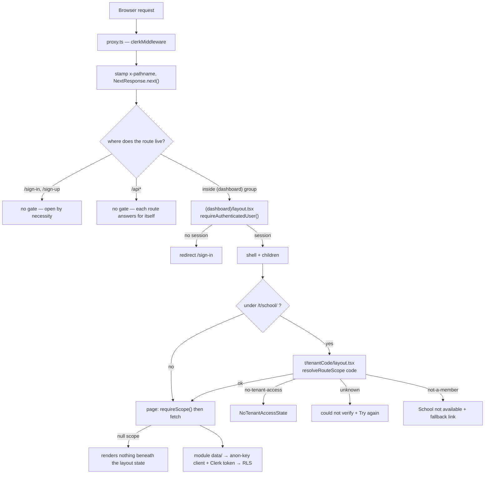

# Routing, Layout Gates and the Request Path

Four route responsibilities are separated deliberately, and three of them are *not* the
middleware. `proxy.ts` stamps one header; `app/(dashboard)/layout.tsx` performs the only
authentication check; the `/t/[tenantCode]` segment layout renders the only scope state; pages
fetch through `requireScope()` and never render a scope state themselves. Which of those applies
<!-- openwiki: broken internal link [/app] file "/app" does not exist. Fix the href or restore the target, then delete this comment. -->
is decided by *where a file sits* in [`app/`](/app), so the tree is the authorization map, not
decoration.

This page owns the route tree and the request path. RLS as the boundary under all of it is on
[Supabase Data Model and RLS Policies](/openwiki/architecture/data-model-and-rls.md); the
end-to-end scoping/role workflow is on
[Tenant Scoping and Role Authority](/openwiki/workflows/tenant-scoping-and-role-authority.md);
honest empty states are on
<!-- openwiki: broken internal link [/openwiki/concepts/error-snapshots-and-honest-empty-states.md] file "/openwiki/concepts/error-snapshots-and-honest-empty-states.md" does not exist. Fix the href or restore the target, then delete this comment. -->
[Error Snapshots and Honest Empty States](/openwiki/concepts/error-snapshots-and-honest-empty-states.md).

## The request path

*Each hop of a request, and the one place on it where a real gate and a scope decision exist.*

The gate is a layout, not the middleware, because Clerk deprecated `createRouteMatcher` in favour
of checking in the component that renders protected data. That choice carries the whole
guard model: a route is protected by a group it is *inside*.

## `proxy.ts` gates nothing by design

The middleware is `clerkMiddleware` wrapping a handler whose entire body is to add
`x-pathname` from `request.nextUrl.pathname` to the forwarded headers and return
`NextResponse.next()`. No session check, no redirect, no per-path matcher.

Its `matcher` list does real work of a different kind. Besides the negative pattern that excludes
`_next` and static extensions, it names `/__clerk/(.*)` and `/(api|trpc)(.*)` — so the middleware
runs on API routes, and Clerk's inbound webhook at
[`app/api/webhooks/clerk/route.ts`](/app/api/webhooks/clerk/route.ts) reaches the app through it
rather than being short-circuited. That route is unauthenticated on purpose: Clerk signs the body
and the handler verifies it with `verifyWebhook` against `CLERK_WEBHOOK_SIGNING_SECRET`, so no
middleware exclusion is needed for it to receive requests.

The header is the middleware's second product, consumed by
<!-- openwiki: broken internal link [/app/(dashboard] file "/app/(dashboard" does not exist. Fix the href or restore the target, then delete this comment. -->
[`app/(dashboard)/layout.tsx`](/app/(dashboard)/layout.tsx) to decide `isTrainerRoute` for the
shell, and by the sign-in subtree for its own layout.

**Failure modes.**

- **A gate that looks like one.** `clerkMiddleware` sounds like route protection, and the handler
  never asks whether a session exists. Anything relying on it redirects nobody.
- **A missing or empty header.** Both consumers do `headers().get('x-pathname') ?? ''`. A blank
  value silently means "office route": `isTrainerRoute` is false and every trainer-only nav
  omission lapses. On the sign-in screen the same blank collapses its variant choice to the
  office default. The server shell also cannot see the current path the way `usePathname()` can
  in a client island — [`modules/shell/ui/Sidebar.tsx`](/modules/shell/ui/Sidebar.tsx) resolves
  the active school from `usePathname()`, so the two can disagree.
- **The header is a hint, never an authority.** Nothing authorizes on `x-pathname`; a forged or
  stale value changes presentation only.

## The `(dashboard)` gate

`(dashboard)` is a route group: it does not appear in the URL, and it exists to hang one layout
over every office screen. That layout's first statement is `requireAuthenticatedUser()`, which
redirects `/sign-in` when `auth().userId` is absent and otherwise returns the id.
[`e2e/auth.spec.ts`](/e2e/auth.spec.ts) asserts exactly this — an anonymous `/dashboard` visit
must land on `/sign-in` — and its header comment records that the redirect belongs to the layout,
not to `proxy.ts`, which "only forwards the pathname header".

`requireAuthenticatedUser()` returns a `string` and never a nullable: callers get the Clerk id or
the redirect, so a page cannot accidentally continue with `null`. [CLAUDE.md](/CLAUDE.md) states
the chain as `proxy.ts` → this call → token-attaching client → RLS, in that order.

### Three consequences worth stating plainly

- **Outside the group is unguarded until the route adds a gate.**
  [`app/api-docs/page.tsx`](/app/api-docs/page.tsx) calls `requireAuthenticatedUser()` itself.
<!-- openwiki: broken internal link [/app/sign-in] file "/app/sign-in" does not exist. Fix the href or restore the target, then delete this comment. -->
  [`app/sign-in`](/app/sign-in) and `/sign-up` must stay open or sign-in could not be reached, and
<!-- openwiki: broken internal link [/app/api] file "/app/api" does not exist. Fix the href or restore the target, then delete this comment. -->
  [`app/api/*`](/app/api) is reached by machines, so each route there answers for itself — just as
  [openapi.json](/app/api/openapi.json/route.ts) checks `getAuthUserId()` itself and answers
  `401` with no session.

  The webhook is the exception that cannot use `requireAuthenticatedUser()`: a redirect is wrong
  for a machine and Clerk's request carries no app session, so `POST /api/webhooks/clerk`
  authenticates by signature instead — `verifyWebhook` verifies the signed body and answers `400`
  on failure. `GET /api/health` is unauthenticated on purpose for probes.
  [auth-check](/app/api/debug/auth-check/route.ts) is deliberately dev-only (`404` in production)
  because it returns the raw Supabase and token detail that RULES rule 6 keeps out of the UI.
- **The gate needs a live check each render.** `requireAuthenticatedUser()` is not a one-time
  middleware pass; anything that lets a signed-in user reach a protected tree without it
  re-running is a hole, not a cache.
- **The layout resolves identity once and hands it down.** A single `getProfileSnapshot()` +
  `isPlatformAdmin()` `Promise.all` supplies the nav's admin row, the user card, the school
  switcher and its default. All of it is trusted-role and DB-snapshot data, never
  `resolveRouteRole`, whose `?role=` preview would let any caller conjure the "Add user" row. A
  failed profile read yields `null` role and empty tenant list rather than throwing, so the shell
  renders a smaller, honest menu (`isAdmin` false) instead of a larger one. `isPlatformAdmin` is a
  separate axis read from `platform_admins` through a `security definer` RPC, because that table
  is deliberately unreadable through the anon client.

### A page still renders under a failed layout

`Postgres` errors do not abort the layout. It renders, with `role: null` and `tenants: []`, and
the page renders beneath it — possibly fine, possibly into its own failure state. Two visible
symptoms: `Sidebar`'s `NO_TENANT_NAME`/`NO_TENANT_META` fallbacks render in place of a school
name rather than a plausible-looking one, and the admin/platform rows disappear — hiding, not
denying, which is why the route and the Server Action re-check the same role. `isPlatformAdmin`
is the sharpest case: it is a boolean, so a failed read merely hides "Add school", which is why the
*route* distinguishes a failed check (`sync-failed`) from a real denial rather than trusting the nav.

The layout also does **not** render a KPI row: a root layout does not re-render on client-side
navigation, so a row placed here kept the previous school's numbers after a school switch. Only
the two dashboard pages render one, each from its own path.

**`/schools/new` and `/users/new` are unscoped, but not ungated.** Both live directly under
`(dashboard)/` so they stay reachable from a trainer route where the nav lists no school row, and
each resolves its own authority server-side — the router's `isTrainerRoute` flag says nothing
about them.

## The scoped segment: `/t/[tenantCode]`

Office screens take the school from the URL path segment (ADR-001 §7 K1), because SSR, shareable
links and "never dropped" were the point. The segment layout
[`app/(dashboard)/t/[tenantCode]/layout.tsx`](/app/(dashboard)/t/[tenantCode]/layout.tsx) turns
that promise into a validated scope *before any page in the segment renders*.

Its four arms are the four variants of `RouteScope`
<!-- openwiki: broken internal link [/app/(dashboard] file "/app/(dashboard" does not exist. Fix the href or restore the target, then delete this comment. -->
([`tenant-scope.ts`](/app/(dashboard)/tenant-scope.ts)):

| `resolveRouteScope` arm | Layout renders |
|---|---|
| `ok` | `children` |
| `no-tenant-access` | `NoTenantAccessState` subject `"this school"` |
| `unknown` | "Couldn't verify your school access" — usually temporary, "Try again" |
| `not-a-member` | "School not available" — links to `resolved.fallback` when a default school exists |

The `not-a-member` link is the one place the tree answers a wrong code constructively:
`scopedPath(resolved.fallback.code, 'dashboard')` sends the caller to a school they do belong to
instead of a dead end. A foreign or unknown code never falls back to "all schools" implicitly —
the URL always ends up naming one school.

The rule under all four is in
[`modules/tenancy/domain/scope.ts`](/modules/tenancy/domain/scope.ts): a scope exists only for a
school in `profile.tenants`, so it is *selection, not authorization* (RULES rule 2). Queries add
`tenant_id = scope.tenantId` on top of RLS; RLS still decides. `scopeForCode` lowercases both
sides, and `defaultScope` takes the flagged `defaultTenantId`, then the first membership, then
`null` — pinned by [`tests/unit/tenant-scope.test.ts`](/tests/unit/tenant-scope.test.ts).

### Why `requireScope` returns `null` instead of calling `notFound()`

Pages call `requireScope(params)` and `return null` when it yields no scope. `null` means the
layout is already rendering the correct state — three of the four arms — and the page simply
contributes nothing.

`notFound()` would have been the reflex. It loses because **layouts and pages render in
parallel**: a thrown 404 could beat the layout's friendlier `no-tenant-access` explanation to the
response, and the user gets a generic 404 for "you are not a member of this school". Security does
not rest on the choice either way — with no scope there is no tenant id left to query with — so
the friendlier state wins. The same reasoning explains why the segment layout, not `proxy.ts` and
not a page, renders every non-`ok` arm: it is the only component in the segment guaranteed to run
and to own a state rather than data.

`requireScope` is also where a trainer is turned away: once the scope is `ok` it redirects
`/trainer` before the page fetches, because these screens would otherwise hand full batch DTOs to
client components, which RULES rule 5 forbids. The check sits in the page path rather than the
layout because **a layout does not re-run on every navigation** — a trainer already inside the
shell could move between scoped sections and never be re-checked. The validated scope and profile it
returns are what a page fetches with.

The two helpers are `cache()`-wrapped, so the layout's read and the page's read of the same
`tenantCode` are one profile fetch per request. `getSignedInProfile()` collapses a failed
identity read to `'unknown'` and a missing row to `'none'` — never the other way round.

**Failure modes.**

<!-- openwiki: broken internal link [/app/(dashboard] file "/app/(dashboard" does not exist. Fix the href or restore the target, then delete this comment. -->
- **Cheap navigation reads as broken access.** [`app/(dashboard)/t/loading.tsx`](/app/(dashboard)/t/loading.tsx)
  sits deliberately *above* `[tenantCode]/layout.tsx`, because "a loading file does not cover its
  own folder's layout" and that layout awaits the scope. Putting a `loading.tsx` inside the
  segment instead leaves the school switch blank.
- **A state rendered twice.** A page that handles the four arms itself duplicates the layout and
  the two can diverge; a page that forgets `if (!resolved) return null` runs with an undefined
  tenant id.
- **Naming the wrong absence.** `unknown` rendered as `none` tells a provisioned coordinator they
  were never assigned a school. The `unknown`-is-not-`none` rule is the same one
  [`tests/unit/tenant-access.test.ts`](/tests/unit/tenant-access.test.ts) pins for the
  `withTenantAccess` fold.

### The legacy unscoped paths

`/batch-cards`, `/documents`, `/report`, `/table-view`, `/analytics`, `/activity-log`, `/billing`
survive for bookmarks and old links as one-line stubs from `legacyRoute(section)` in
<!-- openwiki: broken internal link [/app/(dashboard] file "/app/(dashboard" does not exist. Fix the href or restore the target, then delete this comment. -->
[`app/(dashboard)/legacy-redirect.tsx`](/app/(dashboard)/legacy-redirect.tsx).
`redirectToDefaultScope()` re-encodes the caller's search params onto
`/t/<default school>/<section>` and redirects; only "no school" and "could not verify" render.
The redirect keeps `batch=`/`state=`/`role=` intact, so a deep link survives the hop.

`/dashboard` is the same machinery with a router in front of it: trainers go to `/trainer`,
admins to `/overview`, everyone else falls through to the legacy redirect. Both decisions read
`profile.role` off `getSignedInProfile()`, the trusted read.

**Failure mode.** The hop must not lose the query string. `redirectToDefaultScope` appends every
param value — repeated keys included — through `URLSearchParams`, so `?batch=DEV-AKB-001` still
names the batch after landing; a stub that redirects with a bare path hands the caller the
section's default view and silently drops their context.

`/t/<school>` on its own lands on `dashboard` — `parseScopedPath` defaults the section that way,
and the unscoped sidebar's `sectionHref` falls back to `/<section>`, so the two trees stay wired
to each other.

## The `/trainer` subtree

`/trainer/**` is deliberately unscoped (ADR-001 §7 K1-redirect): trainer routes address by batch,
and `batch_trainer_assignments` carries the tenant, so a trainer never picks a school. The scoped
sections keep a private copy of the same list, so `isScopedSection` is what tells the two apart.

The shell is told which subtree it is on through `isTrainerRoute`, derived from the header.
`Sidebar.resolveOperations` keeps only the Settings op, drops the admin and platform lists, and
`Topbar` hides the activity bell — activity is per school, and no teacher-owned screen is one.
Both are listed as guarding *explicitly* rather than by implication, so the conditions cannot
drift apart later.

## The role split is a redirect rule

Two role sources, two jobs, and confusing them is a privilege bug.

`resolveTrustedRole(dbRole)` reads `profiles.role` — the column RLS reads — and nothing else.
Clerk is identity only; the old `publicMetadata` fallback once showed one admin as ADMIN and
VIEWER on the same screen. A user with no profile row resolves `null`, not a default.

`resolveRouteRole`/`resolveDisplayRole` let `?role=` win: any caller can type a role into the URL.
So `?role=` may pick a *variant* and may never decide a *redirect*:

| Decision | Function | Why the split matters |
|---|---|---|
| `/dashboard` dispatch | `profile.role` directly | a trainer must not be routed to an office screen |
| trainer refusal under `/t/*` | `profile.role` in `requireScope` → `redirect('/trainer')` | `?role=admin` would let a real trainer skip the gate and read billing financials |
| `billing` and `report` re-check | `resolveTrustedRole(profile.role)` | a second opinion, because the nav is only a hint |
| `/overview` admin-only | `resolveTrustedRole(profile.role)` → `redirect('/dashboard')` | tenant-scoped role read once, no override |
| `users/new`, `schools/new` | `resolveTrustedRole` / `isPlatformAdmin()` | the nav row that leads there is only a hint |
| rendered variants | `toOfficeRole` / `resolveDisplayRole` | a preview only |

`toOfficeRole` collapses everything that is not `admin`/`coordinator`/`viewer` —
trainer, `null`, `'superuser'` — to read-only `viewer`. That least-privilege fallback is the
safety net if a trainer ever reaches an office screen, and
[`tests/unit/display-role.test.ts`](/tests/unit/display-role.test.ts) pins it along with
`resolveDisplayRole` ignoring an unrecognized `?role=` trial value. The tests call these a
*usability* gate: the real boundary is RLS — `can_manage_tenant` is admin/coordinator only, so a
viewer write is denied whether or not a button rendered.

**Failure mode.** A trainer's `?role=admin` on billing renders admin chrome while the server
refuses them — or, worse, the redirect is skipped and trainer DTOs reach an office screen. The
mirror failure is a `null` role rendering write-enabled UI, which is why the fallback is `viewer`.

## The unguarded entry point: `/sign-in`

`/sign-in` must stay outside the gate, and that makes its own inputs attacker-controlled. The
`redirect_url` query param is where sign-in resumes afterwards, so an unchecked value is an open
redirect: the user authenticates against the real app and is handed to an attacker's site. The
`[[...sign-in]]` catch-all passes it through
[`sanitizeRedirectUrl`](/modules/auth/domain/redirectUrl.ts) — a pure function that returns `"/"`
unless the value is a genuine same-origin path — and each rejected shape is a browser
misresolution, not a cosmetic one: `https://…` is absolute, `//evil.com` is protocol-relative,
`/\evil.com` normalizes to `//evil.com`, and `javascript:`/`data:` execute. The sanitized value is
both the signed-in bounce target and the `redirectUrl` handed to Clerk's OAuth start, so there is
exactly one place to get this right.
[`tests/unit/redirect-url.test.ts`](/tests/unit/redirect-url.test.ts) pins each trap plus the
`/batches?tab=2` pass-through and the empty-value fallback.

## Configuration and extension rules

- **A new scoped screen** is a directory under `t/[tenantCode]/(sections)/` plus an entry in
  `SCOPED_SECTIONS`; a directory without the constant is not a valid legacy target.
- **A new unscoped screen** goes directly under `(dashboard)/` and must carry its own authority
  check if it is not readable by everyone in the tenant.
- **The segment layout is the only place that renders a scope state.** Everything else returns
  `null`.
- **A new `/api` route must include its own gate.** Nothing upstream checks it. Follow
  `/api/openapi.json` (`getAuthUserId()`, `401`) for anything readable by a person; a
  machine-called route authenticates its caller (signature, shared secret) instead.
- **A redirect target a caller can influence needs sanitizing.** `redirect_url` goes through
  `sanitizeRedirectUrl`; the legacy stubs carry params through `URLSearchParams` rather than
  splicing them into a string.
- **`proxy.ts` needs no change for a new route.** Only the header stamping applies; an API route
  that Clerk must reach is already covered by `/(api|trpc)(.*)`.
- **A page with no `data/` layer needs nothing from this page.** `/trainer/classes` is a
  placeholder and reaches no scope.

## What the tests cover

[`tests/unit/tenant-scope.test.ts`](/tests/unit/tenant-scope.test.ts) pins scope construction
(a foreign code yields `null`, the default chain degrades to `null`), the
`scopedPath`/`parseScopedPath` round trip, and — by mocking `getCurrentUser` to say `admin` —
that `resolveTrustedRole` still answers from the DB role.
[`tests/unit/session-exists.test.ts`](/tests/unit/session-exists.test.ts) pins
`isSessionExistsError` matching `session_exists` anywhere in `errors[]` and ignoring unrelated
codes and non-array throwals — the sign-in screen's forwarding case, which must not read as a
failed sign-in. `/trainer` and the segment arms have no direct unit coverage; the e2e suite
proves the gate and nothing behind it, so the arm outcomes rest on the pure `scopeForCode` /
`defaultScope` cases. The rest of the verification loop is on
[Verification and Test Strategy](/openwiki/operations/verification-and-test-strategy.md).
