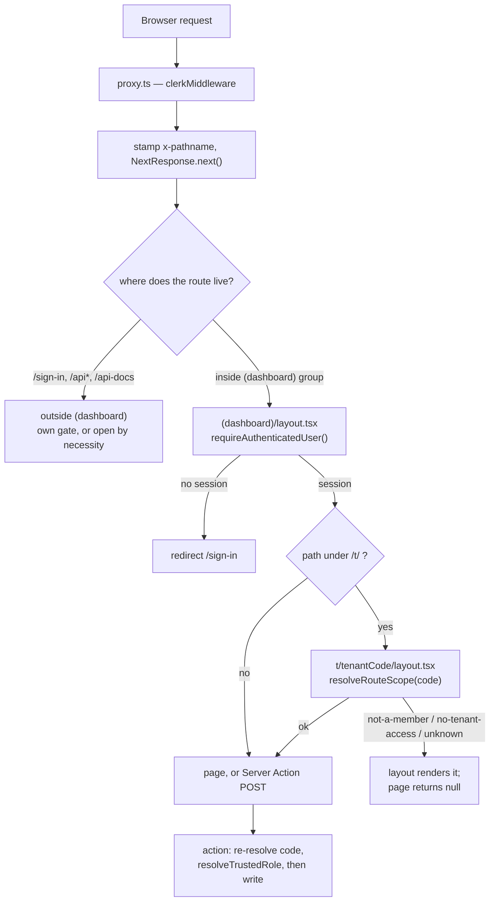

# Routing, Layout Gates and the Request Path

Four route responsibilities are separated deliberately, and three of them are *not* the
middleware. [`proxy.ts`](/proxy.ts) stamps one header; the `(dashboard)` layout performs the only
authentication check; the `/t/[tenantCode]` segment layout renders the only scope state; pages
fetch through `requireScope()` and never render a scope state themselves. Which of those applies
is decided by *where a file sits* in `app/`, so the tree is the authorization map, not decoration.

This page owns the route tree and the request path. RLS as the boundary under all of it is on
[Supabase Data Model and RLS Policies](/openwiki/architecture/data-model-and-rls.md); the
end-to-end scoping/role workflow is on
[Tenant Scoping and Role Authority](/openwiki/workflows/tenant-scoping-and-role-authority.md); the
machine-facing API routes are on [Auth and Provisioning](/openwiki/modules/auth-and-provisioning.md).

## The tree, and where the gates are

*One gate, one scope decision, and one re-check inside the action — never in the middleware.*

The gate is a layout, not the middleware, because Clerk deprecated `createRouteMatcher` in favour
of checking in the component that renders protected data. That choice carries the whole guard
model: a route is protected by a group it is *inside*.

## `proxy.ts` gates nothing by design

The handler's entire body copies `request.nextUrl.pathname` into an `x-pathname` forwarded header
and returns `NextResponse.next()`: no session check, no redirect, no per-path matcher. Its
`matcher` list does real work of a different kind — besides excluding `_next` and static extensions
it *names* `/__clerk/(.*)` and `/(api|trpc)(.*)`, so Clerk's inbound webhook reaches the app
through the middleware rather than being short-circuited.

The header is the middleware's second product, consumed by the `(dashboard)` layout to decide
`isTrainerRoute` and by the sign-in subtree for its variant choice.

**Failure modes.** `clerkMiddleware` sounds like route protection, so anything "relying on the
middleware" protects nothing. Both consumers read `headers().get('x-pathname') ?? ''`; a blank
value silently means "office route", so the trainer-only nav omissions lapse — and the server shell
cannot see the current path the way the `usePathname()` island in
[`modules/shell/ui/Sidebar.tsx`](/modules/shell/ui/Sidebar.tsx) can, so the two can disagree. The
header is a hint, never an authority.

## The `(dashboard)` gate and the groups outside it

`(dashboard)` does not appear in the URL; it exists to hang one layout over every office screen.
That layout's first statement is `requireAuthenticatedUser()`, which redirects `/sign-in` when
[`auth().userId`](/modules/auth/data/auth.ts) is absent and otherwise returns the id as a `string`
(never nullable, so a caller cannot continue with `null`). [`e2e/auth.spec.ts`](/e2e/auth.spec.ts)
asserts exactly this and records that the redirect belongs to the layout, not `proxy.ts`.

**Everything outside the group is unguarded until the route adds a gate, and each does it its own
way:**

- [`app/api-docs/page.tsx`](/app/api-docs/page.tsx) calls `requireAuthenticatedUser()` itself.
- `/sign-in` and `/sign-up` stay open by necessity — which makes their inputs attacker-controlled;
  the catch-all passes `redirect_url` through
  [`sanitizeRedirectUrl`](/modules/auth/domain/redirectUrl.ts), pinned by
  [`tests/unit/redirect-url.test.ts`](/tests/unit/redirect-url.test.ts).
- `app/api/*` is reached by machines, where a redirect is the wrong gate: `/api/openapi.json`
  checks `getAuthUserId()` and answers `401`, the Clerk webhook authenticates by `verifyWebhook`
  signature, and `/api/health` is open for probes.

A **Server Action needs its own authority check** — it is a separate POST target and inherits
nothing from the page that rendered the form. [`t/[tenantCode]/actions.ts`](/app/(dashboard)/t/[tenantCode]/actions.ts)
re-resolves the school from the URL code carried in the `FormData` (never a tenant id from the
form), resolves the role with `resolveTrustedRole`, rejects anything but admin/coordinator as
`denied`, and then states that both checks are "defence in depth and usability; the boundary is the
`batches` UPDATE policy", which for anyone else matches zero rows and surfaces as
`conflict-or-denied`. `users/new/actions.ts` and `schools/new/actions.ts` share the shape, gated on
`resolveTrustedRole` and `isPlatformAdmin()` respectively.

The layout itself resolves identity once and hands it down: one `Promise.all` of
`getProfileSnapshot()` and `isPlatformAdmin()` supplies the admin row, user card and switcher. A
failed profile read yields `null` role and empty tenant list, so the shell renders a smaller,
honest menu — hiding, not denying, which is why the route and the action re-check. `isPlatformAdmin`
is a separate axis read through a `security definer` RPC because the anon client cannot read
`platform_admins` (ADR-006 P2), and `schools/new` tells `sync-failed` apart from a real denial
rather than trusting the nav.

`/schools/new` and `/users/new` are unscoped but not ungated — both sit directly under
`(dashboard)/` and resolve their authority server-side. The layout renders **no KPI row**: a root
layout does not re-render on client-side navigation, so a row there kept the previous school's
numbers after a switch.

## The scoped segment: `/t/[tenantCode]`

Office screens take the school from the URL segment (ADR-001 K1), because SSR, shareable links and
"never dropped" were the point. The segment layout turns that into a validated scope *before any
<!-- openwiki: broken internal link [/app/(dashboard] file "/app/(dashboard" does not exist. Fix the href or restore the target, then delete this comment. -->
page renders*, and renders the four [`RouteScope`](/app/(dashboard)/tenant-scope.ts) arms there:

| `resolveRouteScope` arm | Layout renders |
|---|---|
| `ok` | `children` |
| `no-tenant-access` | `NoTenantAccessState` subject `"this school"` |
| `unknown` | "Couldn't verify your school access" — usually temporary, "Try again" → `/dashboard` |
| `not-a-member` | "School not available" — links to `resolved.fallback` when a default school exists |

A foreign or unknown code never falls back to "all schools": `scopedPath(fallback.code, 'dashboard')`
sends the caller to a school they do belong to, so the URL always ends up naming one.
[`modules/tenancy/domain/scope.ts`](/modules/tenancy/domain/scope.ts) is the rule underneath — a
scope exists only for a school in `profile.tenants`, so it is *selection, not authorization*
(RULES rule 2); RLS still decides.

**Why `requireScope` returns `null` rather than throwing `notFound()`.** Pages call it and
`return null` on a non-`ok` scope because the layout already renders that state. Layouts and pages
render in parallel, so a thrown 404 could beat the layout's friendlier explanation to the response.
Security does not rest on the choice — with no scope there is no tenant id to query with. The same
reasoning makes the layout, not a page, the owner of every non-`ok` arm.

`requireScope` is also where a trainer is turned away: once the scope is `ok` it redirects
`/trainer` before the page fetches, because these screens hand full batch DTOs (billing, BSRS) to
client components, which RULES rule 5 forbids. It sits in the page path, not the layout, because a
layout does not re-run on every client-side navigation. Both helpers are `cache()`-wrapped, so the
layout and the page share one profile read.

**Failure modes.** A cheap navigation reads as broken access unless
<!-- openwiki: broken internal link [/app/(dashboard] file "/app/(dashboard" does not exist. Fix the href or restore the target, then delete this comment. -->
[`t/loading.tsx`](/app/(dashboard)/t/loading.tsx) stays *above* `[tenantCode]/layout.tsx` — a
loading file does not cover its own folder's layout, and one placed inside the segment leaves the
school switch blank. A page that handles the arms itself can diverge from the layout; a page that
forgets `if (!resolved) return null` runs with an undefined tenant id. Naming `unknown` as `none`
tells a provisioned coordinator they were never assigned a school — the distinction
`withTenantAccess` keeps.

### The legacy unscoped paths

`/batch-cards`, `/documents`, `/report`, `/table-view`, `/analytics`, `/activity-log`, `/billing`
survive for bookmarks as one-line stubs from
<!-- openwiki: broken internal link [/app/(dashboard] file "/app/(dashboard" does not exist. Fix the href or restore the target, then delete this comment. -->
[`legacyRoute(section)`](/app/(dashboard)/legacy-redirect.tsx). `redirectToDefaultScope()`
re-encodes every search param — repeated keys included, through `URLSearchParams` — onto
`/t/<default school>/<section>`, which is what keeps `?batch=`/`?state=`/`?role=` intact across the
hop; a bare-path redirect would silently drop the caller's context. Only "no school" and "could not
verify" render. `/dashboard` is the same machinery behind a dispatch from `profile.role` — trainers
to `/trainer`, admins to `/overview`, everyone else falling through.

## `?state=` and `?role=`: two overrides, two different powers

**`?state=` previews a *guard state*, not a role.** Any caller can force `sync-failed`, `stale`,
`denied`, `empty` or `no-tenant-access` to see a screen's state without breaking data. The
precedence rule is the load-bearing part: a forced failure must not be masked by a tidier
explanation, so `denied` wins first, then a real failure with zero rows, then empty — RULES rule
19's guard ordering, spelled out in the dashboard's `guardState()` and in `billing`'s
`syncFailed && batches.length === 0` branch. A forced `sync-failed` on a non-empty snapshot falls
through to the inline banner instead.

**`?role=` changes presentation only and never authority.** Two role sources, two jobs:
`resolveTrustedRole(dbRole)` reads `profiles.role` — the column RLS reads — and nothing else; a user
with no profile row resolves `null`, not a default (the retired `publicMetadata` fallback once
showed one admin as ADMIN and VIEWER on the same screen). `resolveRouteRole`/`resolveDisplayRole`
let `?role=` win, so:

| Decision | Source |
|---|---|
| `/dashboard` dispatch, trainer refusal in `requireScope`, `billing`/`report` re-check, every action gate, `/overview` admin-only, `users/new`, `schools/new` | `profiles.role` |
| rendered variant (`toOfficeRole`, `resolveDisplayRole`) | `?role=`, then `profiles.role` |

`toOfficeRole` collapses everything that is not `admin`/`coordinator`/`viewer` — trainer, `null`,
`'superuser'` — to read-only `viewer`; [`tests/unit/display-role.test.ts`](/tests/unit/display-role.test.ts)
pins that least-privilege fallback and the ignoring of an unrecognized value.

The trap: **`?role=admin` does not make a trainer an admin.** A real trainer adding it to a scoped
screen is still redirected — by `requireScope`, and again by `billing`, which re-derives the
trusted role and redirects *before* the fetch so the preview cannot leak financials. The mirror trap
is the other direction: because `resolveRouteRole` falls through to `profiles.role`, a working
`?role=` build still looks correct while every gate reads the DB, and only fails when someone gates
a redirect on the preview value.

## `/trainer`, and the Next 16 / React 19 conventions

`/trainer/**` is unscoped by design (ADR-001 K1-redirect): trainer routes address by batch and the
assignment row carries the tenant, so a trainer never picks a school. `isScopedSection` keeps the
two lists apart; `Sidebar.resolveOperations` keeps only Settings and `Topbar` hides the activity
bell on a trainer route, both as explicit `!isTrainerRoute` conditions so they cannot drift.

The settings carry routing consequences rather than preferences:

- **`params` and `searchParams` are Promises** (`next ^16.4.6`, `react 19.2.4`). Every route here
  `await`s them; a synchronous read type-checks only if the type is wrong, then yields `undefined`
  at runtime — the failure mode is an undefined tenant id, not a crash. Server Actions are the
  exception: they take a `FormData` argument because a form post has no route context.
- **Server Components by default, client islands on demand** (RULES rule 26) — the layouts and
  pages are server components, which is why the gate can run per request; `Sidebar.tsx` is the
  `'use client'` island inside it.
- **`cache()` is request-scoped dedupe, not persistent caching** — `resolveRouteScope`,
  `getSignedInProfile` and `getPlatformAdminSnapshot` rely on it so a layout and its page pay one
  read.
- **`next.config.ts` deliberately holds almost nothing** — `turbopack.root` and
  `experimental.agentUpgrade` only, with no `redirects()`, `rewrites()` or `basePath`. Every legacy
  path is a real route file, so a new screen is a directory rather than a config line. `pnpm dev`
  runs `next dev --webpack` while the build is Turbopack; check the build before blaming routing.
- **Client islands bind actions with `useActionState`, not `useState` + `onSubmit`.**
  `RqmCodeEditor`, `CreateUserForm` and `CreateSchoolForm` destructure `[state, formAction, pending]`
  and derive their state during render; a hand-rolled handler loses pending state and the re-render
  after `revalidatePath`. `CLAUDE.md` says not to assume the Next.js you know and to read
  `node_modules/next/dist/docs/` first.

## Extension rules

- A **new scoped screen** is a directory under `t/[tenantCode]/(sections)/` plus a
  `SCOPED_SECTIONS` entry; a **new unscoped office screen** goes under `(dashboard)/` and carries its
  own authority check unless everyone in the tenant may read it. Anything decided outside
  `(dashboard)` gates itself.
- The segment layout is the only place that renders a scope state; everything else returns `null`.
- A redirect target a caller can influence needs sanitizing, and a legacy stub carries params
  through `URLSearchParams` rather than splicing them.
- `proxy.ts` needs no change for a new route; only the header stamping applies.

## What the tests cover

[`tests/unit/tenant-scope.test.ts`](/tests/unit/tenant-scope.test.ts) pins scope construction and
the `scopedPath`/`parseScopedPath` round trip;
[`tests/unit/tenant-access.test.ts`](/tests/unit/tenant-access.test.ts) pins `unknown`-is-not-`none`.
`/trainer`, the segment arms, the actions and both overrides have no direct coverage — the e2e suite
proves the gate and nothing behind it, so arm outcomes rest on the pure `scopeForCode`/`defaultScope`
cases. The rest of the loop is on
[Verification and Test Strategy](/openwiki/operations/verification-and-test-strategy.md).
