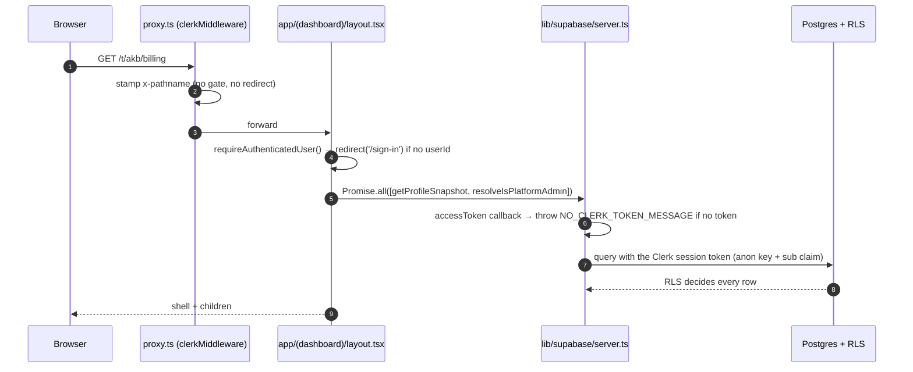

# Architecture Overview

TVI-CAMS is an internal multi-tenant compliance working layer for TVI schools running TESDA scholarship batches (TWSP/CFSP): batch lifecycle, documents, LAMR evidence, and TESDA billing documents generated as populated `.docx` files. TESDA SIS/T2MIS/BSRS stay authoritative — this is an internal working layer, and no UI copy may imply official approval or submission (RULES rule 27, locked by ADR-001).

This page is only the map. Depth lives with the neighbours, and each section below names the one that owns it.

## What the system is, and is not

- **One Next.js app talking directly to one hosted Supabase project.** No separate backend, and **no staging environment** — which is why RULES rule 36 is a `[deny]`: no statement runs against the live project, read-only `select`s included, without explicit permission.
- **Not a TESDA portal.** Nothing here submits or approves; the copy boundary is rule 27.
- **Not an Express app (yet).** A Node/TypeScript backend is documented as future-only in [`CLAUDE.md`](/CLAUDE.md); do not build it or treat it as present.
- **Not a place for business logic in `app/`.** Routes fetch through a module's `data/` and compose module `ui/` (rule 11); everything else goes inside its owning module (rule 12).

## Stack

| Concern | Choice | Why it matters here |
| --- | --- | --- |
| Framework | Next.js 16 App Router (`next ^16.4.6`, dev is `next dev --webpack`) | Server Components by default; client islands only for interactivity (rule 26) — and the layout gate below only works because Server Components run per request |
| UI / language | React `19.2.4`, TypeScript `strict` | checked by `pnpm exec tsc --noEmit`; there is no dedicated script |
| Styling | Tailwind v4 | UI rules are [`RULES.md` §4](/RULES.md), rules 21–26 — there is no `design-system.md` file in the repo, so do not go looking for one |
| Identity | Clerk `@clerk/nextjs ^7.4.1` | `ClerkProvider` sits in the root `app/layout.tsx`; Clerk is identity only, never role authority |
| Data | hosted Supabase (Postgres + Storage) | RLS on that database is the security boundary |
| Runtime | pnpm `9.15.4`, Node ≥ 22 | Node 22+ is hard-required: Vitest 4's rolldown throws `ERR_INVALID_ARG_VALUE` on Node 21 before any test loads |

## The request path and the auth chain

The whole guard model is one sentence: **identity is established by a layout, the database decides everything after that.** [`proxy.ts`](/proxy.ts) stamps `x-pathname` and gates nothing, and the four layers below it only ever narrow.



Full routing depth — every branch of the tree, the `loading.tsx` placement, the `/trainer` exception, the legacy-redirect factory — is on [Routing, Layout Gates and the Request Path](/openwiki/architecture/nextjs-routing-and-request-path.md). The three facts a reader must not get wrong:

1. **`proxy.ts` is context injection, not a gate.** Commenting out `requireAuthenticatedUser()` would leave the whole `(dashboard)` group open. It is `clerkMiddleware` whose only work is copying `request.nextUrl.pathname` into an `x-pathname` header; its matcher excludes static assets and *adds* `__clerk` and `api`/`trpc` so the Clerk webhook is not short-circuited. No session check, no redirect. A route is protected by the group it sits *inside*.
2. **`app/(dashboard)/layout.tsx` is the only authentication gate.** Its first statement is `requireAuthenticatedUser()` — a four-line function in [`modules/auth/data/auth.ts`](/modules/auth/data/auth.ts) (`getCurrentUser`, `getAuthPayload`, `getAuthUserId`, `requireAuthenticatedUser`) that redirects `/sign-in` when the Clerk `userId` is missing and otherwise returns it. Clerk deprecated `createRouteMatcher` in favour of exactly this. Anything outside `(dashboard)` is unguarded until it adds its own check — [`app/api-docs/page.tsx`](/app/api-docs/page.tsx) calls the same helper.
3. **One identity read feeds every downstream decision.** The layout runs `Promise.all([getProfileSnapshot, resolveIsPlatformAdmin])` and derives, from that one snapshot, the nav's admin row (`isAdmin`, narrowed by `resolveTrustedRole`), the user's name, the tenant list and the default school; `isPlatformAdmin` is passed to the Sidebar as a *separate* boolean. A failed read yields `null` role and an empty tenant list, so the shell renders a smaller, honest menu — hiding, not denying, which is why the route and the Server Action re-check.

**Failure modes.** `lib/supabase/server.ts` builds an **anon-key** client (Clerk's native third-party auth, not a JWT template, because the schema needs no claim beyond `sub`) whose `accessToken` callback returns the session token. A missing token **throws `NO_CLERK_TOKEN_MESSAGE` rather than degrading to an `anon` client**: an anon query returns zero rows with no error, indistinguishable from "this user has no batches". The throw is lazy — it fires inside the callback when the query runs — so each caller's `catch` maps it to `sync-failed`. Separately, `isSupabaseConfigured()` yields `unconfigured` when env vars are absent, and neither state may substitute mock data; `sync-failed` must also keep its banner (rule 19), and `/api/debug/auth-check` tells the two token verdicts apart in dev. The **service-role key never reaches client code** and is confined to the webhook path (below).

**Both layout helpers are navigation-only.** The platform-admin boolean hides "Add school" on a failed check instead of rendering a link into a denial; the snapshot behind it tells `denied` from `sync-failed` at the route, where the two need different screens (rule 24).

**RLS makes every authorization decision** from that identity — RLS is the boundary, hiding a button is usability only (rule 1). The helper chain, the per-table policy map and the ADR-006 boundary are on [Supabase Data Model and RLS Policies](/openwiki/architecture/data-model-and-rls.md); the runtime meaning of the boundary once signed in is on [Tenant Isolation and RLS](/openwiki/architecture/tenant-isolation-and-rls.md).

Two routes sit outside the gate by design: `/api/openapi.json` checks `getAuthUserId()` itself and answers `401`, and `POST /api/webhooks/clerk` is unauthenticated because it verifies Clerk's body signature with `verifyWebhook` — no session exists to scope it. That webhook is also the sole `service_role` path: route → `modules/auth/data/provisioning.ts`, which creates profiles as `viewer` and flips `is_active = false` on delete; `SUPABASE_SERVICE_ROLE_KEY` is never `NEXT_PUBLIC_`-prefixed and never read outside [`lib/supabase/service.ts`](/lib/supabase/service.ts) (rule 3).

## Scoped routing — `/t/<tenantCode>`, and the registry outside it

<!-- openwiki: broken internal link [/app/(dashboard] file "/app/(dashboard" does not exist. Fix the href or restore the target, then delete this comment. -->
Tenant context lives in the URL path segment. `/t/<school>/<section>` is a **selection, not an authorization** (rule 2): `scopeForCode` builds a scope only from `profile.tenants`, an RLS-scoped read, and queries then add `tenant_id = scope.tenantId` on top of RLS. [`resolveRouteScope`](/app/(dashboard)/tenant-scope.ts) is `cache()`-wrapped and four-way — `ok`, `no-tenant-access`, `unknown`, `not-a-member` with a fallback — and [`t/[tenantCode]/layout.tsx`](/app/(dashboard)/t/[tenantCode]/layout.tsx) renders every non-`ok` arm, because it is the only place in the segment that owns a state.

`requireScope()` is the pages' step, and it does two things rather than one. It returns `{ scope, profile }` or `null` (the layout already owns the state; it deliberately does not `throw notFound()`, because layout and page render in parallel and a thrown 404 could race the layout's friendlier arm — and without a scope there is no tenant id to query with, so security does not rest on it either way). **Past that, a trainer is redirected to `/trainer`.** Office pages hand full batch records to client components — billing deadline, BSRS — which rule 5 forbids a trainer to see, so the check sits in every office page's path rather than in a layout, because a layout does not re-run on client-side navigation.

Two lessons are load-bearing and live in full on the routing page: a foreign code never falls back to "all schools", and `unknown` (could not check) is never rendered as `none` (belongs to none). Legacy unscoped paths redirect to the caller's default school with search params intact.

**The registry is the one write path outside a tenant.** `/schools/new` is unscoped because a school with no members cannot satisfy a membership-scoped `tenants` policy, and it gates on platform admin, a separate axis resolved through a `security definer` RPC (`getPlatformAdminSnapshot` in `modules/tenancy/data/platform.ts`) because `public.platform_admins` is readable through nothing. Platform admin is a table, never a fifth `profile_role`; its reach is the registry only, and extending it to a compliance table or letting it seat itself into a tenant needs its own ADR (ADR-006 P2/P3, rule 30). The page says so at the gate: it is gated on neither role resolver, because holding `admin` at some school grants nothing here.

## Role: trusted authority vs. presentation

Authority is `profiles.role` — the column RLS reads — through `resolveTrustedRole` in [`modules/auth/data/role.ts`](/modules/auth/data/role.ts). Clerk's `publicMetadata` was a fallback that once showed one admin as ADMIN and VIEWER on the same screen, so authority no longer consults it; a user with no profile row resolves `null` and callers narrow to read-only `viewer`. **Every redirect and every write decision goes through it.**

The presentation variants sit above it and are narrower in effect than their names suggest:

- `resolveDisplayRole(queryRole, trustedRole)` lets a `?role=` value pick the rendered office variant. It is pure and synchronous, and **nothing in `app/` calls it** — its only consumers are `tests/unit/display-role.test.ts`, so treat it as an available helper rather than part of any live request path.
- `resolveRouteRole` has one live caller, the billing page, and its result goes through `toOfficeRole` — so a `?role=` override there can only ever select an office *variant* of the rendered queue. The trainer redirect on that page is decided earlier, on `resolveTrustedRole`, precisely so a real trainer cannot request `?role=admin` and skip it.

Admin and coordinator are paired by every policy, so the difference records who someone is, not what they may do. Trimming is server-side, never CSS (rule 5), Server Actions re-derive the role so a rendered form is never the authority, and viewer writes are server-denied (rule 4). The scoping and role workflow end to end is on [Tenant Scoping and Role Authority](/openwiki/workflows/tenant-scoping-and-role-authority.md).

## The import model, in one table

Code is grouped by domain, not by file type (DDD-influenced, TES-68), and nothing imports upward.

| Layer | May import | Never |
| --- | --- | --- |
| `app/` | any module's `data/`, `domain/`, `ui/`; `shared/`; `lib/supabase` | business logic of its own (rule 11) |
| `modules/<d>/data/` | its own `domain/`, `shared/types.ts`, `lib/supabase/*` | another module's `data/` (rule 8) |
| `modules/<d>/domain/` | `shared/types.ts` | `database.types.ts` (rule 10), I/O (rule 14) |
| `modules/<d>/ui/` | `domain/`, `shared/ui/*`, `shared/types.ts` | `database.types.ts` (rule 10) |
| `shared/` | `lib/supabase` only | `modules/`, `app/` (rule 9) |
| `lib/supabase/` | — | anything above it |

The direction is enforced at lint time by `import/no-restricted-paths` zones in [`eslint.config.mjs`](/eslint.config.mjs), including one generated zone per module in its `domains` array making each `data/**` private (rule 7). **A lint failure here is an architecture violation, not a style nit** — the usual fix is to fetch in `app/` instead of reaching sideways. No index barrels (rule 13); take domain types from `shared/types.ts`, not generated rows. The fetch → map → derive contract, the snapshot union's guard ordering and the enum bridge are on [Module Boundaries and the Data Layer Pattern](/openwiki/architecture/module-boundaries-and-data-pattern.md).

## Module catalog

One module per PRD FR plus `shell` for chrome — 14 modules, the same set as the ESLint `domains` array, which is the authoritative list. One line each.

| Module | FR | One line |
| --- | --- | --- |
| `auth` | FR-01 | Clerk access, the `requireAuthenticatedUser` gate, trusted-role resolution, invitation metadata, service-role provisioning |
| `tenancy` | FR-02 | profile/membership reads, tenant access and scope, user administration, the ADR-006 registry |
| `batches` | FR-03/04/05 | reference data layer; lifecycle, urgency, alerts, metrics, cross-school overview; dashboard widgets; T2MIS terminal fields on `LearnerRow` |
| `documents` | FR-06 | requirement catalog, per-batch records, evidence upload and signed URLs; ADR-004's untracked rule |
| `attendance` | FR-07 | README only — plans `data/attendance.ts` and `domain/eligibility.ts` (ADR-007) |
| `lamr` | FR-08 | README only — plans LAMR fetch/map and evidence UI |
| `billing` | FR-09 | document-generating engine (ADR-001): rates, tracks, readiness gate, ADR-003 queue; `.docx` population still planned |
| `import-export` | FR-10 | RFC 4180 parser and ULI reconciliation, plus the T2MIS layout the export builds from — the CSV import half is unfinished |
| `analytics` | FR-11 | `ui/` only — props-only chart primitives |
| `activity` | FR-12 | activity snapshot feeding the dashboard panel and log; no `ui/` |
| `notifications` | FR-13 | README only — alerts are computed on read (no cron, no email) |
| `settings` | FR-14 | `ui/` only — design-sync overlay; toggles are session-local |
| `reports` | FR-15 | EGACE/employment helpers and the XLSX export; `{domain,ui}` only, so the report page fetches through `batches` itself |
| `shell` | (none) | app chrome — a module, not `shared/`, because it carries tenant and data context |

`modules/reports` having no `data/` layer is deliberate, not drift: the report page borrows `modules/batches/data/*` rather than duplicating a fetch. **`reports` is also where a new export unit goes** — `ui/exportXlsx.ts` is the first real-tooling export.

**Three modules carry a `README.md` and nothing else**: `attendance`, `lamr` and `notifications`. Glob `modules/<name>/*` to confirm before trusting any "planned" claim about a fourth. Write no code in them until their `data/`/`domain/` plan is followed; the trainer pages that should eventually move into `attendance` are self-contained placeholders.

## Docs priority and the ADR chain

[`RULES.md`](/RULES.md) is the checklist of non-negotiable *what*, each rule tagged with its enforcement level (`hook`, `deny`, `lint`, `types`, `rls`, `review`); [`CLAUDE.md`](/CLAUDE.md) explains the *why*. **Where they disagree, `RULES.md` wins** and the drift gets fixed — rule 34 still claims no test runner exists while `tests/unit/` is substantial.

Below the rules the order is fixed and each layer outranks the one beneath. **The ADRs are read first and override the rest** (rule 31), and must be read before touching schema or billing math (rule 30):

```
docs/adr/  >  docs/MASTER_PRD_SRS.md  >  docs/TRD.md  >  docs/IMPLEMENTATION_PLAN.md
```

Read the ADR files directly — they are short and each carries its own status line:

- [ADR-001](/docs/adr/ADR-001-billing-and-domain-model.md) — supersedes *any* conflicting "billing = preparation signal only" PRD wording; billing is a document-generating engine.
- [ADR-003](/docs/adr/ADR-003-billing-packet-queue.md) — amends ADR-001 §4.
- [ADR-004](/docs/adr/ADR-004-untracked-document-semantics.md) — fixes `untracked` as a third document state.
- [ADR-006](/docs/adr/ADR-006-platform-admin-and-school-registry.md) — supersedes FR-02's "Super Admin is not implemented".
- [ADR-007](/docs/adr/ADR-007-attendance-based-dropout-rule.md) — replaced the fixed ≥5-absence rule.
- [ADR-008](/docs/adr/ADR-008-recorded-batch-billing-deadline.md) — still `Proposed`; do not code against it as settled.

Never quote the superseded PRD wording for eligibility or billing.

## Verification

| Command | What it does | In CI |
| --- | --- | --- |
| `pnpm lint` | flat ESLint config, including the import zones | yes |
| `pnpm exec tsc --noEmit` | strict typecheck | yes |
| `pnpm test` | Vitest over `tests/unit/` (Node 22+) | yes |
| `pnpm test:e2e` | Playwright, dev server on `:3000` | **no** |

[`.github/workflows/ci.yml`](/.github/workflows/ci.yml) runs lint, typecheck and unit tests on every pull request and every push to `main` — so an import-zone breach or an enum the mapper forgot cannot merge. `pnpm test:e2e` is the step CI still omits: it drives a real dev server and needs Clerk's testing token, so it stays a local gate.

`tests/unit/` pins mappers, domain rules and the route-scope/tenant-access folds with fixed as-of dates; `e2e/auth.spec.ts` proves an anonymous `/dashboard` lands on `/sign-in` — the standing proof that the layout, not the proxy, is the gate. Real-Supabase RLS tests are still outstanding and sit behind rule 36. The loop and its traps are on [Verification and Test Strategy](/openwiki/operations/verification-and-test-strategy.md); schema state and the migration ledger are on [Live Supabase and Migrations](/openwiki/operations/live-supabase-and-migrations.md).

## Related pages

- [Routing, Layout Gates and the Request Path](/openwiki/architecture/nextjs-routing-and-request-path.md) — the route tree in full, the scope arms, why `requireScope` returns `null`
- [Tenant Isolation and RLS](/openwiki/architecture/tenant-isolation-and-rls.md) — the runtime boundary once signed in
- [Supabase Data Model and RLS Policies](/openwiki/architecture/data-model-and-rls.md) — tables, enums, `app_private.*`, migration ledger
- [Module Boundaries and the Data Layer Pattern](/openwiki/architecture/module-boundaries-and-data-pattern.md) — fetch → map → derive, snapshots, enum bridge
- [Auth and Provisioning](/openwiki/modules/auth-and-provisioning.md) — the gate helper and the service-role webhook
- [Tenant Scoping and Role Authority](/openwiki/workflows/tenant-scoping-and-role-authority.md) — the workflow the role split serves
- [Quickstart](/openwiki/quickstart.md) — task routing and the verification loop
