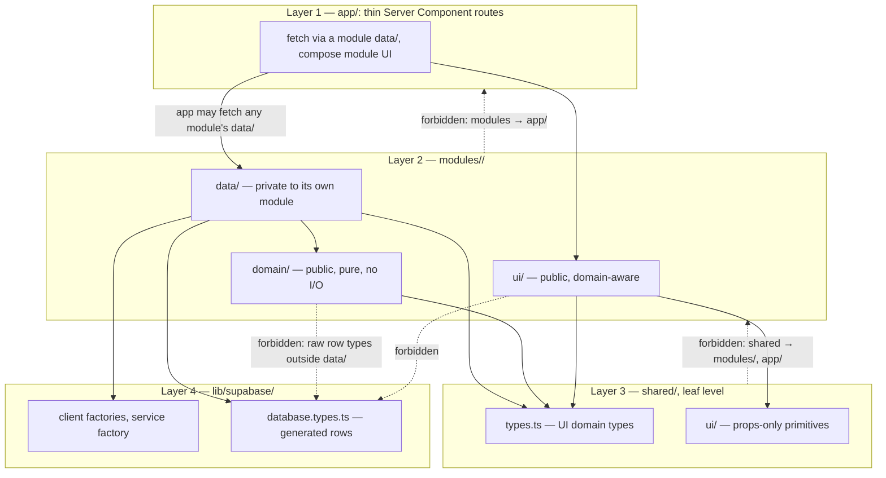

# Architecture Overview

TVI-CAMS is an internal multi-tenant compliance working layer for TVI schools running TESDA scholarship batches (TWSP/CFSP): batch lifecycle, documents, attendance, LAMR evidence, and TESDA billing documents generated as populated `.docx` files. It is an internal working layer only — TESDA SIS/T2MIS/BSRS stay authoritative, and UI copy must never imply official approval or submission (RULES rule 27).

This page is the map: stack, request path, auth chain, routing model, import boundaries, module catalog, docs precedence, build/run/test. Depth is owned by the neighbours — [Supabase Data Model and RLS Policies](/openwiki/architecture/data-model-and-rls.md) for schema, migrations and policies; [Module Boundaries and the Data Layer Pattern](/openwiki/architecture/module-boundaries-and-data-pattern.md) for imports, the fetch → map → derive contract, snapshots and the enum bridge.

## Stack at a glance

| Concern | Choice | Notes |
| --- | --- | --- |
| Framework | Next.js 16 App Router (`next ^16.4.3`) | dev runs `next dev --webpack`; Server Components by default, client islands only for interactivity (RULES rule 26) |
| UI / language | React `19.2.4`, TypeScript `strict` | typecheck via `pnpm exec tsc --noEmit` (no dedicated script) |
| Styling | Tailwind v4 (`@tailwindcss/postcss`) | design rules are [RULES.md §4](/RULES.md) — there is no `design-system.md` |
| Identity | Clerk `@clerk/nextjs ^7.4.1` | `ClerkProvider` sits in the root `app/layout.tsx` |
| Data | one hosted Supabase project (Postgres + Storage) | the app talks to it directly — no separate backend, **no staging environment** |
| Backend direction | none today | Express.js is documented future-only — do not build it or treat it as present ([`CLAUDE.md`](/CLAUDE.md)) |
| Runtime | pnpm `9.15.4`, Node ≥ 22 | Node 22+ is hard-required: Vitest 4's rolldown calls `util.styleText` with an array argument that throws before any test loads |

## The auth chain

Authorization is layered so that only the last layer decides, and each earlier layer can only narrow.

1. **`proxy.ts` injects context; it does not gate.** It is `clerkMiddleware` with a matcher that skips static assets and adds `__clerk` and `api`/`trpc`, and its only work is stamping `x-pathname` so Server Components can read the full request path. No session check, no redirect (RULES rule 1 — no route check is the boundary).
2. **`app/(dashboard)/layout.tsx` is the only authentication gate.** It calls `requireAuthenticatedUser()` and redirects anonymous visitors to `/sign-in`. A route outside `(dashboard)` is unguarded until it adds its own check — `app/api-docs/page.tsx` calls `requireAuthenticatedUser()` directly. The gate belongs to the component that renders protected data, not to middleware: Clerk recommends this after deprecating `createRouteMatcher`.
3. **The layout resolves identity once and feeds every downstream decision from it.** One `getProfileSnapshot()` read supplies the role, the name and the tenant list; `resolveTrustedRole` narrows the DB role to admin/coordinator/viewer/trainer (or `null`); `isPlatformAdmin()` is a *separate* axis read through a `security definer` RPC because `public.platform_admins` is deliberately unreadable through the anon client (ADR-006). A failed check hides the nav row rather than rendering a link into a denial — the route itself tells `denied` from `sync-failed` because the two need different screens.
4. **The Supabase client carries the caller, not a key.** `lib/supabase/server.ts` builds an **anon-key** client whose `accessToken` callback returns the Clerk session token — Clerk's native third-party-auth integration, not a JWT template (deprecated 1 Apr 2025), because this schema needs no custom claims: `app_private.*` reads only `sub`. The callback is re-invoked on expiry, so `supabase.auth.*` must never be called on this client (RULES rule 3).
5. **Postgres RLS makes every authorization decision** from that identity. RLS is the boundary; hiding a button is usability. The helper chain and policy map are on [Supabase Data Model and RLS Policies](/openwiki/architecture/data-model-and-rls.md).

**Failure mode — a missing token must throw, never query as `anon`.** An `anon` query returns zero rows with no error, indistinguishable from "this user has no batches", which is the dangerous outcome for a compliance tool. The throw is lazy — inside the `accessToken` callback, when the query runs — so it surfaces as a query error and each caller's `catch` maps it to `sync-failed`. `NO_CLERK_TOKEN_MESSAGE` is exported so "not signed in" can be told from "Supabase rejected the token"; the dev-only `/api/debug/auth-check` route reports that verdict and `404`s in production.

**Failure mode — no credentials at all.** `isSupabaseConfigured()` gates client construction, so a local run without env vars yields `unconfigured` snapshots rather than a throw; neither `unconfigured` nor `sync-failed` may substitute mock data (RULES rule 19).

Two routes sit outside the gate by design: `/api/openapi.json` checks `getAuthUserId()` itself and answers `401`; `POST /api/webhooks/clerk` is unauthenticated and verifies Clerk's signature via `verifyWebhook` instead, since no session exists to scope it.

**`service_role` is one path only.** `lib/supabase/service.ts` bypasses RLS and is confined to the webhook: route → `modules/auth/data/provisioning.ts` (creates `profiles` on `user.created`/`user.updated`, flips `is_active = false` on `user.deleted`, never hard-deletes). `SUPABASE_SERVICE_ROLE_KEY` must never be `NEXT_PUBLIC_`-prefixed or read outside that file (RULES rule 3).

## Scoped routing — `/t/<tenantCode>`

Tenant context lives in the URL path segment (locked domain fact). `/t/<school>/<section>` is a *selection* over rows RLS already allows, never an authorization of its own — but it is validated server-side so a wrong-school read is impossible rather than merely unlikely.

- **Legacy unscoped paths redirect.** `/batch-cards`, `/documents`, `/report` etc. still exist as thin stubs (the `legacyRoute()` factory); `app/(dashboard)/legacy-redirect.tsx` → `redirectToDefaultScope()` → `/t/<default school>/<section>`, preserving search params. Only a caller with no school gets a `NoTenantAccessState` — or a "couldn't verify" state when the profile read failed — instead of a redirect (`unknown` is never rendered as `none`).
- **`/dashboard` is a router, not a screen.** It sends trainers to `/trainer`, admins to `/overview` (the cross-school view), and everyone else to their default school's dashboard, then falls into the legacy redirect.
- **`resolveRouteScope(code)`** (`app/(dashboard)/tenant-scope.ts`, `cache()`-wrapped) returns a four-way union: `ok` with a scope built by `modules/tenancy/domain/scope.ts`'s `scopeForCode`, `no-tenant-access`, `unknown` ("we could not check"), or `not-a-member` carrying a fallback scope.
- **The `t/[tenantCode]/layout.tsx` gate renders the states** — `ok` passes children through; every other arm renders an honest `EmptyState`/`NoTenantAccessState`. A foreign or unknown code never falls back to "all schools".
- **Pages then call `requireScope()`**, which returns the validated scope or `null` (the layout already owns the state). Deliberately not `notFound()`: layout and page render in parallel, so a thrown 404 could race the layout's friendlier arm. Security does not rest on either — without a scope there is no tenant id to query with, so scope is selection, never enforcement (RULES rule 2).

The unscoped surfaces are `/overview`, `/trainer/**`, `/schools`, `/users`, `/profile`, `/api-docs`. `app/(dashboard)/tenant-access.ts` answers the orthogonal question "is this person a member of any school?" by joining `modules/auth` identity to `modules/tenancy`'s profile read — a join only `app/` may make, since another module's `data/` is private (RULES rule 8). Screens fold its verdict over a snapshot with `withTenantAccess`, which replaces only an `ok` snapshot, so a real failure is never masked by the tidier explanation.

**Metrics ownership follows the segment.** `MetricsRow` was moved out of the root layout because App Router does not re-render a parent layout on client navigation — a root-owned row kept showing the previous school's numbers after a switch. It now lives in `t/[tenantCode]/(sections)/layout.tsx` (the dashboard renders its own row) and `trainer/layout.tsx`, and is omitted entirely on a non-`ok` snapshot rather than shown as zeros.

## Role authority

Role comes from `profiles.role` — the column RLS reads — through `resolveTrustedRole`. Clerk is identity only; its `publicMetadata` was a fallback that once let one admin render as ADMIN and VIEWER on the same screen, so it is no longer consulted for authority. A signed-in user with no profile row resolves to `null` and callers narrow to the least-privilege `viewer`.

`resolveRouteRole` is the *presentation* variant: it takes a `?role=` query override first, so any caller can preview any UI. That means gating on it is a bug — a real trainer could request `?role=admin` and skip a redirect. `billing` and `report` therefore redirect trainers on `resolveTrustedRole` before ever computing `resolveRouteRole`, and use the latter only to pick a variant; the scope resolver's `getSignedInProfile` is likewise the trusted read behind the `/dashboard` and `/overview` redirects.

Admin is the school's proprietor, coordinator the day-to-day staff; every policy pairs them, so the difference records who someone is, not what they may do. Payload trimming is server-side, never CSS (RULES rule 5): `MetricsRow` takes `hideBilling`, `billing`/`report` refuse trainers outright, and viewer is read-only, server-denied on writes rather than merely hidden (rule 4). Server Actions re-derive the role server-side (`schools/new/actions.ts`), so a rendered form is never the authority; RLS enforces the same distinctions underneath.

## The four-layer import model

Code is grouped by domain, not by file type (DDD-influenced, TES-68). Everything sits in a one-way hierarchy — `app → modules → shared → lib/supabase` — enforced by `import/no-restricted-paths` in [`eslint.config.mjs`](/eslint.config.mjs) (RULES rule 7):

The load-bearing zones: `database.types.ts` is importable only from `data/` layers and `lib/supabase` itself — components take domain types from `shared/types.ts` (rule 10); `shared/` never imports upward (rule 9); every module's `data/**` is forbidden to every *other* module (rule 8); no index barrels — deep imports are the convention (rule 13). The snapshot union, the total `DB_TO_UI_STAGE` enum map and the regeneration contract are on [Module Boundaries and the Data Layer Pattern](/openwiki/architecture/module-boundaries-and-data-pattern.md).

## Module catalog

One module per PRD FR under `modules/`, plus `shell` for app chrome — **14 modules, the same set as the ESLint `domains` array**. New code goes inside its owning module, never in a new top-level folder (RULES rule 12).

| Module | FR | One line |
| --- | --- | --- |
| [`auth`](/modules/auth/README.md) | FR-01 | server-side Clerk access, the `requireAuthenticatedUser` gate, trusted-role and display-role resolution, invitation metadata, sign-in redirect defence, service-role profile provisioning |
| [`tenancy`](/modules/tenancy/README.md) | FR-02 | profile/membership and tenant-access reads, tenant scope, user administration, the ADR-006 school registry |
| [`batches`](/modules/batches/README.md) | FR-03/04/05 | reference implementation of fetch → map → derive; urgency, alerts, attention, metrics and cross-school overview domain rules; dashboard, timeline and overview widgets |
| [`documents`](/modules/documents/README.md) | FR-06 | requirement catalog, per-batch records, evidence upload and signed URLs; `domain/compliance.ts` holds the sole untracked-document rule (ADR-004) |
| [`attendance`](/modules/attendance/README.md) | FR-07 | README only — plans `data/attendance.ts` and the ADR-007 dropout rule in `domain/eligibility.ts` |
| [`lamr`](/modules/lamr/README.md) | FR-08 | README only — plans LAMR fetch/map and evidence UI |
| [`billing`](/modules/billing/README.md) | FR-09 | live document-generating engine (ADR-001): rates, three tracks, statement builder, readiness gate, ADR-003 packet projection, queue and statement-preview UI; real `.docx` output and the `billing_records` read are still planned |
| [`import-export`](/modules/import-export/README.md) | FR-10 | RFC 4180 CSV parser, ULI-keyed learner reconciliation, an `importLearnersCsv` write path that has never run against a live database |
| [`analytics`](/modules/analytics/README.md) | FR-11 | `ui/` only — props-only chart primitives; the page fetches the snapshot itself |
| [`activity`](/modules/activity/README.md) | FR-12 | `data/activity.ts` snapshot (`getActivitySnapshot`) feeding the dashboard panel and the activity-log feed; no `ui/` yet |
| [`notifications`](/modules/notifications/README.md) | FR-13 | README only — alerts are computed on read (no cron, no email); `AlertsPanel` lives in `batches/ui/dashboard` |
| [`settings`](/modules/settings/README.md) | FR-14 | `ui/` only — the design-sync overlay; toggles are session-local, "Save changes" is a toast, not a write |
| [`reports`](/modules/reports/README.md) | FR-15 | pure EGACE/employment helpers plus XLSX export; the report page fetches the full snapshot itself |
| [`shell`](/modules/shell/README.md) | (none) | app chrome — `NavDrawerProvider`, `Sidebar`, `Topbar`, `MobileHeader`, `MetricsRow`, `AuthHeader` — a module, not `shared/`, because it carries tenant and data context |

## Docs precedence and the ADR chain

`RULES.md` is the checklist of non-negotiable *what*, each rule tagged with its enforcement level (`hook`, `deny`, `lint`, `types`, `rls`, `review`); `CLAUDE.md` explains the *why*. **Where they disagree, `RULES.md` wins** and the drift gets fixed — rule 34 still claims no test runner exists, but `tests/unit/` is substantial and green is the gate.

Below the rules: `docs/MASTER_PRD_SRS.md` (product) → `docs/TRD.md` (engineering) → `docs/IMPLEMENTATION_PLAN.md` (phasing), all overridden by the ADR chain in `docs/adr/` (rule 31), which must be read before touching schema or billing math (rule 30). Eight ADRs are accepted or proposed. The four with the widest blast radius, by effect:

| ADR | Effect |
| --- | --- |
| [ADR-001](/docs/adr/ADR-001-billing-and-domain-model.md) | billing is a **document-generating engine** (TSF/Allowance, Training Cost, Entrepreneurship as populated `.docx`; Assessment Fee out of scope); locks progress = `sessions_held ÷ total_sessions`, one RQM = one batch, append-only `billing_records` |
| [ADR-003](/docs/adr/ADR-003-billing-packet-queue.md) | amends ADR-001 §4: the queue is a *projection* of `(batch, billing_type, tranche)` on `draft → ready → generated → submitted → settled`, due dates derived |
| [ADR-004](/docs/adr/ADR-004-untracked-document-semantics.md) | a requirement with no record is `untracked` — a third state excluded from measurement and failing closed at gates, decided in one module so no surface re-decides it |
| [ADR-006](/docs/adr/ADR-006-platform-admin-and-school-registry.md) | **supersedes FR-02's "Super Admin is not implemented"**: a platform admin exists on a separate axis and provisions the school registry only — extending it to a compliance table, or letting it seat itself into a tenant, needs its own ADR |
| [ADR-007](/docs/adr/ADR-007-attendance-based-dropout-rule.md) | amends ADR-001 §2: dropout is absences exceeding 20% of `total_sessions` **or** 3 consecutive unexcused absences — the retired fixed ≥5-absence rule is gone from `CONTEXT.md` and `RULES.md`, though `modules/attendance/README.md` still cites it |
| [ADR-008](/docs/adr/ADR-008-recorded-batch-billing-deadline.md) | proposed: a recorded `batches.billing_deadline` replaces urgency counted down from `end_date`; null means "not recorded", never "no deadline"; packet `due_date` stays derived |

ADR-002 and ADR-005 are still accepted and load-bearing for scope (the prototype portrays the ADR-001 target; one membership per profile, demo account on AKB, seeds never migrations) but need no routing row here.

Other locked facts code must not contradict: ULI is the permanent learner key; tenant context lives in the URL path; alerts are computed on read. Schema state is on [Supabase Data Model and RLS Policies](/openwiki/architecture/data-model-and-rls.md) — `supabase/migrations/` holds nine `.sql` files, `20260528160300_create_tenant_scoped_schema.sql` is canonical, new ones are additive (rule 20), and seeds live in `supabase/seeds/`.

## Build, run, and test

| Command | What it does |
| --- | --- |
| `pnpm dev` | Next.js dev server (`next dev --webpack`) |
| `pnpm build` / `pnpm start` | production build / serve |
| `pnpm lint` | ESLint flat config, including the import zones |
| `pnpm exec tsc --noEmit` | strict typecheck (no dedicated script) |
| `pnpm test` | Vitest unit suite over `tests/unit/` |
| `pnpm test:e2e` | Playwright (`e2e/auth.spec.ts`, dev server on `:3000`) |
| `pnpm preview` | static design preview bundle on `:5000` |

`tests/unit/` is substantial and green is the merge gate: mappers, domain rules and the route-scope/tenant-access folds with fixed as-of dates. The Playwright spec exercises unauthenticated access to a dashboard route redirecting to `/sign-in` — proof that the layout, not `proxy.ts`, is the gate. **Real-Supabase RLS/tenant-isolation tests are still outstanding** and must run against the hosted project with no mocks (rule 35). A first-run walkthrough is on [Quickstart](/openwiki/quickstart.md).

## Design material — do-not-edit zones

`assets/`, `preview/`, `screenshots/`, `ui_kits/`, `uploads/` are ported verbatim, `globalIgnores`-excluded from lint and edit-blocked by `.claude/hooks/protect-static-dirs.sh`; `FIGMA FILES/`, `diagrams/`, `.design-sync/` are review-level artifacts (rules 28–29). Edit the source design files instead, or ask first. UI rules themselves: [RULES.md §4](/RULES.md).

## Related pages

- [Supabase Data Model and RLS Policies](/openwiki/architecture/data-model-and-rls.md) — tables, enums, `app_private.*` helpers, migration ledger
- [Module Boundaries and the Data Layer Pattern](/openwiki/architecture/module-boundaries-and-data-pattern.md) — import zones, fetch → map → derive, snapshots, enum bridge
- [Quickstart](/openwiki/quickstart.md) — task routing and verification loop
