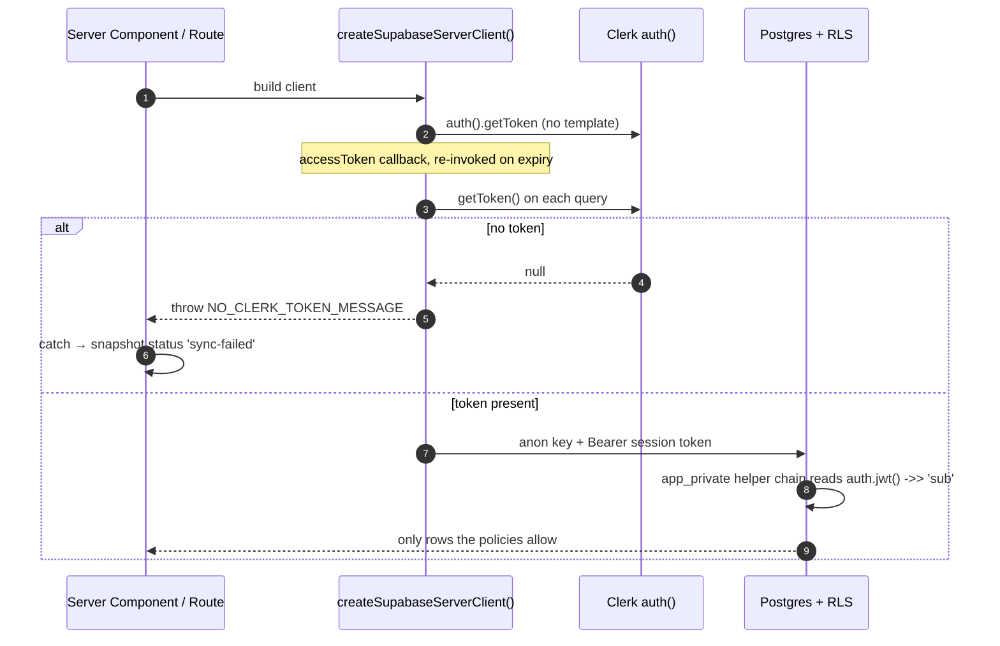

# Tenant Isolation, RLS and the Role Boundary

This page is the runtime half of the security model: what actually carries identity into Postgres, what the application layer is allowed to decide on its own, and where the app must *deny* rather than merely hide. The policy text lives on [Supabase Data Model and RLS Policies](/openwiki/architecture/data-model-and-rls.md) — this page links it rather than reproducing it.

Three invariants frame everything below, all from `RULES.md` §1 and all `[review]`-enforced (no linter catches them):

1. **RLS is the boundary; UI hiding is usability** — every authorization decision is Postgres's (rule 1).
2. **Never authorize by tenant in JS** (rule 2).
3. **The service-role key never reaches client code**, and a missing session token must throw rather than query anonymously (rule 3).

 — none of them fails `pnpm lint`, `pnpm exec tsc --noEmit`, or any test. That is the reason they are written down.

## The policy text is a mechanism, not a claim

`RULES.md` rule 1 is worth reading literally: the decision is made by `app_private.*` helpers, not by a `role` string the application compares. The chain is `app_private.current_clerk_user_id()` → `current_profile_id()` → `current_role()` / `can_access_tenant()` → `can_manage_tenant()` / `can_read_batch()` / `can_trainer_write_batch()` ([base migration](/supabase/migrations/20260528160300_create_tenant_scoped_schema.sql)), and each link is `security definer` with `search_path = ''` so it cannot be shadowed by a caller-controlled search path.

Two properties follow, and both matter for how you change code:

- **Identity reads only the session's `sub`.** `current_clerk_user_id()` is `coalesce(nullif(auth.jwt() ->> 'sub', ''), …)` — `sub` first, with two Clerk-shaped fallbacks. Role and tenant are then *looked up in the database*, so no custom JWT claim can widen access.
- **The helpers resolve through `profiles.is_active`.** Deactivating a profile (what the Clerk `user.deleted` webhook does) drops access at the next request with no revocation list to maintain.

`platform_admins` is the one table with **RLS enabled and deliberately no policy**, so it is invisible to `authenticated` `select`s; the app learns the answer only via the boolean-only definer RPC `public.current_user_is_platform_admin()` ([registry migration](/supabase/migrations/20260906114735_add_school_registry_and_platform_admin.sql#L65-L126)). That is why platform admin cannot be self-granted through any application path. Per-table policies, the ADR-006 registry boundary, and rule 30 are the data-model page's.

## From Clerk session to RLS-visible identity

`lib/supabase/server.ts` is the whole bridge, and it is an **anon-key** client — never the service-role key, which is confined to `lib/supabase/service.ts` for the one path with no session (the Clerk webhook).



`accessToken` re-invokes `getToken()` rather than setting a static `Authorization` header, so a long-lived client never reuses an expired token; `getToken()` is called **with no template argument** because this schema needs no custom claims beyond `sub`. [`tests/unit/supabase-server.test.ts`](/tests/unit/supabase-server.test.ts) pins all three: a function (not a header), no template, and a thrown sentinel.

The **throw** is the load-bearing part (rule 3). Returning `null` would build an unauthenticated client, and RLS answers every query with zero rows *and no error* — indistinguishable from "this user has no batches" in a compliance tool. `NO_CLERK_TOKEN_MESSAGE` is exported so callers can tell "not signed in" from "Supabase rejected the token"; `/api/debug/auth-check` matches it. At the data layer the throw lands in the existing `catch` and becomes `sync-failed` ([`getProfileSnapshot`](/modules/tenancy/data/tenancy.ts#L132-L151)).

## Selection is not authorization

Rule 2 bans a JS tenant check **used as access control**, even when it returns the right answer. The failure mode is not a leak today, it is drift: a query written as if RLS did not exist silently keeps working when a policy is widened, and the person reviewing the policy no longer has a reader who can see the consequence.

The one sanctioned shape is a filter derived from a validated `TenantScope`:

```ts
scopeForCode(profile, code)   // → TenantScope | null, built ONLY from profile.tenants
supabase.from('batches').eq('tenant_id', scope.tenantId)   // selection, on top of RLS
```

[`modules/tenancy/domain/scope.ts`](/modules/tenancy/domain/scope.ts) builds a scope from `profile.tenants` alone — itself an RLS-scoped read of `profile_tenant_memberships` — so an unknown or foreign code yields `null` and never a scope. Three consequences worth knowing before you touch a route:

- **A foreign URL code is a rendered state, not a 404.** [`resolveRouteScope`](/app/(dashboard)/tenant-scope.ts#L46-L52) is `cache()`-wrapped and four-way (`ok` / `not-a-member` with a fallback / `no-tenant-access` / `unknown`); [`t/[tenantCode]/layout.tsx`](/app/(dashboard)/t/[tenantCode]/layout.tsx) renders every non-`ok` arm. Pages call `requireScope()`, which returns `null` and deliberately does not `notFound()` — layout and page render in parallel.
- **`unknown` is never `none`.** A failed identity read must not be rendered as "you were never assigned".
- **Route awareness is the reason the fold lives in `app/`.** Joining `modules/auth` identity to `modules/tenancy` membership needs two private `data/` layers, which only `app/` may import (rule 8) — so [billing](/app/(dashboard)/t/[tenantCode]/(sections)/billing/page.tsx) fetches the profile itself and passes the verdict down, instead of `access.ts` reaching sideways.

Clerk-scoped writes obey the same split: the create-user Server Action's admin check is **defence in depth**, and its own header says so — a non-admin who reached it would still have the INSERT rejected by the `20260904120000` policies. The check is load-bearing only on the Clerk invitation branch, which has no RLS behind it. Server Action validation and RLS must keep agreeing; current drift is tracked on [/openwiki/workflows/user-provisioning-and-membership.md](/openwiki/workflows/user-provisioning-and-membership.md).

## The `TenantAccess` verdict and the `withTenantAccess` fold

RLS is *good* at silence, which is the one thing the UI cannot read. A caller with zero memberships gets an empty, successful read from every tenant-scoped table — correct, and far too easy to render as "No batches yet — import one", an action they cannot perform. [`modules/tenancy/domain/access.ts`](/modules/tenancy/domain/access.ts) exists to name that difference:

| Verdict | Meaning | Render |
| --- | --- | --- |
| `granted` | at least one membership | ordinary empty states are true |
| `none` | no membership | `NoTenantAccessState` |
| `unknown` | could not check (failed or unconfigured read) | nothing changes |

No query produces this verdict — RLS reports `none` as success. It is derived from the profile snapshot ([`deriveTenantAccess`](/modules/tenancy/data/tenancy.ts#L167-L177), `not-found` → `none`) and applied by route code calling `withTenantAccess(snapshot, access)`, whose precedence is exact:

```ts
access === 'none' && snapshot.status === 'ok' ? { status: 'no-tenant-access' } : snapshot
```

It replaces **only** an `ok` snapshot. A `sync-failed` or `unconfigured` passes through untouched, because "you belong to no school" is a tidier story than "the fetch broke" and would bury the banner that rule 19 requires; `unknown` changes nothing because an unverified verdict must not rewrite a successful read. [`tests/unit/tenant-access.test.ts`](/tests/unit/tenant-access.test.ts) pins both rules precisely because a refactor to `status === 'ok' ? … : …` would look like a simplification.

Order follows from the fold's purpose: resolve scope → derive access → fold → *then* the screen's guard ladder checks failure before emptiness. The dashboard's `guardState` puts `syncFailed && batchCount === 0` ahead of the `no-tenant-access` and empty arms for the same reason. Snapshot semantics generally are on [/openwiki/architecture/module-boundaries-and-data-pattern.md](/openwiki/architecture/module-boundaries-and-data-pattern.md); honest empty states are on [/openwiki/concepts/error-snapshots-and-honest-empty-states.md](/openwiki/concepts/error-snapshots-and-honest-empty-states.md).

## Viewer read-only: server denial, not a hidden control

Rule 4 is stated as *server-denied*, and "the button is gone" does not satisfy it — a viewer can replay the request. Viewer is read-only because no write policy admits it: `can_manage_tenant()` requires `current_role() in ('admin','coordinator')`, `can_trainer_write_batch()` requires `trainer`. Viewer appears in exactly three policies, all `for select`.

The role itself is resolved from **`profiles.role` only**, via `resolveTrustedRole`, never Clerk metadata. [`modules/auth/data/role.ts`](/modules/auth/data/role.ts) separates that trusted resolver from the `?role=` presentation override (`resolveRouteRole` / `resolveDisplayRole`) and collapses anything unrecognised to `viewer` — the least-privileged rendering. Gating a *redirect* on the override would let a real trainer ask `?role=admin` and skip it, so billing, report, `/overview`, `/users/new` and `/schools/new` decide on trusted sources and use `?role=` only to pick a variant. `billing/page.tsx` is explicit: the trainer redirect reads `resolveTrustedRole(dbRole)` *before* `resolveRouteRole` is consulted for `billingRole`.

The consequence for a reader of route code: a `?role=`-derived `viewer` is a preview of another role's UI, not a demotion, and a trusted `viewer` is not trusted because the page rendered a read-only variant. The `viewer` note in `BillingQueueBanners` says as much ("Generating and marking packets requires a coordinator or admin role") while RLS is what actually refuses.

## Trainer trimming: server omission, and its RLS half

Rule 5 has two enforcement halves and they are not interchangeable.

**RLS half — rows.** `can_read_batch()` narrows a trainer to `b.trainer_profile_id = current_profile_id()`. The MRR/billing-document tables and `learner_details` use it for `select`, so a trainer's fetches return only their own assigned batches — `/trainer` passes no scope at all because RLS already narrowed the set. `learner_details` is the sharper case: it is a one-to-one table precisely because **RLS filters rows, not columns**. Contact, birth date, employer and salary range on `learners` would be one API call from any assigned trainer, so they moved to a table whose read policy names `admin`/`coordinator`/`viewer` and whose comment says "Trainers are deliberately absent" ([T2MIS migration](/supabase/migrations/20261111120000_add_t2mis_terminal_report_fields.sql#L56-L119)). On money columns the trimming is RLS.

**Omission half — fields the trainer's own environment can read.** The trainer's role can read the financial figures; the DTO must still not carry them. `/trainer` passes `hideBilling` to [`MetricsRow`](/modules/shell/ui/MetricsRow.tsx), which forwards it to `KpiSummary`, whose render simply does not emit `NextBillingCard`. `/t/<school>/<section>` routes `redirect('/trainer')` for a trusted trainer before any billing work — `/billing` and `/report` both do, and `report` added the redirect when it went live rather than leaning on a nav row it had already removed. `/overview` is reached directly by admins and so carries no trainer guard. The `/trainer` dashboard's comment states the boundary directly: it "shows on this dashboard only", and the metrics row is not in a layout because a layout does not re-render on client-side navigation.

Plan the shape so the omission survives: a component that mounts billing markup and hides it in CSS is not rule 5, and neither is a `pages`-level redirect that leaves the DTO intact for anything fetching it directly.

## Where this goes wrong

Each of these compiles, lints, and passes the suite:

- A `tenant_id` filter added to make a screen parent-scoped while a policy still allows a wider read — it will hide the drift until the policy is widened.
- A trainer redirect gated on `resolveRouteRole`, so `?role=admin` skips `/billing`.
- `accessToken: async () => getToken()` with no null check — one genuinely empty-looking page per expired session.
- `deriveTenantAccess` normalising `sync-failed` to `none`, so a broken fetch reads as "no school assigned".
- `withTenantAccess` applied to a snapshot status other than `ok`, or a guard ladder that checks "empty" first, swallowing the sync-failed banner.

## Extending safely

- **Adding a tenant-scoped table:** enable RLS, write the policy through a helper, add per-function `grant execute` (the base migration's `grant … on all functions` was a one-time statement), and check the caller lacks a JS pre-filter. New policies are additive; Postgres OR-combines permissive ones.
- **Adding a scoped section:** it must appear in `SCOPED_SECTIONS` and in the URL before its query is written — a screen that reads every school under one school's name was audit finding I1, and the scope module's header records it.
- **RLS verification** runs against real Supabase, no mocks (rule 35); rule 36 makes that permission-gated against the single hosted project. Until then the policy text is intent, and the migration is canonical.