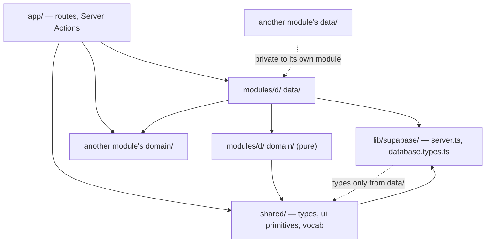
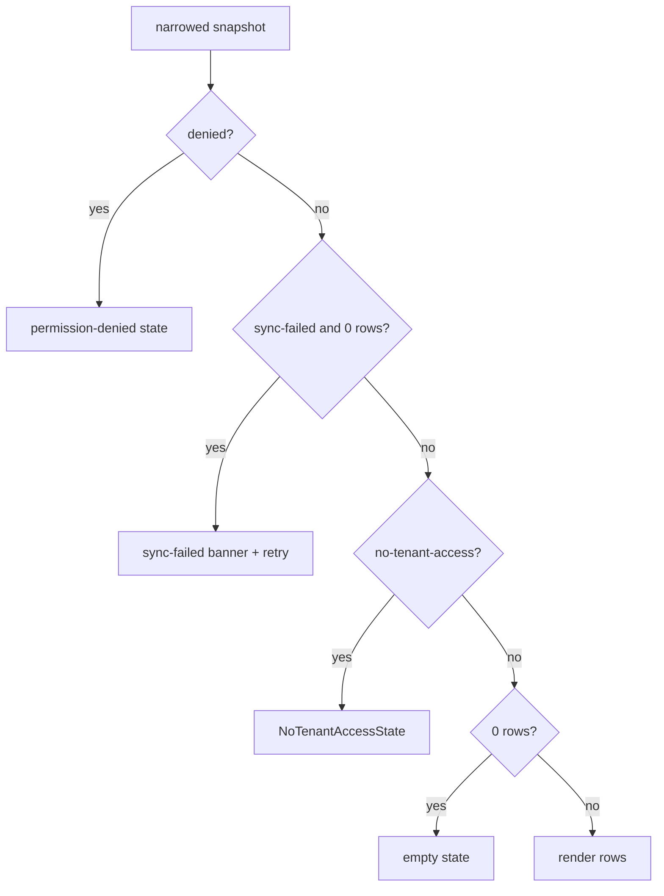

# Module Boundaries and the Data Layer Pattern

Code is grouped **by domain, not by file type** (TES-68): every feature lives in `modules/<domain>/` split into `data/`, `domain/` and `ui/`, and the whole tree sits in a one-way hierarchy `app → modules → shared → lib/supabase`. [`RULES.md`](/RULES.md) §2–§3 states this as rules 7–20, each tagged with its enforcement level; `[lint]` means `pnpm lint` fails, `[types]` means `pnpm exec tsc --noEmit` fails. [`CLAUDE.md`](/CLAUDE.md) §Architecture explains the why, and where the two disagree `RULES.md` wins.

This page owns three things: the zone table, the contract every `data/` file implements, and the snapshot states a route must distinguish. The request path and route gating live in [tenant-isolation-and-role-authority](/openwiki/security/tenant-isolation-and-role-authority.md); cross-school routing lives in [overview](/openwiki/architecture/overview.md).

## The zone matrix

Four zones, one direction, and four edges forbidden outright. Each forbidden edge closes a specific failure:

| Edge | Why it is forbidden | Enforcement |
|---|---|---|
| any layer except `data/` → `lib/supabase/database.types.ts` | raw generated row types must not leak past the mapper, or a column rename ripples through components | rule 10, `[lint]` zone |
| `shared/` → `modules/` | `shared/` stops being a leaf and a cycle starts | rule 9, `[lint]` zone |
| `shared/`, `modules/` → `app/` | `app/` is the composition root, so nothing below may reach up into it | rules 7–8, `[lint]` zones |
| `modules/<other>/data/` → `modules/<d>/data/` | one module's mapper is an internal detail; its `domain/` and `ui/` are the public surface | rule 8, one `[lint]` zone per entry in the `domains` array |

Two supporting rules make `data/` a genuine boundary: it is the only layer that talks to Supabase (rule 10), and a `domain/` layer is pure, no I/O (rule 14). `domain/` is therefore the only cross-module surface, which is why `modules/batches/data/learners.ts` may import `ageOn` from `modules/import-export/domain/t2mis` but never from another module's `data/`.

The zones live in [`eslint.config.mjs`](/eslint.config.mjs) as `import/no-restricted-paths` (rule 7). That file's `domains` array generates one `data/`-privacy zone per module name, so **a folder created under `modules/` but not added to the array has no enforced boundary at all** (rule 12 puts the new code in the module; only the array entry makes it private). A violation surfaces as a lint error naming the offending import.

### Three mechanical facts the zone file holds

Each is a place where the matrix is easy to misread from the prose:

- **`app/` is exempt from every `data/` rule.** The per-domain zones target `modules/!(${d})/**` only, and a separate zone restricts only `shared/**` against `./modules/**`. Nothing forbids `app/` from importing a module's `data/` — that is the composition-root privilege, and it is how a report route pairs one module's batch snapshot with another's roster.
- **`!(${d})` is an extglob matched against the path, not the importer.** Same-module `data/` → sibling `data/` matches the "can-except-`d`" half, so it lints clean; only cross-module imports are caught.
- **The first zone does not restrict `app/`.** Its target list covers `./app/**`, `./shared/**` and every module's `ui/`/`domain/`, but no `app/` file imports `database.types.ts`: the convention holds by habit, not by lint.



Solid arrows are allowed. Dashed arrow one is the rejection that bites in practice: a `data/` file may not pull in another module's `data/`, only its `domain/`.

Treat zones as shape, not classification. A `shared/ui` primitive that starts reading data or encoding a business rule belongs in the owning module, and `metrics` had to move out of `shared/` for exactly that reason.

## Reaching sideways into another module's `data/`

This is the recurring mistake. It looks harmless — the function is exported and its type is right — and it still fails lint, because no zone has an `app/` target. The fix is always the same shape: **do the fetch in `app/` and pass the rows down.**

`modules/documents/data/documents.ts` is the worked example. Its docblock carries the full `mapDocumentRow` / `MISSING_DOC` / backfill trio, which `modules/batches/data/batches.ts` then re-implements by hand because two private `data/` layers may not import each other — and the copy is kept in sync manually, not generated. `"no row means missing"` is this contract's decision, not each caller's (ADR-004 D1). A key still absent after the backfill is one this batch's catalog never listed; callers read that as **untracked** through `modules/documents/domain/compliance.ts` and never by indexing the map (ADR-004 D2/D6).

The legitimate alternatives, in order of preference: import the other module's `domain/`; pass a parameter the caller resolved; or fetch both modules' `data/` in the same `app/` route. Duplication is the fallback when both modules own half of a pure helper and the copy is small enough to keep in view.

## The `data/` contract: fetch → map → derive

Rule 17 names `modules/batches/data/batches.ts` the reference every entity contract follows. Its three layers are deliberately separate so each can be read and tested alone:

1. **fetch** — a typed Supabase query, `cache()`-wrapped, whose rows RLS has already scoped.
2. **map** — a pure row → UI-domain translation (`mapBatchRow`), no I/O, exported for tests.
3. **derive** — lifecycle, deadline and session helpers computed from the mapped row (`deriveLifecycle`, `daysUntil`, `completedSessions`).

The control flow is fixed: `unconfigured` first, `try` around the client and the query, raw error retained in a `sync-failed` member, thrown errors caught into the same member. Neither `isSupabaseConfigured` nor the client ever decides a row.

`cache()` is not decoration. The `(dashboard)` layout and every nested page call `getBatchesSnapshot` independently in one request, so the wrapper collapses them to one round-trip; the same treatment covers `getProfileSnapshot`. The `tenantId` argument is scope *selection* on top of RLS, the one JS tenant filter rule 2 allows — omitted, the query spans every school RLS permits, which only the admin overview and trainer routes ask for.

Ambiguity is resolved in the mapper, once, rather than at each call site: `daysUntil` returns `Number.POSITIVE_INFINITY` — the "no known deadline" sentinel that sorts last — for a missing *and* for an unparseable date, because `NaN` would silently corrupt urgency math. `orEmpty`/`orZero` keep a runtime null out of a progress bar, and `completedSessions` answers `null` unless both a snapshotted `total_sessions` and at least one attendance row exist (PostgREST returns `[]`, never null, for an empty embed).

The counterpart waste: a mapper is not a place to invent a field. Gaps carry `TODO(contract)` defaults rather than a plausible-looking value.

## The snapshot union and the mandate on guard order

Every data function returns a discriminated union the caller must narrow before touching rows:

```ts
type BatchesSnapshot =
  | { status: 'ok'; batches: Batch[]; dataAsOf: string | null; fetchedAt: string }
  | { status: 'no-tenant-access' }
  | { status: 'sync-failed'; error: string }
  | { status: 'unconfigured' };
```

Plus `selectBatchesForDisplay(snapshot)`, which collapses to `[]` for every non-`ok` member. **Three of the four states carry no rows**, so a screen that checks "is my list empty" before reading the status renders the same thing for a broken fetch as for a genuinely empty school — and the retry banner is swallowed. Rule 19 is exactly that: `sync-failed` must surface its banner, and an ordering that tests emptiness first silently eats it whenever a failure yields zero rows.

The order is therefore fixed, failure first:



`app/(dashboard)/t/[tenantCode]/(sections)/documents/page.tsx` shows the short form: it passes `syncFailed` into the client island so a failed-but-populated grid keeps its rows, and returns `NoTenantAccessState` before the view. Nothing enforces the order at the type level — a reviewer is the only check — which is why the dashboard's `guardState` carries a comment pointing at rule 19.

`no-tenant-access` is the member **no query can produce**. Every RLS policy scopes through `app_private.can_access_tenant()`, so an unattached caller gets a successful empty read that is indistinguishable from a real one. It is folded in by the route via `withTenantAccess` in `modules/tenancy/domain/access.ts`, because membership is `modules/tenancy`'s fact and its `data/` is private. The fold is deliberately narrow — `access === 'none' && snapshot.status === 'ok'` — so a failure is never rewritten into the tidier story and an unverified `unknown` verdict never overrides a good read. The verdict itself comes from `tenantAccessOf(profile)` or, from a profile snapshot, `deriveTenantAccess`, which reads `not-found` as `none` but `sync-failed`/`unconfigured` as `unknown`. Detail on `deriveTenantAccess` and the profile snapshot belongs to [tenant-isolation-and-role-authority](/openwiki/security/tenant-isolation-and-role-authority.md).

`ok` carries the freshness pair: `dataAsOf` is the newest `updated_at` (when data was last **edited**), `fetchedAt` is the read (what the "Data as of" label prints). No pair on a non-`ok` member, so the label degrades rather than printing a stand-in time.

## The total enum map as a forcing function

Rule 18 keeps the enum bridge in the mapper. `DB_TO_UI_STAGE` is typed `Record<DbLifecycleStage, LifecycleStageKey | null>`, so adding a DB stage is a compile error until someone chooses its treatment: `training`/`assessment`/`billing` map to `train`/`assess`/`bill`; `completed`/`blocked` map to `null` because `deriveLifecycle` gives them their own handling (all-done, nothing-active). `entre` is UI-only — it lives in `UI_PIPELINE` and appears in no value. `normalizeStatus` is the one hand-written ternary, with a `TODO(contract)` to align the two status unions.

The property to preserve is totality, not the map: the compiler is what forces the decision. It is deliberately dropped where the key is configured data rather than a closed enum — `DOCUMENT_ICONS` is a `Partial` with a generic fallback because `document_key` is per-program.

## Tests that pin the pattern

`tests/unit/batches.test.ts` covers the contract's behaviour rather than its coverage number: the mapper's field and enum translation, and that an unavailable value is `null` and never a fabricated zero (`billing_deadline` absent ⇒ `null` + `Infinity`). It freezes the clock for `daysToBilling` so "whole days from an as-of date" is deterministic, and asserts `selectBatchesForDisplay` returns `[]` for `unconfigured`, `sync-failed` and empty-`ok` alike — an `ok` with zero rows is still authoritative.

`tests/unit/supabase-server.test.ts` pins the client underneath every contract: an `accessToken` callback (not a static header), `getToken()` with no template argument, and a throw of the exported `NO_CLERK_TOKEN_MESSAGE` on a missing token rather than an unauthenticated `anon` client that would return zero rows and no error.

`tests/unit/tenant-access.test.ts` pins the fold's two silent failure modes: `unknown` must never behave like `none`, and a real failure must survive `withTenantAccess`. No test renders a route, so the guard *order* is unexercised — real-Supabase RLS tests are still outstanding. See [verification-and-test-strategy](/openwiki/guides/verification-and-test-strategy.md).

## Failure modes

| Failure | Symptom | Guard |
|---|---|---|
| another module's `data/` imported directly | lint error naming the import; the mapper becomes a de facto API | fetch in `app/`, import `domain/`, or duplicate |
| a `modules/` folder missing from `domains` | its `data/` is public and nothing says so | add the name to `eslint.config.mjs` |
| empty checked before `sync-failed` | retry banner hidden behind "no batches yet" | read `status` first, collapse rows second |
| `withTenantAccess` rewriting a non-`ok` snapshot | real failure hidden as "no school" | the fold rewrites `ok` only |
| `unknown` access rendered as `none` | "you have no school" when the check merely failed | `unknown` untouched |
| a `Partial` map over a closed enum | new DB variant silently `undefined` | total maps, compile error |
| a fabricated default for a missing field | UI that looks measured but is not | `null`/`Infinity` sentinels + `TODO(contract)` |

## Extending

**A new read contract:** add the type to `shared/types.ts`, create `modules/<domain>/data/<entity>.ts` with `unconfigured` first, the `try`/`catch`, the raw error retained, an exported mapper and a `select*ForDisplay` returning `[]`; add a union member only if genuinely distinct in kind, and keep `no-tenant-access` out of non-tenant-scoped contracts; test the mapper against a fixture typed `Parameters<typeof map…>[0]`; and guard failure-before-empty in every consuming route.

**A new enum column:** write the total map in the mapper, in the direction the data moves, and let the compiler drive the call sites.

**A new module:** create `modules/<name>/{data,domain,ui}` **and add the name to `domains`** in `eslint.config.mjs`.

## Related

- [Architecture overview](/openwiki/architecture/overview.md) — the stack, the request path, and each module's one-line purpose.
- [Tenant isolation and role authority](/openwiki/security/tenant-isolation-and-role-authority.md) — `requireScope` and the layouts the fold runs inside, the role redirects, and why `tenant_id` is selection rather than authorization.
- [Schema and RLS reference](/openwiki/architecture/schema-and-rls-reference.md) — the canonical migration `20260528160300`, the `app_private` helpers, and the rule 20 regenerate-then-update step.
- [Verification and test strategy](/openwiki/guides/verification-and-test-strategy.md) — lint, typecheck, and the mapper/domain test convention.
- [Quickstart](/openwiki/quickstart.md) — running `pnpm lint` and `pnpm exec tsc --noEmit` locally.
- [`RULES.md`](/RULES.md) §2–§3 — the boundary and data-layer rules quoted above.
