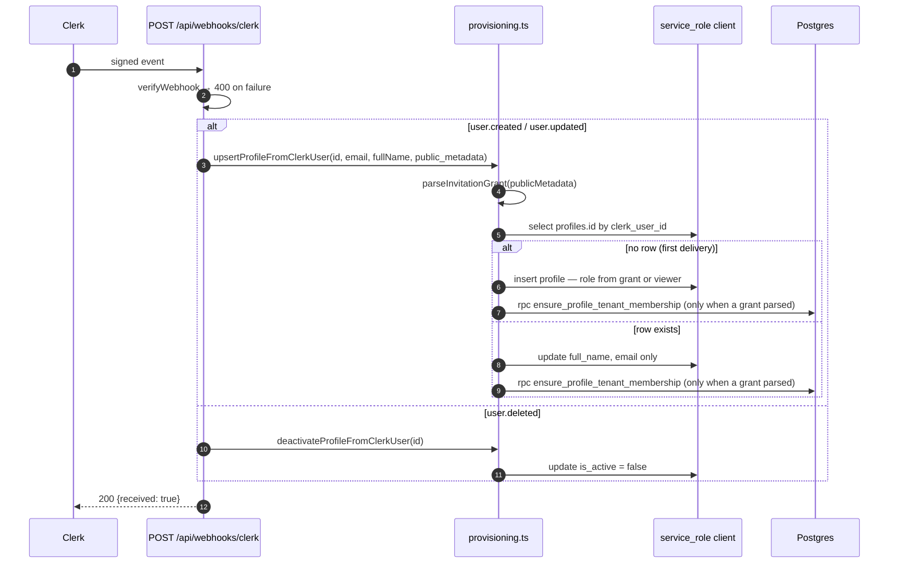

# Clerk Identity and Profile Provisioning

Clerk owns identity in this system and nothing else. It issues the session token that RLS reads for `sub`, and it is the only source of the user ids that `public.profiles` is keyed on — but the role and tenant a person may act under are `profiles.role` and `profile_tenant_memberships`, which live in Postgres. The one thing the two systems must agree on is identity, and `POST /api/webhooks/clerk` is where that agreement is maintained.

This page covers the identity integration and the provisioning write path. Which rows a profile can then reach is [Tenant Isolation and Role Authority](/openwiki/security/tenant-isolation-and-role-authority.md)'s material, the helper chain is on [Schema, Migrations and RLS Reference](/openwiki/architecture/schema-and-rls-reference.md), and the request path that the webhook sits outside of is on the [Architecture Overview](/openwiki/architecture/overview.md).

## The shape of the integration

| Concern | Where it lives | Boundary it must respect |
| --- | --- | --- |
| Session identity (`sub`) | [`proxy.ts`](/proxy.ts) → `requireAuthenticatedUser()` in `app/(dashboard)/layout.tsx` | The layout is the gate; `proxy.ts` only stamps `x-pathname` |
| Supabase access for signed-in callers | `lib/supabase/server.ts` — anon key + Clerk token via `accessToken` | Rule 3: missing token throws `NO_CLERK_TOKEN_MESSAGE`, never a silent `anon` request |
| Identity reconciliation | `app/api/webhooks/clerk/route.ts` → `modules/auth/data/provisioning.ts` | The only `service_role` path |
| Invitation grants | `modules/auth/domain/invitationMetadata.ts` (pure) and `modules/auth/data/invitations.ts` (Backend API) | Read by the webhook, written by the admin action |

Two routes deliberately sit outside the `(dashboard)` gate, and this is one of them: no session exists when Clerk calls. `proxy.ts` needs no exclusion for it because its matcher already covers `/(api|trpc)(.*)` and gates nothing ([`proxy.ts`](/proxy.ts#L10-L15)); the `Architecture Overview` carries the full matcher rationale.

## Why the webhook is unauthenticated, and why that is not a hole

Absence of a session is not absence of proof. Clerk signs the request body, and the route verifies that signature before doing anything else:

```ts
let event;
try {
    event = await verifyWebhook(req);
} catch (error) {
    console.error('Clerk webhook verification failed', error);
    return new NextResponse('Verification failed', {status: 400});
}
```

`verifyWebhook` from `@clerk/nextjs/webhooks` checks the request headers against `CLERK_WEBHOOK_SIGNING_SECRET`, so the trust anchor is a server-only secret rather than a cookie ([`app/api/webhooks/clerk/route.ts`](/app/api/webhooks/clerk/route.ts#L19-L26)). Three consequences follow, and each is a trap worth naming:

- **The route is a public endpoint.** Anyone can `POST` to it. What they cannot do is make an arbitrary body verify, so the dispatch below never sees an event Clerk did not send.
- **`CLERK_WEBHOOK_SIGNING_SECRET` is deployment-critical.** Without it every delivery 400s and no profile is ever created — a signed-up user with no `profiles` row. `SUPABASE_SERVICE_ROLE_KEY` has the same standing, and `modules/auth/README.md` records both alongside the local `clerk webhooks listen --forward-to http://localhost:3000/api/webhooks/clerk` loop.
- **Verification failure is terminal for that delivery.** A `400` body of `Verification failed` tells Clerk to keep retrying; nothing downstream runs.

### A verified webhook is still not a session

The distinction matters because it is what forces the service-role client. A verified delivery proves *Clerk sent this body*; it proves nothing about which Supabase identity the request carries, because there is no user making the request at all.

- **`user.created` has no `sub` yet in any usable form** — the profile row that would resolve `sub` to a `profile_id` is the very thing being written by `app_private.current_profile_id()`. An anon-key client under RLS would have no `current_profile_id()` and could not insert into `profiles`, which holds no `authenticated` INSERT policy in the applied schema.
- **`user.deleted` arrives after the identity is gone.** There is nothing left to authenticate as.
- **Delivery is machine-to-machine.** Clerk holds no session cookie and would not be issued one for a tenant it belongs to.

So the webhook runs as `service_role`, which [tenancy and RLS](/openwiki/security/tenant-isolation-and-role-authority.md) treat as the sanctioned bypass — not as an exception granted to the webhook but as the reason it exists. The same reason is why the function it depends on is granted to `service_role` alone (ADR-006 P6).

## The write path

`modules/auth/data/provisioning.ts` exposes exactly two functions, both called only from the route and both built on `createSupabaseServiceClient()`.



The route keeps the extraction — email from `email_addresses[0]`, `full_name` from the two name fields — and passes a `ClerkUserSummary` down, so no Supabase call and no decision lives in the route (rule 11). The `try`/`catch` around the dispatch turns any thrown provisioning error into `500 Sync failed`:

```ts
} catch (error) {
    console.error(`Failed to sync profile for Clerk event "${event.type}"`, error);
    return new NextResponse('Sync failed', {status: 500});
}
```

### The insert path grants nothing on its own

<!-- openwiki: broken internal link [/docs/adr/ADR-005-demo-account-tenant-scoping.md#L17-L24] heading anchor "L17-L24" does not exist in "/docs/adr/ADR-005-demo-account-tenant-scoping.md". Fix the href or restore the target, then delete this comment. -->
A self sign-up writes `role: 'viewer'` — the least-privileged enum value — and **no membership row**. That is not defensiveness for its own sake: RLS resolves tenant access purely through `profile_tenant_memberships`, so the absence of a row is what makes a fresh profile read zero rows everywhere. `SignUpModal` tells the user an administrator will assign their school and role, and the ADR-005 record of the resulting experience (signed-in, everything empty) is the deliberate consequence ([ADR-005](/docs/adr/ADR-005-demo-account-tenant-scoping.md#L17-L24)).

The one path that lands with access is an admin invitation, which arrives carrying a grant.

### The update path never changes what a person may do

For an existing `clerk_user_id` the update touches `full_name` and `email` and nothing else. `role` and `is_active` are absent from the column list, so a renamed account, a changed address, a re-delivered `user.updated`, or metadata edited onto a live user through Clerk's Backend API all leave authority untouched. Role and the active flag stay admin-managed in the app (`assignUserAccess` in `modules/tenancy/data/users.ts`, under RLS).

The narrowest possible repair runs underneath: **only when the profile holds no membership at all** does a parsed grant get applied. A grant can therefore never add a second school or move someone an admin already seated.

## The membership RPC

`ensureTenantMembership` does not insert a membership itself; it calls `supabase.rpc('ensure_profile_tenant_membership', …)`. The function ([migration](/supabase/migrations/20260906120000_ensure_invitation_membership_atomic.sql#L1-L35)) is `security invoker` with `search_path = ''`, and inside one transaction it takes `for update` on the profile row, returns early if any membership exists, and otherwise inserts the membership with `is_default := true`.

The row lock is the whole point: concurrent deliveries for one profile — including deliveries proposing different tenants — serialize on the parent profile instead of both observing an empty membership set and seating different schools. Because the service-role count is the whole truth (no RLS narrows it), "no memberships" genuinely means *none*, which is also what makes `is_default: true` correct by construction.

What happens to each outcome:

| RPC result | Provisioning | Delivery |
| --- | --- | --- |
| Success | resolves | `200` |
| `23505` unique violation | swallowed — an outside writer beat the lock | `200` |
| Any other error | logged and rethrown, so the route answers `500` | Clerk retries |

All three are pinned by [`tests/unit/auth-provisioning.test.ts`](/tests/unit/auth-provisioning.test.ts#L57-L86), including the exact log line — the test mocks `lib/supabase/service` and asserts the arguments, so it is a test of the contract rather than of Postgres.

### What breaks when the RPC is absent

The function is not part of the base migration; it lands in `20260906120000` with `revoke execute … from public, anon, authenticated` and `grant execute … to service_role`. Its signature is present in the hand-maintained `Database['public']['Functions']` block, so `pnpm exec tsc --noEmit` type-checks the call even against a database that does not have it.

If it is missing, PostgREST answers `PGRST202` ("could not find the function in the schema cache"), the error is not `23505`, and provisioning rethrows. The observable damage is bounded to the grant half of the flow:

- The `profiles` row and its role **still land**. The insert or update commits before the RPC is attempted, and the route never rolls it back.
- The membership does not, so an invited user resolves to zero visible rows on every screen — the ADR-005 experience for an account the admin believed they had assigned.
- Every delivery answers `500 Sync failed`, which is what makes the state recoverable: the `user.updated` retry reaches the same helper.

That recovery channel is the current design's strength and its limit. The update path routes through `ensureTenantMembership` for exactly this reason — an insert-time failure used to log, answer `200`, and stay permanent. But recovery only fires while the grant is still readable on `User.publicMetadata`; clearing it, or deleting the user first, removes the repair without removing the half-built profile.

## Invitation grants and why they are trusted

`profiles.clerk_user_id` is `not null unique`, so no row exists before a person signs up — an admin inviting a stranger has nothing in Postgres to write a role onto. The grant is parked on the invitation's `publicMetadata` instead ([`modules/auth/data/invitations.ts`](/modules/auth/data/invitations.ts#L64-L83)), Clerk copies it onto `User.publicMetadata` at sign-up, and the webhook reads it back out.

Trusting it rests on one property: `publicMetadata` is writable **from the Backend API only**, never from the client, so the person signing up cannot author or tamper with what arrives with them. What the webhook honours is the inviting admin's authority, which makes this the single exception to "provisioning never grants tenant access" — an admin assignment made before the account existed.

`parseInvitationGrant` is the gate, and it is strict twice over ([`modules/auth/domain/invitationMetadata.ts`](/modules/auth/domain/invitationMetadata.ts#L67-L78)): keys are namespaced (`tvicamsRole`, `tvicamsTenantId`) so unrelated metadata can never be mistaken for a grant, and parsing is all-or-nothing — a role outside `public.profile_role`, a blank tenant id, or half a pair yields `null` and falls back to `viewer` with no membership. [`tests/unit/user-access.test.ts`](/tests/unit/user-access.test.ts#L142-L190) pins each refusal; the comment there is the reason it is load-bearing rather than cosmetic: the webhook runs with no RLS above it, so nothing downstream will catch a loose parse.

## Deletion deactivates, never deletes

`user.deleted` sets `is_active = false`. A hard delete would cascade or orphan every FK onto `profiles.id` and destroy the compliance audit trail, while `app_private.current_profile_id()` already filters `is_active = true`, so access stops at the next request on its own — no session cleanup, no membership sweep, no history lost.

The guard `if (event.data.id)` matters for the same reason: a deletion payload Clerk has already scrubbed still lets the request succeed without an unhandled error.

Note the scope of the update: it keys on `clerk_user_id` with no `is_active` condition, so a redelivered `user.created` for a deactivated profile will refresh name and email without reactivating it. Reviving an account is an admin action.

## The service-role client, and rule 3

<!-- openwiki: broken internal link [/RULES.md#L28-L31] heading anchor "L28-L31" does not exist in "/RULES.md". Fix the href or restore the target, then delete this comment. -->
[`lib/supabase/service.ts`](/lib/supabase/service.ts) is the only file that reads `SUPABASE_SERVICE_ROLE_KEY`. Rule 3 puts the ban in one sentence: **the service-role key must never reach client code** ([`RULES.md`](/RULES.md#L28-L31)). Enforcement is `[review]`, so the guarantee is structural rather than lint-checked, and the header comment states the whole contract: import it only from server-only code, keep the variable unprefixed (`NEXT_PUBLIC_` would ship it in the browser bundle), and never read it outside this file. `createSupabaseServiceClient()` also throws on a missing URL or key rather than building a half-configured client, and it disables session persistence and token refresh because there is no session to persist.

Contrast that with `createSupabaseServerClient()` ([`lib/supabase/server.ts`](/lib/supabase/server.ts#L40-L67)), which is anon key plus the Clerk token so **RLS stays the security boundary**. The service client bypasses RLS entirely, which is also why "no memberships" can be trusted in the RPC: an RLS-scoped read means "none this admin can see", a service-role read means none.

Nothing enforces the confinement mechanically — no lint zone names `lib/supabase/service`, and the test suite mocks it rather than asserting the import graph. `provisioning.ts` is the only caller today; a new data layer that reaches for the client for convenience turns whatever it writes into an RLS-free write, so confirm the caller genuinely has no session before importing it.

### The anon-key path this bypasses

For everything else, [`tests/unit/supabase-server.test.ts`](/tests/unit/supabase-server.test.ts) pins the complementary invariant: the server client passes an `accessToken` callback (not a static header, not a JWT template — Clerk deprecated Supabase templates on 1 Apr 2025), calls `getToken()` with no argument, and **throws the exported `NO_CLERK_TOKEN_MESSAGE` sentinel instead of silently degrading to `anon`** ([`tests/unit/supabase-server.test.ts`](/tests/unit/supabase-server.test.ts#L99-L124)). The service client is where that sentinel is irrelevant by design: there is no token to miss.

## Diagnosing the chain: `/api/debug/auth-check`

The identity chain fails in ways that look identical from the UI, so the repository keeps a manual probe. [`app/api/debug/auth-check/route.ts`](/app/api/debug/auth-check/route.ts) is **dev only** — it answers `404` under `NODE_ENV=production` and never logs or returns the token — and it selects `id` from `profiles` for the caller and nothing else.

Its verdicts separate what a rendered page cannot:

| Verdict | Meaning | Where to look |
| --- | --- | --- |
| `ok` | token validated, RLS ran, a profile row resolved | nothing to fix |
| `authenticated-but-no-profile` | the auth chain works; RLS simply matched nobody | provisioning: webhook delivery, `CLERK_WEBHOOK_SIGNING_SECRET` |
| `no-clerk-session` | the query threw the `NO_CLERK_TOKEN_MESSAGE` sentinel | are you signed in? |
| `token-rejected` | Clerk issued a token and Supabase refused it, so RLS never ran | third-party auth not enabled on one or both sides |
| `unconfigured` | `NEXT_PUBLIC_SUPABASE_URL` or the anon key is missing | `.env.local` |

The probe matches on the exported sentinel for a deliberate reason: without it every signed-out visit would be reported as a dashboard misconfiguration, so drifting the message silently turns the diagnostic into a liar ([`app/api/debug/auth-check/route.ts`](/app/api/debug/auth-check/route.ts#L37-L52)).

## Failure modes, named

- **Forged or unsigned delivery.** `400 Verification failed`; nothing is written.
- **Provisioning throws.** `500 Sync failed`, logged with the event type. This covers `PGRST202`, a permission error, and any other write failure; Clerk retries, and an existing profile re-enters the repair path.
- **Membership `23505`.** Accepted, not an error — a concurrent writer won.
- **No profile row.** The user is signed in, `current_profile_id()` is `NULL`, every predicate fails, and reads return zero rows. This is correct RLS behaviour and looks like a broken dashboard, which is why the probe's `authenticated-but-no-profile` verdict exists.
- **Deactivated profile.** `getAuthUserId()` still returns an id, so layouts and pages render and only RLS denies. Deactivation is not a sign-out.
- **Grant metadata on a live user whose role differs.** The role does not move (the update path has no `role` column); only a wholly tenantless profile gets seated.

## Environment

`.env.example` documents only the Playwright/E2E Clerk pair (`pk_test_*`/`sk_test_*` and a test user), not the webhook. The two variables this integration needs — `CLERK_WEBHOOK_SIGNING_SECRET` and `SUPABASE_SERVICE_ROLE_KEY` — are recorded in `modules/auth/README.md` and must be set in every deployment that expects profiles to exist. Apply order matters: the RPC migration is a prerequisite for invitations, and rules 20 and 36 apply to both ([Supabase and Migrations](/openwiki/operations/supabase-and-migrations.md)).
