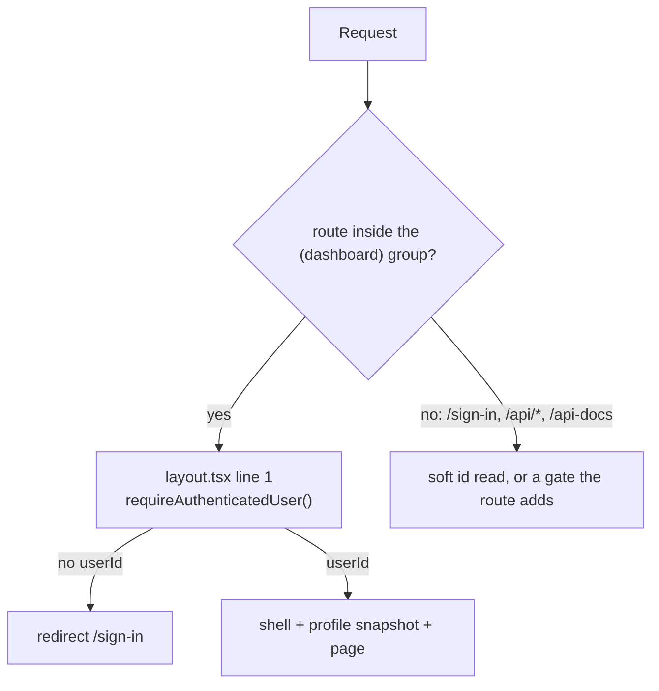
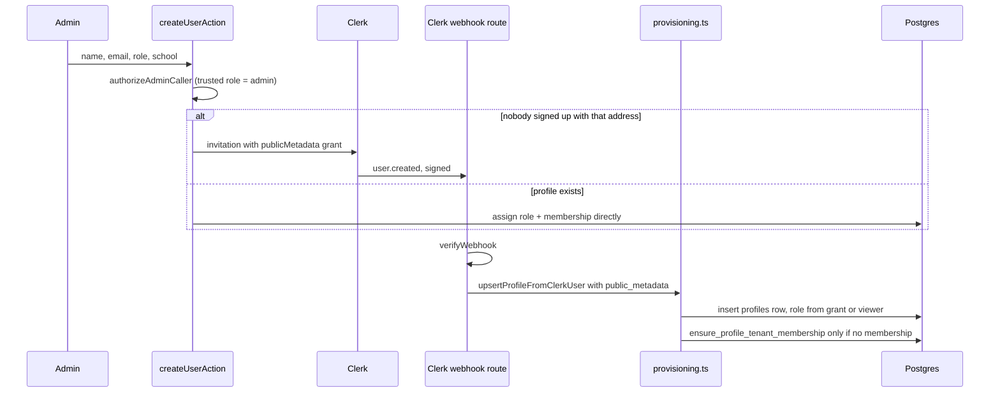

# Auth, Session Gate and Service-Role Provisioning

**Clerk is identity, never authority.** It supplies a verified `userId` and nothing else; the
authority is `profiles.role`, the column RLS reads. So a signed-in user with no profile row has no
role at all, and every caller narrows to read-only `viewer`. This module does exactly two things:
get a person from anonymous to a gate that passes, and get a profile row written behind them. What
that row lets them do belongs to [Tenancy](/openwiki/modules/tenancy.md);
[User Provisioning and Membership](/openwiki/workflows/user-provisioning-and-membership.md) owns
<!-- openwiki: broken internal link [/openwiki/architecture/overview.md#the-auth-chain] heading anchor "the-auth-chain" does not exist in "/openwiki/architecture/overview.md". Fix the href or restore the target, then delete this comment. -->
the admin-side flow; [Architecture Overview](/openwiki/architecture/overview.md#the-auth-chain) owns
the chain.

That is also why the odd combination in this page is not an accident: the same module holds the
*interactive* surface (`ui/`, sign-in) and the *unauthenticated* surface (the webhook and
`data/provisioning.ts`). Sign-in runs before any session exists; provisioning runs before any
session exists. Both are, by construction, this module's business.

## The gate: `requireAuthenticatedUser`

[`modules/auth/data/auth.ts`](/modules/auth/data/auth.ts#L1-L22) is four helpers over Clerk:
`getCurrentUser()` and `getAuthPayload()` — exposing `currentUser()` and `auth()` — and
`getAuthUserId()`, which returns `auth().userId`. `requireAuthenticatedUser()` is the fourth: read
the id, `redirect('/sign-in')` when it is absent, otherwise return it.

**It is not the gate because it is called often — it is the gate because everything else is soft.**
<!-- openwiki: broken internal link [/app/(dashboard] file "/app/(dashboard" does not exist. Fix the href or restore the target, then delete this comment. -->
Two callers hard-redirect through it: [`app/(dashboard)/layout.tsx`](/app/(dashboard)/layout.tsx#L12-L13)
as its first statement, and [`app/api-docs/page.tsx`](/app/api-docs/page.tsx#L5), which sits outside
the route group. Every other consumer uses the soft `getAuthUserId()` and handles `null` itself:
<!-- openwiki: broken internal link [/app/(dashboard] file "/app/(dashboard" does not exist. Fix the href or restore the target, then delete this comment. -->
[`app/(dashboard)/tenant-scope.ts`](/app/(dashboard)/tenant-scope.ts#L39) and
<!-- openwiki: broken internal link [/app/(dashboard] file "/app/(dashboard" does not exist. Fix the href or restore the target, then delete this comment. -->
[`tenant-access.ts`](/app/(dashboard)/tenant-access.ts#L32) (both `.catch(() => null)`),
`/schools/new`, `/users/new`, the billing and report pages, the sign-in layout, and
[`app/api/openapi.json/route.ts`](/app/api/openapi.json/route.ts#L6), which answers `401` instead of
redirecting because a redirect is meaningless to a machine. The rule to keep: a Server Component
that *renders* under a denial calls `requireAuthenticatedUser`; a caller that converts identity into
a status/snapshot calls `getAuthUserId`. Swapping a soft read into a page lets the tree render before
the gate resolves.

`createRouteMatcher` — middleware-wide route protection — is deprecated in favour of exactly this
per-render shape, which is why `proxy.ts` stamps `x-pathname` and gates nothing. Consequences worth
internalising:

- Because `modules/<domain>/data/` is private (rule 8) and `app/` is the one place allowed to fetch
  from any module's `data/`, **only `app/` can call the gate at all**. A new
  `modules/x/ui/*Page.tsx` cannot protect itself; its `app/` route must.
- The gate re-runs on every render of the group layout, so anything that reaches a protected tree
  *without* re-running it is a hole. A route outside `(dashboard)` is unguarded until it adds its own
  call.
- The gate returns an **id, not a profile**. `layout.tsx`'s very next line accepts `clerkUserId` as
  given; the profile is a separate, fallible read.

*One hard gate, one route group. Everything else is the caller's own responsibility.*

## Sign-in and sign-up

[`app/sign-in/[[...sign-in]]/sign-in-page.tsx`](/app/sign-in/%5B%5B...sign-in%5D%5D/sign-in-page.tsx)
exports `SignInCard`, driven by Clerk's `useSignIn()` so the UI is owned here and Clerk owns the
auth. The layout one level up is the mirror case: it reads `getAuthUserId()` and
<!-- openwiki: broken internal link [/app/sign-in/%5B%5B...sign-in%5D%5D/layout.tsx#L12-L13] file "/app/sign-in/%5B%5B...sign-in%5D%5D/layout.tsx" does not exist. Fix the href or restore the target, then delete this comment. -->
[`redirect('/')`](/app/sign-in/%5B%5B...sign-in%5D%5D/layout.tsx#L12-L13) when the visitor already
holds a session.

<!-- openwiki: broken internal link [/app/sign-up/%5B%5B...sign-up%5D%5D/page.tsx] file "/app/sign-up/%5B%5B...sign-up%5D%5D/page.tsx" does not exist. Fix the href or restore the target, then delete this comment. -->
`/sign-up` has no screen of its own — [`page.tsx`](/app/sign-up/%5B%5B...sign-up%5D%5D/page.tsx)
redirects to `/sign-in?sign_up=1`, which seeds the modal's open state. `SignUpModal` deliberately
does **not** `setActive()` on completion: at `status === 'complete'` it switches to a `done` step
telling the user an administrator will assign their school and role
([`SignUpModal.tsx`](/modules/auth/ui/SignUpModal.tsx#L563-L567)). A fresh self sign-up has neither,
so activating a session into an empty dashboard would explain nothing. `?reason=auth-required` seeds
the error slot so a sign-in reached by redirect explains itself.

### Redirect sanitization

`redirect_url` arrives in the query string, so it is attacker-controlled.
[`sanitizeRedirectUrl`](/modules/auth/domain/redirectUrl.ts#L12-L24) is pure and returns `"/"`
unless the value is a genuine same-origin path. Four traps it closes, each of which browsers resolve
off-site:

| Input | Browser treats it as | Why it is rejected |
| --- | --- | --- |
| `https://evil.com` | absolute URL | no leading slash |
| `//evil.com` | protocol-relative origin | double leading slash |
| `/\evil.com` | normalized to `//evil.com` | any backslash |
| `javascript:` / `data:` | executed or inlined document | scheme after the first slash |

That is the open-redirect failure: the user signs in against the real app and is handed to an
attacker's site wearing the app's credibility. [`tests/unit/redirect-url.test.ts`](/tests/unit/redirect-url.test.ts)
pins each trap, the whitespace trim, and the pass-through of `/batches?tab=2`; the signed-in bounce
and the `redirectUrl` handed to Clerk's OAuth start both read the sanitized value.

### `session_exists` is a forwarding case, not an error

A sign-in begun while the browser already holds a live session (another tab signed in) comes back
from Clerk as a `400` with `errors[].code === 'session_exists'`, delivered either in the result
object or thrown. Showing it puts a red wall in front of a user who is, in fact, signed in.
[`isSessionExistsError`](/modules/auth/domain/sessionExists.ts#L9-L12) scans `errors[]` for the code
and returns `false` for a bare `Error`, `null` or an empty array
([`tests/unit/session-exists.test.ts`](/tests/unit/session-exists.test.ts)). `SignInCard` checks it
at six handlers — password, MFA, device verification, Google SSO, account create, submit — and each
one calls `continueExistingSession()` instead of setting the error string.

The Google path is orchestrated by
[`startGoogleSignIn`](/modules/auth/domain/oauthSignIn.ts#L26-L39) with a fake-able client rather
than inline. Its load-bearing detail: a stale `status` left by an abandoned attempt must be
**awaited**-cleared with `reset()` first, because `sso()` silently declines to start when it sees a
non-empty status and surfaces no error. [`tests/unit/oauth-sign-in.test.ts`](/tests/unit/oauth-sign-in.test.ts)
models the mutable field rather than call order, so an un-awaited `reset()` fails the way it failed
in production.

## The webhook: unauthenticated by design, signed by Clerk

[`app/api/webhooks/clerk/route.ts`](/app/api/webhooks/clerk/route.ts) has no session to check — it
is Clerk calling. It verifies the body signature with `verifyWebhook()` against
`CLERK_WEBHOOK_SIGNING_SECRET` and answers `400` on failure; the middleware matcher already covers
`/api(.*)`, so no `proxy.ts` exclusion is needed.

| Event | Effect |
| --- | --- |
| `user.created` | insert a `profiles` row — `viewer` unless an invitation grant parses |
| `user.updated` | sync `full_name`/`email`, then repair a missing invitation membership |
| `user.deleted` | set `is_active = false` |

### Why this is the one service-role path

`user.created` arrives before the person has ever signed in, so there is no session to scope a query
by. [`lib/supabase/service.ts`](/lib/supabase/service.ts#L16-L24) is the client that bypasses RLS
entirely, and it is kept narrow on purpose: `SUPABASE_SERVICE_ROLE_KEY` is not `NEXT_PUBLIC_`-prefixed
and is read nowhere outside that file (rule 3); it throws if either variable is missing rather than
degrading to `anon` — **a silent anon fallback would make the write fail on RLS with a much less
obvious error than a boot-time throw.**

The consequence is that **the module owns the whole no-session surface**: whoever calls
`data/provisioning.ts` is running with RLS bypassed, so a new caller outside the webhook is not a
refactor but a security change.

### The provisioning rules

[`data/provisioning.ts`](/modules/auth/data/provisioning.ts) reads the profile by `clerk_user_id`
first, then branches. The insert path writes `role: grant?.role ?? 'viewer'` and `is_active: true`.

- **Self sign-up grants nothing.** No grant means `viewer` and no membership row. Correct by
  construction: the sign-up copy promises an admin will assign school and role, so self sign-up must
  never confer tenant access.
- **Update never re-grants role or `is_active`.** Neither is in the update's column list, so no
  Clerk profile edit — or a re-delivered `user.updated` — can change what a person may do.
- **Membership is written only when the profile holds none.** `ensureTenantMembership()` calls the
  `security invoker` `ensure_profile_tenant_membership` RPC
  ([migration](/supabase/migrations/20260906120000_ensure_invitation_membership_atomic.sql#L1-L35)),
  which locks the profile row (`for update`), returns early if *any* membership exists, and inserts
  with `is_default: true` — one transaction, one shared serialization point per profile. An existing
  membership therefore always wins: a grant can never add a second school or move a person an admin
  already seated, and the zero-membership gate is what makes `is_default: true` honest. Because the
  lock is taken, a duplicate-key (`23505`) can only come from a writer outside the helper, so it is
  accepted; **any other error is logged and rethrown**. The RPC is executable by `service_role`
  alone, so RLS is never the caller's problem here.
- **Delete deactivates, never hard-deletes.** A cascade or orphaned FK would destroy the compliance
  audit trail, and `current_profile_id()` already filters `is_active = true`, so access stops at the
  next request while the history survives.
- **The rethrow is load-bearing.** A swallowed provisioning error would produce the worst state
  available: a signed-in Clerk user with no profile row, hence `null` role, every predicate
  failing, an empty dashboard, and nobody able to tell why. `500` hands the problem to Clerk's retry
  instead.

### Failure is visible because `user.updated` repairs it

Fixed once, the retry is only useful because the update path re-attempts the membership. Without
that, a membership insert that failed on `user.created` used to be permanent: it logged, the route
still answered `200`, Clerk never retried, and every later delivery returned before looking at the
grant. [`tests/unit/auth-provisioning.test.ts`](/tests/unit/auth-provisioning.test.ts) pins all
three behaviours — the RPC is called with the atomic arguments, `23505` resolves, and a `42501` logs
then rejects. That narrowing is the honest statement of the never-re-grant invariant: a membership
is written **only when there is none**, so an admin can still rescue a tenantless profile through
Clerk's Backend API, and still cannot overwrite anything already set here.

### Why invitation metadata can be trusted

`profiles.clerk_user_id` is `not null unique`, so no profile exists before the person signs up — an
admin inviting a stranger has nothing to write a role onto. `createUserAction` uses that split
directly: if nobody has signed up with the address it falls through to
[`inviteUser`](/modules/auth/data/invitations.ts#L158-L161), which parks the grant on the Clerk
invitation's `publicMetadata`; Clerk copies it onto `User.publicMetadata` on sign-up.

It is trusted for one reason: `publicMetadata` is writable **from the Backend API alone**, never from
the client, so the person signing up cannot author or tamper with what arrives with them. It is the
inviting admin's authority the webhook honours — the single narrow exception to "provisioning never
grants tenant access", and still an admin assignment, merely made before the account existed.
[`parseInvitationGrant`](/modules/auth/domain/invitationMetadata.ts#L67-L78) is strict and
all-or-nothing under namespaced keys: a half-formed grant is `null`, which costs an admin one manual
assignment, while a partial apply could hand out access nobody authorised.

That reasoning only holds while the invitation path is admin-gated, and it is — but not by RLS:
`inviteUser` writes to *Clerk*, which never sees a Postgres policy. `authorizeAdminCaller`
<!-- openwiki: broken internal link [/app/(dashboard] file "/app/(dashboard" does not exist. Fix the href or restore the target, then delete this comment. -->
([`actions.ts`](/app/(dashboard)/users/new/actions.ts#L56-L81)) therefore resolves the caller's
profile and checks `resolveTrustedRole` against `'admin'` *before* the invitation branch — never
`resolveRouteRole`, which would let any signed-in user claim admin and reach the branch RLS does not
cover. Configure Clerk invitations somewhere else and that check is the only thing standing in the
way.

`inviteUser` also keeps `ignoreExisting` off, so a second invitation for one address is reported
(`duplicate`) rather than created: two live invitations carrying different grants would make *which
link is clicked* decide access.

## Applying an invitation, end to end

*Invitation is the only path that arrives carrying a grant; everything else lands tenantless.*

## Failure modes worth knowing

- **No profile row yet.** `userId` real, RLS resolves to `NULL`, every predicate fails, reads return
  zero rows. Correct, and it looks like a broken dashboard — which is why `/users/new` exists.
- **Provisioning insert fails and the route answers `200`.** Permanently an unprovisioned user until
  a later delivery repairs it; the rethrow exists to keep it visible.
- **Profile read fails in the layout.** `role` is `null` and the tenant list empty — the menu shrinks
  honestly and nothing is widened.
- **Deactivated profile.** The gate still returns an id, so the layout and page render; only RLS
  denies. Deactivation is not a sign-out.
- **`session_exists` treated as an error.** The user is stuck on a red card while already signed in.
- **A redirect value passed to navigation unsanitized.** Open redirect.
- **A new long-lived route added outside `(dashboard)` without its own gate.** Unauthenticated until
  someone adds the call, and nothing in `proxy.ts` will catch it.

## Where not to look for authority

`publicMetadata` is not role authority and neither is any token claim — see
[Role Authority](/openwiki/workflows/tenant-scoping-and-role-authority.md). `data/role.ts` holds
`resolveTrustedRole(dbRole)` as well as the `?role=` presentation override, and both are that
workflow's material. Read the shape once, though, because this module is the reason it exists:
`resolveTrustedRole(entity.role)` is the DB column only — the Clerk `publicMetadata` fallback was
removed because the dashboard read that while the sidebar read the DB, showing one admin as `ADMIN`
and `VIEWER` on the same screen (audit I5). `resolveRouteRole` / `resolveDisplayRole` /
`toOfficeRole` let any caller preview any UI with `?role=`, so any caller can preview *up*; the
least-privileged fallback is `viewer`, never a write-enabled variant. **Redirects and writes gate on
`resolveTrustedRole`, never on the preview value.**
