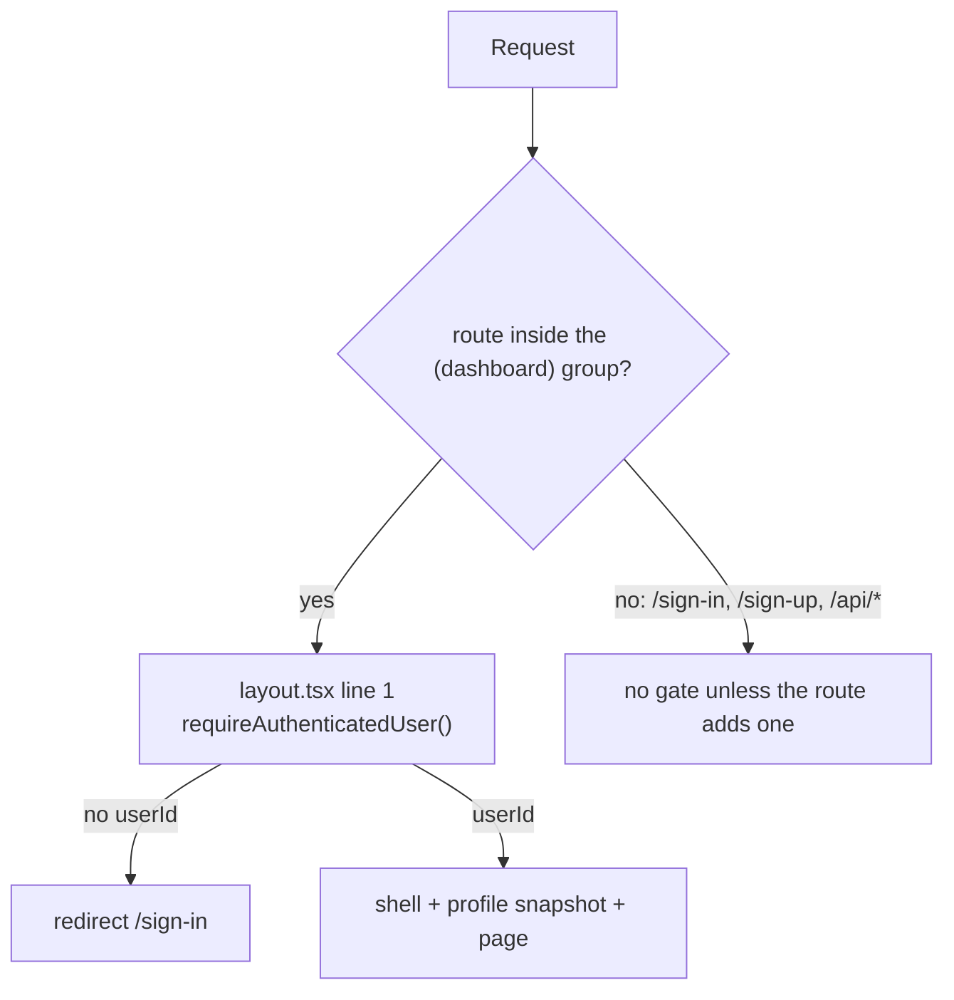
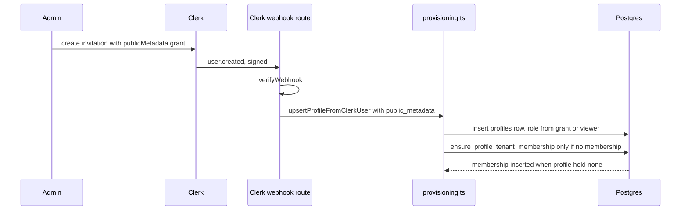

# Auth, Identity and Profile Provisioning

**Clerk is identity, never authority.** It supplies a verified `userId` for the session and
nothing else. The authority is `profiles.role` — the column RLS reads through
`app_private.current_role()` — so a signed-in user with **no** profile row has no role at all and
every caller narrows to read-only `viewer` (rule 4, `RULES.md` §1). The module's job is to get a
person from anonymous to "has a profile row", and then stop; what that row lets them do belongs to
[Tenancy](/openwiki/modules/tenancy.md) and the admin-side flow on
[User Provisioning and Membership](/openwiki/workflows/user-provisioning-and-membership.md).
[Architecture Overview](/openwiki/architecture/overview.md#the-auth-chain) owns the full chain.

## The single gate lives in a `data/` layer

`requireAuthenticatedUser()` ([`modules/auth/data/auth.ts`](/modules/auth/data/auth.ts#L18-L22)) is
four lines: read `auth().userId`, `redirect('/sign-in')` when absent, otherwise return it. It is
the only authentication check in the application.

Because `modules/<domain>/data/` is private to its module (rule 8, `RULES.md` §2 lint-enforced), and
because `app/` is the one place allowed to fetch from any module's `data/`, **only `app/` may call
it**. Two places do: [`app/(dashboard)/layout.tsx`](/app/(dashboard)/layout.tsx#L12-L13) as its
first statement, and [`app/api-docs/page.tsx`](/app/api-docs/page.tsx#L5), which sits outside the
route group. It is not a middleware pass — it re-runs on every render of the group layout, so
anything that reaches a protected tree *without* re-running it is a hole. The corollary is blunt: a
route outside `(dashboard)` is unguarded until it adds its own call, and `layout.tsx`'s very next
line accepts `clerkUserId` as given.

*The gate is per-render layout code, and only the dashboard group has it.*

`getAuthUserId()` alone is the softer variant: [`app/api/openapi.json/route.ts`](/app/api/openapi.json/route.ts)
uses it and answers `401` instead of redirecting, because a redirect is meaningless to a machine.
Do not swap one for the other inside a Server Component — `redirect()` is what stops the tree
rendering.

## Sign-in and sign-up

[`app/sign-in/[[...sign-in]]/sign-in-page.tsx`](/app/sign-in/[[...sign-in]]/sign-in-page.tsx)
exports `SignInCard`, driven by Clerk's `useSignIn()` hook so the UI is owned here and Clerk owns
the auth. `/sign-up` has no screen of its own: the route redirects to `/sign-in?sign_up=1`, which
opens the `SignUpModal` island. That modal deliberately does **not** activate the session — it tells
the user an administrator will assign their school and role, because a fresh self sign-up has
neither.

`?reason=auth-required` seeds the error slot, so a sign-in reached by redirect explains itself.

### Redirect sanitization

`redirect_url` arrives in the query string, so it is attacker-controlled.
`sanitizeRedirectUrl` ([`modules/auth/domain/redirectUrl.ts`](/modules/auth/domain/redirectUrl.ts#L12-L24))
is pure (rule 14) and returns `"/"` unless the value is a genuine same-origin path. Four traps it
closes, each of which browsers resolve off-site:

| Input | Browser treats it as | Why it is rejected |
| --- | --- | --- |
| `https://evil.com` | absolute URL | scheme in the value |
| `//evil.com` | protocol-relative origin | double leading slash |
| `/\evil.com` | normalized to `//evil.com` | any backslash |
| `javascript:` / `data:` | executed or inlined document | scheme after the first slash |

That is the open-redirect failure: the user signs in against the real app and is then handed to an
attacker's site wearing the app's credibility. [`tests/unit/redirect-url.test.ts`](/tests/unit/redirect-url.test.ts)
pins each trap plus the pass-through of `/batches?tab=2` and the empty-value fallback. The
sanitized value is both the destination of the signed-in bounce and the `redirectUrl` handed to
Clerk's OAuth start, so there is exactly one place to get this right.

### `session_exists` is a forwarding case, not an error

A sign-in attempt begun while the browser already holds a live session (another tab signed in)
comes back from Clerk as a `400` with `errors[].code === 'session_exists'` — delivered either in the
result object or thrown. Showing it puts a red wall in front of a user who is, in fact, signed in.
`isSessionExistsError` ([`modules/auth/domain/sessionExists.ts`](/modules/auth/domain/sessionExists.ts#L9-L12))
is the pure detector: it scans `errors[]` for that code and returns `false` for a bare `Error`,
`null`, or an empty array ([`tests/unit/session-exists.test.ts`](/tests/unit/session-exists.test.ts)).
The card checks it at six call sites — password, MFA, device verification, Google SSO, account
create and submit — and each one calls `continueExistingSession()`, which navigates to the
sanitized destination instead of setting the error string.

The Google path is orchestrated by `startGoogleSignIn`
([`modules/auth/domain/oauthSignIn.ts`](/modules/auth/domain/oauthSignIn.ts#L26-L39)) rather than
inline, so it can be tested with a fake client. Its load-bearing detail: a stale `status` left by an
abandoned attempt must be **awaited**-cleared with `reset()` first, because `sso()` silently declines
to start when it sees a non-empty status and surfaces no error.
[`tests/unit/oauth-sign-in.test.ts`](/tests/unit/oauth-sign-in.test.ts#L8-L50) models the mutable
field rather than call order, so an un-awaited `reset()` fails the test the way it failed in
production.

## The webhook: unauthenticated by design, signed by Clerk

[`app/api/webhooks/clerk/route.ts`](/app/api/webhooks/clerk/route.ts) has no session to check — it
is Clerk calling, so it verifies the body signature with `verifyWebhook()` against
`CLERK_WEBHOOK_SIGNING_SECRET` and answers `400` on failure. No `proxy.ts` exclusion is needed: the
middleware matcher already covers `/api(.*)` and only stamps a header, gating nothing.

| Event | Effect |
| --- | --- |
| `user.created` | insert a `profiles` row — `viewer` unless an invitation grant parses |
| `user.updated` | sync `full_name`/`email`, then repair a missing invitation membership |
| `user.deleted` | set `is_active = false` |

It is the **only** `service_role` path (rule 3): no session exists yet, so
[`modules/auth/data/provisioning.ts`](/modules/auth/data/provisioning.ts) runs on the client that
bypasses RLS. A thrown provisioning error becomes a `500` so Clerk retries.

### The provisioning rules

- **Self sign-up grants nothing.** The insert writes `role: viewer` and no membership row. Correct
  by construction: the sign-up copy promises an admin will assign school and role (ADR-005), and
  self sign-up must never confer tenant access.
- **Update never re-grants.** Role and `is_active` are not in the update's column list, so no Clerk
  profile edit — or a re-delivered `user.updated` — can change what a person may do. Role stays
  admin-managed in the app.
- **Membership is written only when the profile holds none.** `ensureTenantMembership()` calls the
  security-invoker `ensure_profile_tenant_membership` RPC
  ([migration](/supabase/migrations/20260906120000_ensure_invitation_membership_atomic.sql#L1-L35)),
  which locks the profile row, checks for memberships and inserts in one transaction. An existing
  membership therefore wins: a grant can never add a second school or move a person an admin already
  seated. The atomic zero-membership gate is also what makes `is_default: true` honest, and it is why
  a duplicate-key error (`23505`) is accepted rather than treated as failure. Any other error is
  logged and rethrown — the update path reaches the same helper, so a retry closes a half-applied
  creation instead of stepping over it.
- **Delete deactivates, never hard-deletes.** A cascade or orphaned FK would destroy the compliance
  audit trail, and `current_profile_id()` already filters `is_active = true`, so access stops at the
  next request while the history survives.
- **Update runs the membership repair only for an existing profile with a parseable grant.**

### Why invitation metadata can be trusted

`profiles.clerk_user_id` is `not null unique`, so no profile exists before the person signs up — an
admin inviting a stranger has nothing to write a role onto. The grant is parked on the Clerk
invitation's `publicMetadata`, which Clerk copies onto `User.publicMetadata` on sign-up.

It is trusted for one reason only: `publicMetadata` is writable **from the Backend API alone**, never
from the client, so the person signing up cannot author or tamper with what arrives with them. It is
the inviting admin's authority the webhook honours. That makes it the single narrow exception to
"provisioning never grants tenant access" — an admin assignment made before the account existed.
`parseInvitationGrant` ([`modules/auth/domain/invitationMetadata.ts`](/modules/auth/domain/invitationMetadata.ts#L67-L78))
is strict and all-or-nothing under namespaced keys: a half-formed grant is `null`, which costs an
admin one manual assignment, while a partial apply could hand out access nobody authorised.

"Insert only" has a stored-procedure corollary: metadata edited onto an *existing* user through the
Backend API can still seat a tenantless profile via the repair path, but it can never overwrite a
role or a membership an admin has already set here.

## Applying an invitation, end to end

*The invitation is the only path that arrives carrying a grant; everything else lands tenantless.*

## Failure modes worth knowing

- **No profile row yet.** Signed in, `userId` real, RLS resolves `current_profile_id()` to `NULL`,
  every predicate fails, reads return zero rows. This is correct and looks like a broken dashboard —
  it is why the gate returns an id, not a profile, and why `/users/new` exists.
- **Provisioning insert fails, webhook still answers `200`.** Historically permanent: Clerk never
  retried and every later delivery skipped the grant. The `user.updated` repair path is the fix, not
  a second write path.
- **Profile read fails in the layout.** `role` is `null` and the tenant list empty — the menu shrinks
  honestly. Nothing is granted, so nothing is widened.
- **Deactivated profile.** `getAuthUserId()` still returns an id, so the layout renders and the page
  renders under it; only RLS denies. Deactivation is not a sign-out.
- **`session_exists` treated as an error.** The user is stuck on a red card while already signed in.
- **A redirect value passed to navigation unsanitized.** Open redirect.

## Where not to look for authority

`publicMetadata` is not role authority and neither is any token claim — see
[Role Authority](/openwiki/workflows/tenant-scoping-and-role-authority.md). `role.ts` in this module
separates `resolveTrustedRole` (the DB column) from the `?role=` presentation override; both are that
workflow's material, not this page's.