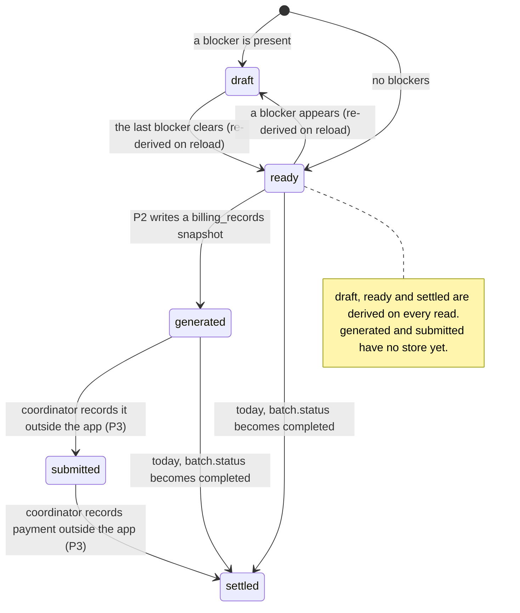

# Billing Engine — Readiness, Packet Queue and Generated Documents

Billing is the only workflow where a wrong number reaches a signed document. ADR-001 (**V2**/**W1**/**AA2**) made billing a **document-generating engine** — the app populates the school's own `.docx` templates for Training Cost, TSF/Allowance and Entrepreneurship. The Assessment Center bills the Assessment Fee separately, so it is out of scope and deliberately absent from the `billing_type` enum (`supabase/migrations/20260910120000_add_adr001_billing_domain.sql`). Every status on this screen is internal only — TESDA SIS/T2MIS/BSRS stay authoritative (ADR-003 **P3**, RULES.md rule 27).

ADR-003 is the second half of the design. It **amends ADR-001 §4** (RULES.md rule 30) by adding a *packet queue* over the engine — tracking surface only — while explicitly upholding **NoLedger** (no envelope, no balance, no over-billing guard; the TESDA Provincial Office reconciles) and **JJ1** (alerts computed on read; no cron, no email). Neither the queue nor the statements it opens get a store of their own.

`modules/billing/` splits into pure `domain/` rules (rates, tracks, statement, amount-in-words, readiness, packets), a `data/` projection, and `ui/` (the queue and the statement modal). Everything is a deterministic function of a batch plus its documents, so any of it can be unit-tested against a fixed fixture without a database.

## Two signals that must never be merged

`domain/readiness.ts` exports both, and the split is the module's most-regressed invariant (restated in `modules/billing/README.md`):

- **`isBillingReady(batch)`** — `status === 'ongoing' && progressPct >= BILLING_READY_THRESHOLD` (80). Threshold only, no document component. This is the **prep signal**: `modules/batches/domain/alerts.ts` renders it as the green "reached the billing progress threshold" row and `BatchCard`/`BatchModal`/`TableView` render it as a badge. Touching no documents, it says nothing about whether the paperwork is in hand, so no alert or badge copy may claim readiness to bill.
- **`billingGate(batch, docs)`** — ADR-001 §Ready: threshold reached **and** every required supporting document on file. It returns `thresholdMet`, `docsVerified`, the counts, and `ready` so the UI can show each half with its own text and icon (rule 23). This is the generate-gate.

Merging them fails in both directions: folding documents into `isBillingReady` silences every dashboard badge for a reason it does not display, and dropping the document half lets a document-less batch generate a statement.

`docsVerified` requires `requiredTotal > 0`, so an empty requirement catalog reads **not verified**, never auto-ready. `tests/unit/billing-readiness.test.ts` pins all four combinations including the zero-requirement case.

Where the halves meet: `isBillingReady` re-requires `status === 'ongoing'`, so a **completed** batch has `ready: false` even at 100 % with a full document set. `buildBillingCards` filters completed batches out, so only a caller building a card directly meets that.

## The rate reference and its fallbacks

`domain/rates.ts` is ADR-001 **BB1**'s component table flattened to constants (TSF ₱160/day, New Normal ₱1,000, Insurance ₱100.80, Entrepreneurship ₱800, ₱8 nominal session hours, plus per-qualification nominal hours and training cost). Per **BB1-prune** it holds current rates only — no `circular_no`, no `effectivity_date`. Version safety lives in the batch snapshot, so a rate change must never be made by editing history.

Two lookups carry silent fallbacks, and both matter for a new qualification:

- `nominalHoursFor` falls back to `DEFAULT_NOMINAL_HOURS` (360) and `trainingCostFor` to `DEFAULT_TRAINING_COST` (15,000), so an unmapped qualification bills **without complaint** at a stand-in rate.
- Only the Agricultural Crops ₱15,390 figure is verbatim from the source template; the other per-qualification costs (and Cookery's hours) are representative until a real `program_qualification_rates` source lands.

## Tracks: Entrepreneurship is CFSP-only

`domain/tracks.ts` is the **TVI-scope** list. `tracksForProgram` always returns Training Cost and TSF/Allowance and appends Entrepreneurship only when `isCfsp(program)` — a trimmed, case-insensitive `'CFSP'` compare. TWSP routes Entrepreneurship through PAFSE, so on a TWSP batch the tab simply does not exist rather than rendering empty.

One `docTitle` is program-aware at build time: on TWSP the TSF cover reads "Training Support Fund (TSF)" instead of the CFSP title that would claim a New Normal component the program does not pay. Cover copy is compliance copy, not cosmetic.

## The statement builder

`domain/statement.ts` — `buildStatement(batch, trackId, tenant)` — is the whole document engine, kept pure so the preview and the eventual `.docx` share one source of truth. It builds the cover header (school, region, uppercased program banner, docTitle, `batch.rqmCode` or `null`, a `${hours} hrs` training period), dispatches on the track, and finalizes with `totalLabel`, `grandTotal` and `grandWords`. `BillingStatementModal` is its only consumer and re-derives on every render, so nothing is memoized across track tabs.

Math per track, all per scholar:

| Track | Per-scholar total |
| --- | --- |
| `training_cost` | `trainingCostFor(qualification)` (flat) — the artefact reproduces the source docx exactly |
| `tsf_allowance` | `tsfDaysFor(qualification) × ₱160` plus, **CFSP only**, `₱1,000` New Normal and `₱100.80` Insurance |
| `entrepreneurship` | `₱800` flat |

`tsfDaysFor` is `Math.round(nominalHoursFor(q) / 8)`, so 360 hours → 45 days → ₱7,200, ADR-001 §BB1's worked example.

The builder is honest about a missing roster: `batch.scholars_list ?? []` yields a zero-row table and grand total 0 rather than an error. `scholars_list` is **not** part of the batches snapshot — only the report route attaches it via `attachRoster`, and that fetch is already ordered `last_name`, `first_name`, `id`, satisfying ADR-001 **Order**. A batch from any other surface previews an empty statement.

Not implemented, and a change must not assume them: ADR-001 **FF2**'s absence deduction on the final tranche (no per-scholar absence count is passed in), **Flag-3x**'s exclusion of dual-trained scholars from the ₱800, tranche percentages, and signatories/letterhead/addressee from `tenant_settings`. The "60 training-day split" and "calendar-duration split" captions on the tracks portray the ADR's tranche schedules; they are not a computed ladder.

`domain/amountInWords.ts` renders `grandWords` (**AmtWords**): "… Pesos and NN/100 only", centavos padded to two digits. A negative or non-finite amount collapses to "Zero Pesos only" rather than emitting a malformed string.

## The packet projection

`domain/packets.ts` implements ADR-003 **P1**: a packet is a **projection** of `(batch_id, billing_type, tranche_no)`, not an entity and not an invoice — which is why NoLedger survives intact. `buildPackets` emits one packet per batch and numbers the display-only `ref` as `PKT-NNN`; every identity field is derived, and the table stores none of them.

Two consequences of the derivation being incomplete:

- **One packet per batch.** The type and tranche axes are named in the key but not in the projection, so a batch that will eventually bill three documents bills one row.
- **The ref is positional.** It is stable only by position, so `filterPackets` matches a number that means nothing outside the screen; searching `INV-042` (the design's label) finds nothing. The search box really matches ref, batch name, qualification, school code and program.

`state` is derived, never read:

- `settled` when `batch.status === 'completed'` (the due label then becomes "Settled") — an ADR-002 prototype portrayal, since no state store exists;
- `ready` when `blockers` is empty;
- `draft` otherwise.

Blockers are human sentences assembled from progress below `PACKET_READY_THRESHOLD` (80, the same number as the gate threshold, declared separately) and unsatisfied supporting documents. If the requirement list is empty the blocker is "catalog unavailable" instead — an unevaluated checklist must never look satisfied. The detail panel prints `blockers.join(' ')` and is the only place a reader learns why a packet is stuck.

`summarizePackets` sums over the projection into four tiles and excludes overdue packets from the ready and pending buckets. "Recorded as paid" is an **observation** total (§P3/§P6), labelled with where it comes from and never a reconciliation.

### Pre-billing document scope

`PRE_BILLING_STAGES = ['aou', 'ntp', 'tip', 'train']` deliberately excludes `assess` and `bill` stage documents, because billing *produces* those and requiring them would make readiness circular and leave Generate permanently dead. `data/billing.ts` holds the same set as `SUPPORTING_DOC_STAGES` and additionally requires `r.critical`, so only critical pre-billing requirements reach the denominator.

Both surfaces route through `isDocOnFile` (`modules/documents/domain/compliance.ts`), the single document-compliance rule. Under ADR-004 **D4** gating inverts the measurement rule: an **untracked** requirement reads as not on file, never satisfied, and so does `pending`. `submitted` **is** satisfied — ADR-001 §7.2.4 accepts an uploaded manual attendance sheet as billing evidence, so verification is not a release blocker. A packet doc keeps `'untracked'` as its own status and renders "not tracked" rather than flattening into `missing`, which would assert a document is absent that nobody ever recorded.

Note the double scope closure: the queue filters by stage inside `buildPacket` while `deriveDocReadiness` filters the same list again. An empty list closes both gates independently — neither opens on an unloaded catalog.

### Due dates and overdue are derived (P5)

`daysToDue` is `batch.daysToBilling`; the label is "Nd past due" / "Due today" / "Due tomorrow" / "Due in Nd". Nothing stores a packet due date; `isOverdue` is `state !== 'settled' && daysToDue < 0`, so the screen inherits the route's "Data as of" stamp instead of drifting. What is derived is the *countdown*, not what P5 specifies: P5 derives a `due_date` from the tranche schedules, while this derives it from the recorded `batches.billing_deadline`. ADR-008 **BD5** sanctions the arrangement — the recorded deadline is the coordinator's batch-level commitment, the packet stays derived, and reconciling the two is a future ADR.

`daysToBilling` comes from `daysUntil(row.billing_deadline ?? null)`, and `daysUntil(null)` returns the `Infinity` sentinel. A batch with **no recorded deadline** therefore carries `daysToDue: Infinity` and renders the literal label "Due in Infinityd" while counting as neither ready-pending nor overdue (BD2 asks for an explicit unavailable state). `urgencyTier` already maps a non-finite value to `muted`; the packet formatter does not.

### Packet lifecycle

Only `ready → generated` would append to `billing_records`; `submitted` and `settled` are a person's marks (P3). Of the five states, only `draft`, `ready` and `settled` are ever produced by `buildPacket` — nothing in the UI produces `generated` or `submitted`, and closing the preview toasts "nothing was saved... nothing was submitted to TESDA".

Solid arrows are what `buildPacket` can actually produce; the others are ADR-003 **P2**/**P3** targets with no writer in the module. Because the state is re-derived on each read, the draft ⇄ ready edge is a gain or loss of blockers, not a stored transition — and jumping straight to `settled` is the only way a packet ever leaves `ready` today.

## The data projection

`data/billing.ts` is the only place the screen's inputs are assembled: `deriveDocReadiness` (critical pre-billing requirements only, via `isDocOnFile`), then `billingGate`, `tracksForProgram` and `resolveTenant`. `BillingCard` carries the whole `Batch` precisely because the statement modal needs it.

`resolveTenant(batch.tenantId, [])` is called with an **empty tenant list**, so the statement header prints the raw tenant UUID as the school name and leaves the region blank. Rule 6 forbids leaking internal IDs to the UI; this is a known breach on a document-shaped surface, not a design choice — passing the route's `resolved.profile.tenants` is the fix.

`buildBillingCards` drops completed batches (their billing is history) and sorts ready-first, then by descending progress.

**The catalog gap is mostly vestigial.** The route still passes `const documentRequirements = []` while `Batch` now carries `documentRequirements` from the embedded `scholarship_programs.program_document_requirements` select, and the documents route builds its catalog with `requirementCatalogOf(batches)` over the same field. Until billing reads it, the gate and every packet blocker stay closed for every batch on a live database.

## Route and access

`app/(dashboard)/t/[tenantCode]/(sections)/billing/page.tsx` is a thin Server Component — sequence: `requireScope`, profile snapshot, the trusted-role redirect, tenant-access fold-in, `getBatchesSnapshot`, then packets and cards. `/(dashboard)/billing` is only a `legacyRoute('billing')` forwarder to the caller's default school.

**The trainer denial** runs on `resolveTrustedRole(dbRole)` — `profiles.role` only — and `redirect('/trainer')` fires **before** the batch fetch, so no billing figure is ever serialized into a trainer's payload (rule 5, the omission half; see [auth-and-provisioning](/openwiki/modules/auth-and-provisioning.md)). `?role=` is presentation only: `toOfficeRole(await resolveRouteRole(params, dbRole))` runs *after* the redirect and picks the render variant, so a real trainer adding `?role=admin` still lands on `/trainer`. `toOfficeRole` narrows anything that is not an office role — including a previewed `trainer`, for which the view has no variant — to read-only `viewer`.

The view is a thin client island over these two projections. It owns selection (packet `ref`), the search box and the open preview, but no rule. Its one join is `cards` to packets on `batchId`, and it gates both the header's "Generate packet" and the detail panel's "Preview statement" on `gate.ready` — the header falling back to the first generable card. Choosing from either therefore means the same thing; neither action trusts the packet state chip.

`canWrite` (`role !== 'viewer'`) hides Generate and Preview, and a viewer also gets an inline read-only banner. RLS is the boundary and is stricter than the gate: the `billing_records` policies grant SELECT to an explicit `admin, coordinator, viewer` allowlist — deliberately **not** `can_read_batch`, which would admit an assigned trainer — and INSERT only to `can_manage_tenant`, with no UPDATE or DELETE policy, so append-only is enforced by the database rather than convention.

Guard ordering follows rule 19: the `forcedState === 'denied'` preview returns first, then `syncFailed && batches.length === 0` returns the retry state **before** the "No batches to bill yet" and `no-tenant-access` branch, so a failed fetch can never read as an empty queue. `?state=` forces `denied`/`empty`/`sync-failed`/`stale`; an `ok` snapshot that is genuinely non-empty still falls through to the view's inline sync-failed banner.

Footer copy carries the rule rather than the design's framing: the preview footer reads "Internal working copy · TESDA SIS and BSRS remain authoritative", and the queue's closing callout explains that generation appends a snapshot and never overwrites one. Any new copy here inherits ADR-003 **P3** — no TESDA approval or official-submission implication.

## Failure modes worth knowing

- **Merging the two signals** — see above; also makes the alert row claim document readiness it never checked.
- **Adding `assess`/`bill` to `PRE_BILLING_STAGES`** — Generate goes dead for every batch.
- **Treating untracked as satisfied** — a batch whose catalog never mentioned a document passes a gate nobody verified; do not "fix" this by mapping untracked to `submitted`.
- **Unmapped qualification** — falls back to 360 hours / ₱15,000 and bills silently; add the row rather than editing the fallback.
- **Assuming a stored state or a ledger** — nothing is persisted: state and due date are recomputed each read, and Generate writes no `billing_records` row yet.
- **Deriving a packet due date from the tranche schedule without revising ADR-008** — BD5 leaves today's `billing_deadline` countdown sanctioned, but a second derivation must not quietly disagree with BD3's urgency read.

## Planned surface — do not assume it exists

- `.docx` population (ADR-001 §W1) and the append-only `billing_records` snapshot (the table and its policies exist; no code queries or writes it).
- The 20/50/80 (`7.2.3`) TSF and 5.1.x Training Cost tranche ladder with per-tranche checklists (**LL1**); the screen shows one compound gate.
- Billing reading `Batch.documentRequirements`, a real tenant list, a `billing_records` fetch behind the same `BillingCard` shape, FF2 absence deduction, and signatory/letterhead population from `tenant_settings`.

Tests: `tests/unit/billing-readiness.test.ts` pins the gate matrix, and `tests/unit/batches.test.ts` covers the `billing_deadline` mapper (including the `Infinity` no-deadline case) plus one `buildStatement` assertion (a real RQM code, or `null`). Nothing tests `pesosInWords`, `tsfAmount`, `buildPacket` or `summarizePackets`, so the math that reaches a document and the overdue tally are unpinned — a golden-file fixture per track is the cheapest real protection.

<!-- openwiki: broken internal link [/openwiki/workflows/billing-packet-and-statement.md] file "/openwiki/workflows/billing-packet-and-statement.md" does not exist. Fix the href or restore the target, then delete this comment. -->
The end-to-end walk is [billing-packet-and-statement](/openwiki/workflows/billing-packet-and-statement.md); the document status ladder is [documents-and-evidence](/openwiki/modules/documents-and-evidence.md); `daysToBilling`, urgency and the ADR-008 deadline belong to [batches-and-lifecycle](/openwiki/modules/batches-and-lifecycle.md).
