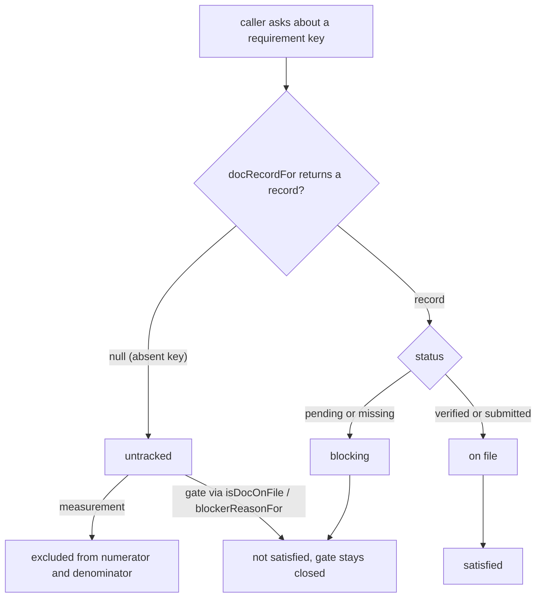

# Documents and Evidence

`modules/documents` owns FR-06: the requirement catalog a program is audited against, the per-batch
status map those requirements resolve to, the compliance and blocker arithmetic over both, and the
`compliance-evidence` bucket. It is the module ADR-004 exists to defend, because the interesting part
is not the happy path but what happens when a caller asks about a requirement the batch never carried
a record for.

A batch embeds `documents: Record<string, DocRecord>` keyed by `document_key`, plus its own
`documentRequirements`. `DocStatus` is a four-member union — `verified`, `submitted`, `pending`,
`missing` — that mirrors the DB `document_status` enum.
See [Data Model and RLS](/openwiki/architecture/data-model-and-rls.md) for the column and policy
detail behind both, and
[Module Boundaries and Data Patterns](/openwiki/architecture/module-boundaries-and-data-pattern.md)
for why the domain rules below must stay I/O-free.

## The two data layers and the obligation to keep them in sync

Two independent paths produce that map:

- `modules/documents/data/documents.ts` — `getBatchDocumentsSnapshot(batchId, requirements)` plus
  its `mapDocumentRows`. Used by any caller that already holds the catalog; nothing calls it yet.
- `modules/batches/data/batches.ts` — `mapDocumentsMap(rows,
  scholarship_programs.program_document_requirements)`, fed by the embedded select in
  `getBatchesSnapshot`. This is the path the `/documents` screen actually takes.

`mapDocumentRow`, the `MISSING_DOC` constant, the `DOCUMENT_ICONS` map and the backfill loop are
**duplicated** between the two files. The duplication is not sloppiness: `eslint.config.mjs` makes
every module's `data/` private to that module (`import/no-restricted-paths`), so `batches.ts` cannot
import `documents.ts`. The cost is a standing obligation — a change to the backfill, the timestamp
preference, the `source` label or an icon must land in both files or the two producers of
`Batch.documents` drift.

Both backfill every key in the batch's **own** program catalog to `MISSING_DOC`
(`status: 'missing'`) before overlaying real rows. So "no submitted row" is decided at the data layer,
not in each caller (ADR-004 **D1**). A key that is *still* absent after that backfill is one this
batch's catalog never listed — the only remaining absence, and the one the domain layer interprets.

## The requirement catalog

`program_document_requirements` rows *are* the catalog, scoped per `program_id`, so "which documents
must this batch carry" is a data question, never a hardcoded list. `getDocumentRequirementsSnapshot`
returns it in `sort_order`; its snapshot type deliberately has **no** `no-tenant-access` member,
because the catalog is reference data — a caller attached to no school still reads the same TWSP/CFSP
requirements, and an empty catalog therefore means "unseeded", never "you have no access".

The catalog is also *configured data*, not a closed enum. `mapRequirementRow` resolves a display icon
from a `Partial` key map with a generic fallback, and `buildEvidencePath` shape-validates
`document_key` rather than checking membership. Anything that assumes a fixed key set is wrong at the
seam.

Consequently a requirement added after a batch started legitimately diverges from that batch's
tracked keys: the new row gets backfilled on the next read, the older snapshot — or a requirement from
a program the batch is not in — does not. Merging the catalogs was rejected precisely so this mismatch
stays visible; ADR-004's whole job is to make it legible instead of fatal.

## Untracked: a third state carried by absence

Read every status through `modules/documents/domain/compliance.ts` — the single home of the rule
(D6). Indexing `batch.documents[key]` outside a `data/` layer is the pattern the ADR removes, and an
unguarded `documents[key].status` threw a `TypeError` on live batches before it landed.

- `docRecordFor(batch, key)` returns the record or **`null`**. `null` *is* untracked.
- There is deliberately **no `'untracked'` member of `DocStatus`** (D5). The union mirrors the DB enum
  and is assigned straight off a row; a UI-only variant no row can produce would force every consumer
  to handle a phantom case. Untracked is represented as absence and read only through `docRecordFor`.
  The one exception elsewhere is `PacketDoc.status` (`DocStatus | 'untracked'`), a derived projection.

Two consumers then answer the same batch in opposite directions, and that divergence is the design:

| Consumer | Function | Untracked answer |
| --- | --- | --- |
| Measurement (KPI, donut, matrix completeness, analytics) | `summarizeDocCompliance` / `summarizeBatchDocCompliance` / `summarizeOwnCatalogCompliance` | excluded from numerator **and** denominator |
| Gating (billing readiness, packet blockers, blocking strip) | `isDocOnFile` | **not satisfied** — the gate stays closed |

`pct()` returns `null` when the denominator is zero, so `onFilePct` and `verifiedPct` are `null` —
never `0`, never `100` — when nothing is tracked. That `null` is the type-level forcing function: the
UI must render "—" plus words, never a percentage (RULES.md rule 23). `isDocTracked` answers the "does
the batch carry this at all" question that alerting uses to avoid firing on a catalog nobody has
recorded against.

The reason for the asymmetry is stated in the module header: a measurement that counts an unseen
requirement as verified reads as a cleared checklist, one that counts it as missing asserts absence of
a document nobody required, and *both* directions of the deliberate split fail safe. A gate that
treated untracked as satisfied would open on evidence nobody has seen — the failure mode this page
exists for.

*The same absence measures as "not judged" and gates as "not satisfied" — the ADR-004 asymmetry.*

`blockingDocuments` / `blockerCount` / `blockingDocumentNames` build the named strip on top of D4.
They return only `label`s, because FR-06 AC-1 forbids rendering a raw `document_key`, and the blocker
vocabulary is its own `DocBlockerReason` (`untracked` / `missing` / `pending`) rather than a subset of
`DocStatus`. `blockingDocuments` partitions criticals first rather than sorting, and an empty catalog
yields an empty summary — asking about nothing is not a problem, unlike measuring nothing, which is
unknown.

## The matrix screen

`DocumentsView` is a client island whose columns are `requirementCatalogOf(batches)` — the union of
every shown program's catalog, first occurrence per key, **for display only**; completeness is scored
per batch against its own `criticalRequirements`. The union is what creates untracked cells: a Program
A requirement on a Program B column.

The screen's own `docOf()` narrows with `b.documentRequirements.some(...)` *before* calling
`docRecordFor`, so a leftover row for a key outside the batch's catalog still renders "Not tracked"
rather than as a live status. Untracked cells are `disabled`, carry the `.na` treatment with an
explanatory `title`, and are skipped by the click handler — there is nothing to preview and nothing to
attach against. With no catalog at all the view renders one "requirements unavailable" state instead
of a grid of empty rows.

State ladder per cell: `verified` and `submitted` open `FilePreviewModal`; `pending` and `missing`
raise an "Attach document" toast for writers; `na`/untracked is inert. Verification is an **admin-only
override in local state** — `{ status: 'verified', verifiedBy, verifiedDate }` keyed `batchId:key` —
and is refused when the profile has no display name, so a record is never attributed to nobody. No
write reaches the database from this screen.

The route applies `withTenantAccess` to the batch snapshot before picking a batch, and a
`no-tenant-access` read renders `NoTenantAccessState` rather than the ordinary empty state — an
all-blank matrix would read as "your batches are missing everything" instead of "you have no school".
Guard order in general is the data-pattern page's; the one local rule is that `documents` uses the
resolved `profiles.role`, never `?role=`.

## Evidence storage

The pure half lives in `modules/documents/domain/evidencePath.ts`; `modules/documents/data/evidence.ts`
is the Storage I/O around it. Nothing calls either yet — the screen's upload control is a toast — so
treat both as written and unexercised.

**Path convention:** `{tenant_id}/{batch_id}/{document_key}/{filename}`. This is a security boundary,
not formatting. The `compliance-evidence` bucket's policies authorize select, insert and update with
`app_private.can_access_tenant((storage.foldername(name))[1]::uuid)` — Postgres splits the object name
and hands **segment 1** to the membership function, so `segment 1 IS the tenant check`. A `filename`
containing a `/` does not produce a weird name; it shifts every segment and relocates the object into a
folder whose first segment is no longer the caller's tenant. A tenant the caller also belongs to is
then not denied at all.

The path must therefore be **derived from identity, never accepted from the client**: the browser
supplies the file name, but tenant, batch and key come from the loaded batch, and the server re-derives
the key from three anchors. `buildEvidencePath` validates in a fixed order — tenant id, batch id,
document key, filename — so the outermost problem is the one reported. Ids are anchored UUID v1–v8
regexes (they are interpolated *before* Postgres casts them); `document_key` is
`^[a-z0-9][a-z0-9_-]{0,63}$`; filenames reject separators, C0/C1 control characters, bare `.`/`..`,
percent-encoded separators (`%2f`, `%5c`, `%2e%2e`) that clients decode in transit, surrounding
whitespace, and length over 200. That guard is also what keeps the `documents_batch_id_document_key_key`
upsert key unambiguous once a file name is appended to it.

Every entry point returns a discriminated result instead of throwing, because FR-06 needs *invalid
type*, *upload rejected* and *upload failed* to stay three distinguishable states;
`EVIDENCE_REJECTION_COPY` supplies copy per reason and leaks no identifier, table or bucket name.
`tests/unit/evidence-path.test.ts` is mostly separator-injection coverage, including that the tenant
check runs first.

`validateEvidenceFile` enforces `EVIDENCE_MAX_BYTES` (52 428 800) inclusively, rejects
non-finite/≤0 sizes, normalizes MIME parameters and case, and tests size before type so an oversized
file is not blamed on its format. The constant must stay in step with the bucket's own
`file_size_limit`; the test asserts the literal.

Bucket policy facts that shape the code:

- The bucket is **private** (`public = false`). Every read is a signed URL —
  `getSignedEvidenceUrl` defaults to 300 s, and no public-URL path may be added.
- `uploadEvidence` passes `upsert: false`, so re-submitting evidence creates a new object and leaves
  the prior one intact; a compliance archive must not silently overwrite a file an auditor referenced.
- The canonical migration has select/insert/update policies and **no DELETE**. `20260910120000` adds
  one gated on `can_manage_tenant` (tighter than its `can_access_tenant` siblings, because reading and
  uploading are ordinary trainer work and destroying evidence is not). `evidence.ts` still exposes no
  `deleteEvidence`; the policy is the seam.

`getSignedEvidenceUrl` re-parses the stored path back through `buildEvidencePath` and rejoins the
trailing segments with `/`. `documents.storage_path` is unconstrained `text`, so a hand-edited row could
carry anything; rejoining rather than taking segment 4 makes a key with extra segments fail
`isSafeFilename` instead of validating a shorter path than the one that gets signed.

Every call returns `unconfigured` when Supabase is unset and `sync-failed` — with an opaque message
that never reaches the screen — when Storage refuses or throws; a reply with no URL and no error is
also a failure. Note the surfaces ahead of this code: `getSignedEvidenceUrl` is never called, so
`FilePreviewModal` treats any non-null `file.url` as present, derives a fake `name.pdf`, and renders a
simulated page. Today `mapDocumentRow` sets `url` to `storage_path` (a bare object key) or
`external_url`, so the uploaded-file path is untested end to end.

## Failure modes worth knowing

- **Treating untracked as satisfied.** A batch whose catalog never mentioned a document passes a gate
  nobody verified. Do not "fix" it by mapping untracked onto `submitted`.
- **Reading `batch.documents[key]` directly.** Works with a fixture, throws on any live batch whose
  catalog lacks the key.
- **Rendering a `document_key`.** The flag is internal; render `label`.
- **Overwriting on upload.** `upsert: true` loses the version an auditor may cite.
- **Adding a public bucket URL.** The bucket is private by design.
- **Fixing only one copy of the duplicated mapper or icon table.** The two producers of
  `Batch.documents` then disagree about what "no row" means.

## Tests

`tests/unit/doc-compliance.test.ts` (D1–D4, `null`-not-zero, `requirementCatalogOf` union order,
alert suppression), `tests/unit/doc-blockers.test.ts` (untracked blocks, labels never keys, and an
explicit "gate and measurement disagree" test so a refactor cannot quietly align them),
`tests/unit/evidence-path.test.ts`, `tests/unit/documents.test.ts`. These four pins cover the domain
helpers, the duplicated mappers and the path builder only; the Storage I/O half of `evidence.ts` is
mocked or uncovered, so a green suite is not proof of the bucket round trip. RLS and the live upload
are unverified pending the Clerk/Supabase auth toggles.

The end-to-end flow these pieces serve is in
[Document Compliance and Evidence](/openwiki/workflows/document-compliance-and-evidence.md); the gate
that depends on `isDocOnFile` is in [Billing](/openwiki/modules/billing.md).
