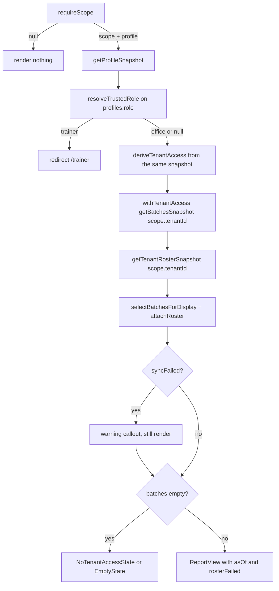

# Reports, EGACE and the T2MIS Export

`modules/reports` is FR-15 — the school's reporting surface and the only place a file leaves
this app. Two things are easy to get wrong about it:

- **Producing the file is not a submission.** TESDA SIS/T2MIS/BSRS stay authoritative, so no copy
  here may say a report was *filed* or *sent* (rule 27). The screen builds a working `.xlsx` and
  the browser downloads it.
- **The workbook is split across two modules on purpose.** The 48-column **layout** is
  [`modules/import-export/domain/t2mis.ts`](/modules/import-export/domain/t2mis.ts) — the same
  header contract the import side parses — while the **writer** lives here in
  `domain/xlsx.ts`. Reaching a sibling module's `domain/` is the legal direction under rule 8; a
  `data/`-to-`data/` import would have been blocked. Details of the layout belong to
  [CSV import and the T2MIS layout](/openwiki/modules/import-export.md); this page covers who
  fills the cells, the writing, and the screen around it.

The module has **no `data/` layer**. Its route fetches through `modules/batches/data` and the
folder holds only `domain/` and `ui/`, so there is no report-scoped snapshot type and nothing here
to follow the fetch → map → derive contract with. Rate the claim "no report data layer" as
deliberate: every number is derived from the shared batch snapshot plus the roster.

## The report route

`app/(dashboard)/t/[tenantCode]/(sections)/report/page.tsx` is the only caller. The order it does
things in is the contract.

1. **`requireScope()`** (`app/(dashboard)/tenant-scope.ts`) resolves the URL's school against the
   caller's memberships and hands back the cached profile with it. Null means the segment layout is
   already rendering the not-a-member / no-school / unknown state, and the page returns null.
2. **Trainer redirect, before any fetch.** `resolveTrustedRole` is called on `profiles.role` alone
   and a `trainer` is sent to `/trainer`. It is deliberately not `resolveRouteRole`: that resolver
   honours a `?role=` preview override, so a real trainer requesting `?role=admin` would slip past.
   The comment records that the route had no redirect while it rendered mock data — now that it
   reads live scholar-level outcomes, it must be *server*-denied like
   [billing](/openwiki/modules/billing.md), not merely absent from the sidebar.
3. **The membership verdict is reused, not re-fetched.** `deriveTenantAccess` reads the profile
   snapshot already in hand and the verdict is folded in with `withTenantAccess`, which rewrites
   only an `ok` batch snapshot — so "you belong to no school" can never mask a real fetch failure.
4. **A separate roster fetch.** `getTenantRosterSnapshot(scope.tenantId)` is awaited after the
   batch snapshot and its result is hung on the batches with `attachRoster`. Nothing else loads it
   (see below).
5. **One combined failure flag.** `syncFailed` is `snapshot.status === 'sync-failed' ||
   rosterSnapshot.status === 'sync-failed'` and drives an `InfoCallout` warning plus a Retry link.
   It renders *above* both the empty branch and the populated report, so a failed roster still
   shows a report with blank roster-derived cells — and, per rule 19's ordering warning, is not
   swallowed by the empty branch. `rosterFailed` is also passed to `ReportView` so the export can
   distinguish an empty workbook from a broken one.

`asOf` comes from `snapshot.fetchedAt` and only when the snapshot is `ok`, so the screen carries an
exact "as of" stamp (rule 24) and loses it rather than inventing one when the read failed.

**The gap worth knowing.** `unconfigured` produces no `syncFailed`, so a report rendered with no
Supabase environment looks empty and normal with no callout at all. That is the one guard state
this screen does not announce.

## The roster carries what no other screen should load

The roster is fetched here and nowhere else because it carries **contact, address and employment**
data that sits in `learner_details`, a one-to-one table existing precisely because RLS filters rows
and not columns. Its read policy names `admin`, `coordinator` and `viewer` and omits `trainer`
entirely, so **RLS returns no `learner_details` row to a trainer** and `mapLearnerRow` blanks all 25
detail cells to `''`. That is the second reason for the redirect: even if a trainer reached the
page, the cells they came for would be empty.

`getTenantRosterSnapshot` also pages the `learners` table 1000 rows at a time — the API caps a
response and silently drops the rest, which would shorten a large school's export with no error —
and takes a separate, second `batches` query for the `training_calendar_code` and
`tenant_qualifications → qualifications` facts the export repeats on every line. Both queries'
errors return `sync-failed`. The fetch shapes are covered in
[module boundaries and the data pattern](/openwiki/architecture/module-boundaries-and-data-pattern.md).

## EGACE as rates over an enrolled base

`domain/egace.ts` is pure (rule 14) and has no `EgaceCounts` source anywhere: no mapper sets
`Batch.egace`, so on live data every batch reads as untracked. The helpers are written for the day
one does.

- **Enrolled is the denominator, and it degrades safely.** `egaceVal(b, 'enrolled')` falls back to
  the batch's scholar count, a number that exists even when outcomes do not; every other stage
  returns `0` when the batch has no `egace` block.
- **Rates use a different base than the totals.** `computeEgaceTotals` sums enrolled over *every*
  batch, but `egaceRate` is fed `outcomeEnrolledBase(rows)` — enrolled summed over only the batches
  that record outcomes — so batches with no outcome data cannot dilute a rate. `ReportView` builds
  it as `egaceRate({ ...totals, enrolled: outcomeEnrolledBase(rows) }, v)`.
- **Zero denominators give `0`, not `NaN%`.**

**A `—` is not a zero.** A metric with no source renders an em dash plus what is missing, never `0`
(rule 23). `EgaceOutcomesTable` renders `—` per cell when `s.key !== 'enrolled' && !b.egace`, again
for `v === 0`, and once across the whole TOTAL row while `hasEgaceOutcomes(rows)` is false; the
Summary strip shows `—` and "Not recorded yet" off the same flag, and the table footnote switches
to "…aren't recorded in TVI-CAMS yet". The functional limit is documented by
`tests/unit/reports-domain.test.ts`: `egaceVal` alone can only return `0`, so "0 employed" and
"employment not tracked" are the same number and separate only by which batch supplied it. Adding
a live `egace` mapper means deciding which stages are *blank* versus genuinely zero — do not just
point the mapper at a column.

## Employment follow-up

`domain/employment.ts` selects the same three ways:

- **Cohorts** are batches with an `employmentFollowUp` record. Like `egace`, nothing sets it
  currently; `followUpDue` is metadata and does not gate selection.
- **Scholars** are the ones with `assessmentResult === 'Competent'` — certified, i.e. the
  population the ~6-month follow-up obligation applies to.
- **Totals** roll up `certified`, `employed` (wage *and* self-employed), `awaiting` and
  `unemployed`. The buckets deliberately **do not sum to `certified`**: `EMPLOYMENT_STATUSES.na`
  is `''`, so an uncaptured status counts as certified but lands in no outcome bucket rather than
  being counted unemployed, which would overstate a negative outcome in a TESDA report.
  `empTone` returns `neutral` for the same status, not red.

`employmentRate` is employed ÷ certified and `0` when nobody is certified. `EmploymentReportTable`
still prints `—` for an empty status cell and for occupation/employer/salary of anyone not
employed, so the neutral-badge case reads as missing rather than as a bucket.

## The XLSX writer

`domain/xlsx.ts` ships **no dependency** and is a hand-rolled zip-*store* archive — no compression,
so the XML parts are readable in the bytes — over the five minimal OOXML parts
(`[Content_Types].xml`, `_rels/.rels`, `xl/workbook.xml`, `xl/_rels/workbook.xml.rels`,
`xl/worksheets/sheet1.xml`). `buildXlsx(headers, rows, sheetName)` returns a `Blob` typed
`application/vnd.openxmlformats-officedocument.spreadsheetml.sheet`, row 1 the header, data from
row 2, all cells `inlineStr` (no shared-strings part), the sheet name escaped then truncated to
Excel's 28-character limit. It was moved out of the view component so it is unit-testable
(rule 35) and importable from the module's public surface (rule 8) — the same reason the layout
lives in `import-export/domain/`.

What a hand-rolled writer can get wrong, and what `tests/unit/report-xlsx.test.ts` pins instead:

| Failure mode | The test that fails first |
| --- | --- |
| A CRC-32 that disagrees with the IEEE polynomial | classic check vector `crc32('123456789') === 0xCBF43926`, and `0` for an empty payload |
| A zip Excel cannot open (lost local header or EOCD) | `PK\x03\x04` on the first four bytes, `PK\x05\x06` closing the archive |
| A part renamed or dropped | all five part paths still present |
| Rows numbered from 0 | `<row r="1">`, `r="2"`, `r="3"` and `A1`/`B3` cell refs |
| Unescaped `&`, `<`, `>`, `"` corrupting the sheet | inline value escaped to `&amp; &lt;w&gt; &quot;q&quot;` |
| `colRef` breaking past `Z` at column 27 | `<c r="AA1"` |
| A sheet name longer than Excel accepts | a long name absent from the output |

Not pinned, and the real risks: compression, styles, shared strings, and multi-sheet books. All
data is stringified, so a numeric cell will not be typed as a number in Excel.

`ui/exportXlsx.ts` keeps the DOM work — `buildT2misRows(rows, tenantOf)`, `buildXlsx` on
`T2MIS_HEADERS` into a sheet named `EGACE-Employment`, an object URL, an `<a download>`, and a
40-second revoke delay because revoking immediately cancels the download in some browsers. It
reports through a toast in every branch, including `Export failed` when the build throws. An empty
workbook is graded by `rosterFailed`: "Export unavailable" with a retry, not "Nothing to export".

An inline-string sheet has one trap beyond the tests: a cell beginning `=`, `+`, `-` or `@` stays a
string, because `t="inlineStr"` and the `<is><t>` wrapper override any formula intent.

## Who fills the cells, and where they go blank

The export renders the provider columns from the **tenant catalog passed down by the route**
(`resolved.profile.tenants`), the qualification-registration columns from `Batch.t2mis` (attached
from the roster's facts query), and the learner columns from `ScholarRow`. `ReportView`'s
`tenantOf` falls back to a `{ code: '—', name: '—', region: '' }` placeholder — the region split
needs `region` because seeded tenants store `Region IV-A · Laguna` in it — so a tenant the catalog
does not resolve blanks those provider cells to `''` instead of throwing.

So **the top rows of every exported line, and every learner cell, arrive from the roster fetch, not
from `getBatchesSnapshot`**. A near-empty roster yields a near-empty file, which is why the route
passes `rosterFailed` through and the toast upgrades a zero-row result to a failure.

### The untracked/blank discipline, rechecked

The brief's premise is half-stale: there is **no error-code predicate left in the source** —
`grep 42703` matches nothing under `modules/` or `app/` — so both roster queries now fail the whole
snapshot and `42703`, `PGRST200`, `PGRST204` are the *historical* tolerance, not code. The
discipline holds at the cell level in a different form and must stay:

- A blank cell only means "not recorded" if the query succeeded, which is why `syncFailed` shows a
  warning while still rendering — the reader is told the report may be incomplete.
- Every learner cell goes through `orEmpty`, so a **`null`** and an **absent** `learner_details`
  row (RLS, no details row yet, or a pre-migration schema) both blank.
- So any change that *swallows* a roster error into an `ok` snapshot with blanks makes
  "not recorded" hide "the read broke". Any change that *fails* on a merely missing detail column
  makes the whole report disappear. Picking either is a decision, not a cleanup.

## Tests and constraints on a change

`tests/unit/reports-domain.test.ts` fixes the domain truths above, including non-mutation of the
batches it sums, the 0-instead-of-`NaN` guards, and the bucket sum below `certified`.
`report-xlsx.test.ts` fixes the writer. Neither touches the route: the redirect, the ordering, the
`withTenantAccess` fold and the combined `syncFailed` are asserted only by types.

- Keep `—` and `0` distinct. Dropping the `hasEgaceOutcomes` gate, or defaulting employment to
  `unemployed`, is a copy change with compliance consequences (rule 23).
- Keep the redirect on `resolveTrustedRole`; switching to `resolveRouteRole` silently re-opens the
  `?role=admin` bypass.
- Keep the redirect *before* both fetches — it is the only thing stopping `learner_details` work
  nobody can read.
- Change the layout in `import-export/domain/t2mis.ts`, not here, and only against the header test.
- The six states (rule 24) are load-bearing on this screen; the `unconfigured` callout is the one
  still missing.