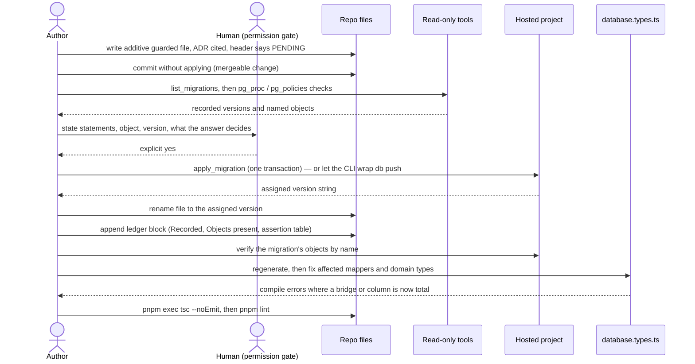

# Live Supabase, the Migration Ledger and Applying a Change

This page is the *procedure* for touching the hosted project. What the live schema actually is — which migration created what, and the RLS that decides access — is on [Data Model and RLS](/openwiki/architecture/data-model-and-rls.md); the local gate that must be green before any of this is worth doing is on [Verification and Test Strategy](/openwiki/operations/verification-and-test-strategy.md). Read this page when you are about to run something, not to answer a schema question.

The database is shared and there is exactly one of it. Everything written there is a school's compliance record, and this app is an internal working layer — TESDA SIS/T2MIS/BSRS stay authoritative, so nothing here claims submission.

## The gate: rule 36 is `[deny]`

`RULES.md` rule 36 is the whole reason this is a runbook and not a habit:

> **Never execute statements against the live Supabase project without explicit user permission, or an agreed plan that covers it.** Covers `execute_sql` (**including read-only `select`s** — the tool is denied, not the statement kind), `apply_migration`, branch create/merge/reset, and edge-function deploys, by any route: the MCP server, the CLI (`db push`, `db reset`, `migration up`), or `psql`. State exactly what will run and why, then wait. There is one hosted project and no staging, so an unreviewed statement lands on real tenant data. `[deny]`

Two things about the phrasing matter more than the list. The line is drawn at the **tool**, not the statement kind — `list_migrations` sails through, a `select count(*)` through `execute_sql` does not. And the rule is permission-first: *stating* a plan is not a yes. Committing a reviewed migration changes nothing live; it stays a pending claim until a human answers.

### How the refusal is wired

The gate is `.claude/settings.json`'s `permissions.deny`, paired with the Supabase MCP server registration in [`.mcp.json`](/.mcp.json) bound to the single hosted project `azywaivpyphhsblxjgtn`. The deny list names the eight MCP mutation tools **twice** — bare `mcp__supabase__*` and the instance-id-prefixed `mcp__bd43a5a2-…__*` — plus `db push`/`db reset`/`migration up` under both `supabase` and `npx supabase`, and `Bash(psql:*)`, which is the route no wrapper can sanity-check.

Because `permissions.deny` is session-wide, an agent cannot request an exception in-session; lifting a deny means editing the file first. Three unrelated destructive shell commands and four work-discarding Git commands sit in the same file (`permissions.ask` for the Git ones), so "the deny list" protects uncommitted work generally and rule 36 is one section of it — the reason rule 37 lets reviewers keep `Bash` at all. [`docs/agents/issue-tracker.md`](/docs/agents/issue-tracker.md) carries the obligation into task filing: a `research` ticket that needs the live project is flagged and surfaced, not auto-fired.

<!-- openwiki: broken internal link [/docs/adr/ADR-008-recorded-batch-billing-deadline.md#L48-L53] heading anchor "L48-L53" does not exist in "/docs/adr/ADR-008-recorded-batch-billing-deadline.md". Fix the href or restore the target, then delete this comment. -->
[`20261024110000`](/supabase/migrations/20261024110000_add_dashboard_operational_fields.sql) is the gate working as designed: written, reviewed under ADR-008, committed with `NOT APPLIED — RULES.md rule 36 requires explicit permission` on line 5, and [ADR-008's "Applying" section](/docs/adr/ADR-008-recorded-batch-billing-deadline.md#L48-L53) says the same — `apply_migration` only on a yes, then rename to the recorded version. State the statements verbatim, say which object and version they verify, say what you will do with the answer, then wait.

## Answering before asking

Rule 36 names its own escape hatch, and the order matters: answer from the checked-in migrations and `lib/supabase/database.types.ts` **first**. Only then the read-only introspection tools (`list_tables`, `list_migrations`, `get_advisors`, `search_docs`) — and only for what those cannot answer. `supabase/migrations/README.md` shows the intended pre-push block: read the recorded versions, then the tables.

Both useful tools lie in ways that have already cost this repo time. Use them as indexes, never as evidence.

| Tool | Returns | Trap |
| --- | --- | --- |
| `list_tables` | tables with an `rls_enabled` flag, plus a row count that is a `reltuples` **planner estimate** | wrong here by whole orders of magnitude — a table reporting 0 held 16 rows. Never call a table empty on it; a real `count(*)` costs an `execute_sql` ask |
| `list_tables` | the table list | never authoritative for a **column**; read ADR-007's `excused`/`max_absence_percent` from the migration |
| `list_migrations` | recorded **version strings** | says nothing about objects. A hand-applied file has its objects and no row |
| `list_migrations` vs a directory listing | two orderings | neither is the deployed schema; comparing them turns a benign difference into an unanswerable question |

**Confirm by name, never by set.** To check that one migration landed, look for *its* objects — `pg_proc` for functions, `pg_policies` for policies. Several migrations add policies to the same tables, so a set comparison returns a superset and reads as a match no matter what is missing.

## The ledger and the filename rule

[`supabase/migrations/README.md`](/supabase/migrations/README.md) is the record, and it is mandatory: a file with no row is drift. It is a dated series of blocks (`State as of …`), one row per file, with Recorded / Objects present, plus the assertion table behind a verify. **The database wins over any row and the row wins over any file header** — so recording is the step that closes an apply, not optional bookkeeping.

Supabase keys its applied-migrations table on the **version string** — the numeric prefix of the filename — not on content. Everything awkward here follows from that:

- **Renaming a file makes it look unapplied.** The recorded version matches no filename, so `db push` re-runs it against a database that already has its objects. The standing fix is to **record first, then name the file for the version actually recorded**; both surviving renames (`20260906114735`, `20261024071359`) exist for exactly that reason.
- **`apply_migration` assigns its own version.** A file written with a guessed timestamp gets renamed by reality — check what it recorded and rename to match, or the next push replays the file.
- **Hand-execution records nothing.** The objects exist and the table has no row; the database ends up *ahead* of its records and neither the directory nor the table can answer "what is deployed?". A `-- Active: <connection string>` header is the marker a SQL editor writes in that case — [`20260906114735`](/supabase/migrations/20260906114735_add_school_registry_and_platform_admin.sql) carries two, while its neighbours' `-- Active:` line was stripped when they were pasted without one.

`20261111120000` shows the drift in the other direction, in its own words: applied *piecemeal* through the SQL editor, then the policies, trigger, grant and indexes (re)created with an idempotent script and the version inserted into `supabase_migrations.schema_migrations` by hand. That insertion — repair-recording — is the honest repair, and it records only that objects match. It does not record that the file reproduces them from scratch, and the ledger records the piecemeal route rather than hiding it.

## The one standing hazard

`20261024110000` is recorded ❌ and only "partly checked": its `batches.billing_deadline` column is live, but the column comment and the partial index `batches_tenant_billing_deadline_idx` on `(tenant_id, billing_deadline)` in the same file were never checked — while its own header still says NOT APPLIED. A `db push` therefore tries to re-run it, and its header cannot settle the question. Verify the remaining objects by name and record it before any push.

Next to it, `20261111120000` is the cautionary shape rather than live drift: `create table public.learner_details`, its policies and trigger, and two bare `add constraint`s fail on a second run, and `learners_tenant_batch_uli_key` is a unique index with **no dedup**, so one duplicate `(tenant_id, batch_id, uli)` aborts the file and rolls back every statement. The file writes the duplicate-finding query next to the index for that reason; run it before applying, not after.

Both are the same lesson: guarded statements are the second half of additive, and the files that skip the guard cannot be replayed.

## Additive, and why it survives an unanswered question

[`20260528160300_create_tenant_scoped_schema.sql`](/supabase/migrations/20260528160300_create_tenant_scoped_schema.sql) is canonical for schema and RLS. It is also **history**: recorded ✅ with objects ✅, so a body-only edit changes the repo and never the database. Everything since is a new file.

Migrations run in **filename order**, so a new file that only adds or alters objects an existing file created is correct whether that file ran before or runs for the first time in the same push. That is what makes the additive rule (rule 20) safe against an *unanswered* applied/unapplied question — and it is how ADR-007 was re-cut. It was first written as an in-place edit of `20260910120000`; when that file turned out to be recorded, the edit moved into `20261024071359_adr007_attendance_dropout_rule.sql`, because a recorded file re-runs for nobody and the repo would have claimed `max_absence_percent` while the column stayed `max_absences`. `20261024071359` guards every statement (`add column if not exists`, `drop column if exists`), so re-running it is a no-op — belt and braces even against a replayed push.

The newest files arrived unguarded and with a much longer list of objections — `20260910120000` opens by declaring itself **single-shot**, explaining that Postgres has no `if not exists` for policies and guarding only some of the file would give a false impression. The saving grace is transactional application: the CLI and `apply_migration` each wrap the file, so a failure rolls the whole thing back. Piping to `psql` without an explicit `BEGIN` leaves half-applied objects to drop by hand.

Data preconditions belong in the file as comments next to the statement they guard — that is the pattern `20261111120000` follows — because the whole file is one transaction and the comment is the only place a reader will meet the query before the failure.

## Seeds are not migrations

`supabase/seeds/` holds dev fixtures and verification scripts, and **nothing there runs automatically**. `supabase/config.toml` points `[db.seed]` at a placeholder [`../seed.sql`](/supabase/seed.sql) rather than a glob, precisely because these files are not idempotent reference data. Real reference data lives in the canonical migration.

The reason is identity, not tidiness ([ADR-005](/docs/adr/ADR-005-demo-account-tenant-scoping.md)): the files hardcode Clerk user IDs, and a Clerk development instance and a production instance issue *different* IDs for the same person. A migration carrying them would insert dead identities into `public.profile_tenant_memberships`, the table RLS trusts most. `dev_profile_memberships.sql` is marked DRAFT and asks for a human check for the same reason.

The cost of that split already landed: the dev fixture `20260831120000_seed_dev_operational_data.sql` sat in `migrations/` for a while, so `batches`, `learners` and `documents` hold fixture rows in the hosted project that no committed migration creates. Moving the file stopped a future push from re-doing it; it did not remove the rows (#230).

`verify_user_admin_setup.sql` shows the other seed shape: Part 1 restates the four policies of `20260904120000` made idempotent, Part 2 is a temporary role change with its revert, and both parts share one transaction so an uncommented `set local app.environment` aborts *everything*. It also documents the connection string reality — the session pooler on 5432 as `postgres.<ref>`, not the direct host, which publishes an AAAA record only.

## Landing a change, in order

1. **Write an additive, guarded file** named `<UTC timestamp>_<what_it_does>.sql`, citing its ADR. Never edit a recorded one (rule 20), canonical file included.
2. **Write the data preconditions as a comment** beside the statement they guard, with the query to check them.
3. **Commit without applying.** Say it is pending in the header. That is a complete, mergeable change.
4. **Read the record, then the objects by name.** `list_migrations` and the `pg_policies`/`pg_proc` checks. The question is which objects exist, not whether a dump looks familiar.
5. **Ask at the human-permission gate**, stating what will run and why. Wait for the yes, then — for `apply_migration` — read the version it assigned and **rename the file to that version**.
6. **Record it** as a new dated block in the ledger: file name, Recorded, Objects present, verification used. Creating that row is mandatory.
7. **Regenerate `lib/supabase/database.types.ts`, then update the affected mappers and domain types** (rule 20), including any total enum bridge a new variant breaks (rule 18). Regeneration is the *first* code step and the only generator output — the mapper half is on [Module Boundaries and the Data Pattern](/openwiki/architecture/module-boundaries-and-data-pattern.md).
8. **Verify locally**: `pnpm exec tsc --noEmit` then `pnpm lint` — see [Verification and Test Strategy](/openwiki/operations/verification-and-test-strategy.md).

Four files in `lib/supabase/` import the `Database` type — `client.ts`, `server.ts`, `service.ts` and the type file itself — so a regeneration replaces their table, enum and function shapes all at once. Regenerating is therefore safe only against a database already holding every object the file describes, and it is a whole-file replacement, not a patch.

### Where regeneration currently stops

No such database exists yet, and the type file says so in its own header: it is hand-maintained, it carries `billing_deadline` (and the T2MIS shapes) by hand ahead of their records — `billing_deadline` even though the column is live — and it holds no `excused`, no `max_absence_percent` and none of the billing-domain tables. Regenerate today and the generator deletes the hand-carried halves. So the type is hand-carried and mirrored at the mapper; the step-7 goal is a full-inventory database, not a convenient one.

`SUPABASE_SERVICE_ROLE_KEY` takes the same care: read only by `lib/supabase/service.ts`, never `NEXT_PUBLIC_`, so every other path carries the Clerk session token on the anon key and leaves authorization to RLS. `.env.example` documents only the Clerk `pk_test_*`/`sk_test_*` pair and the Playwright user; the Supabase pair is what `isSupabaseConfigured()` gates the data layer on.

## Reading drift defensively

While the type layer and the database disagree, mappers must tolerate objects that are not there. Two mirrored patterns, one per direction:

- **Absent column made safe on read.** `select('*')` yields `undefined`, never `null`, for a column the database lacks — so a bare `!== null` check reads a missing column as "no deadline recorded". `mapBatchRow` writes `row.billing_deadline ?? null` and comments that it is waiting on `20261024110000`.
- **Absent table made safe on read.** `mapLearnerRow` defaults `learner_details` to `{}` and runs every field through `orEmpty` (`?? ''`, mirroring "null = not recorded"), so a roster with no details rows renders blank cells rather than erroring.

The import half is still unhedged: `writeDetails` upserts straight into `learner_details` with no absence check, so the import fails at request time wherever that table is not deployed. Which half is guarded and which is not is the readable signal of what has actually landed.

The price of the pattern is that a bug which *needs* one of these columns to exist produces blanks, not a crash. Keep it to the mapper and let everything else raise.

## Failure modes, ranked

1. **Re-running an applied migration** — from a renamed file, a hand-applied one, or a directory ahead of `list_migrations`. Unguarded files (`20261111120000`, `20260910120000`) apply partially, or survive only because the CLI wrapped them.
2. **A pending file left pending.** It reads as done and every read above it carries `?? null` indefinitely. `20261024110000` is this state and must be verified by name and recorded before any push.
3. **A body-only edit to a recorded migration** — a normalisation pass, say. It changes the repo, never the database; the repo has taken formatter churn inside the applied canonical file.
4. **Regenerating against a database missing objects.** Hand-carried types vanish silently and the divergence moves into compile-time silence.
5. **A guessed timestamp, or a filename that disagrees with the record.** Both end in a replay of a file whose objects already exist.
6. **Trusting a `reltuples` row count, a policy-set diff, a `NOT APPLIED` header, or a checked-in seed that says DRAFT.** Each is a belief on a date, never a measurement.
