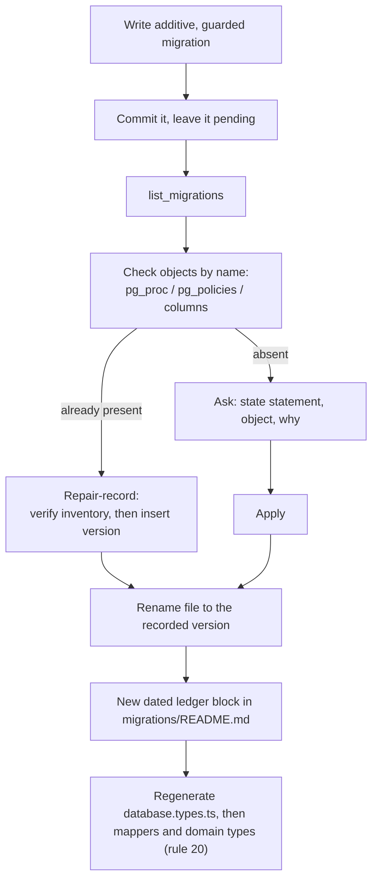

# Live Supabase and the Migration Runbook

There is **one hosted project and no staging** (`project_ref=azywaivpyphhsblxjgtn`, registered as the single MCP server in [`.mcp.json`](/.mcp.json)). Every migration here is written against the only data that exists, so "try it and see" means trying it on schools' learner records. This page is the loop around that fact. What the schema *is* — tables, helpers, per-table policies, the drift rows — belongs to [Schema, Migrations and RLS Reference](/openwiki/architecture/schema-and-rls-reference.md); the runtime meaning of the policies belongs to [Tenant Isolation and Role Authority](/openwiki/security/tenant-isolation-and-role-authority.md).

## The deny, at the tool and not the statement

`RULES.md` rule 36 is `[deny]` level, enforced by `permissions.deny` in [`.claude/settings.json`](/.claude/settings.json) — an agent cannot request an exception mid-session, so lifting it means editing that file in a reviewed change first.

The deny names each entry point twice, under the bare MCP server and under the instance-id-prefixed spelling (`mcp__bd43a5a2-…`), because the prefix varies per session:

| Route | Denied entries |
| --- | --- |
| MCP | `execute_sql`, `apply_migration`, `deploy_edge_function`, `create_branch`, `delete_branch`, `merge_branch`, `rebase_branch`, `reset_branch` |
| CLI | `db push`, `db reset`, `migration up` — under both `supabase` and `npx supabase` |
| Direct | `Bash(psql:*)` |

Two consequences read straight off that list. **`execute_sql` is denied as a tool, not by statement kind** — a read-only `select count(*)` is refused exactly like a `drop table`. And the deny covers branch and edge-function operations even though neither is schema: the MCP server is bound to the hosted project, so anything it can reach counts as touching it. The same file also denies `rm -rf`, `git reset --hard` and force-push and parks `git checkout --`/`restore`/`clean`/`stash` in `permissions.ask`, which is why one file governs both the database and uncommitted work.

The habit the rule actually asks for is procedural, not atmospheric: **state the exact statement, the object and version it verifies, and what you will do with the answer — then wait.** `docs/agents/issue-tracker.md` carries the same obligation into task filing: a ticket that would need the live project says so, and its research subagent is not auto-fired.

## What stays readable

Rule 36 names its own escape hatch, and the ordering in it matters: answer schema questions from the checked-in migrations and [`lib/supabase/database.types.ts`](/lib/supabase/database.types.ts) **first**, and reach for the read-only introspection tools (`list_tables`, `list_migrations`, `get_advisors`, `search_docs`) only for what those cannot answer. The file is not a live oracle — it is hand-maintained and has been ahead of the database (`billing_deadline` is typed in it while `20261024110000`, which creates the column, is unrecorded), so "the type file lists it" answers *what the code expects*, not *what the database has*.

`.mcp.json` is committed rather than local for the same reason the deny is: the project ref is part of the configuration, so an agent cannot be pointed at a different project by accident. Session start runs `.claude/hooks/check-mcp-health.sh`, which greps `claude mcp list` for a failed server and is silent when healthy — an unauthenticated MCP server is the common way this whole loop silently stops working, and it fails before a task depends on it rather than at the query.

## Before you push

[`supabase/migrations/README.md`](/supabase/migrations/README.md) is the ledger: one dated block per verification pass, one row per file with *Recorded* and *Objects present*, and the tool used. The checklist is read-only and cheap, and it runs in this order:

1. `list_migrations` — the recorded version strings.
2. `list_tables` — tables and `rls_enabled`, for orientation only.
3. Objects **by name** for the specific migration: `pg_proc` for functions, `pg_policies` for policies, and columns by name against the objects that file claims.

**Never compare policy sets.** Several files add policies to the same tables, and Postgres OR-combines permissive ones, so a set comparison returns a superset and reads as a match no matter what the candidate migration is missing. `20260904120000_add_user_admin_write_policies.sql` is the exact case: it adds four and drops none, so its own header has to say "additive only, no existing policy is dropped or replaced" — the set can never prove that for you.

`list_tables` row counts are `reltuples` planner estimates, **not counts**. They have been wrong here by whole orders of magnitude — a table reporting 0 held 16 rows — so never conclude a table is empty from one. A real `count(*)` costs an `execute_sql` ask.

## Reconciling records to the database, not the reverse

Migrations of this repo have mostly gone in **by hand**, not through a tool that records: the ledger's `-- Active: <connection string>` headers mark buffers run in a SQL editor, `20260904120000` was applied that way and left unrecorded, and `20261111120000` went in piecemeal until its remaining objects were (re)created from an idempotent script and its version inserted into `supabase_migrations.schema_migrations` by hand. A **repair-record** is that act made explicit: inventory the objects, prove they match the file, then write the version without re-running. The ledger says which rows were repaired and how, in those words, because a repair records *that the objects match* — never that the file reproduces them from scratch.

So the direction is database → records. What that implies:

- **A file's own header is an author's belief on a date; a dated ledger block is an operator's check.** `20261024110000_add_dashboard_operational_fields.sql` still carries `NOT APPLIED — RULES.md rule 36` in its header (line 5) while its `billing_deadline` column is live; the ledger row is `Recorded ❌, Objects partly checked` and outranks the header. Read both, trust the newer measurement.
- **Neither the directory listing nor `list_migrations` is the deployed schema.** Rounding the two up is how a benign divergence (a moved seed file, a renamed migration) becomes a question nobody can answer against a live database.
- **Never re-run a file to find out.** `20261111120000` uses bare `add constraint` and dies on replay; the guarded repairs are what kept it from becoming a half-applied run.
- **Whatever you fix, write it back.** A verified version goes into the ledger and into [`docs/DATA_MODEL.md`](/docs/DATA_MODEL.md)'s version table, and a repair note says which verification was used. Then regenerate.

The failure this ordering closes is concrete: `20261024110000` has sat pending since 2026-10-24. It reads as done, the type file and its callers carry `billing_deadline ?? null` regardless, and the risk is that someone regenerates types or pushes while its status is still a guess.

Additive is the invariant that makes the ordering safe: because migrations run in filename order, a new file building on a possibly-unapplied one is correct either way, which is how [ADR-007](/docs/adr/ADR-007-attendance-based-dropout-rule.md) was re-cut after first editing `20260910120000` in place. Rule 20 states the additive rule; it is the [deny]-adjacent half of the same rule 36 section, and no ADR restates it — the migrations' own headers cite "RULES.md rule 3" for it. Every statement is guarded, too, so a re-run is a no-op.

## The version string is the key

Supabase keys applied migrations on the version string — the filename's numeric prefix — so names and records must agree in both directions.

- **Renaming a file makes it look unapplied** and `db push` re-runs a file whose objects exist. Two live filenames (`20260906114735`, `20261024071359`) are the recorded versions, renamed *to* match, not the timestamps their authors had typed.
- **`apply_migration` assigns the version itself.** ADR-007's file was written as `20261024063000` and recorded as `20261024071359`. Read the recorded version and rename the file to it immediately after any MCP apply, before anything else is done with the file.

A version with no filename is drift in the other direction and shows up in a rebuild that omits an applied migration; a filename with no version re-runs on the next push. Both are the same bug.

## Regenerating types is step two, not step one

Rule 20: after any migration, regenerate `lib/supabase/database.types.ts`, then update affected mappers and domain types. The order is not stylistic — the generator emits a snapshot of the database it runs against, so regenerating before the objects are *applied and recorded* deletes the types the file carries ahead of its own records ([`database.types.ts`](/lib/supabase/database.types.ts) records, per block, which migration wrote each shape and whether the shapes were checked against a generator run). Today that means the generator runs deliberately, against a fully accounted-for database, while a pending column is hand-carried and the mapper reads it as `?? null` — `select('*')` yields `undefined`, never `null`, for an absent column, so a bare null check would report "not recorded" for an object the database has not got.

Hand-carrying has its own price, and the file says so at the top: `database.types.ts` stubs every table's `Relationships` as `[]`, which is why supabase-js cannot infer embedded joins and why four long-standing TS2352 casts exist in `modules/*/data`. A regeneration with real `Relationships` arrays would likely retire all four; nothing schedules it.

Regenerating drags the mapper layer behind it — including any total enum bridge, where a new DB variant must fail compilation until its UI treatment is chosen (rule 18). Sort that work by owning module's `data/` and `domain/`, not by feature. And at the mapper, keep the `?? null` / `orEmpty` tolerance exactly until the inverse has actually landed.

## Environment, and the two keys

[`.env.example`](/.env.example) is not this boundary — it documents the Clerk `pk_test_*`/`sk_test_*` pair and `E2E_CLERK_USER_*` for Playwright. Supabase's URL and anon key are stack-level and read by `isSupabaseConfigured()`, which the first line of a data function checks and which therefore decides `unconfigured` vs. a query.

`SUPABASE_SERVICE_ROLE_KEY` is read **only** in [`lib/supabase/service.ts`](/lib/supabase/service.ts), is never `NEXT_PUBLIC_`, and its client bypasses RLS entirely — reserved for trusted server-to-server writes with no session to scope by, i.e. the Clerk webhook. Everything else goes through the anon-key client plus the Clerk token, so RLS decides (rule 3; provisioning detail on [Clerk Identity and Provisioning](/openwiki/integrations/clerk-identity-and-provisioning.md)). The failure mode to know: on a host missing the service-role key, every RLS-scoped read still serves and the webhook's provisioning throws at request time — a "Supabase is broken" symptom that is env, not policy.

## End state of a migration

Mergeable to write, pending to push: the file is committed, guarded, headed with what it is and which ADR decided it, and it says NOT APPLIED. It stays that way until a yes, and the run after the yes is verify → apply → rename → ledger block → regenerate → mappers. A file with no ledger row is drift; a page of prose about it is not a substitute.

## Related

- [Schema, Migrations and RLS Reference](/openwiki/architecture/schema-and-rls-reference.md) — what is deployed, the drift rows, the policy map.
- [Tenant Isolation and Role Authority](/openwiki/security/tenant-isolation-and-role-authority.md) — what the deployed policies decide at request time.
- [Clerk Identity and Provisioning](/openwiki/integrations/clerk-identity-and-provisioning.md) — the one caller that legitimately uses the service-role client.
- [Quickstart](/openwiki/quickstart.md) — local setup before any of this. client.
- [Quickstart](/openwiki/quickstart.md) — local setup before any of this./openwiki/quickstart.md) — local setup before any of this.t.md) — local setup before any of this.
