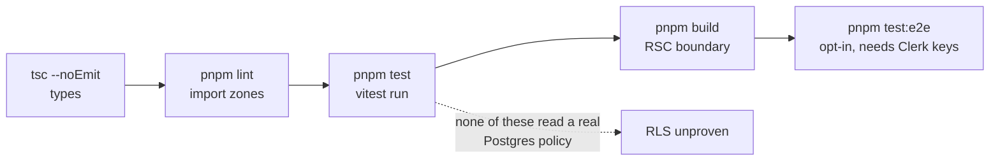

# Quickstart — Task Routing, Invariants and the Verification Loop

## What this system is, and the copy boundary that follows

TVI-CAMS is an internal multi-tenant working layer for TVI schools running TESDA TWSP/CFSP scholarship batches: batch lifecycle, documents, attendance, LAMR evidence, and generated billing documents. It never holds official standing — TESDA SIS, T2MIS and BSRS remain authoritative, statuses describe the school's own internal progress, and UI copy must never imply official approval or submission (RULES rule 27). A compliance tool whose copy overstates its own authority is a real operational failure, not a wording preference.

Stack, auth chain and module catalog are on [Architecture Overview](/openwiki/architecture/overview.md); read it before touching a route.

## Read in this order

1. **`RULES.md`** — the invariants, each tagged with its enforcement level. Read the whole file before any change; it is short and it is the checklist.
2. **`CLAUDE.md`** — the architecture and the *why* behind those rules.
3. **`docs/adr/`** — binding decisions. Where `RULES.md` and `CLAUDE.md` appear to disagree, `RULES.md` wins and the drift gets fixed (RULES preamble, `CLAUDE.md` header).

Then the page below that owns your task. Then the source.

### Precedence, and the documents that lie

ADR-001 supersedes conflicting "billing = preparation signal only" PRD/TRD wording; ADR-003 amends ADR-001 §4 (packet due dates stay derived) but upholds NoLedger and JJ1; ADR-007 replaced the retired ≥5-absence dropout count with 20% of `total_sessions` or 3 consecutive unexcused absences; ADR-008 amends ADR-003's derived-due-date position for the batch-level `billing_deadline` only; ADR-006 supersedes FR-02's "Super Admin is not implemented". ADR-002 (the ported prototype is not the target) and ADR-005 (demo-account scoping) stay load-bearing. RULES rule 30 locks this chain and requires an ADR before any schema or billing-math change.

Two checked-in documents are stale on purpose-bearing points — the ADR chain and the source outrank both:

- **RULES rule 34** still says there is no test runner and that `pnpm test` is a placeholder. There is a suite; see [verification](/openwiki/operations/verification-and-test-strategy.md).
- **Any PRD/TRD wording describing billing as a preparation signal only**, and anywhere it says platform admin does not exist. Both were reversed by ADR-001 and ADR-006.

Two more drift from the code: `README.md`'s Status table still lists CSV import as Planned while `modules/import-export/` is built with no screen, and `docs/DATA_MODEL.md` stops at seven migrations and predates ADR-006/007/008. Prefer the module README, the ADR and the migration. There is no `design-system.md` anywhere — not in `docs/` and not in this wiki — so UI questions go to `RULES.md` §4 (rules 21–26) instead of to a page that does not exist.

## Task routing

Each task names the invariant its diff must satisfy. Depth lives on the linked page, not here.

| If the task is… | Read | Must satisfy |
| --- | --- | --- |
| Add or change a screen under `/t/<code>/…` | [Tenant scoping and role authority](/openwiki/workflows/tenant-scoping-and-role-authority.md), [tenant isolation](/openwiki/architecture/tenant-isolation-and-rls.md) | 1, 2, 5, 24 (all six states), 26 |
| Add a route or move a route group | [Next.js routing and the request path](/openwiki/architecture/nextjs-routing-and-request-path.md) | 26; the new group is unguarded until it calls the gate itself |
| Add a module data function | [Module boundaries and the data pattern](/openwiki/architecture/module-boundaries-and-data-pattern.md) | 7–10, 17, 19 (guard order) |
| Change the schema | [Data model and RLS](/openwiki/architecture/data-model-and-rls.md), then [live Supabase and migrations](/openwiki/operations/live-supabase-and-migrations.md) | 20, 30, **36** before touching the project |
| Change billing math or a packet transition | [Billing](/openwiki/modules/billing.md), ADR-001 + ADR-003 | 27, 30 |
| Touch auth, role or membership | [Auth and provisioning](/openwiki/modules/auth-and-provisioning.md), [Tenancy](/openwiki/modules/tenancy.md) | 3, 4, 5, 6 |
| Touch attendance or the dropout rule | [Attendance and dropout eligibility](/openwiki/workflows/attendance-and-dropout-eligibility.md), ADR-007 | 14, 30 |
| Add a document state or blocker | [Document compliance](/openwiki/workflows/document-compliance-and-evidence.md), ADR-004 | 16, 24 |
| Fix a guard state or empty state | [Module boundaries](/openwiki/architecture/module-boundaries-and-data-pattern.md) §the snapshot union | 19 (guard order), 24 |
| Change an export or report | [Report assembly and export](/openwiki/workflows/reporting-and-export.md) | 23, 27 |
| Touch the import pipeline or T2MIS layout | [Import and export](/openwiki/modules/import-export.md) | 14 (pure `domain/`), 27 |
| Add cross-cutting chrome, analytics or settings | [Analytics, activity, settings, shell](/openwiki/modules/analytics-activity-settings-and-shell.md) | 15, 25 |
| Change copy | this page §the copy boundary | 27 |
| Edit a design-bundle directory | `RULES.md` §6 | 28 (`assets/`, `preview/`, `screenshots/`, `ui_kits/`, `uploads/` are `[hook]`-protected) |

## The invariants that gate every change

Full list and enforcement levels: `RULES.md`. The four an agent breaks most often:

- **RLS is the boundary; a JS tenant check is not.** Rule 1 makes Postgres RLS (`app_private.*`) the decision; rule 2 says a JS-side tenant check used as access control is a bug even when it returns the right answer. The one allowed form is a `tenant_id = scope.tenantId` filter derived from a validated `TenantScope` (`modules/tenancy/domain/scope.ts`) — it *selects* which of the caller's schools a screen shows on top of RLS and never grants what RLS would deny. Both rules are `[review]`, so only a reader catches a violation.
- **No auth logic in JS.** Rule 3: the anon-key client carries the Clerk session token through the `accessToken` callback (never a hand-set `Authorization` header, never a JWT template), and a missing token must throw — `lib/supabase/server.ts` throws the exported `NO_CLERK_TOKEN_MESSAGE` so it surfaces as `sync-failed` instead of an empty `anon` read that looks like "no batches". The service-role key lives only in `lib/supabase/service.ts`.
- **The enum bridge lives in the mapper.** Rule 18 `[types]`: `DB_TO_UI_STAGE` is a total map, so a new DB enum variant fails compilation until its UI treatment is chosen. A new variant added to the union in `database.types.ts` is *not* enough — the mapper and the domain type need it too.
- **Snapshot guard order.** Rule 19: `ok` / `sync-failed` / `unconfigured` (plus `no-tenant-access` folded in by `withTenantAccess`) may never be backfilled with mock data, and a guard that tests "empty" before `sync-failed` silently swallows the banner whenever a failure yields zero rows.

Role rules are load-bearing rather than cosmetic: trainer DTOs omit billing deadline, billing preparation, NTP lag, BSRS and financial fields **server-side** (rule 5), and viewer is server-denied on writes (rule 4). Hiding a field in CSS is not compliance. Server Actions carry the same duty as screens — `setBatchRqmCodeAction` re-resolves the route scope, denies a non-member *and* a viewer before any write, and distinguishes "could not load the profile" (an error) from "not a member" (a denial), pinned in `tests/unit/rqm-action.test.ts`.

## The verification loop

Run in this order, from the repo root. Each step proves a different thing and is blind to the others.



```bash
pnpm exec tsc --noEmit   # [types] 1 · enum-bridge totality
pnpm lint                # [lint] 2 · import direction, data-layer privacy
pnpm test                # 3 · behavioural pins (vitest run)
pnpm build               # 4 · only this catches Server Component compile errors
```

1. **tsc** — RULES rule 18 `[types]`. Nothing else catches a `DB_TO_UI_STAGE` map missing a variant, because the union lives in generated types, not in a lint rule.
2. **lint** — rules 7–10 `[lint]` via `import/no-restricted-paths` in `eslint.config.mjs`: `app → modules → shared → lib/supabase`, `data/` private to its module, `shared/` leaf-only, `database.types.ts` for data layers only. The config also *warns* at cyclomatic complexity 15 — a refactor prompt, not a gate. The PostToolUse hook lint-edits each file you save, which is not a substitute for the full run.
3. **test** — `pnpm test` is `vitest run` over the specs in `tests/unit/` (include `tests/unit/**/*.test.ts`), which pin domain rules, snapshot guard ordering (rule 19) and rendered markup. Time-dependent behavior is frozen with `vi.setSystemTime` on a fixed as-of date (`batches.test.ts` uses `2026-06-01`), never the wall clock; `dashboard-domain.test.ts` needs no clock because `daysToBilling` is precomputed on its fixtures. Copy the nearest `fixtureRow`/`fixtureBatch` helper's shape; do not invent a sparse one.
4. **build** — the only step that compiles Server Components. A page that typechecks can still fail the RSC boundary.

CI (`.github/workflows/ci.yml`) runs steps 1–3 on every PR and on `main`, on Node 22 — mandatory, because Vitest 4's rolldown throws `ERR_INVALID_ARG_VALUE` on Node 21 or older before any test loads, which looks nothing like a test failure. CI does **not** run `pnpm build`, does **not** run Playwright, and needs no secrets.

### What the loop cannot prove

- **No RLS coverage.** There is no `tests/integration/` or `tests/security/`, so every authorization claim rests on reading the migration (rule 35). A green suite says nothing about whether a policy admits the wrong row — the single most valuable missing test class.
- **Mocks at the boundary.** `supabase-server.test.ts` mocks `createClient` and Clerk's `auth`; it pins how the client is *called*, not that Supabase accepts the call.
- **The schema you actually have.** Green unit tests run against `database.types.ts`, which can disagree with the live database.
- **Route wiring.** `rqm-action.test.ts` mocks `resolveRouteScope` and `resolveTrustedRole` outright, so it proves the action's own policy, not that the page passes it a real scope.

`pnpm test:e2e` (Playwright, `e2e/auth.spec.ts` → `/dashboard` must redirect to `/sign-in`) needs `pk_test_*`/`sk_test_*` keys and a seeded Clerk test user from `.env.example`, and boots the app with `pnpm dev`. It exercises the `requireAuthenticatedUser()` gate, not `proxy.ts`.

## The live-database trap

There is **one hosted Supabase project and no staging**. RULES rule 36 is `[deny]` in `.claude/settings.json`, so an agent cannot request an exception mid-session. Blocked: `execute_sql` — **read-only `select`s included**, because the tool is denied rather than the statement kind — plus `apply_migration`, every branch operation, edge-function deploys, `supabase db push` / `db reset` / `migration up`, and `psql`.

The workflow is therefore: answer the schema question from the checked-in migrations and `database.types.ts` first; if that is not enough, state exactly what will run and why, then wait for explicit permission. `list_tables`, `list_migrations`, `get_advisors` and `search_docs` stay open — but `list_tables` row counts are `reltuples` planner estimates, not counts.

A header line is a claim, not evidence, and the two checked-in files disagree with each other: `20261024110000` (ADR-008 `billing_deadline`) still says `NOT APPLIED` while its column is live, and `20261111120000` (T2MIS terminal-report fields) says `APPLIED 2026-11-11` because it went in piecemeal and was repair-recorded afterwards. Neither shape reproduces cleanly on a second run. Confirm with `list_migrations` plus the named objects before any push. Details: [live Supabase and migrations](/openwiki/operations/live-supabase-and-migrations.md).

Local dev is `pnpm install` then `pnpm dev`. Unset Supabase env means `isSupabaseConfigured()` is false and data functions return `unconfigured` snapshots; that is the honest empty state, not a bug to paper over.

## Before you open a PR

- Issue on the Linear team `TESDA-CAMS` only — it two-way syncs with this repo, so creating on both duplicates (rule 32). Branch `klynejoshua13/tes-NN-…` (rule 33).
- After a migration: regenerate `database.types.ts`, then update affected mappers and domain types (rule 20).
- Reviewers are read-only agents committed under `.claude/agents/` (rule 37); they keep `Bash` to run this loop themselves, so a claim they cannot reproduce is worth less than the command output.
