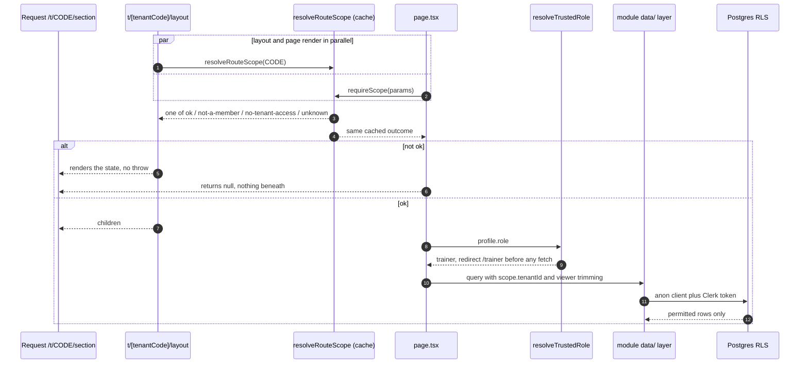

# Tenant Isolation and Role Authority

Isolation does not start at this page. Postgres RLS is the boundary (RULES.md rule 1 **[rls]**), the anon-key-plus-session-token chain is how a request earns an RLS identity (`lib/supabase/server.ts`, rule 3), and the `app_private.*` helper map lives on [Schema and RLS Reference](/openwiki/architecture/schema-and-rls-reference.md). What this page covers is the thinner, easier-to-break layer above: **once a request is signed in, what may the application decide for itself — and what is only a hint.**

Two things the application is allowed to decide, and one it is not:

| Decision | Owner | Why it is safe |
|---|---|---|
| Which of the caller's schools this screen shows | URL segment, validated against the caller's own memberships | Selection only; a foreign id is denied by RLS anyway (rule 2) |
| Whether to render, redirect, or refuse on role | `resolveTrustedRole` only, from `profiles.role` | The same column RLS reads |
| Which variant of a screen renders | `?role=` / `?state=` overrides | Presentation; cannot grant a row |

A mistake here therefore **misleads rather than leaks**. The failure modes at the end are accurate-looking wrong answers, which is why they are worth knowing.

<!-- openwiki: broken internal link [/openwiki/workflows/tenant-scoping-and-role-authority.md] file "/openwiki/workflows/tenant-scoping-and-role-authority.md" does not exist. Fix the href or restore the target, then delete this comment. -->
<!-- openwiki: broken internal link [/openwiki/architecture/nextjs-routing-and-request-path.md] file "/openwiki/architecture/nextjs-routing-and-request-path.md" does not exist. Fix the href or restore the target, then delete this comment. -->
The ordered workflow with its data flow is [Resolving School Scope and Acting Role](/openwiki/workflows/tenant-scoping-and-role-authority.md); route placement and layout ownership are [Routing, Layout Gates and the Request Path](/openwiki/architecture/nextjs-routing-and-request-path.md). This page is the invariants and the failure semantics underneath both.

## The segment is selection, and the scope is built only from memberships

The locked domain fact is that tenant context lives in the URL path segment (`/t/<code>/<section>`). `modules/tenancy/domain/scope.ts` states the consequence outright: a scope is *selection, not authorization*, and it is only ever built from `profile.tenants`, itself an RLS-scoped read. So `scopeForCode` returns `null` for any code the profile is not a member of, and a `tenant_id = scope.tenantId` filter then picks one of the schools RLS already allows. Rule 2 permits exactly that filter and calls a JS tenant check used *as* access control a bug.

The design is also load-bearing against a real audit finding: before the segment existed, every office screen read every school the caller belonged to, and a three-school user saw three schools' batches summed under one school's name (audit I1). A foreign code never falls back to "all schools" — it renders a state and offers the caller's default school as a link, so the URL always ends up naming one school and stays shareable (ADR-001 K1, [ADR-001](/docs/adr/ADR-001-billing-and-domain-model.md)).

`SCOPED_SECTIONS` is a closed list in the same domain file. Account pages, `/overview` and every `/trainer/**` route are deliberately outside it: they are not about one school, and a tenant segment would only add a hop.

## The four-way resolver, and why pages return null

`app/(dashboard)/tenant-scope.ts` composes `modules/auth`'s identity read with `modules/tenancy`'s profile read, which is why it lives in `app/` at all — only `app/` may import two modules' private `data/` (rule 8). The rule it applies is not here; it is in `scope.ts`. `resolveRouteScope` returns a tagged union of exactly four outcomes:

| Outcome | Meaning |
|---|---|
| `ok` | `scopeForCode` matched a membership; the page gets scope + profile |
| `not-a-member` | foreign, unknown or renamed code; carries a `defaultScope` fallback |
| `no-tenant-access` | the caller belongs to no school at all |
| `unknown` | the profile could not be read |

`getSignedInProfile` and `resolveRouteScope` are both `cache()`-wrapped, so the segment layout and the page asking the same question cost one profile read per request. The wrapper is per-request dedupe, never a cache.

The segment layout owns all four renderings; the page's half is `requireScope(params)`, which narrows to `ok` and otherwise returns **null** rather than calling `notFound()`. Layouts and pages render **in parallel**, so a thrown 404 could beat the layout's friendlier state and win the race. Security does not rest on the choice: with no scope there is no tenant id to query with, so a page that renders nothing cannot fetch the wrong school.

*The resolve-and-render race: the state is rendered by the layout instead of thrown by the page, so a parallel child render cannot pre-empt it.*

## unknown is never none

A caller who belongs to no school is not the same caller as one whose membership read failed, and rendering the first as the second tells a fully provisioned coordinator they were never assigned. `modules/tenancy/domain/access.ts` names three verdicts for this and orders the reasoning deliberately:

- `granted` — at least one membership, so an empty result is a real fact about the data.
- `none` — no membership. Every RLS-scoped read is empty regardless of what the tables hold.
- `unknown` — profile read failed, or the environment has no Supabase. **Never** treated as `none`.

`deriveTenantAccess` maps a `not-found` profile (signed in, webhook not yet provisioned) to `none` — honest in both readings — but maps `sync-failed` and `unconfigured` to `unknown`. `resolveTenantAccess` makes the same call for the empty-identity case: a failed `getAuthUserId()` becomes `'unknown'` rather than falling through.

**Why "no rows" breaks here at all.** Every table's policy scopes through `app_private.can_access_tenant()`, so a zero-membership caller reads zero batches, zero documents, zero activity — not because the tables are empty. A screen that renders "No assigned batches — import one" states something untrue and offers an action the caller cannot complete. The verdict exists so each screen can say the accurate thing.

`withTenantAccess(snapshot, access)` folds it into a contract's snapshot, and the precedence is the invariant: it rewrites **only** an `ok` snapshot. A `sync-failed` passes through untouched so the tidier "you belong to no school" never buries a real error (rule 19's ordering concern), and `unknown` changes nothing because an unverified verdict must not rewrite a successful read. The routes that already hold a profile snapshot — the school dashboard, billing, report — call `deriveTenantAccess` on it directly instead of fetching a second time.

## Role authority: one trusted column, and previews beneath it

`profiles.role` is the only role authority. `resolveTrustedRole` reads nothing else; when there is no profile row it returns `null` and callers fall back to the least-privileged variant. Clerk is identity, never role — it used to be consulted as a fallback, and one admin was rendered ADMIN in the sidebar and VIEWER on the dashboard at the same time (audit I5).

Above that sit two presentation-only affordances, and the split is the whole rule:

- `resolveRouteRole` puts `?role=` **first**, then falls through to the trusted role.
- `resolveDisplayRole` / `toOfficeRole` collapse anything that is not an office role — a trainer, `null`, an unparsed string — to read-only `viewer`.

`?role=` and `?state=` are unauthenticated query params. Any caller can type them. **A redirect gated on the override is a redirect nobody is held to**, so a real trainer adding `?role=admin` would walk past the office-only gate and receive billing deadlines, NTP lag and BSRS that rule 5 says trainers must not have. Every gate in the tree therefore decides on the trusted source and uses the overrides only to choose a rendering.

## Server-side denial: trainer redirect and viewer trimming

The `/trainer` redirect is rule 5's omission half plus rule 4's neighbour. It is reached from three places, each on a trusted value: `requireScope` on `profile.role` from the already-validated scope, and — for pages that also read `?role=` — `resolveTrustedRole(dbRole)` in `billing/page.tsx` and `report/page.tsx`, both evaluated **before** the batch fetch so no financial field is ever serialized into a trainer's payload.

The placement inside the page path, not the layout, is the point. **A layout does not re-run on client-side navigation**, so a guard there survives a soft nav into an office section. `billing` and `report` each carry the comment recording that they added their own redirect rather than relying on a nav row they had already removed; the sidebar's Billing row is shown to everyone precisely because the route refuses. The same reason retired the KPI row from the root layout (below).

`use server` writes on the same segment authorise twice over: `t/[tenantCode]/actions.ts` re-resolves the scope from the URL code (never a form field), narrows on `resolveTrustedRole`, and then lets the `batches` UPDATE policy be the actual boundary — an unauthorized caller matches zero rows, surfaced as `conflict-or-denied` rather than an error.

Viewer is read-only because no write policy admits it, and the application's job is not to *hide* writes but to state the narrowing: `toOfficeRole(await resolveTrustedRole(profile.role))` picks the read-only variant, and the school dashboard keeps a screen-reader-only `ROLE_NOTE` saying write actions are "hidden and server-denied". The sidebar's `Add user` row is hidden from non-admins — usability only; the route and the Server Action re-check.

## School-switch recalculation, and where the KPI row lives

A layout does not re-run on client-side navigation, so whatever it renders is carried into the next route instead of being recomputed. The KPI row used to sit in `app/(dashboard)/layout.tsx` and kept showing the **previous school's numbers** after a switch; it now renders on the two dashboard pages only — `/t/<tenantCode>/dashboard` and `/trainer` — each from its own page body, so every navigation produces its own metrics. The layout still resolves the profile (for the school switcher's `tenants` and the admin flag), and a Server Action that mutates a batch calls `revalidatePath('/t/[tenantCode]', 'layout')` for the trees that do carry layout chrome, but the invariant is simple: **anything that must change when the school changes belongs to a page.**

The switcher itself has no client state to drift. `resolveActiveSchool` derives the active school from the pathname via `parseScopedPath`, uses the default membership off a scoped page, then the first membership, then `null`; each choice in the dropdown is a link to the same section of the chosen school. The candidate link is built from the section the URL is on, so switching schools never dumps the caller back on a dashboard. Audit I1 is the reason: the selector was once client state the queries never read, so switching changed only the label.

## Guarding tests

- `tests/unit/tenant-scope.test.ts` — a scope exists only for a member school; `defaultScope` order; path round-trip; and `resolveTrustedRole` ignoring a mocked Clerk `publicMetadata.role`.
- `tests/unit/tenant-access.test.ts` — `unknown` never behaves like `none`, `not-found` maps to `none`, and `withTenantAccess` never overwrites a real failure.
- `tests/unit/display-role.test.ts` — `toOfficeRole` narrows trainer/`null`/garbage to `viewer`; an unrecognised `?role=` is ignored rather than trusted.
- `tests/unit/sidebar.test.ts` — operations list permutations (trainer route strips everything but Settings), URL-over-default school resolution, every workspace row pointing into the active school, and honest "School not set" placeholders.

## Failure modes

- **Gating a redirect on `resolveRouteRole`.** `?role=admin` on `/t/<school>/billing` skips the trainer redirect and financial fields reach a trainer.
- **Rendering `unknown` as `none`.** A provisioned coordinator is told they have no school and offered an import they cannot run.
- **Letting `withTenantAccess` rewrite a `sync-failed`.** A broken fetch becomes a tidy, wrong explanation and the retry banner never appears.
- **Moving a role guard into a layout.** It silently stops running on soft navigation; a trainer reaches an office section while the nav already hides nothing.
- **Building a scope from anything but `profile.tenants`.** A validity check against a tenant catalogue rather than memberships lets a valid-looking foreign code through to a query that RLS would answer with zero rows.
- **A page that fetches without the `null` guard.** No scope means an undefined tenant id and an unscoped read — every school's rows under one school's heading.
