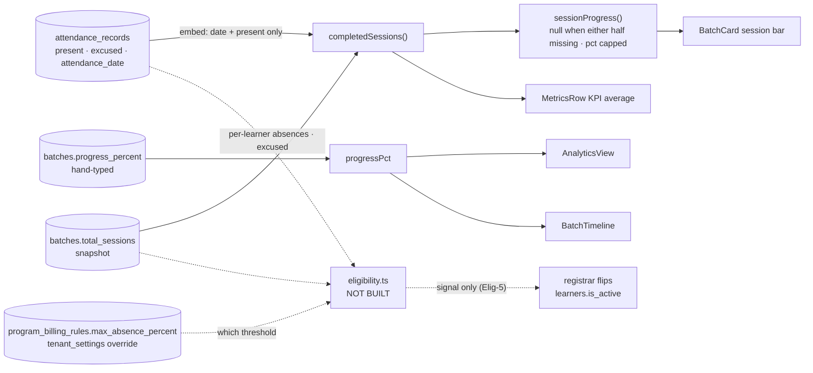

# Workflow: Attendance, Progress and the Dropout Rule

Attendance is the most load-bearing fact in this product and the least built. It is
what progress is supposed to mean, what billing tranches hang off, and what decides
whether a scholar stays enrolled — and today the only attendance code in the
repository is one embedded read inside the batch mapper. The dropout rule is locked,
stored, and **read by nothing**.

That split is the whole page: the chain that exists, then the chain that was decided
and has to be built from scratch. Schema state, the RLS policy map and the migration
ledger are on [Data Model and RLS](/openwiki/architecture/data-model-and-rls.md); the
words themselves are on [Domain Vocabulary](/openwiki/concepts/domain-vocabulary.md).

## What exists: one embedded read

`modules/attendance/` holds a `README.md` and nothing else — no `data/`, no `domain/`,
no `ui/`. Its README states "No code yet" and lists all three as planned. The trainer
pages that would own this workflow are self-contained placeholders: the attendance
route renders a heading and a paragraph about a Figma frame, with no module import.

The one live attendance read sits in [`modules/batches/data/batches.ts`](/modules/batches/data/batches.ts),
whose batch query embeds `attendance_records(attendance_date, present)`. Its readonly
`completedSessions()` helper counts **distinct attended dates** — a `Set` over rows
where `present` is true, not a row count — and returns `null` unless both halves
exist: a snapshotted `total_sessions` and at least one attendance row. The `null`
matters mechanically, because PostgREST answers an empty embed with `[]`, never
`null`; without the guard, "attendance not recorded here" would render as a real
"0 sessions held". `totalSessions` comes straight off the batch's snapshotted
`total_sessions` (nominal hours ÷ 8, ADR-001 E2).

`excused` and `notes` are **not** in that embed, so today nothing distinguishes an
excused absence from an unexcused one anywhere in the app.

## Progress: the data versus the locked formula

[`modules/batches/domain/progress.ts`](/modules/batches/domain/progress.ts) is presented as
the attendance-derived rule ("`sessions held / total sessions` … never the hand-typed
`progress_percent`"), and `metrics.ts` repeats it. `sessionProgress()` consumes
`completedSessions`/`totalSessions`, returns `null` when either half is missing, and
caps `pct` at 100 so a recording error cannot draw a bar past full.
`describeSessionProgress()` turns the same `null` into the words "Sessions not
recorded".

The mapper does not carry that through. `mapBatchRow` sets `progressPct` from
`row.progress_percent` with an `orZero` default while deriving `completedSessions`
from attendance beside it — so one `Batch` holds a hand-typed percentage and an
attendance figure that are free to disagree. Two surfaces read the hand-typed half:

- [`modules/analytics/ui/AnalyticsView.tsx`](/modules/analytics/ui/AnalyticsView.tsx) charts
  "Training progress by batch" from `b.progressPct` and its "Days elapsed vs
  remaining" bars from the `currentDay`/`totalDays` aliases, which are zero-defaulted.
- [`modules/batches/ui/dashboard/BatchTimeline.tsx`](/modules/batches/ui/dashboard/BatchTimeline.tsx)
  fills the training phase's bar from `progressPct` and prints `Day currentDay/totalDays`.

Against ADR-001 **B2** — progress is attendance-derived, "not manually typed" — a batch
with no attendance rows still charts a non-zero completion figure and a "Day 0/0"
caption. `batch.progressPct` is typed non-nullable in `shared/types.ts`; the attendance
figures beside it are nullable and documented as such. The dashboard KPI average
(`sessionProgress` in `metrics.ts`) is the one aggregate that already reads the
attendance pair and excludes untracked batches instead of scoring them zero. Treat the
`progressPct` wiring as a known gap, not a design: `tests/unit/dashboard-domain.test.ts`
pins `sessionProgressPct: null` for a batch whose only signal is `progressPct: 90`.

The honest per-batch surface is `BatchCard`, whose session bar renders the unavailable
state in words ("Attendance not recorded yet") whenever `sessionProgress` is `null` —
the pattern the analytics and timeline views do not follow.

## The rule that is decided

ADR-001's `Elig` decision is retired outright; do not implement it. It fixed
eligibility at `absences ≥ 5`, stored as `max_absences = 4` with the rule `absences >
max_absences`, and — the part worth keeping — made the outcome a *payment exclusion*
from the allowance track. ADR-007 replaces both the number and the unit and moves the
outcome to an *enrollment dropout*.

[ADR-007](/docs/adr/ADR-007-attendance-based-dropout-rule.md) **Elig-2** locks: a
scholar is dropped from the program if **(a)** total absences exceed **20% of the
batch's `total_sessions`** — allowed absences `⌊total_sessions × percent ÷ 100⌋`, the
`(n+1)`th absence disqualifying — **or (b)** the scholar accumulates **3 consecutive
unexcused absences**, whichever trips first. It sits in `RULES.md`'s locked domain
facts, unnumbered, beside the progress formula. Three shapes of the rule are easy to
get wrong:

- **`total_sessions` is the denominator, and it is snapshotted, not counted.** It is
  `program nominal hours ÷ 8`, frozen at batch creation (E2/D3), so it never moves with
  the calendar. A batch with a null `total_sessions` cannot be evaluated at all — the
  existing `completedSessions()` already refuses for the same reason.
- **"Consecutive" is over consecutive *recorded* rows**, ordered by `attendance_date`
  (Elig-4). No session-calendar table exists, so a date with no row is *unmarked*, and
  an ordered scan must not read a gap as an absence — the "absent key ≠ evidence"
  caution [ADR-004](/docs/adr/ADR-004-untracked-document-semantics.md) applies to
  documents.
- **Dropout is a signal, not a write (Elig-5).** Crossing either threshold surfaces as
  an at-risk state; setting `learners.is_active = false` stays a manual registrar
  action, so no screen may claim the app dropped anyone from TESDA's own systems.
  `is_active` has existed since the canonical migration, unread for this purpose.

Deductions do not move with it: ADR-001 **FF2** (`tranche% × total_TSF − absences ×
₱160`) still runs off the raw per-scholar absence count on the final tranche,
independent of the threshold (Elig-6). A scholar can accrue a deduction for sessions
attended before a dropout took effect.

## Where the rule lands in storage

Three columns, one migration, no code. The migration
[`20261024071359_adr007_attendance_dropout_rule.sql`](/supabase/migrations/20261024071359_adr007_attendance_dropout_rule.sql)
is additive and every statement is guarded, so a re-run is a no-op:

- `attendance_records.excused boolean not null default false`, meaningful only where
  `present = false`. The default is the compliance-safe direction: an absence nobody
  has marked counts as unexcused, so forgetting to mark cannot excuse a scholar.
- `program_billing_rules.max_absence_percent numeric(5,2) not null default 20.00`,
  checked `> 0 and <= 100`.
- `tenant_settings.max_absence_percent`, same CHECK, **nullable and with no default**,
  so null means "inherit the program rule" and an override cannot be born accidentally.
  A consumer resolves `tenant ?? program`, never a second hardcoded 20.

It is not a rename: `max_absences = 4` counted sessions, so a cast to `4.00` would read
as "4 percent" and allow one absence on a 45-session batch instead of nine. The old
column is dropped from both tables rather than kept beside the new one, because two
thresholds in two units silently disagree. As a separate file, it also survives the
applied-state question around `20260910120000` that ADR-007's header documents.

**It shipped as a new file, not an edit.** Supabase keys applied migrations on the
version string, so editing a recorded file changes the repository and never the
database: the repo would claim `max_absence_percent` while the live column stayed
`max_absences`. Migrations run in filename order, so the additive file is correct
either way. `RULES.md` rule 20 makes that the standing pattern — new migrations are
additive.

Rows stay editable in place, with no lock flag, even after billing ([ADR-001](/docs/adr/ADR-001-billing-and-domain-model.md)
**X2**). The `attendance_records` policies encode it: INSERT and UPDATE both admit
`can_trainer_write_batch(batch_id)` **or** `can_manage_tenant(tenant_id)`, while DELETE
is `can_manage_tenant` only — a trainer corrects by updating `present`/`excused`, not by
deleting evidence. The same policy row already covers `excused`; ADR-007 adds columns
and no policies. Correcting an absence is therefore a normal edit, and each one appends
an `activity_log` event (X2). No trigger writes that event, though — it is
convention plus the append-only `activity_log` table, so any new write path has to
author its own event or the audit trail quietly stops.

## Nothing reads those columns yet

This is the state a builder inherits, and all three parts hold:

- `grep` for `max_absence_percent` and for `excused` across `app/`, `modules/`,
  `shared/` and `lib/` returns nothing. `database.types.ts` does not carry either
  column, so the type layer does not even know they exist; `attendance_records` is not
  typed at all in the codebase's terms — it appears only inline in `batches.ts` as an
  embed shape, never as a table.
- `modules/attendance/domain/eligibility.ts` is **planned** in the module README and
  in `docs/IMPLEMENTATION_PLAN.md`, never built.
- ADR-007 records that no shipped code encoded the retired rule either — a grep for
  `max_absences` also finds nothing — so this was a schema and docs correction, not a
  refactor of live math. `IMPLEMENTATION_PLAN.md` and `MASTER_PRD_SRS.md` still cite
  the ≥5-absence rule in places.

Both halves of the rule are unevaluable today: absence *total* aside, there is no
per-learner attendance read at all — the embed is batch-level. Everything below is
therefore new work, not a modification. Do not expect a partially working eligibility
layer to extend.

## What a builder has to create

The order is forced by the data, not by preference:

1. **Schema to types.** Regenerate `lib/supabase/database.types.ts` — but only against a
   database that already holds every object the file describes (rule 20), which it does
   not while `billing_deadline` is hand-carried. Until then a typed wrapper is hand
   written and must not assume the two ADR-007 columns are present.
2. **A per-learner attendance read** in `modules/attendance/data/`, since nothing reads
   one row per learner. Extend the embed to `excused`, or the rule reads zeros.
3. **`modules/attendance/domain/eligibility.ts`** as pure logic over injected rows:
   the floor, the ordered unexcused streak that skips unmarked dates, and a `null`
   result when `total_sessions` is missing — mirroring `sessionProgress()` rather than
   inventing a second style. Resolve the threshold tenant-then-program and treat a null
   in both as the program default.
4. **The signal surface**, which must show "not recorded" distinctly from "0 absences"
   (RULES.md rule 23: text + icon, never colour alone; an unsourced metric renders
   "—" plus what is missing, never 0).
5. **Marking UI** on `/trainer/classes/[batchId]/attendance`, which needs
   duplicate-day handling: the table is unique on `(tenant_id, batch_id, learner_id,
   attendance_date)`, so a second write for one learner-date is an UPSERT or a merge.

Two failure modes to design out. Defaulting `excused` to `true` anywhere understates
dropout risk for every scholar at once. Reading an unmarked date as an absence trips
the 3-consecutive rule on a holiday.

## Tests that matter

The existing pins are sparse and all on the progress side:
`tests/unit/batches.test.ts` fixes distinct-date counting (two rows on one date count
once), `completedSessions: null` for an empty embed and for a null `total_sessions`;
`tests/unit/dashboard-domain.test.ts` fixes the `null`/cap behaviour of
`sessionProgress()` and the KPI average. No test touches `excused`,
`max_absence_percent`, or any dropout boundary. The ADR's own worked example — 45
sessions, 9 allowed, the 10th dropping — belongs in a fixture beside a
2-consecutive-then-marked case and an unmarked-gap case.

## Boundaries of this page

Billing's use of attendance (FF2, tranche thresholds, packet regeneration) is
[Billing](/openwiki/modules/billing.md); `attendance_records` RLS detail, the ADR-007
migration's ledger row, and the `database.types.ts` regeneration contract are
[Data Model and RLS](/openwiki/architecture/data-model-and-rls.md); apply-and-record
procedure is [Live Supabase and Migrations](/openwiki/operations/live-supabase-and-migrations.md).
The ADR index, with ADR-007's supersession of ADR-001's `Elig` row, is on
[Modules, Overview and the ADR Index](/openwiki/modules/overview-and-adr-index.md).