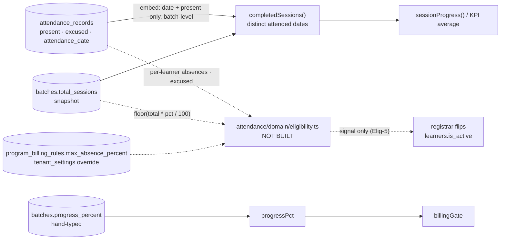

# Workflow: Attendance and Dropout Eligibility (ADR-007)

Attendance is the most load-bearing fact in this product and the least built. It is what
progress is supposed to mean and what decides whether a scholar stays enrolled, and the
only attendance code in the repository is one embedded read inside the batch mapper. The
dropout rule is locked, stored, and **evaluated by nothing**: `modules/attendance/` holds a
`README.md` and no other file — no `data/`, no `domain/`, no `ui/` — so there is no
`domain/eligibility.ts` to extend, only a design to implement from scratch. Its README is
explicit ("No code yet") and lists all three directories as planned.

That split is the whole page: the chain that exists, then the rule that has to be built.

## The rule, and the three ways to get it wrong

[ADR-007](/docs/adr/ADR-007-attendance-based-dropout-rule.md) **Elig-2** supersedes ADR-001's
`Elig` row and locks: a scholar is dropped from the program if **(a)** total absences exceed
**20% of the batch's `total_sessions`** — allowed absences `⌊total_sessions × percent ÷ 100⌋`,
the `(n+1)`th absence disqualifying — **or (b)** the scholar accumulates **3 consecutive
unexcused absences**, whichever trips first. It is a locked domain fact in `RULES.md`,
unnumbered, beside the progress formula. The retired rule was a flat `absences ≥ 5` (stored
`max_absences = 4`) and a *payment* exclusion; do not quote it.

- **Nothing is a constant.** `total_sessions` is the denominator and is `nominal hours ÷ 8`
  snapshotted at batch creation (E2/D3), frozen so it never moves with the calendar. A
  45-session batch allows 9 absences; a 20-session batch allows 4. A batch with a null
  `total_sessions` cannot be evaluated at all.
- **The comparison is strict.** `absences > allowed`, so exactly 20% is still eligible and
  the next absence drops — the same `actual > allowed` shape the old rule used, with
  `allowed` derived per batch instead of hardcoded.
- **Both triggers are independent.** The streak fires even when the scholar is far inside the
  percentage, so an implementation must return whichever trips and must not short-circuit on
  "under threshold".

Deductions do not move with it: ADR-001 **FF2** (`tranche% × total_TSF − absences × ₱160`)
still runs off the raw per-scholar absence count on the final tranche, independent of the
threshold (Elig-6), so a scholar can accrue a deduction for sessions attended before a
dropout took effect.

## Two trigger mechanics that decide the shape of the code

**The streak counts consecutive *recorded* rows, ordered by `attendance_date` (Elig-4).** No
session-calendar table exists — `schedule_pattern` stays free text per D3 — so a date with no
row is **unmarked**, not proof of absence. An absence run must break on a recorded *present*
row only; a calendar gap between two absences does not reset it. Reading an unmarked holiday
as an absence trips the 3-consecutive rule on schedule alone. ADR-004's "absent key ≠
evidence" caution is the same idea applied to documents.

**`attendance_records.excused` is the only thing that keeps an excused absence out of the
streak** (Elig-3). It is meaningful only where `present = false`, and the migration defaults
it to `false`: an absence nobody marked counts as unexcused, so forgetting to mark cannot
excuse a scholar. The reverse default is the subtler failure and understates dropout risk for
every scholar at once. `excused` affects trigger (b) only — the percentage trigger counts
absences, excused or not.

**Dropout is a signal, not a write (Elig-5).** Crossing either threshold surfaces an
at-risk state; flipping `learners.is_active = false` stays a manual registrar action, per JJ1
(alerts computed on read, no cron). `is_active` has existed since the canonical migration and
is read for nothing else: `getBatchLearnersSnapshot` deliberately returns every learner
regardless of `is_active` and leaves the exclusion policy to the caller.

## Threshold resolution

Two columns hold the number, and precedence is the program default with a per-tenant
override:

- `program_billing_rules.max_absence_percent numeric(5,2) not null default 20.00`, checked
  `> 0 and <= 100`.
- `tenant_settings.max_absence_percent`, same CHECK, **nullable and with no default**, so
  null means "inherit the program rule" and an override cannot be born accidentally. A
  consumer resolves `tenant ?? program`, and treats a null in both as the program default —
  never a second hardcoded 20.

Mark this as **needs confirmation**: no code resolves either column today (below), so the
precedence above is what the ADR, the migration comments and the nullable override shape
describe, not what a shipped function does.

## What exists today

The one live attendance read sits in [`modules/batches/data/batches.ts`](/modules/batches/data/batches.ts),
whose batch query embeds `attendance_records(attendance_date, present)`. Its readonly
`completedSessions()` counts **distinct attended dates** — a `Set` over rows where `present`
is true — and returns `null` unless both halves exist: a snapshotted `total_sessions` and at
least one attendance row. The `null` matters mechanically, because PostgREST answers an
empty embed with `[]`, never `null`; without the guard, "attendance not recorded here" would
read as a real "0 sessions held". `totalSessions` comes straight off the snapshot.

`excused` and `notes` are **not** in that embed, and the embed is batch-level: nothing reads
one row per learner, so the rule's input does not exist yet.

The trainer-facing surface is placeholders. `/trainer` renders a heading and a `MetricsRow`
built from the batch snapshot, with no module import; `/trainer/classes/[batchId]/attendance`
renders "Mark attendance", echoes `batchId`, and states the contract for later (verify the
trainer is assigned before returning a roster or accepting writes). Both rewire when the
module lands — new attendance code goes in the module, not in `app/` (rule 12).

## Progress versus the eligibility signal

Attendance already feeds progress, so the two must not be conflated:
`sessionProgress()` consumes `completedSessions`/`totalSessions`, returns `null` when either
half is missing, and caps `pct` at 100; the dashboard KPI average in `metrics.ts` reads that
pair and excludes untracked batches rather than scoring them zero. Eligibility is different —
it scores a *learner*, not a batch, and it answers a yes/no, not a percentage.

Billing readiness consumes the hand-typed half: `isBillingReady` and `billingGate` compare
`batch.progressPct`, which `mapBatchRow` fills from the stored `progress_percent` column with
an `orZero` default, not from attendance. Progress therefore gates billing readiness today
even though a batch with no attendance rows still charts a number. See
[Billing](/openwiki/modules/billing.md) for the gate itself.

## Where the rule lands in storage

One additive migration,
[`20261024071359_adr007_attendance_dropout_rule.sql`](/supabase/migrations/20261024071359_adr007_attendance_dropout_rule.sql),
adds the three columns and three column comments; every statement is guarded, so a re-run is a
no-op. It is not a rename: `max_absences = 4` counted sessions, so a cast to `4.00` would read
as "4 percent" and allow one absence on a 45-session batch instead of nine. The old column is
dropped from both tables rather than kept beside the new one, because two thresholds in two
units silently disagree.

It shipped as a new file because Supabase keys applied migrations on the version string:
editing a recorded file changes the repository and never the database, leaving the repo
claiming `max_absence_percent` while the live column stayed `max_absences`. Migrations run in
filename order, so the additive file is correct either way — `RULES.md` rule 20's standing
pattern. Ledger and apply procedure: [Data Model and RLS](/openwiki/architecture/data-model-and-rls.md)
and [Live Supabase and Migrations](/openwiki/operations/live-supabase-and-migrations.md).

Rows stay editable in place, with no lock flag, even after billing (ADR-001 **X2**). The
existing `attendance_records` policies encode it: INSERT and UPDATE admit
`can_trainer_write_batch(batch_id)` **or** `can_manage_tenant(tenant_id)`, DELETE is
`can_manage_tenant` only — a trainer corrects by updating `present`/`excused`, not by deleting
evidence. The same rows already cover `excused`; ADR-007 adds no policies. Each correction
should append an `activity_log` event (X2), but **no trigger writes one** — a new attendance
write path has to author its own event or the audit trail quietly stops.

## What a builder has to create

Order is forced by the data:

1. **A per-learner attendance read** in `modules/attendance/data/`, the fetch→map→derive
   contract of rule 17. Extend the select with `excused`, or the streak trigger reads zeros.
2. **`modules/attendance/domain/eligibility.ts`**, pure over injected rows (rule 14): the
   floor, the ordered unexcused streak that survives unmarked gaps, and a `null` result when
   `total_sessions` is missing — mirroring `sessionProgress()` rather than inventing a second
   unavailable style.
3. **Types.** `database.types.ts` carries neither new column and `attendance_records` is not
   typed at all — it exists in code only as an inline embed shape. Rule 20 wants regeneration
   first, but the file is hand-maintained and carries columns ahead of their records, so until
   it is regenerated a hand-written wrapper must treat both columns as possibly absent.
4. **The signal surface**, showing "not recorded" distinctly from "0 absences" (rule 23: text
   + icon, never colour alone; an unsourced metric renders "—" plus what is missing, never 0).
5. **Marking UI** on `/trainer/classes/[batchId]/attendance`. The table is unique on
   `(tenant_id, batch_id, learner_id, attendance_date)`, so a second write for one
   learner-date is an UPSERT or a merge, not an INSERT.

There is no test to inherit on the eligibility side: the existing pins are all progress
(`tests/unit/batches.test.ts` fixes distinct-date counting and the two null `completedSessions`
cases; `tests/unit/dashboard-domain.test.ts` fixes the `null`/cap behaviour and the KPI
average). Nothing touches `excused`, `max_absence_percent` or a dropout boundary. The ADR's
own worked example — 45 sessions, 9 allowed, the 10th dropping — belongs in a fixture beside a
2-consecutive-then-marked case and an unmarked-gap case.

## Boundaries of this page

`attendance_records` schema, RLS and the migration ledger are
[Data Model and RLS](/openwiki/architecture/data-model-and-rls.md); trainer scope and
role authority are [Tenant Scoping and Role Authority](/openwiki/workflows/tenant-scoping-and-role-authority.md);
the FF2 deduction and tranche thresholds are [Billing](/openwiki/modules/billing.md); batch
lifecycle, `total_sessions` and the snapshot rules are
[Batches and Lifecycle](/openwiki/modules/batches-and-lifecycle.md). Shell, settings and
analytics surfaces are
[Analytics, Activity, Settings and Shell](/openwiki/modules/analytics-activity-settings-and-shell.md);
start here for orientation: [Quickstart](/openwiki/quickstart.md). The ADR index, with
ADR-007's supersession of ADR-001's `Elig` row, is
<!-- openwiki: broken internal link [/openwiki/modules/overview-and-adr-index.md] file "/openwiki/modules/overview-and-adr-index.md" does not exist. Fix the href or restore the target, then delete this comment. -->
[Modules, Overview and the ADR Index](/openwiki/modules/overview-and-adr-index.md).
