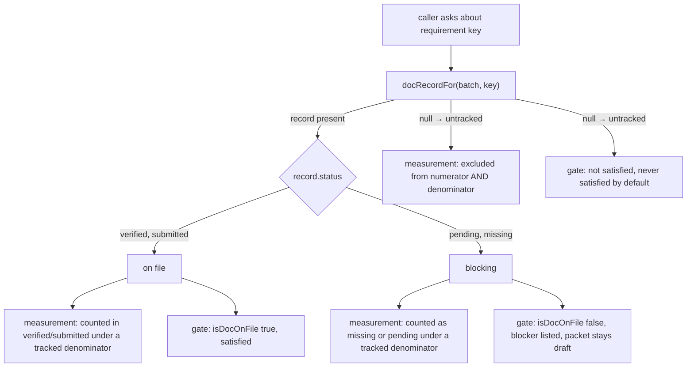

# Workflow: Measuring Document Compliance vs. Gating on It

A requirement catalog arrives from `program_document_requirements`, resolves into a `documents` map
on each batch, and then splits into two ends that never agree on purpose. One end **measures** — a KPI,
a matrix completeness card, an alert count. The other **gates** — billing readiness, packet blockers,
the blocking strip. The interesting part of both is the key that is *not* in the map: an untracked
requirement, which is neither verified nor missing.

`modules/documents/domain/compliance.ts` is the single arbitrating module
([ADR-004](/openwiki/modules/documents-and-evidence.md) D6). It is public across modules because
`domain/` is (`eslint.config.mjs` makes only `data/` private — RULES.md rule 8), so every counting
surface can import it. **Indexing `batch.documents[key]` directly outside a `data/` layer is the
pattern the ADR exists to remove**, and grep confirms no `.tsx` in `modules/` does it any more.

## How a key gets a record — and how one stays absent

Both producers of `Batch.documents` backfill first, overlay second:

- `mapDocumentsMap` in `modules/batches/data/batches.ts` writes every key of the embedded program's
  `program_document_requirements` to `MISSING_DOC`, then overwrites with real rows.
- `mapDocumentRows` in `modules/documents/data/documents.ts` does the same against the catalog handed
  in by `getBatchDocumentsSnapshot(batchId, requirements)`.

So "no submitted row" is settled at the data layer ([D1](/openwiki/modules/documents-and-evidence.md)),
not by each caller. A key **still** absent after the backfill was never in *that batch's* catalog, and
only the domain layer gets to interpret it. Two ways that survives in practice:

- **Partial catalogs.** Callers pass a different catalog than the batch carries — the matrix passes
  `requirementCatalogOf(batches)`, the union across every shown program, so a Program A requirement is
  untracked on a Program B column by construction; `deriveDashboardMetrics` reads each active batch's
  own catalog instead.
- **No catalog at all.** Every caller of `DocumentsView`/`TableView`/`AlertsPanel`/
  `DocumentStatusDonut` still passes an empty `documentRequirements` because no page has a program id
  to fetch one with (`modules/documents/README.md`). An empty map is therefore the *current normal
  state*, not an edge case.

Both branches from one lookup are decided in `docRecordFor(batch, key)`, which returns the record or
`null`. The branches then diverge deliberately: measurement declines to judge, gating fails closed (D2
vs D4, `tests/unit/doc-blockers.test.ts` pins a "gate and measurement disagree" case so a refactor
cannot quietly align them).

*`null` is the only split point: measurement steps aside, gating treats it as unmet.*

## Measurement: untracked leaves the denominator

`summarizeDocCompliance(batches, requirements)` counts `untracked` separately and hands every
percentage to `pct(part, whole)`, which returns `null` when `whole` is 0. So:

- One verified and one missing of four requirements → `verifiedPct: 50`, `onFilePct: 50`,
  `untracked: 2`. The two untracked keys neither drag the figure down (as `missing` would) nor prop it
  up (as the retired "absent ⇒ verified" rule did).
- Nothing tracked → `tracked: 0`, `onFilePct: null`, `verifiedPct: null`. **Never `0`, never `100`** (D3).

`summarizeOwnCatalogCompliance(batches)` wraps that per batch over `criticalRequirements(
batch.documentRequirements)`. `criticalRequirements` — a filter on `req.critical`, i.e. the DB
`is_required` flag — is also the tool that stops another program's requirement counting against a
batch. `requirementCatalogOf` unions catalogs for display only; never score against the union.

The `null` propagates as a **type**, not a convention: `DashboardMetrics.docCompliancePct` is
`number | null` (`modules/batches/domain/metrics.ts`), so a forgetting consumer is a compile error.
`KpiSummary` renders `'—'` with the sub-label "Not yet tracked", `SchoolsOverview` prints "Not tracked"
instead of a figure, and `DocumentsView`'s completeness card computes its own `pct === null → '—'`
over tracked records only (RULES.md rule 23: a metric with no source renders "—", never 0).

`docRecordFor(...)?.status === 'missing'` is the *other* legitimate measurement read: the dashboard
attention list (`modules/batches/domain/attention.ts`) names only recorded-missing critical documents,
never untracked ones. `tests/unit/dashboard-domain.test.ts` asserts exactly that exclusion.

## Gating: untracked is not satisfied

`isDocOnFile(batch, key)` is `record !== null && ON_FILE_STATUSES.has(record.status)`, and
`ON_FILE_STATUSES` is `{verified, submitted}` (ADR-001 §7.2.4 accepts the uploaded manual attendance
sheet as billing evidence, so `submitted` clears a gate without being verified — **verification is not
a release blocker**). Untracked short-circuits to `false`: a gate must never open on evidence nobody
recorded.

Downstream, untracked surfaces as a first-class, *non-satisfied* state rather than being flattened
into `missing`:

| Gate | Read | Untracked outcome |
| --- | --- | --- |
| `deriveDocReadiness` (`billing/data/billing.ts`) | `isDocOnFile` over critical `aou/ntp/tip/train` | denominator keeps the slot, `verified` does not move, `billingGate` stays shut |
| `buildPacket` (`billing/domain/packets.ts`) | `docRecordFor` for `status`, `isDocOnFile` for `satisfied` | `PacketDoc.status === 'untracked'` (the one `DocStatus \| 'untracked'` projection, D5), `satisfied: false`, labelled in the blocker sentence, `state` forced to `draft` |
| `blockingDocuments` / `blockerCount` (`compliance.ts`) | `blockerReasonFor` | `reason: 'untracked'`, counted, criticals sorted first |
| `batchAlerts` (`batches/domain/alerts.ts`) | `summarizeBatchDocCompliance(b, criticalDocs)` | untracked excluded from `missing`, row fires only once `tracked > 0` |

`buildPacket` also guards the empty catalog separately: `requirements.length === 0` is
"catalog unavailable", not "nothing required", because an unevaluated checklist must never read as
satisfied — the same `requiredTotal > 0` guard `billingGate` uses. The gate halves are documented on
[/openwiki/modules/billing.md] and walked end to end in
[/openwiki/workflows/billing-packet-and-statement.md].

## Failure modes, plainly

- **An unguarded `documents[key].status` throws.** Before ADR-004, `TableView` and `DocumentsView`
  crashed with a `TypeError` on any batch whose catalog lacked a mock-catalog key — the ADR's own
  review found these were the two sites that did not "fail safe". The fix is that consumers call
  `docRecordFor` and narrow to `null`, never `undefined`. A new counting surface that indexes the map
  directly reintroduces the crash for every batch with a partial catalog.
- **An all-absent set prints 0%.** The pre-ADR donut skipped absent keys but still printed `0%` for a
  set with nothing tracked, and the dashboard needed a local `docsTracked` patch to show "—" over the
  old "absent ⇒ verified" counter (which read as a cleared checklist). The replacement is one `null`,
  produced by `pct`, and the patch is gone.
- **A gate opens on evidence nobody has seen.** Mapping untracked onto `submitted` "fixes" the closed
  gate by asserting a document that was never recorded; a batch with no catalog would then generate a
  packet. Keep it as its own state and keep it unsatisfied.
- **A wrong catalog makes one program's documents count against another.** Scoring a union instead of
  `batch.documentRequirements` marks a Program B batch missing for Program A's requirements;
  `AlertsPanel`'s pre-ADR guard ("is *any* document tracked") was the narrow version of the same
  mistake — a batch tracking one non-critical document and no critical ones slipped through, which is
  why the guard is now `tracked > 0` on the *critical* summary.
- **Trusting the map's shape.** `Batch.documents` is `Record<string, DocRecord>` per
  `shared/types.ts`, but the type says nothing about which keys are present; only the domain layer's
  `null` return carries that.

## The evidence ladder

Evidence is what moves a requirement from `pending`/`missing` toward `verified`. The ladder has three
rungs, and the top one is a permission, not an automatic consequence of an upload.

**1. Path validation** (`modules/documents/domain/evidencePath.ts`). `buildEvidencePath` composes
`{tenant_id}/{batch_id}/{document_key}/{filename}` and validates tenant id, batch id, document key,
filename — in that order, so the outermost problem is reported. This is a security boundary: the
`compliance-evidence` bucket's policies authorize every operation with
`app_private.can_access_tenant((storage.foldername(name))[1]::uuid)`, so **segment 1 is the tenant
check** and a filename containing `/` relocates the object into a folder whose first segment is no
longer the caller's tenant. `tests/unit/evidence-path.test.ts` is mostly separator-injection coverage.
`validateEvidenceFile` enforces `EVIDENCE_MAX_BYTES` (52 428 800 — matching the bucket's own
`file_size_limit`) and a narrow MIME allowlist, size before type. Every entry point returns a
discriminated result instead of throwing, because FR-06 needs *invalid type*, *upload rejected* and
*upload failed* to stay three distinguishable states; `EVIDENCE_REJECTION_COPY` holds the copy and
leaks no identifier.

**2. Upload** (`modules/documents/data/evidence.ts`). `uploadEvidence` returns `unconfigured` when
Supabase is unset, validates file then path, then writes with `upsert: false` so a re-submission
creates a new object and leaves the prior one, which an auditor may already cite, intact. Failures
split into `rejected` (bytes never sent) and `sync-failed` (Storage refused or threw). Reads are
signed URLs only — the bucket is private (`public = false`) and `getSignedEvidenceUrl` defaults to a
300 s TTL. Nothing calls either function yet: `DocumentsView`'s upload control is still an
"Attach document" toast, and `mapDocumentRow` sets `doc.url` to the bare `storage_path` key, so the
round trip is written but unexercised.

**3. The status ladder.** `DocStatus` mirrors the DB `document_status` enum and is assigned straight
off the row by `mapDocumentRow`: `missing` (backfilled when no row exists) → `pending` → `submitted`
(an upload, now `on file` for every gate) → `verified`. Verification is an **admin-only** action with
no store yet: `DocumentsView.handleVerify` writes an override keyed `batchId:key` into local state as
`{status: 'verified', verifiedBy, verifiedDate}` and refuses when the profile has no display name, so
a record is never attributed to nobody. Because the panel's `verifiedBy` and `verifiedDate` come from
the same local override, the verification rung survives until reload and no further — and since
`submitted` already clears `isDocOnFile`, a stale verification blocks nothing.

Bucket policy shape that constrains future work: select/insert/update for any member of segment 1; a
DELETE policy added by `20260910120000_add_adr001_billing_domain.sql` gated on the tighter
`can_manage_tenant`, because reading and uploading are ordinary trainer work and destroying evidence
is not. `evidence.ts` still exposes no `deleteEvidence`. `storage_path` is unconstrained `text`, so
`getSignedEvidenceUrl` re-parses the stored key through `buildEvidencePath` and rejoins the trailing
segments with `/` rather than trusting segment 4.

## Where to change what

- **A new counting surface** routes through `docRecordFor` / `summarizeBatchDocCompliance` /
  `isDocOnFile`; a new *gate* uses `isDocOnFile` so it fails closed.
- **A new measurement copy state** must handle `null` before any number; `DashboardMetrics` gives the
  compiler the reminder.
- **A new evidence surface** calls `validateEvidenceFile` and `buildEvidencePath` on both sides, then
  `uploadEvidence`; never compose a key by hand.
- **The rule itself** lives only in `compliance.ts` — a per-site re-decision is a regression, not a
  local choice.

Tests: `tests/unit/doc-compliance.test.ts` (D1–D4, `null`-not-zero, alert suppression),
`tests/unit/doc-blockers.test.ts` (untracked blocks; the deliberate disagreement),
`tests/unit/evidence-path.test.ts`, `tests/unit/documents.test.ts`,
`tests/unit/batches.test.ts` (backfill before overlay). RLS and the live upload round trip are
unverified pending the Clerk/Supabase auth toggles (issue #122).

Companions: module reference and screen behaviour on
[/openwiki/modules/documents-and-evidence.md]; banner-before-empty guard ordering on
[/openwiki/concepts/error-snapshots-and-honest-empty-states.md].