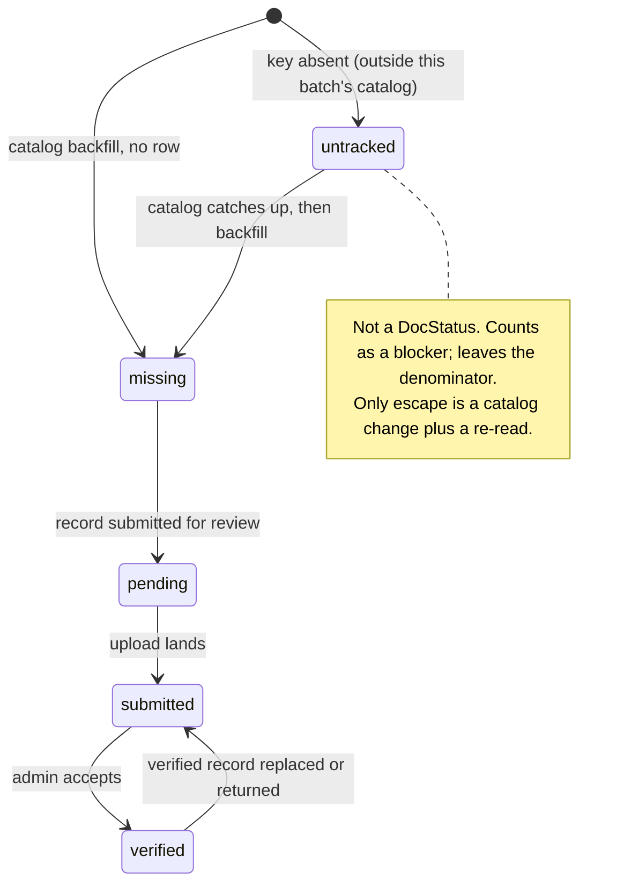

# Workflow: Requirement Catalog → Blocker, or Verified Evidence

Trace one requirement from the catalog to the moment it stops costing anything: an admin accepts it,
or — per ADR-001 §7.2.4 — an uploaded manual attendance sheet is taken as billing evidence without
anyone verifying it. A `program_document_requirements` row resolves into a `documents` map on each
batch and runs one order, `missing` → `pending` → `submitted` → `verified`, plus a fifth, off-ladder
answer for a key the batch never carried. Four of those five are `DocStatus` values mirroring the DB
`document_status` enum
([canonical migration](/supabase/migrations/20260528160300_create_tenant_scoped_schema.sql)); the
fifth, ADR-004's **untracked**, is represented as *absence* and has no enum member
([D5](/docs/adr/ADR-004-untracked-document-semantics.md)).

The workflow is an *order*, not a table shape. Two things break it silently: a transition that jumps
a state, and code that folds untracked into `'missing'`. Either moves a blocker count with no type
error, no failure outside the domain specs, and no trace on screen.

*Every arrow is a caller-choosable data write and only one domain rule decides what each state means;
`untracked → missing` is the only one a client cannot cause directly. `verified → submitted` and
`verified → pending` are the undo edges — permitted at the DB layer, offered by nothing in the UI.*

`modules/documents/domain/compliance.ts` is the only module allowed to interpret a key
([D6](/docs/adr/ADR-004-untracked-document-semantics.md), RULES.md rule 8); `domain/` is public across
modules because `eslint.config.mjs` restricts only `data/`, which is why every counting and gating
surface imports it and none indexes `batch.documents[key]` anymore. Both halves of this page's domain
are pure (RULES.md rule 14) — no clock, no network — and that is load-bearing: the fixed-date specs
cannot pin a branch that reads either.

## The state machine: who may move a cell, and what can be undone

Only four arrows are real, because only four writes exist. Reading the table left to right, the
trouble is on the right.

| Transition | Who | Recorded in | Undoable? |
| --- | --- | --- | --- |
| *(none)* → `missing` | nobody — the data layer | nothing; `MISSING_DOC` is synthesised per read (`mapDocumentsMap`, `mapDocumentRows`) | n/a — never stored |
| `missing`/`pending` → `submitted` | an admin/coordinator, or a trainer assigned to the batch on a `trainer`/`all`-audience requirement | the row's `status`, `storage_path`, `submitted_by`, `submitted_at` (expected; no UI path yet) | yes — a fresh upload writes the same row |
| `submitted`/`pending` → `verified` | **admin only.** `canManage` gates the button *and* `handleVerify` re-guards it | today: a component `overrides` entry keyed `batchId:key`, lost on reload. `verified_by`/`verified_at` exist but nothing writes them from this path | **no.** Only a second admin verify can overwrite it, and there is no un-verify control |
| `verified` → `pending`/`submitted` ("Request changes", or a replacement upload) | a writer by role; only the requirement's own trainer for a row they submitted | nothing today — a toast, and the preview modal merely closes | yes at the DB level, unbuilt in the UI |

So `verified` is not safely above the ladder: with no exit control it is a one-way door whose only
"correct" handling is that a lost verification is harmless, because `submitted` already cleared the gate.
The price is paid in attribution, not in readiness.

The DB draws the who: `documents` has an all-command policy for `can_manage_tenant`, while a trainer may
insert only where `can_trainer_write_batch(batch_id)` and the requirement's audience is `trainer`/`all`,
and update only a row whose `submitted_by = current_profile_id()`
([migration](/supabase/migrations/20260528160300_create_tenant_scoped_schema.sql)). A viewer never
appears in a write predicate, and nothing constrains the *edge* — a correctly ordered transition is a
convention, not an enforcement.

The UI is narrower than the policy on two counts. `FilePreviewModal` renders "Verify document" and
"Request changes" **only while the cell is `submitted`**, so an admin cannot verify a `pending` record —
that half of the row is DB shape, not a reachable screen state (`handleVerify` re-guards
`role === 'admin'` regardless). And because `handleVerify` writes an override that `docOf` merges over
the record, the modal reopens as `verified` and the verify pair disappears, so a second admin verify is
unreachable too.

The classic failure is the fourth row: **rejection is irreversible and, in the UI, note-free.** There is
no `rejected` status to land on and no column for a reason, so a rejected document is indistinguishable
from one nobody looked at, and the re-work is invisible to the next reviewer. Worse, the cell keeps
reading `verified` the whole time, so an admin looking at the matrix after refusing a document sees a
green cell. A durable fix needs a real write — prior status plus a note — before the toast can stay a
toast.

The override is the same hazard one layer down: it is the only place `verifiedBy` lives for an in-session
verification, and a reload reverts the cell to `submitted`. That costs no gate — `submitted` already
clears `isDocOnFile` — but it destroys the attribution verification existed for.

## Where the keys come from

Both producers of `Batch.documents` backfill first, overlay second: `mapDocumentsMap`
(`modules/batches/data/batches.ts`) and `mapDocumentRows` (`modules/documents/data/documents.ts`)
write `MISSING_DOC` for every key of the embedded program's catalog, then overwrite with real rows.
"No submitted row" is settled at the data layer ([D1](/docs/adr/ADR-004-untracked-document-semantics.md)),
not by each caller. Only a key still absent afterwards — one *this* batch's catalog never listed —
reaches the domain layer, and only there becomes untracked.

Two ways that survives in production:

- **Partial catalogs.** `DocumentsView`'s columns are `requirementCatalogOf(batches)`, the union across
  every shown program, so a Program A requirement is untracked on a Program B column by construction.
  `deriveDashboardMetrics` instead reads each active batch's own catalog — see
  [the module reference](/openwiki/modules/documents-and-evidence.md) for the split.
- **Empty catalogs.** A batch whose program join is null, or whose program has no requirement rows,
  carries one. The **billing route still passes `const documentRequirements: DocumentRequirement[] = []`**,
  because `Batch` carries no program id to fetch a real one with.

The catalog is also *deployment* state, not a constant. `documents` ships with no unique key on
`(batch_id, document_key)`; the dev seed adds `documents_batch_id_document_key_key` with a warning that
a real upload path would otherwise duplicate rows silently.

## The split point

`docRecordFor(batch, key)` returns the record or `null`, and every branch hangs off that one return. The
two directions are deliberately opposite and both fail safe: **measurement** drops `null` from numerator
and denominator, so nothing tracked yields `null` from `pct()` ([D2, D3](/docs/adr/ADR-004-untracked-document-semantics.md));
**gating** treats `null` as not satisfied, because a gate must never open on evidence nobody recorded
([D4](/docs/adr/ADR-004-untracked-document-semantics.md)).

`tests/unit/doc-blockers.test.ts` pins the disagreement end to end: one verified requirement plus one
untracked measures `onFilePct: 100` while `blockerCount` returns 1. "100% compliant and still blocked" is
the correct answer, so aligning the two is the regression to watch.

On the gate side, `isDocOnFile` is `record !== null && ON_FILE_STATUSES.has(record.status)` with
`ON_FILE_STATUSES = {verified, submitted}`. `submitted` clears a gate without ever being verified, so
**verification is not a release blocker** — a document that slips back down the ladder costs no gate
anything.

`blockerReasonFor` is the inverse and returns its own narrow vocabulary — `'untracked' | 'missing' |
'pending'`, not a `DocStatus` subset, because `untracked` is a state no row can carry. `blockingDocuments`
collects it, partitions criticals first with two filters rather than a comparator, and surfaces `count`
and `criticalCount`; `blockingDocumentNames` maps to `label` because FR-06 AC-1 forbids rendering a key.

## Which blocker surface is live

- `blockingDocuments`, `blockerCount` and `blockingDocumentNames` have **no caller anywhere**, `app/`
  included. The intended consumer is the batch card's badge next to the named strip, and it is unrendered.
- The count that actually reaches a coordinator is the dashboard KPI's `docMissing`, from
  `deriveDashboardMetrics` → `summarizeOwnCatalogCompliance` → `summarizeBatchDocCompliance`, rendered
  by `KpiSummary.documentStatus` as `"{docMissing} required missing"`. It counts **tracked-missing
  criticals only** — an untracked requirement blocks in the strip model but is excluded from `docMissing`
  and only totals separately in `docUntracked`, which the KPI never prints. The screen under-reports
  blocking by exactly the untracked count. `SchoolsOverview` prints "Not tracked" only when
  `docCompliancePct` is `null`, so any tracked-but-untracked mix still prints a percentage.
- `DocumentStatusDonut` renders only the tracked picture: it prints `onFilePct` in the ring centre,
  returns `null` when nothing is tracked, and carries the untracked figure only in the panel metadata —
  so it and the KPI above it can disagree about which number is "it".
- `batchAlerts` fires the missing-critical-docs row only when `tracked > 0 && missing > 0`, so untracked
  keys raise nothing and a catalog-less batch is silent for documents
  ([ADR-004](/docs/adr/ADR-004-untracked-document-semantics.md) required the *critical*-tracked guard
  precisely so this cannot fire on a non-overlapping catalog).

None of these agree on a unit. If the strip is wired, the KPI should adopt it rather than keep growing a
parallel count.

## Gating destinations

An untracked or non-on-file requirement travels to four gates, each of which keeps it closed:

| Gate | Read | Untracked outcome |
| --- | --- | --- |
| `deriveDocReadiness` (`billing/data/billing.ts`) | `isDocOnFile` over critical `aou/ntp/tip/train` | denominator keeps the slot, `verified` does not move, `billingGate` stays shut |
| `buildPacket` (`billing/domain/packets.ts`) | `docRecordFor` for `status`, `isDocOnFile` for `satisfied` | `PacketDoc.status === 'untracked'` (the one `DocStatus \| 'untracked'` projection, D5), `satisfied: false`, named in the blocker sentence, `state` forced to `draft` |
| `blockingDocuments` / `blockerCount` | `blockerReasonFor` | `reason: 'untracked'`, counted, criticals first |
| `batchAlerts` | `summarizeBatchDocCompliance` | excluded from `missing`; row fires only once `tracked > 0` |

Both billing halves guard the empty catalog separately — `deriveDocReadiness`'s full-set denominator
never satisfies `billingGate`'s `requiredTotal > 0` check, and `buildPacket` emits "catalog unavailable"
rather than counting zero blockers — because an unevaluated checklist must not read as satisfied. The
gate walk-through lives in [/openwiki/modules/billing.md]; billing readiness itself is not re-derived here.

## Evidence: path, upload, signed read

Evidence is what the middle arrow of the machine consumes. All three helpers are written and none is
exercised by a component — the cell click still raises an "Attach document" toast — so the *transition*
`missing → submitted` is specified but not wired.

1. **Path** (`domain/evidencePath.ts`). `buildEvidencePath` composes
   `{tenant_id}/{batch_id}/{document_key}/{filename}` and validates tenant id, batch id, key, filename —
   in that order, so the outermost problem is the one reported, while tenant and batch are anchors and
   only `filename` is user-shaped. The bucket's policies authorize every operation with
   `app_private.can_access_tenant((storage.foldername(name))[1]::uuid)`, so segment 1 *is* the tenant
   check: a filename containing `/` relocates the object into a folder whose first segment is no longer
   the caller's tenant, and a tenant the caller also belongs to is not denied at all.
   `validateEvidenceFile` enforces `EVIDENCE_MAX_BYTES` (52 428 800, the bucket's own `file_size_limit`)
   inclusively and a narrow MIME allowlist, size before type. Every entry point returns a discriminated
   result, because FR-06 needs *invalid type*, *upload rejected* and *upload failed* distinguishable.
2. **Upload** (`data/evidence.ts`). `uploadEvidence` returns `unconfigured` when Supabase is unset
   (`isSupabaseConfigured` — a server env check, so client-side calls would always short-circuit),
   validates file then path so a bad request costs no round trip, then writes with `upsert: false`,
   leaving the prior object an auditor may cite intact. Failures split into `rejected` (bytes never sent)
   and `sync-failed`.
3. **Read**. The bucket is private; reads are signed URLs only, `getSignedEvidenceUrl` defaulting to
   300 s. `storage_path` is unconstrained `text`, so the stored key is re-parsed through the builder and
   the trailing segments rejoined with `/` rather than trusting segment 4 — a key with extra segments
   fails `isSafeFilename` instead of signing a shorter path than the one validated.

`uploadEvidence` returns only `{path}`. Nothing in `documents` is written, so the transition itself is
a second step the caller owns — and two states can now disagree silently: a `submitted` row whose object
is missing, or an object whose requirement is still `missing`. Deriving one from the other inside the
domain layer would put Storage I/O in front of every compliance figure.

Nothing here is covered by a test, and both functions sit behind auth toggles that are still unset
(issue #122), where every call fails with an RLS denial indistinguishable from a code defect.

## What changes where

| Action | Leaves a mark in |
| --- | --- |
| Add a requirement to a program catalog | `program_document_requirements`; the next `getBatchesSnapshot` backfills the new key `'missing'` on every batch of that program |
| First upload for a `(batch, key)` | `storage.objects` under the tenant prefix, and `documents` — status `submitted`, `storage_path`, `submitted_by`, `submitted_at` |
| Admin verify | `documents.status = 'verified'`, `verified_by`, `verified_at` |
| Client-only click of "Verify document" | component `overrides`; until reload — and, because `submitted` already clears `isDocOnFile`, a lost verification costs no gate anything |
| "Request changes" | a toast only — no write, no note, no status change; the cell still reads `verified` |

Only the third row is a durable state change an auditor can read later, and it is the one with no code
behind it. `mapDocumentRow` does populate `verifiedBy` / `verifiedDate` and `FilePreviewModal` prints
them, so a DB-verified row attributes correctly; only the in-session verification is unattributed.

Bucket policy shape for future work: select/insert/update for any member of segment 1; a DELETE policy
added by `20260910120000` gated on the tighter `can_manage_tenant`, since reading and uploading are
ordinary trainer work and destroying evidence is not. `evidence.ts` still exposes no `deleteEvidence`,
so even the bucket cannot undo an upload from the app.

## Failure modes, plainly

- **Folding untracked into `'missing'`.** Denominators shift, `batchAlerts` starts firing on catalogs
  nobody recorded, and every gate stays closed for the wrong reason.
- **Printing `0` or `100` over an untracked set.** The old donut skipped absent keys but still printed
  `0%`, and the old "absent ⇒ verified" counter read as a cleared checklist. Note the mirror image: one
  verified requirement on an otherwise unrecorded batch is a legitimate `100` beside a blocker count of 1.
- **A rejection that writes nothing.** "Request changes" costs the row nothing, so the cell keeps
  reading `verified` after an admin has just refused it, and the next reader cannot tell it was reviewed.
- **Indexing `batch.documents[key]` directly.** Pre-ADR this threw a `TypeError` in `TableView` and
  `DocumentsView` on any batch whose catalog lacked a key; a new counting surface that indexes the map
  reintroduces it for every partial catalog.
- **A clock or a network read inside `compliance.ts` or `evidencePath.ts`.** Both specs are fixed-date;
  a `Date.now()`-derived branch escapes them. (`DocumentsView` legitimately calls `new Date()` — it is a
  component, not the domain.)
- **`upsert: true` on upload, or a trust-the-client key.** Loses the cited object, or lets segment 1
  stop being the tenant.
- **Letting an upload imply a status.** Returns a path and writes no row; treating "an object exists"
  as "`submitted`" hides the second write that never happened.

## Where to change what

- **A new counting surface** calls `docRecordFor` / `summarizeBatchDocCompliance` and handles `null`
  before any number.
- **Actually rendering the blocker strip** is the open job: wire `blockingDocuments` (or `blockerCount`
  for a badge) into the batch card, passing `criticalRequirements(batch.documentRequirements)`, and
  render `label`s, never keys.
- **Wiring `/billing`'s catalog** comes next: it still passes `[]`, so `buildPacket` says "catalog
  unavailable" and `billingGate` stays shut on every batch. Both degrade correctly, neither is useful yet.
- **A verification write path** must set `verified_by` / `verified_at` so it replaces the local override
  rather than joining it; **a rejection write path** must record the note, or the reverse edge stays
  unusable.
- **A new evidence surface** validates file *and* path before send, then calls `uploadEvidence`, then
  writes the returned path plus `status: 'submitted'` to the `(batch, key)` row; never composes a key by
  hand.
- **The rule itself** stays in `compliance.ts`; a per-site re-decision is a regression.

Pins: `tests/unit/doc-compliance.test.ts` (D1–D4, `null`-not-zero, alert suppression),
`tests/unit/doc-blockers.test.ts` (untracked blocks; the deliberate disagreement),
`tests/unit/evidence-path.test.ts`, `tests/unit/documents.test.ts`, `tests/unit/batches.test.ts`
(backfill before overlay). None touches the bucket round trip or any transition write; RLS and the
issue #122 toggles are unverified.

Companions: module and screen reference on
[/openwiki/modules/documents-and-evidence.md]; gating details and readiness on
[/openwiki/modules/billing.md]; the batch side of the same catalog — lifecycle, rename, alerting — on
[/openwiki/modules/batches-and-lifecycle.md]; the data-pattern and guard-order contract every route
here follows on [/openwiki/architecture/module-boundaries-and-data-pattern.md].
