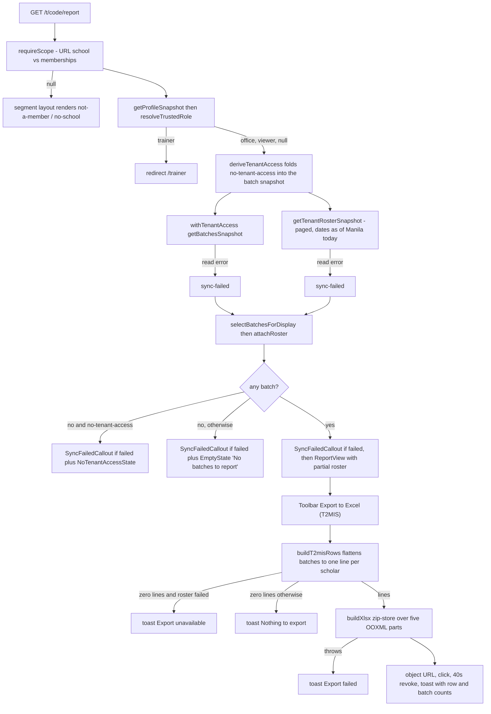

# Workflow: Assembling and Exporting a Report

Request in, file out. This page follows the one path that produces a downloadable workbook, from
the route's first fetch to `<a download>.click()`, and names at each hop where the snapshot can
fail and what the person at the screen sees instead.

The mechanics of the pieces live next door: the module and its writer on
[Reports, EGACE and the T2MIS export](/openwiki/modules/reports-and-t2mis-export.md), the layout and
the reverse (import) direction on [Import, export and the T2MIS layout](/openwiki/modules/import-export.md),
and who may read which columns on [Data Model and RLS](/openwiki/architecture/data-model-and-rls.md).
This page is the composition.

Two framings up front:

- **A downloaded file is a working copy, not an upload to TESDA.** The workbook is assembled
  locally and never sent anywhere; TESDA SIS/T2MIS/BSRS stay authoritative and no copy here may say
  a report was filed (rule 27, locked by `docs/adr/ADR-001-billing-and-domain-model.md`).
- **A short spreadsheet looks exactly like a correct one.** Almost every design decision below —
  paging, failing the snapshot, keeping `''` and "not recorded" separable, counting the toast's own
  rows — exists because a truncated or half-blanked export fails silently, while an *error* fails
  loudly and is therefore the safer outcome.

## The path, with its failure points

Where each snapshot can break, and what the reader gets:

| Hop | Can fail | What the user sees |
| --- | --- | --- |
| `getProfileSnapshot` | Non-`ok` profile | `dbRole` is `null`, so `resolveTrustedRole(null)` does **not** match `trainer` and no redirect happens — the gate is skipped entirely and the page runs on |
| `getBatchesSnapshot` | Any query error, or `unconfigured` | `sync-failed` → `SyncFailedCallout` ("this report may be incomplete" + Retry) plus an empty state; `unconfigured` → an empty state and **no callout at all** |
| Membership fold | Caller in no school (`no-tenant-access`) | `SyncFailedCallout` is skipped and `NoTenantAccessState` replaces the ordinary empty state |
| `getTenantRosterSnapshot` | Either of its two queries | `sync-failed` → same callout above a **still-rendered, roster-blank report**; `attachRoster` simply leaves batches bare |
| `buildT2misRows` / `buildXlsx` | Zero rows, or a throw | A toast in three distinct grades: `Export unavailable`, `Nothing to export`, `Export failed` |

One branch on the diagram is easy to miss: the trainer redirect hinges on a *trusted* profile read.
If the profile snapshot is not `ok`, `dbRole` is `null`, `resolveTrustedRole(null)` returns something
other than `trainer`, and the page runs on instead of denying — the redirect is reached only with a
positive `trainer` verdict.

## Hop 1 — the trainer gate comes first

`requireScope()` (`app/(dashboard)/tenant-scope.ts`) resolves the URL's school against the caller's
memberships and returns `null` when the segment layout is already rendering a state, so the page
returns nothing. The next thing it does — before either read — is `getProfileSnapshot` and
`resolveTrustedRole`, and a `trainer` is `redirect('/trainer')`.

`resolveTrustedRole` is called on `profiles.role` alone, never `resolveRouteRole`: the route resolver
honours a `?role=` preview override, so a real trainer asking for `?role=admin` would walk past the
gate and get a report whose every `learner_details` cell is empty. The redirect is the reason this
workflow is office-only — the roster's detail table has a read policy for `admin`, `coordinator` and
`viewer` and none for `trainer`. The route's own comment records that no redirect existed while the
screen rendered mock data.

The gate is also a cost: the profile snapshot it already holds is reused for `deriveTenantAccess`
rather than fetched twice, and the verdict is folded in with `withTenantAccess`, which rewrites only
an `ok` snapshot — so "you belong to no school" can never disguise a real read failure.
`selectBatchesForDisplay` meanwhile never substitutes data for a non-`ok` snapshot (`[]`).

This is a *route* concern by construction: rule 11 keeps `app/` to fetch-and-compose, rule 8 is
enforced by the `import/no-restricted-paths` zones in `eslint.config.mjs` (its `domains` list
includes both `"reports"` and `"import-export"`), every `modules/*/data/**` is private to its own
module, and only `app/` may reach them. So the tenant, the schools and the membership verdict are
resolved in the page, and the `ReportView` client island never calls Supabase.

## Hop 2 — the roster join, and why it pages

`getTenantRosterSnapshot(scope.tenantId)` is awaited after the batch snapshot, and `attachRoster`
hangs each batch's scholars and T2MIS facts on the batch under its `batch_code`; a batch with no
roster is left unchanged, so a partial read renders as a report with thin rows.

`fetchRosterRows` loops `range(from, from + 999)` with `ROSTER_PAGE = 1000` and stops only when a
page comes back shorter than 1000. Ordering is `last_name`, `first_name`, `id` — `last_name` alone
ties and an unordered tiebreak would reshuffle the ordered walk, dropping or repeating rows between
pages. The loop exists because the API caps a response at 1000 rows and silently discards the
remainder; a school past that boundary would otherwise export its first thousand scholars with no
error anywhere. `seq` (the per-batch position `ScholarRow` carries) is assigned from position in
that already-ordered result.

The second query in the same function pulls `training_calendar_code` and the composite
`tenant_qualifications → qualifications` embed per batch and hangs it on the roster as `t2mis`. It is
kept out of the learner select so the qualification columns are one row per batch rather than
repeated per scholar.

**Dates are computed in Asia/Manila, not UTC.** `todayInManila()` formats an ISO date through
`Intl.DateTimeFormat('en-CA', { timeZone: 'Asia/Manila' })` and that string becomes the roster's
`asOf`, feeding `ageOn` in the mapper. A UTC date is a day behind in the schools' timezone until
08:00, which would print an age one year low on a birthday for the first eight hours of the working
day.

## Hop 3 — EGACE and employment rollups

Both report tabs are computed in the client island from the joined `Batch[]`, by pure functions
(rule 14): `domain/egace.ts` and `domain/employment.ts`. `ReportView` sorts by school then batch id
first, so the figures and the exported line order are stable between reloads.

- `computeEgaceTotals` sums every stage; `egaceVal` falls back to the batch's scholar count for
  `enrolled` and `0` for the rest.
- Rates are fed `outcomeEnrolledBase(rows)` — enrolled over only the batches that record outcomes —
  so untracked batches cannot dilute a rate even though they are counted in the totals. A zero base
  returns `0` rather than `NaN%`.
- Employment selects certified scholars (`assessmentResult === 'Competent'`) and rolls up
  `certified / employed / awaiting / unemployed` where `employed` is wage **and** self-employed. The
  buckets deliberately do not sum to `certified`: an unrecorded status counts as certified and lands
  in no bucket, rather than inflating the unemployment figure. `empTone` gives that status `neutral`.

`tests/unit/reports-domain.test.ts` pins all of it, including non-mutation of the summed batches, both
zero-denominator guards, and the `sum(buckets) < certified` invariant.

## Hop 4 — building the rows against the layout

The toolbar's export button calls `exportXlsx(rows, tenantOf, setToast, rosterFailed)`. The workbook
is split across two modules by design, and the split direction is forced:

- **The layout** — 48 ordered `{ header, value }` columns and `buildT2misRows` — is
  [`modules/import-export/domain/t2mis.ts`](/modules/import-export/domain/t2mis.ts), the same contract
  the CSV import parses back.
- **The writer** is [`modules/reports/domain/xlsx.ts`](/modules/reports/domain/xlsx.ts).
- **They meet in `modules/reports/ui/exportXlsx.ts`.**

`exportXlsx` sits in `ui/` (it does DOM, Blob and object-URL I/O) precisely because a
`data/`-to-`data/` import would be blocked: rule 8 closes every other module's `data/`, and the zone
is generated by the `domains` list above. Consuming the layout through `import-export/domain/` is the
permitted direction. The writer was moved out of the view component into `domain/` under the same
logic in reverse — importable as the module's own surface *and* unit-testable (rule 35), since a
`ui/` sibling could not be tested as pure.

`buildT2misRows` flattens the portfolio: one line per scholar, columns read from the tenant catalog
row `tenantOf` supplies, `Batch.t2mis`, and `ScholarRow`. Dependents fall back rather than throw —
`?? ''` per cell covers a tenant the catalog could not resolve (`ReportView` substitutes a
`{ code: '—', name: '—', region: '' }` placeholder), an unresolved tenant blanks its provider cells,
and a qualification with no registry link blanks the six registration columns. Dates go out through
`isoToT2misDate`, and `Age` prints `''` rather than `0` when `ageOn` could not compute.

`tests/unit/t2mis.test.ts` is the red test on both sides of the layout. It holds the 48 headers equal
to a header row copied verbatim from the TESDA sheet (down to `'Province '` and two columns both
called `Municipality City`), fills every group, blank-checks the missing-details and
missing-qualification cases, and round-trips a produced row back through `parseLearnerCsv` +
`validateRows`. Any change to a layout column, the date format, or the parser has to answer to it.

## Hop 5 — packaging and download

`buildXlsx(T2MIS_HEADERS, data, 'EGACE-Employment')` emits a **zip-store** archive — no
compression — over the five minimal OOXML parts. `zipStore` writes each local header and central
directory record by hand around `crc32`; `xmlEsc` escapes `& < > "` in every inline cell and the sheet
name; `colRef` derives letters past `Z`; the sheet name is escaped then truncated to Excel's 28
characters. `exportXlsx` then creates an object URL, appends an `<a download>` named
`TESDA-T2MIS-EGACE-Employment-Report.xlsx`, clicks it, removes it, and revokes the URL after **40
seconds** — revoking immediately cancels the download in some browsers.

`tests/unit/report-xlsx.test.ts` pins the writer instead of trusting it: the IEEE check vector
`crc32('123456789') === 0xCBF43926` (and `0` empty), the `PK\x03\x04` local header and closing
`PK\x05\x06` EOCD, all five part paths, row 1 as header and data from row 2 with `A1`/`B3` refs,
entity escaping, `AA1` at column 27, and the truncated sheet name. Between the two test files, a
change to the layout, the writer, or the join has a red test to answer to.

## The failure this flow is most exposed to

A query error that blanks a cell is indistinguishable in the file from "not recorded" — both are `''`
in `<is><t>`.

That is why the **qualification-facts query's error fails the whole snapshot** rather than blanking
its six cells (`if (facts.error) return { status: 'sync-failed' … }`): the reader would otherwise
receive twenty built lines whose CTPR, sector and delivery mode are quietly missing and cannot tell
whether the school has no registered qualification or the join broke. It is also why the route passes
`rosterFailed` down and `exportXlsx` grades a zero-row build as `Export unavailable` (with a retry)
rather than `Nothing to export` — the two mean different things.

Reversing the choice is cheap and wrong: swallowing a roster error into an `ok` snapshot with blanks
hides "the read broke", and failing on a merely missing detail column makes the whole report
disappear. The comment above the facts query states the rule — *any error fails the snapshot*.

**The code no longer narrows it.** `42703` / `PGRST200` / `PGRST204` are gone from `modules/` and
`app/` — no `code === …` predicate remains — so the historical "tolerate a not-yet-migrated column"
carve-out is now purely the mapper's structural tolerance: `select('*')`, the `orEmpty` helper, and
`details` defaulting to `{}`. A `null` detail column, an absent `learner_details` row (a trainer read,
no details recorded yet), and a column the database has not got all produce `''`. Migration
`20261111120000_add_t2mis_terminal_report_fields.sql` is the change that made that enough: it is
APPLIED and additive, `sex` is its only `CHECK`, and its header states the empty value keeps meaning
"not recorded".

One inherited gap: `congressional_district` is added by that same migration but **not** selected in
`getProfileSnapshot`'s tenant read, so `mapTenantRow`'s `row.congressional_district ?? ''` always
yields `''`. The `Congressional District` column exports blank for every school today — the
blank-versus-missing problem in its quietest form.

## Changing this flow

- Move the layout only in `import-export/domain/t2mis.ts` and only against the header test; move
  writer behaviour only against `report-xlsx.test.ts`.
- Keep the redirect on `resolveTrustedRole` and keep it before both fetches.
- Keep the roster paged. Replacing the loop with a single `select` re-introduces the silent truncation.
- Keep a roster error `sync-failed`; do not convert it into blanks.
- Keep the ordering. Building `syncFailed` as a combined flag, rendering the `SyncFailedCallout`
  *above* the empty branch, and checking it before the empty state are what stop a zero-row failure
  losing its banner — rule 19 warns about exactly this guard order.
- Keep the copy conservative. The file is a working copy; marking a batch `submitted` elsewhere in
  the app does not make the download a submission to TESDA (rule 27).