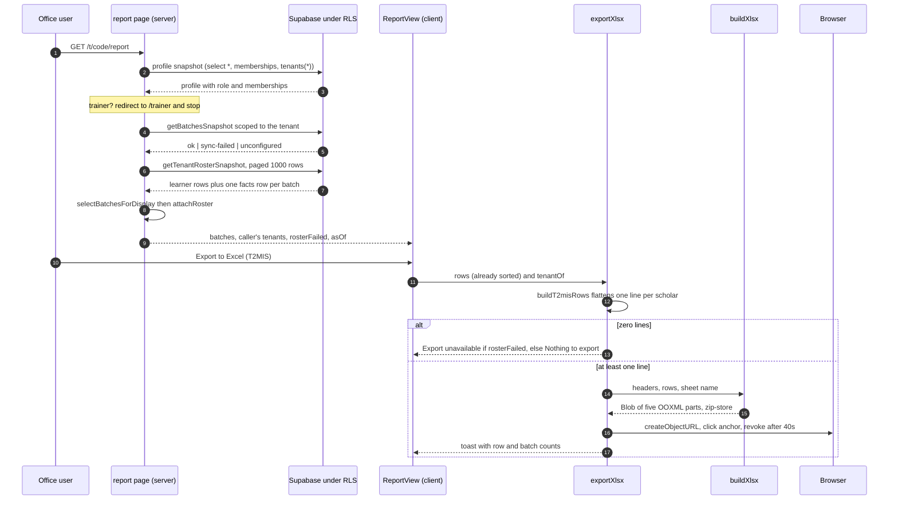
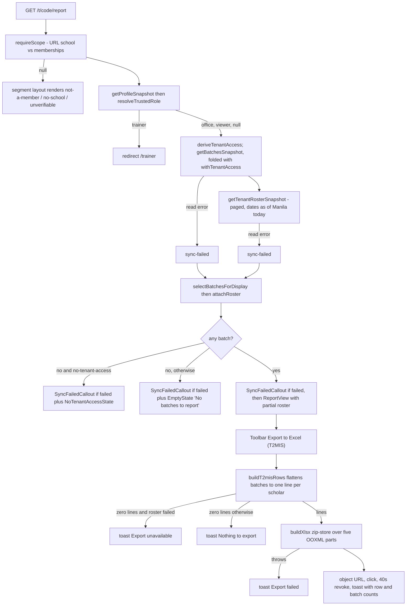

# Workflow: Report Assembly and XLSX/T2MIS Export

Request in, file out. This page follows the one path that produces a downloadable workbook, from
the route's first fetch to `<a download>.click()`, and names at each hop where the snapshot can fail
and what the person at the screen sees instead.

The mechanics of the pieces live next door: the module and its writer on
[Reports, EGACE and the T2MIS export](/openwiki/modules/reports-and-t2mis-export.md), the layout and
the reverse (import) direction on [Import, export and the T2MIS layout](/openwiki/modules/import-export.md),
who may read which columns on [Data Model and RLS](/openwiki/architecture/data-model-and-rls.md), and
the schema these columns come from on
[Live Supabase and migrations](/openwiki/operations/live-supabase-and-migrations.md). This page is the
composition.

Two framings up front:

- **A downloaded file is a working copy, not an upload to TESDA.** The workbook is assembled locally
  and never sent anywhere; TESDA SIS/T2MIS/BSRS stay authoritative, so nothing in the header or the
  filename may claim receipt or approval (rule 27, locked by
  `docs/adr/ADR-001-billing-and-domain-model.md`).
- **A short spreadsheet looks exactly like a correct one.** Almost every decision below — paging,
  failing the snapshot, keeping `''` and "not recorded" separable, grading the zero-row toast — exists
  because a truncated or half-blanked export fails silently, while an *error* fails loudly and is
  therefore the safer outcome.

## One direction only: read → compose → serialize → download

Nothing in this flow writes, refetches or reconciles. The state is read once by the server route,
composed into a `Batch[]` tree, handed to a client island, flattened to strings, serialized into
OOXML bytes, and dropped into an object URL. There is no second read on click of the export button,
so the refetches that keep screen and file in agreement have to be deliberate clicks (the callout's
Retry, or a reload).

The byte-level half of the path reads in order:

The download half of that diagram has no error channel back into the file: once `buildXlsx` returns,
the only remaining failure mode (a browser refusing the download) still produces the success toast.

### Where "as of" could make the sheet disagree with the screen

Two clocks exist and only one is shown:

| Clock | Where it lives | Does the file carry it? |
| --- | --- | --- |
| `fetchedAt` of the batch snapshot, formatted by `formatDateTime` and passed as `asOf` | the screen only — the toolbar meta and the EGACE table sub-heading via `ReportToolbar` and `EgaceOutcomesTable` | **no** |
| `todayInManila()` | baked into each scholar's `age` at map time | indirectly, as the printed `Age` |

So the file's only date-derived value is the age, computed against the roster's as-of day and frozen
into the bytes. The consequence a reader has to know: a workbook downloaded on a later day than the
screen it was built from will print birthdays that have since slipped, and the sheet's own timestamp
of when it was taken exists only in the toast text (`Excel export ready … N scholar records`) — never
in the cells, never in the filename. Any staleness rule added here has to put the as-of value *into*
the workbook rather than depend on the tab it came from.

In-flight state is worse than stale state, because nothing marks it. Batches render from
`selectBatchesForDisplay`, which returns `[]` for any non-`ok` snapshot (rule 19 — no substitution),
and `attachRoster` leaves a batch with no roster unchanged. A roster read that fails therefore
produces a report whose every row is thin — and `buildT2misRows` still flattens those batches to one
blank-padded line per scholar, so the sheet is *full* of rows with nothing in the learner columns.
The only thing distinguishing that file from a correct one is the toast, via `rosterFailed`.

## The path, with its failure points

Where each snapshot can break, and what the reader gets:

| Hop | Can fail | What the user sees |
| --- | --- | --- |
| `requireScope` | School is not the caller's, or memberships unreadable | The segment layout's own state ("School not available" with a link to a real school, `NoTenantAccessState`, or "Couldn't verify your school access"); the page renders nothing |
| `getProfileSnapshot` | Non-`ok` profile, or no Clerk id | `dbRole` is `null`, so `resolveTrustedRole(null)` does **not** match `trainer` and no redirect happens — the gate is skipped and the page runs on |
| `getBatchesSnapshot` | Any query error, or `unconfigured` | `sync-failed` → `SyncFailedCallout` ("this report may be incomplete" + Retry) plus an empty state; `unconfigured` → an empty state and **no callout at all** |
| Membership fold | Caller in no school (`no-tenant-access`) | `SyncFailedCallout` is skipped and `NoTenantAccessState` replaces the ordinary empty state |
| `getTenantRosterSnapshot` | Either of its two queries | `sync-failed` → same callout above a **still-rendered, roster-blank report**; `attachRoster` simply leaves batches bare |
| `buildT2misRows` / `buildXlsx` | Zero rows, or a throw | A toast in three distinct grades: `Export unavailable`, `Nothing to export`, `Export failed` |

One branch on the diagram is easy to miss: the trainer redirect hinges on a *trusted* profile read.
If the profile snapshot is not `ok`, `dbRole` is `null`, `resolveTrustedRole(null)` returns something
other than `trainer`, and the page runs on instead of denying — the redirect is reached only with a
positive `trainer` verdict.

## Hop 1 — the trainer gate comes first

`requireScope()` (`app/(dashboard)/tenant-scope.ts`) is `cache()`d over the same profile read the
segment layout performs, so layout and page agree for one request; it returns `null` whenever the
layout is already rendering a state. It also redirects on `profiles.role === 'trainer'` itself; the
page then re-checks through `getProfileSnapshot` + `resolveTrustedRole` and redirects again. The
second check is not just belt-and-braces: `requireScope` only sees an `ok` scope, so on the page the
gate can be reached before the profile is trusted, and the page's version is what keeps a trainer off
a screen whose every `learner_details` cell would be empty.

`resolveTrustedRole` is called on `profiles.role` alone, never `resolveRouteRole`: the route resolver
honours a `?role=` preview override, so a real trainer asking for `?role=admin` would walk past the
gate. The redirect is why this workflow is office-only — `learner_details` has no trainer read policy.
The route's own comment records that no redirect existed while the screen still rendered mock data.

The gate is also a cost: the profile snapshot it already holds is reused for `deriveTenantAccess`
rather than fetched twice, and the verdict is folded in with `withTenantAccess`, which rewrites only
an `ok` snapshot — so "you belong to no school" can never disguise a real read failure.
`selectBatchesForDisplay` meanwhile never substitutes data for a non-`ok` snapshot.

This is a *route* concern by construction: rule 11 keeps `app/` to fetch-and-compose, and rule 8 is
enforced by the `import/no-restricted-paths` zones in `eslint.config.mjs` (its `domains` list includes
both `"reports"` and `"import-export"`). Every `modules/*/data/**` is private to its module and only
`app/` may reach it, so the tenant, the schools and the membership verdict are resolved in the page;
the `ReportView` client island never calls Supabase.

## Hop 2 — the roster join, and why it pages

`getTenantRosterSnapshot(scope.tenantId)` is awaited after the batch snapshot, and `attachRoster` hangs
each batch's scholars and T2MIS facts on the batch under its `batch_code`; a batch with no roster is
left unchanged, so a partial read renders as a report with thin rows.

`fetchRosterRows` loops `range(from, from + 999)` with `ROSTER_PAGE = 1000` and stops only when a page
comes back shorter than 1000. Ordering is `last_name`, `first_name`, `id` — `last_name` alone ties and
an unordered tiebreak would reshuffle the ordered walk, dropping or repeating rows between pages. The
loop exists because the API caps a response at 1000 rows and silently discards the remainder; a school
past that boundary would otherwise export its first thousand scholars with no error anywhere. `seq`
(the per-batch position `ScholarRow` carries) is assigned from position in that already-ordered result.

The second query in the same function pulls `training_calendar_code` and the composite
`tenant_qualifications → qualifications` embed per batch and hangs it on the roster as `t2mis`. It is
kept out of the learner select so the qualification columns are one row per batch rather than repeated
per scholar.

**Dates are computed in Asia/Manila, not UTC.** `todayInManila()` formats a date through
`Intl.DateTimeFormat('en-CA', { timeZone: 'Asia/Manila' })` and that string becomes the roster's `asOf`,
feeding `ageOn` in the mapper. A UTC date is a day behind in the schools' timezone until 08:00, which
would print an age one year low on a birthday for the first eight hours of the working day. `ageOn`
counts whole years and returns `null` before the birth date, so a future-dated birth date yields `null`
rather than a negative age.

## Hop 3 — EGACE and employment rollups

Both report tabs are computed in the client island from the joined `Batch[]`, by pure functions
(rule 14): `domain/egace.ts` and `domain/employment.ts`. `ReportView` sorts by school then batch id
before deriving anything, so the figures and the exported line order are stable between reloads.

- `computeEgaceTotals` sums every stage; `egaceVal` falls back to the batch's scholar count for
  `enrolled` and `0` for the rest, and never mutates the summed batches.
- Rates are fed `outcomeEnrolledBase(rows)` — enrolled over only the batches that record outcomes — so
  untracked batches cannot dilute a rate even though they are counted in the totals. A zero base
  returns `0` rather than `NaN%`.
- Employment selects certified scholars (`assessmentResult === 'Competent'`) and rolls up
  `certified / employed / awaiting / unemployed`, where `employed` is wage **and** self-employed. The
  buckets deliberately do not sum to `certified`: an unrecorded status counts as certified and lands in
  no bucket rather than overstating unemployment. `empTone` gives that status `neutral`.

`tests/unit/reports-domain.test.ts` pins all of it, including both zero-denominator guards and the
`sum(buckets) < certified` invariant.

## Hop 4 — building the rows against the layout

The toolbar's export button calls `exportXlsx(rows, tenantOf, setToast, rosterFailed)`. The workbook is
split across two modules by design, and the split direction is forced:

- **The layout** — 48 ordered `{ header, value }` columns and `buildT2misRows` — is
  [`modules/import-export/domain/t2mis.ts`](/modules/import-export/domain/t2mis.ts), the same contract
  the CSV import parses back.
- **The writer** is [`modules/reports/domain/xlsx.ts`](/modules/reports/domain/xlsx.ts).
- **They meet in `modules/reports/ui/exportXlsx.ts`.**

`exportXlsx` sits in `ui/` (it does DOM, Blob and object-URL I/O) precisely because a
`data/`-to-`data/` import would be blocked — rule 8 closes every other module's `data/`, and the zone is
generated by the `domains` list above. Consuming the layout through `import-export/domain/` is the
permitted direction, and `import-export/domain/` may not import `reports/data/` back. The writer was
moved out of the view component into `domain/` under the same logic in reverse — importable as the
module's own surface *and* unit-testable (rule 35, `domain/` is pure), since a `ui/` sibling could not be
tested as pure logic.

**`buildT2misRows` reads nothing it was not handed.** It receives the already-sorted `rows` and the same
`tenantOf` the table rendered with, so the sheet and the screen cannot disagree about which batches or
which school label are in play. `ReportView` passes `?? { code: '—', name: '—', region: '' }` for a
tenant the catalog lacks. It flattens the portfolio: one line per scholar, cells read from that catalog
row, `Batch.t2mis` and `ScholarRow`, each guarded by `?? ''` so a missing dependency blanks a cell
instead of throwing. An unresolved tenant blanks its provider cells, and a qualification with no registry
link blanks the six registration columns. Dates go out through `isoToT2misDate`, and `Age` prints `''`
rather than `0` when `ageOn` could not compute.

`tests/unit/t2mis.test.ts` is the red test on both sides of the layout. It holds the 48 headers equal to
a header row copied verbatim from the TESDA sheet (down to `'Province '` and two columns both called
`Municipality City`), fills every group, blank-checks the missing-details and missing-qualification
cases, pins the `ageOn` birthday boundary, and round-trips a produced row back through `parseLearnerCsv`
+ `validateRows`. Any change to a layout column, the date format, or the parser has to answer to it.

## Hop 5 — packaging, download, and the copy boundary

`buildXlsx(T2MIS_HEADERS, data, 'EGACE-Employment')` emits a **zip-store** archive — no compression —
over the five minimal OOXML parts. `zipStore` writes each local header and central directory record by
hand around `crc32`; `xmlEsc` escapes `& < > "` in every inline cell and the sheet name; `colRef` derives
letters past `Z`; the sheet name is escaped then truncated to Excel's 28 characters. `exportXlsx` then
creates an object URL, appends an `<a download>` named `TESDA-T2MIS-EGACE-Employment-Report.xlsx`, clicks
it, removes it, and revokes the URL after **40 seconds** — revoking immediately cancels the download in
some browsers.

`tests/unit/report-xlsx.test.ts` pins the writer instead of trusting it: the IEEE check vector
`crc32('123456789') === 0xCBF43926` (and `0` empty), the `PK\x03\x04` local header and closing `PK\x05\x06`
EOCD, all five part paths, row 1 as header and data from row 2 with `A1`/`B3` refs, entity escaping,
`AA1` at column 27, and the truncated sheet name. Between the two test files, a change to the layout, the
writer, or the join has a red test to answer to.

**The copy boundary.** Nothing in the artifact says "working copy" — the check for rule 27 therefore
lives in three separate places, and none of them is the workbook:

| Surface | Text | Where it is enforced |
| --- | --- | --- |
| Screen tab name | "EGACE Outcomes" / "Employment Report"; view header "official TESDA reporting surface" | `ReportView.tsx`, `ReportToolbar.tsx` |
| Button label | `Export to Excel (T2MIS)` — a *layout* claim, not an "Export to TESDA" | `ReportToolbar.tsx` |
| Filename, sheet name, toast | `TESDA-T2MIS-EGACE-Employment-Report.xlsx`, sheet `EGACE-Employment`, "Excel export ready" | `exportXlsx.ts` |
| Module header | "This is an internal working copy. Producing the file is not a submission." | `t2mis.ts` doc block |

Every string is TESDA-prefixed and TESDA-shaped, so a reader who opens the sheet has no in-file cue that
it was not filed. The sibling `BillingStatementModal` does carry the cue — "Internal working copy ·
TESDA SIS and BSRS remain authoritative" — which makes the mismatch between surfaces visible rather than
hypothetical. ADR-002 is the lock: honesty is carried by copy, and wording that implies official standing
is a defect, not a cosmetic one. Adding that line to the toolbar meta (or the toast) is the cheapest fix
and needs no change to the writer.

## Legibility rules a new export unit must honour

Rule 23 is written for screens, but every clause bites harder in a file a reader opens cold:

- **Dates always carry the year.** The sheet writes `MM/DD/YYYY`; an ISO passthrough would still be
  legible, but a bare `04/21` would not.
- **A metric with no source prints `—` plus what is missing, never `0`.** This is where the export and
  the screen split: `EgaceSummaryStrip` and `EgaceOutcomesTable` do print `—` for untracked stages
  (`hasEgaceOutcomes` guards both), but the sheet has no such guard — a stage the batch never tracked
  reaches the file as `0` from `egaceVal`. `tests/unit/reports-domain.test.ts` records the ambiguity
  explicitly ("both return 0 … a caller cannot tell '0 employed' from 'employment not tracked'"). A new
  export unit over EGACE figures must add the `—` distinction; the T2MIS sheet itself is unaffected
  because every one of its cells is a string column.
- **ULI is the permanent learner key.** A column keyed on anything else is unstable across re-imports; a
  row without one cannot be reconciled, which is why `parseLearnerCsv` requires the header and rejects
  the row.
- **The sheet stays reachable by the trainer-safe fields** (rule 5): the T2MIS layout is exactly the
  projection of `learners` + `learner_details` a trainer could read, no billing deadline or BSRS.

## The failure this flow is most exposed to

A query error that blanks a cell is indistinguishable in the file from "not recorded" — both are `''` in
`<is><t>`.

That is why the **qualification-facts query's error fails the whole snapshot** rather than blanking its
six cells (`if (facts.error) return { status: 'sync-failed' … }`): the reader would otherwise receive
twenty built lines whose CTPR, sector and delivery mode are quietly missing and could not tell whether
the school has no registered qualification or the join broke. It is also why the route passes
`rosterFailed` down and `exportXlsx` grades a zero-row build as `Export unavailable` (with a retry)
rather than `Nothing to export` — the two mean different things.

Where the roster path stops short of that rule is the blank-row case above: once the batch snapshot is
`ok`, a failed roster still yields a populated, non-zero-row sheet of blank learner columns, and the
toast reports success with a row count. `rosterFailed` is graded only when there are *no* rows to write.

Reversing the choice is cheap and wrong: swallowing a roster error into an `ok` snapshot with blanks
hides "the read broke", and failing on a merely missing detail column makes the whole report disappear.
The comment above the facts query states the rule — *any error fails the snapshot*.

**The code no longer narrows it.** `42703` / `PGRST200` / `PGRST204` are gone from `modules/` and `app/` —
no `code === …` predicate remains — so the historical "tolerate a not-yet-migrated column" carve-out is
now purely the mapper's structural tolerance: `select('*')`, the `orEmpty` helper, and `details`
defaulting to `{}`. A `null` detail column, an absent `learner_details` row, and a column the database has
not got all produce `''`. Migration `20261111120000_add_t2mis_terminal_report_fields.sql` is what made
that enough: it is APPLIED and additive, `sex` is its only `CHECK`, and its header states the empty value
keeps meaning "not recorded".

## One known blank, and one dead read

1. **The provider catalog does not arrive.** The route seeds `ReportView` only with `resolved.profile.tenants`
   — the schools the *caller* belongs to — and `ReportView`'s prop comment records that no live
   tenant-listing source exists (blocked on TES-34). A batch from a school the caller is not a member of
   therefore resolves through the `??` placeholder: its whole provider block, `Congressional District`
   included, exports blank and its School label renders `—`. `tests/unit/t2mis.test.ts` fills
   `Congressional District` from a hand-built fixture, so the fixture passes where the live route does not.
2. **`congressional_district` arrives as an empty string.** `getProfileSnapshot` fetches with
   `select('*, profile_tenant_memberships(is_default, tenants(*))')`, so nothing is omitted at the query
   level — the blank comes from `mapTenantRow`'s `congressionalDistrict: row.congressional_district ?? ''`
   only when the column is absent from the generated row type. This is a types/mapper fix, not a select
   fix, and it should land with the tenant-catalog gap so the column does not go from one `''` to another.

Both are the blank-versus-missing problem in its quietest form, and either is a one-line change that
should land with a writer-side expectation, not alone.

## Changing this flow

- Move the layout only in `import-export/domain/t2mis.ts` and only against the header test; move writer
  behaviour only against `report-xlsx.test.ts`.
- Keep the redirect on `resolveTrustedRole` and keep it before both fetches — and keep
  `requireScope`'s own trainer redirect, since the page-level check can be skipped on a non-`ok` profile.
- Keep the roster paged. Replacing the loop with a single `select` re-introduces silent truncation.
- Keep a roster error `sync-failed`; do not convert it into blanks.
- Keep the ordering. Building `syncFailed` as a combined flag, rendering the `SyncFailedCallout` *above*
  the empty branch, and checking it before the empty state are what stop a zero-row failure losing its
  banner — rule 19 warns about exactly this guard order.
- Keep the copy conservative. The file is a working copy; marking a batch `submitted` elsewhere in the app
  does not make the download a submission to TESDA (rule 27). "T2MIS-compatible layout" is the honest
  claim — a column header matching TESDA's sheet says nothing about the file's standing.
