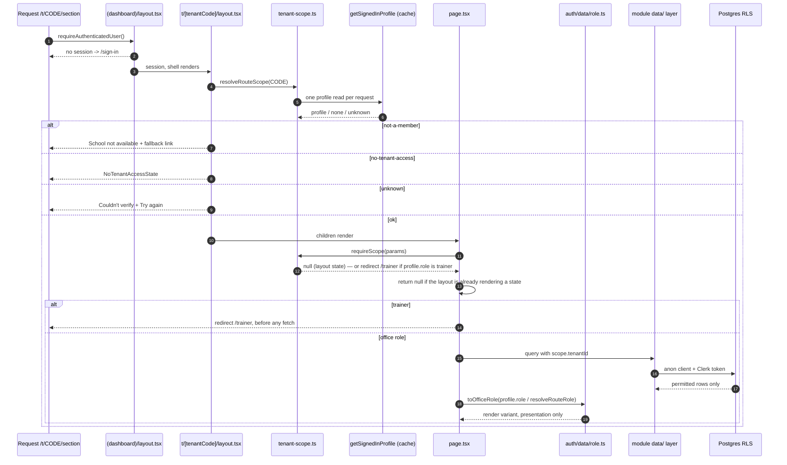

# Workflow: Resolving School Scope and Acting Role

Two questions are answered on every office request, and they are answered **in this order**:
*which school is this screen about, and may the caller see it?* and *which role is acting?*
The order is the design. The scope resolves first and can stop the request — including by
redirecting a trainer out of the office tree; the role resolves second and can only change what
renders.

Neither answer is the security boundary. Postgres RLS sits under every step, using the same
`profiles.role` column and the same membership rows
([runtime isolation model](/openwiki/architecture/tenant-isolation-and-rls.md)). A mistake in this
workflow therefore **misleads rather than leaks**: a caller can see a write button RLS will deny, or
be shown another role's copy, but not another school's rows. That is exactly why the failure modes
at the end are worth knowing — they are accurate-looking wrong answers.

The route tree that hosts these calls — the `(dashboard)` authentication gate, the segment layout,
the legacy redirect stubs — belongs to
[Routing, Layout Gates and the Request Path](/openwiki/architecture/nextjs-routing-and-request-path.md).
This page follows the data and the decisions through those hooks.

## The ordered checks



*Each check in the order it actually runs — the layout gate, the cached profile read, the scope
outcome, the trainer redirect, the fetch, then the presentation-only role.*

Step 1 is outside this workflow: `app/(dashboard)/layout.tsx` calls `requireAuthenticatedUser()`
before anything here runs, and `proxy.ts` only stamps `x-pathname`. The role step is the only one
whose result cannot change the response status; the trainer redirect is the one exception, and it
is decided from the trusted role alone, never from `?role=`.

## Step 1–2: one profile read, shared by layout and page

<!-- openwiki: broken internal link [/app/(dashboard] file "/app/(dashboard" does not exist. Fix the href or restore the target, then delete this comment. -->
[`tenant-scope.ts`](/app/(dashboard)/tenant-scope.ts) exists in `app/` for a boundary reason, not
a layering accident: it joins `modules/auth`'s private `data/` (the Clerk identity) to
`modules/tenancy`'s private `data/` (the profile read), and only `app/` may import across that line
(rule 8). The *rule* it applies lives one module away, in
[`modules/tenancy/domain/scope.ts`](/modules/tenancy/domain/scope.ts).

`cache()` on `getSignedInProfile` and `resolveRouteScope` is what makes the two-call shape
affordable. The segment layout and the page both ask "which school is this, and may they see it?"
with the same `tenantCode`; React dedupes that to **one** `getProfileSnapshot` per request, which
is itself `cache()`-wrapped by `clerkUserId`
([`modules/tenancy/data/tenancy.ts`](/modules/tenancy/data/tenancy.ts)). Drop the wrapper and each
request costs two RLS-scoped profile reads of the whole membership join — layout in parallel with
page, one read per render — for an answer produced from identical inputs. `cache()` is per-request
only, so it is a dedupe, never a stale cache.

The three non-`ok` outcomes of `getSignedInProfile` are deliberately asymmetric:

- A failed identity read (`getAuthUserId()` throws) or any non-`ok` snapshot other than
  `not-found` collapses to `'unknown'` — "we could not check".
- `not-found` (authenticated, no `profiles` row yet — the webhook racing a first request)
  collapses to `'none'`.
- `'unknown'` is checked **before** `'none'`, so "we could not check" never renders as "you were
  never assigned a school". That is the same rule `deriveTenantAccess` encodes one module down.

## Step 3: the scope outcome is selection, not authorization

`resolveRouteScope` returns four arms, and only one of them hands back a `TenantScope`:

| Arm | Meaning | Rendered by |
|---|---|---|
| `ok` | `scopeForCode(profile, code)` matched a membership | the page |
| `not-a-member` | the code is foreign, unknown, or renamed | layout: "School not available" + default-school link |
| `no-tenant-access` | the caller belongs to no school at all | layout: `NoTenantAccessState` |
| `unknown` | the profile could not be read | layout: "Couldn't verify your school access" |

`scopeForCode` lowercases both sides and returns `null` on no match; `defaultScope` takes the
flagged `defaultTenantId`, then the first membership, then `null`. A foreign code never falls
back to "all schools" — the URL always ends up naming one school, which is what makes the segment
shareable ([ADR-001](/docs/adr/ADR-001-billing-and-domain-model.md) K1, the locked domain fact that
tenant context lives in the path).

A `TenantScope` is only ever built from `profile.tenants`, and `profile.tenants` is an RLS-scoped
read. The downstream `tenant_id = scope.tenantId` filter therefore *selects* among schools RLS
already allows; it never grants. That is rule 2's permitted half, pinned by
[`tests/unit/tenant-scope.test.ts`](/tests/unit/tenant-scope.test.ts) — a scope is built for a
member school (`scopeForCode(profile([AKB, NEN]), 'nen')` resolves) and is `null` for a school the
profile is not a member of. RLS would deny a foreign `tenantId` anyway; the null is the friendlier
of the two denials.

**The layout owns the four arms.** Every page under the segment begins
`const resolved = await requireScope(routeParams); if (!resolved) return null;` — all eight
scoped pages carry it verbatim today. `requireScope` calls the same cached resolver and narrows to
the `ok` arm. It returns `null` rather than calling `notFound()` because **layouts and pages render
in parallel**: a thrown 404 from the page could beat the layout's explanation of *which* state
applies. Returning `null` lets the layout's message be the only message. The page contributes
nothing, and nothing is broken by that — with no scope there is no tenant id to query with.

## Step 3b: the trainer redirect lives in `requireScope`, not in the layout

Because `ok` narrows to `{ scope, profile }`, `requireScope` is the first place holding both a
validated school *and* the trusted role — and it is where the trainer redirect now sits, immediately
after the narrowing and **before any page code runs**:

```ts
const resolved = await resolveRouteScope(tenantCode);
if (resolved.status !== 'ok') return null;
if (resolved.profile.role === 'trainer') redirect('/trainer');
return { scope: resolved.scope, profile: resolved.profile };
```

The placement is deliberate on two axes:

- **In the page path, not the layout.** A layout does not re-run on every client-side navigation; a
  page does. A trainer who lands inside the office tree is sent to `/trainer` on the request that
  carries them there, not only on a hard load.
- **After the `ok` narrowing.** Only a scope-carrying request can reach the redirect. A trainer on a
  foreign school code gets the layout's "School not available" state instead, which is the more
  useful answer than a bounce to `/trainer` that hides the mistyped code.

Because the gate is in `requireScope`, no office page starts its fetch for a trainer: rule 5's
omission half is satisfied structurally rather than per route. Pages that still redirect on their
own (`billing`, `report`, and the school dashboard's redundant `profile.role === 'trainer'` line)
are keeping a second, now-unreachable guard — not the load-bearing one.

## Step 4: the trusted role decides the redirect, before the fetch

Role resolution is split into two functions in
[`modules/auth/data/role.ts`](/modules/auth/data/role.ts), and the split is the whole point:

- `resolveTrustedRole(dbRole)` — `profiles.role` and nothing else. This is what a redirect or an
  authorization decision may read. `profiles.role` is the column RLS reads, so the UI and the
  database cannot disagree about who someone is (audit finding I5 came from them disagreeing).
  It is async for signature stability only; its body is the synchronous `asResolvedRole`.
- `resolveRouteRole(params, dbRole)` — `?role=` **first**, then `resolveTrustedRole`. A dev/demo
  affordance left over from before live identity existed
  ([ADR-005](/docs/adr/ADR-005-demo-account-tenant-scoping.md) records that the override outranks
  the database role, which is why the demo account is internal-only).

`?role=` is unauthenticated. Any caller can set it. A redirect gated on the override is therefore
a redirect nobody is held to, and a real trainer adding `?role=admin` would walk straight past the
office-only gate.

The same function gates more than one surface. `POST` handlers in
<!-- openwiki: broken internal link [/app/(dashboard] file "/app/(dashboard" does not exist. Fix the href or restore the target, then delete this comment. -->
[`app/(dashboard)/users/new/actions.ts`](/app/(dashboard)/users/new/actions.ts) prefer it over any
override because the Clerk-invitation branch it reaches has no RLS behind it, and the shell layout
uses it to decide whether the admin-only "Add user" nav row exists.

On the trainer split, `viewer` — never a write-enabled variant — is the fallback. `toOfficeRole`
narrows anything that is not `admin`/`coordinator`/`viewer` (an unparsed role string, `null`, a
trainer the gate let through) to read-only `viewer`, and
[`tests/unit/display-role.test.ts`](/tests/unit/display-role.test.ts) pins that as a
*least-privilege* rule rather than a cosmetic default. Compliance screens take the trusted role
straight off the snapshot `requireScope` returned, `toOfficeRole(await resolveTrustedRole(profile.role))`,
with no second profile read at all.

## Step 5: the snapshot fetch and the membership fold

The fetch is a module `data/` call with `scope.tenantId` passed in. What comes back is a
discriminated snapshot, not rows: `ok` / `no-tenant-access` / `sync-failed` / `unconfigured`.

`no-tenant-access` is never produced by a query — RLS reports "member of nothing" as a
successful empty read, indistinguishable from "this school has no batches". Routes name the
difference with `withTenantAccess(snapshot, tenantAccess)` from
[`modules/tenancy/domain/access.ts`](/modules/tenancy/domain/access.ts), which rewrites **only** an
`ok` snapshot. A `sync-failed` passes through untouched so the tidier "you belong to no school"
never masks a broken fetch. `unknown` changes nothing, because an unverified verdict must not
rewrite a successful read. Screens holding a profile (dashboard, documents, batch-cards) fold
`tenantAccessOf(profile)`; billing and report derive the verdict from the snapshot they already read
(`deriveTenantAccess`) rather than fetching a profile a second time.

## Step 6: where presentation re-enters, and the split point

`billing/page.tsx` is the page that carries both role halves, and it is worth reading as a
template because the two are adjacent in the file and must not be merged:

```ts
const trustedRole = await resolveTrustedRole(dbRole);
if (trustedRole === 'trainer') redirect('/trainer');      // ← before any fetch
// …fetch…
const billingRole = toOfficeRole(await resolveRouteRole(params, dbRole)); // ← render variant only
```

The first three lines stand on `resolveTrustedRole` alone and run before `getBatchesSnapshot`. The
last stands on `resolveRouteRole`, so a previewed `?role=` can change which variant of
`BillingQueueView` renders. There is no trainer variant of that view, so `toOfficeRole` narrows
the previewed trainer to `viewer` — a preview can only make a screen looser, and the `viewer`
fallback keeps it least-privilege when the role resolves to nothing. (The Billing fetch runs after
the page's own redirect, not after `requireScope`'s only, so its duplicate guard is what keeps the
figures out of a trainer's payload for that page.)

`?role=` reaches exactly one page today, which is the honest state of the migration: Billing is
the one route where it is a presentation override. `/users/new`, `/schools/new` and every other
scoped page read it nowhere.

## Invariants and failure modes

- **Redirect on `resolveTrustedRole`, render on `resolveRouteRole`.** Rule 2's predecessor is
  explicit: gate a redirect on the wrong function and the URL picks the role.
- **`unknown` is never `none`.** Both `resolveRouteScope`'s ordering and `deriveTenantAccess`'s
  switch carry it.
- **A page's `null` is not an error.** It is the page deferring to a layout state; a page without
  the guard queries with an undefined tenant id.
- **A dead `cache()` breaks the shared read, not correctness.** Two profile reads per request is a
  cost, not a wrong answer — until the page reads a snapshot the layout already consumed and the
  two are compared.
- **RLS still sits under every step.** A viewer who appears to have a write control, or a scope the
  layout should have rejected, fails at the database rather than in the wrong tenant.

## The two traps

**Trap 1 — a JS tenant filter read as authorization (rule 2).** `scopeForCode` looks like an access
check, and adding `tenant_id = <code from the URL>` looks like it secures the query. It does not.
If the filter were taken straight from the URL segment and RLS were omitted, every school's rows
would still be returned for whoever asks. Rule 2 states the split precisely: a
`tenant_id = scope.tenantId` filter from a *validated* `TenantScope` is allowed and only selects;
a JS tenant check used *as* access control is a bug even when it returns the right answer, because
it signals the query was written assuming no RLS.

**Trap 2 — the `?role=` redirect escape.** The trainer gate must read `profile.role` from the
`ok` arm (or `resolveTrustedRole`) and never `resolveRouteRole`. The confusing part is that the gate
*survives* `?role=`: a real trainer asking for
`/t/<school>/billing?role=admin` is still redirected to `/trainer`, because the redirect decides
from the database role and `?role=` only ever reaches `resolveRouteRole` →
`toOfficeRole`/`resolveDisplayRole` on a page that is already rendering. Reversing that — gating
the redirect on `resolveRouteRole` — is the escape: the trainer stops being redirected, and billing
deadlines, preparation and financial fields reach a role that must never see them (rule 5).
`resolveRouteRole`'s own doc comment carries the warning; `resolveDisplayRole`'s test pins the
adjacent rule that a `?role=trainer` cannot select a trainer variant
(`resolveDisplayRole('trainer', 'admin')` is `admin`), and `tests/unit/tenant-scope.test.ts` pins
the authority half — the database role wins over Clerk metadata, and a missing profile row resolves
to `null`, not to a Clerk-supplied role.

Under both: RLS is rule 1, and every mistake in this workflow misleads rather than leaks. Deep
plumbing facts belong to [Module Boundaries and the Data Layer Pattern](/openwiki/architecture/module-boundaries-and-data-pattern.md)
and the [tenancy](/openwiki/modules/tenancy.md) / [auth](/openwiki/modules/auth-and-provisioning.md) modules.
