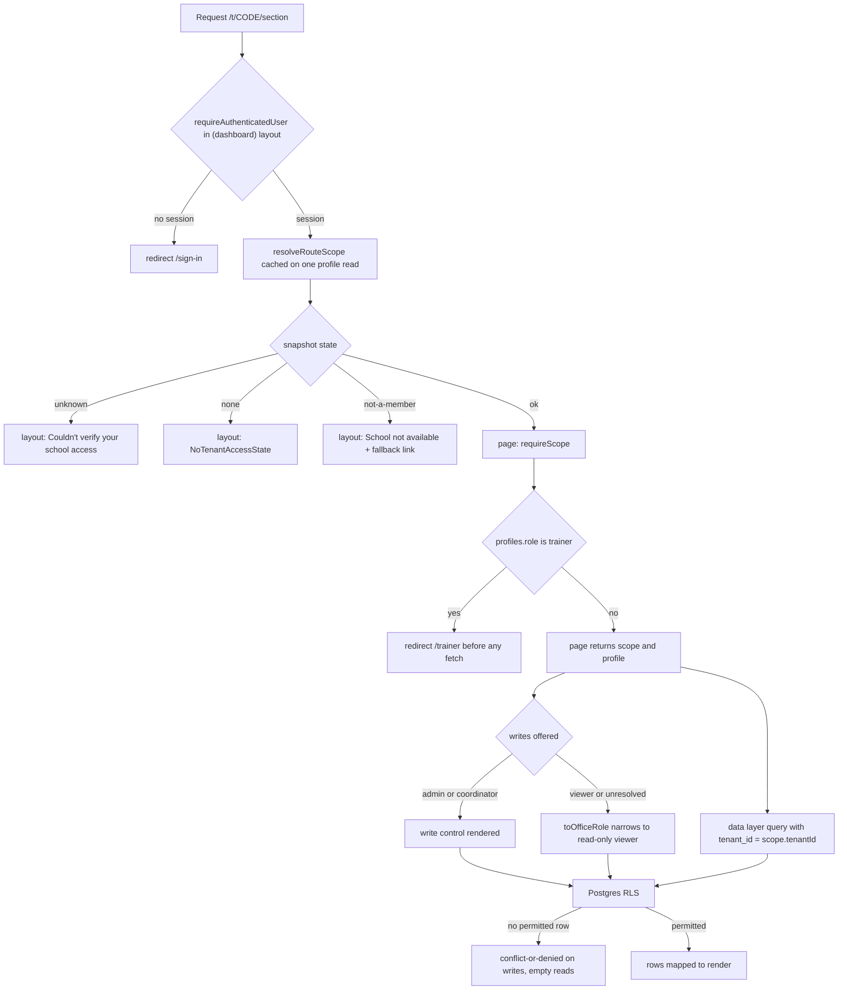

# Workflow: School Scope and Acting Role, End to End

Two questions are answered on every office request, and they are answered **in this order**:
*which school is this screen about, and may the caller see it?* and *which role is acting?* The
order is the design. The scope resolves first and can stop the request — including by refusing a
trainer outright; the role resolves second and can only change what renders.

Neither answer is the security boundary. Postgres RLS sits under every step, switching on the same
`profiles.role` column and the same membership rows
([runtime isolation model](/openwiki/architecture/tenant-isolation-and-rls.md)). A mistake in this
workflow therefore **misleads rather than leaks** — a caller can be shown a write button RLS will
deny, or another role's copy, but not another school's rows. That is exactly why the widening
points at the end are worth knowing: they are accurate-looking wrong answers.

The route tree that hosts these calls — the `(dashboard)` authentication gate, the segment layout,
the legacy `?batch=` redirect stubs — belongs to
[Routing, Layout Gates and the Request Path](/openwiki/architecture/nextjs-routing-and-request-path.md).
This page follows the data and the decisions through those hooks.

## Two authorities, one of them spoofable

| Source | Decides | Set by |
|---|---|---|
| `profiles.role` via `resolveTrustedRole` | every redirect, every action gate, every write | the database, through the admin assignment path |
| `?role=` search param via `resolveRouteRole` | which variant of an already-authorized screen renders | whoever typed the URL |

Clerk is identity only and no longer appears on either side: the dashboard once read Clerk
`publicMetadata.role` while the sidebar read the database, showing one admin as ADMIN and VIEWER on
the same screen (audit I5). RLS reads `app_private.current_role()`, which selects `profiles.role`
from the row `app_private.current_profile_id()` resolves out of the JWT `sub`
([migration](/supabase/migrations/20260528160300_create_tenant_scoped_schema.sql#L339-L378)) — so a
decision made on anything but that column can disagree with the database that enforces it.

## The ordered path



*Every step fails closed: each non-`ok` scope arm stops before a fetch, and RLS answers last.*

Step 1 is outside this workflow: `app/(dashboard)/layout.tsx` calls `requireAuthenticatedUser()`
before anything here runs, and `proxy.ts` only stamps `x-pathname`. The final RLS column is the
boundary; everything above it is a decision the database must still confirm.

## Step 1–2: one profile read, shared by layout and page

[`app/(dashboard)/tenant-scope.ts`](repo://app/(dashboard)/tenant-scope.ts#L1-L13) exists in `app/`
for a boundary reason, not a layering accident: it joins `modules/auth`'s private `data/` (the
Clerk identity) to `modules/tenancy`'s private `data/` (the profile read), and only `app/` may
import across that line ([rule 8](/RULES.md)). The *rule* it applies lives one module away, in
[`modules/tenancy/domain/scope.ts`](/modules/tenancy/domain/scope.ts).

`cache()` on `getSignedInProfile` and `resolveRouteScope` is what makes the two-call shape
affordable. The segment layout and the page both ask "which school is this, and may they see it?"
with the same `tenantCode`; React dedupes that to **one** `getProfileSnapshot` per request, which
is itself `cache()`-wrapped by `clerkUserId`. Drop the wrapper and each request costs two
RLS-scoped profile reads of the whole membership join, for an answer produced from identical
inputs. `cache()` is per-request only, so it is a dedupe, never a stale cache.

`getSignedInProfile`'s three non-`ok` outcomes are deliberately asymmetric, and the asymmetry is
what keeps this time window from becoming a wrong answer:

- A failed identity read (`getAuthUserId()` throws) or any non-`ok` snapshot other than
  `not-found` collapses to `'unknown'` — "we could not check".
- `not-found` (authenticated, no `profiles` row yet — the webhook racing a first request)
  collapses to `'none'`.
- `resolveRouteScope` checks `'unknown'` **before** `'none'`, so "we could not check" never renders
  as "you were never assigned a school". `deriveTenantAccess` encodes the same rule one module down,
  and [`tests/unit/tenant-access.test.ts`](/tests/unit/tenant-access.test.ts) pins both halves by
  name.

## Step 3: the scope outcome is selection, not authorization

`resolveRouteScope` returns four arms, and only one hands back a `TenantScope`:

| Arm | Meaning | Rendered by |
|---|---|---|
| `ok` | `scopeForCode(profile, code)` matched a membership | the page |
| `not-a-member` | the code is foreign, unknown, or renamed | layout: "School not available" + default-school link |
| `no-tenant-access` | the caller belongs to no school at all | layout: `NoTenantAccessState` |
| `unknown` | the profile could not be read | layout: "Couldn't verify your school access" + Try again |

`scopeForCode` lowercases both sides and returns `null` on no match; `defaultScope` takes the
flagged `defaultTenantId`, then the first membership, then `null`. A foreign code never falls back
to "all schools" — the URL always ends up naming one school, which is what makes the segment
shareable (rule 30's locked domain fact: *tenant context lives in the URL path segment*).

A `TenantScope` is only ever built from `profile.tenants`, and `profile.tenants` is an RLS-scoped
read. The downstream `tenant_id = scope.tenantId` filter therefore *selects* among schools RLS
already allows; it never grants. That is rule 2's permitted half, pinned by
[`tests/unit/tenant-scope.test.ts`](/tests/unit/tenant-scope.test.ts) — a scope is built for a
member school (`scopeForCode(profile([AKB, NEN]), 'nen')` resolves) and is `null` for a school the
profile is not a member of. RLS would deny a foreign `tenantId` anyway; the `null` is the friendlier
of the two denials.

**The layout owns the four arms.** Every page under the segment begins
`const resolved = await requireScope(routeParams); if (!resolved) return null;` — all eight scoped
pages carry it. `requireScope` calls the same cached resolver and narrows to `ok`. It returns `null`
rather than calling `notFound()` because **layouts and pages render in parallel**: a thrown 404 from
the page could beat the layout's explanation of *which* state applies. The page contributes nothing,
and nothing is broken by that — with no scope there is no tenant id to query with.

## Step 3b: the trainer refusal lives in `requireScope`, before any fetch

`ok` narrows to `{ scope, profile }`, so `requireScope` is the first place holding both a validated
school *and* the trusted role — and it refuses trainers there, immediately after narrowing:

```ts
const resolved = await resolveRouteScope(tenantCode);
if (resolved.status !== 'ok') return null;
if (resolved.profile.role === 'trainer') redirect('/trainer');
return { scope: resolved.scope, profile: resolved.profile };
```

The placement is deliberate on two axes:

- **In the page path, not the layout.** A layout does not re-run on every client-side navigation; a
  page does. A trainer who navigates into the office tree is sent to `/trainer` on the request that
  carries them there, not only on a hard load.
- **After the `ok` narrowing.** Only a scope-carrying request reaches the redirect. A trainer on a
  foreign school code gets the layout's "School not available" state instead — a more useful answer
  than a bounce to `/trainer` that hides the mistyped code.

Because the refusal sits in `requireScope`, no office page starts its fetch for a trainer and rule
5's server-side omission holds structurally rather than route by route. Three routes keep a second
guard (`billing`, `report`, and the school dashboard's `profile.role === 'trainer'` line); all three
are now unreachable, and only `billing`/`report` justify theirs at all — they fetch their own
snapshot and derive the access verdict from it rather than from the profile `requireScope` already
returned. The same column drives two redirects outside this segment: the `/dashboard` landing
dispatch to `/trainer` (or `/overview` for an admin) and `/overview`'s admin-only bounce.

## Step 4: the trusted role, and the two narrowings

`role.ts` splits role resolution in two, and the split is the whole point:

- `resolveTrustedRole(dbRole)` — `profiles.role` and nothing else. Redirects and authorization
  decisions may read only this. It is async for signature stability; its body is the synchronous
  `asResolvedRole`. A missing profile row yields `null` — no role — rather than a fallback to Clerk.
- `resolveRouteRole(params, dbRole)` — `?role=` **first**, then `resolveTrustedRole`. A dev/demo
  affordance from before live identity existed ([ADR-005](/docs/adr/ADR-005-demo-account-tenant-scoping.md)
  records that the override outranks the database role, which is why the demo account is
  internal-only).

`?role=` is unauthenticated, so a redirect gated on the override is one nobody is held to: a real
trainer adding `?role=admin` would walk straight past the office-only refusal. Two further gates
sit entirely outside the redirect mechanism and lean on the same reasoning — `users/new`'s action
prefers `resolveTrustedRole` because its Clerk-invitation branch has no RLS behind it, and
`/schools/new` uses neither resolver because platform admin is a different axis again.

`resolveRouteRole`'s result reaches a page through `toOfficeRole`, which narrows anything that is
not `admin`/`coordinator`/`viewer` — a trainer the gate let through, an unparsed string, `null` — to
read-only `viewer`. [`tests/unit/display-role.test.ts`](/tests/unit/display-role.test.ts) pins that
as a *least-privilege* rule rather than a cosmetic default. `resolveDisplayRole` is the same
narrowing with the override in front of it; it has no live caller in `app/` today and survives as
the tested composition of the two halves.

Screens holding a profile from `requireScope` take the trusted role straight off it,
`toOfficeRole(await resolveTrustedRole(profile.role))`, with no second profile read. `batch-cards`
renders the RQM editor only for a trusted `admin`/`coordinator`; every other role gets a read-only
card.

## Step 5: the check the role gate does not replace

The forms and actions still carry their own authority, because a rendered control is never the
authority. `POST`-side [`t/[tenantCode]/actions.ts`](/app/(dashboard)/t/[tenantCode]/actions.ts)
re-resolves the school from a `tenantCode` form field against the caller's own memberships — no
tenant id is ever read from the form — then calls `resolveTrustedRole(profile.role)` and refuses
anything but `admin`/`coordinator`. It distinguishes "could not check" from "refused": an `unknown`
resolution returns a save failure, any other non-`ok` returns `denied`. The write then lands on the
`batches` UPDATE policy (`can_manage_tenant`), which for a viewer matches zero rows and surfaces as
`conflict-or-denied` — indistinguishable, on purpose, from a concurrent edit.

## Step 6: the fetch and the membership fold

The fetch is a module `data/` call with `scope.tenantId` passed in. What comes back is a
discriminated snapshot, not rows: `ok` / `no-tenant-access` / `sync-failed` / `unconfigured`.

`no-tenant-access` is never produced by a query — RLS reports "member of nothing" as a successful
empty read, indistinguishable from "this school has no batches". Routes name the difference with
`withTenantAccess(snapshot, tenantAccess)`, which rewrites **only** an `ok` snapshot. A
`sync-failed` passes through untouched so the tidier "you belong to no school" never masks a broken
fetch, and `unknown` changes nothing because an unverified verdict must not rewrite a successful
read. Screens holding a profile (dashboard, documents, batch-cards) fold `tenantAccessOf(profile)`;
billing and report derive the verdict from the snapshot they already read (`deriveTenantAccess`)
rather than fetching a profile a second time.

## Step 7: the trainer DTO boundary

Discarding the trainer's *page* is not the same as trimming the *payload*. `deriveTrainerMetrics`
destructures `nextBilling`, `openBillingObligations`, `billingDeadlinesMissing` and `overdueBilling`
out of the shared summary before returning, so the keys are absent from the object rather than
unrendered. `trainer/page.tsx` therefore calls the unscoped `getBatchesSnapshot()` and lets RLS's
`can_read_batch` limit it to batches assigned to the caller — no tenant filter, no billing fields,
and no role check of its own. That is rule 5's omission half done in a domain function, not in CSS.

## Step 8: what presentation re-enters

`billing/page.tsx` carries both halves adjacent in the file, and must not merge them:

```ts
const trustedRole = await resolveTrustedRole(dbRole);
if (trustedRole === 'trainer') redirect('/trainer');      // ← before any fetch
// …fetch…
const billingRole = toOfficeRole(await resolveRouteRole(params, dbRole)); // ← render variant only
```

The first lines stand on `resolveTrustedRole` alone; the last stands on `resolveRouteRole`, so a
previewed `?role=` can change which variant of `BillingQueueView` renders (its `viewer` variant adds
a read-only banner). Billing has no trainer variant, so a previewed trainer narrows to `viewer` — a
preview can only make a screen looser, and the fallback keeps it least-privilege when the role
resolves to nothing.

`?role=` reaches exactly one page, which is the honest state of the migration: billing is the one
route where it is a presentation override. `/users/new`, `/schools/new` and every other scoped page
read it nowhere.

## Where authority can be silently widened

- **A redirect gated on `resolveRouteRole`.** The URL then picks the role. Rule 2's predecessor is
  explicit and the whole trainer refusal collapses if it drifts.
- **A role-shaped check that reads anything but `profiles.role`.** Clerk metadata is the historic
  offender (audit I5); a second role vocabulary is the same bug in new clothes, which is why
  `Profile.role` is typed as the shared `UserRole` rather than a local enum.
- **A tenant code taken from the form instead of re-resolved.** Nothing on the write path enforces
  it by itself; RLS refuses the wrong tenant, so the symptom is a silent zero-row update.
- **`unknown` collapsed into `none`.** Both `resolveRouteScope`'s ordering and
  `deriveTenantAccess`'s switch carry it; a "simplification" that merges them tells a provisioned
  coordinator they were never assigned.
- **A page's `null` read as an error.** It is the page deferring to a layout state; a page without
  the guard queries with an undefined tenant id.
- **A dead `cache()`.** Two profile reads per request is a cost, not a wrong answer — until the page
  reads a snapshot the layout already consumed and the two diverge.

## The two traps

**Trap 1 — a JS tenant filter read as authorization (rule 2).** `scopeForCode` looks like an access
check, and adding `tenant_id = <code from the URL>` looks like it secures the query. It does not. If
the filter were taken straight from the URL segment and RLS were omitted, every school's rows would
still come back for whoever asks. Rule 2 states the split precisely: a `tenant_id = scope.tenantId`
filter from a *validated* `TenantScope` is allowed and only selects; a JS tenant check used *as*
access control is a bug even when it returns the right answer, because it signals the query was
written assuming no RLS.

**Trap 2 — previewing your way out of a server denial.** `?role=admin` changes no decision: the
trainer refusal still fires, and viewer writes still fail at the policy. The mirror trap is subtler.
Because `resolveRouteRole` falls through to `profiles.role`, a build that gates redirects on the
*preview* looks correct for every office role and only breaks for the one role the URL can claim —
a real trainer. The related schema detail is that the single `batches` UPDATE policy admits
`admin`/`coordinator` only: a viewer keeping the RQM editor after a role-source regression gets a
denial, not a silent write, and that is the failure mode the whole ordering is arranged to make
visible in the right place (per-table policy detail in
[Supabase Data Model and RLS](/openwiki/architecture/data-model-and-rls.md)).
