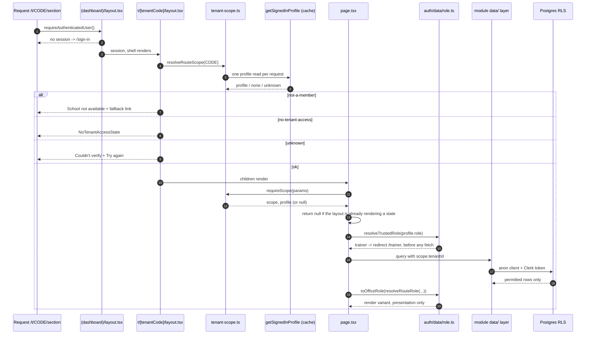

# Workflow: Resolving School Scope and Acting Role

Two questions are answered on every office request, and they are answered **in this order**:
*which school is this screen about, and may the caller see it?* and *which role is acting?*
The order is the design. The scope resolves first and can stop the request; the role resolves
second and can only change what renders.

Neither answer is the security boundary. Postgres RLS sits under every step, using the same
`profiles.role` column and the same membership rows
([data model and RLS](/openwiki/architecture/data-model-and-rls.md)). A mistake in this workflow
therefore **misleads rather than leaks**: a caller can see a write button RLS will deny, or be
shown another role's copy, but not another school's rows. That is exactly why the failure modes
at the end are worth knowing — they are accurate-looking wrong answers.

The route tree that hosts these calls — the `(dashboard)` gate, the segment layout, the legacy
redirect stubs — belongs to [Routing, Layout Gates and the Request Path](/openwiki/architecture/nextjs-routing-and-request-path.md).
This page follows the data and the decisions through those hooks.

## The ordered checks



*Each check in the order it actually runs — the layout gate, the cached profile read, the scope outcome, the fetch, then the presentation-only role.*

Step 1 is outside this workflow: `app/(dashboard)/layout.tsx` calls
`requireAuthenticatedUser()` before anything here runs, and `proxy.ts` only stamps
`x-pathname`. Step 7 is the only step whose result cannot change the response status.

## Step 1–2: one profile read, shared by layout and page

[`tenant-scope.ts`](/app/(dashboard)/tenant-scope.ts) exists in `app/` for a boundary reason, not
a layering accident: it joins `modules/auth`'s private `data/` (the Clerk identity) to
`modules/tenancy`'s private `data/` (the profile read), and only `app/` may import across that
line (rule 8). The *rule* it applies lives one module away, in
[`modules/tenancy/domain/scope.ts`](/modules/tenancy/domain/scope.ts).

`cache()` on `getSignedInProfile` and `resolveRouteScope` is what makes the two-call shape
affordable. The segment layout and the page both ask "which school is this, and may they see it?"
with the same `tenantCode`; React dedupes that to **one** `getProfileSnapshot` per request, which
is itself `cache()`-wrapped by `clerkUserId`
([`modules/tenancy/data/tenancy.ts`](/modules/tenancy/data/tenancy.ts)). Drop the wrapper and each
request costs two RLS-scoped profile reads of the whole membership join — layout in parallel with
page, one read per render — for an answer produced from identical inputs. `cache()` is per-request
only, so it is a dedupe, never a stale cache.

The three non-`ok` outcomes of `getSignedInProfile` are deliberately asymmetric:

- A failed identity read (`getAuthUserId()` throws) or any non-`ok` snapshot other than
  `not-found` collapses to `'unknown'` — "we could not check".
- `not-found` (authenticated, no `profiles` row yet — the webhook racing a first request)
  collapses to `'none'`.
- `'unknown'` is checked **before** `'none'`, so "we could not check" never renders as "you were
  never assigned a school". That is the same rule `deriveTenantAccess` encodes one module down.

## Step 3: the scope outcome is selection, not authorization

`resolveRouteScope` returns four arms, and only one of them hands back a `TenantScope`:

| Arm | Meaning | Rendered by |
|---|---|---|
| `ok` | `scopeForCode(profile, code)` matched a membership | the page |
| `not-a-member` | the code is foreign, unknown, or renamed | layout: "School not available" + default-school link |
| `no-tenant-access` | the caller belongs to no school at all | layout: `NoTenantAccessState` |
| `unknown` | the profile could not be read | layout: "Couldn't verify your school access" |

`scopeForCode` lowercases both sides and returns `null` on no match; `defaultScope` takes the
flagged `defaultTenantId`, then the first membership, then `null`. A foreign code never falls
back to "all schools" — the URL always ends up naming one school, which is what makes the segment
shareable ([ADR-001](/docs/adr/ADR-001-billing-and-domain-model.md) K1, the locked domain fact
that tenant context lives in the path).

A `TenantScope` is only ever built from `profile.tenants`, and `profile.tenants` is an RLS-scoped
read. The downstream `tenant_id = scope.tenantId` filter therefore *selects* among schools RLS
already allows; it never grants. That is rule 2's permitted half, pinned by
[`tests/unit/tenant-scope.test.ts`](/tests/unit/tenant-scope.test.ts) — a scope is built for a
member school (`scopeForCode(profile([AKB, NEN]), 'nen')` resolves) and is `null` for a school the
profile is not a member of. RLS would deny a foreign `tenantId` anyway; the null is the friendlier
of the two denials.

**The layout owns the four arms.** Every page under the segment begins
`const resolved = await requireScope(routeParams); if (!resolved) return null;`. `requireScope`
calls the same cached resolver and narrows to the `ok` arm. It returns `null` rather than calling
`notFound()` because **layouts and pages render in parallel**: a thrown 404 from the page could
beat the layout's explanation of *which* state applies. Returning `null` lets the layout's message
be the only message. The page contributes nothing, and nothing is broken by that — with no scope
there is no tenant id to query with.

## Step 4: the trusted role decides the redirect, before the fetch

Role resolution is split into two functions in
[`modules/auth/data/role.ts`](/modules/auth/data/role.ts), and the split is the whole point:

- `resolveTrustedRole(dbRole)` — `profiles.role` and nothing else. This is what a redirect or an
  authorization decision may read. `profiles.role` is the column RLS reads, so the UI and the
  database cannot disagree about who someone is (audit finding I5 came from them disagreeing).
  It is async for signature stability only; its body is the synchronous `asResolvedRole`.
- `resolveRouteRole(params, dbRole)` — `?role=` **first**, then `resolveTrustedRole`. A
  dev/demo affordance left over from before live identity existed
  ([ADR-005](/docs/adr/ADR-005-demo-account-tenant-scoping.md) records that the override outranks
  the database role, which is why the demo account is internal-only).

`?role=` is unauthenticated. Any caller can set it. A redirect gated on the override is therefore
a redirect nobody is held to, and a real trainer adding `?role=admin` would walk straight past the
office-only gate.

The same function gates more than one surface. `POST` handlers in
[`app/(dashboard)/users/new/actions.ts`](/app/(dashboard)/users/new/actions.ts) prefer it over any
override because the Clerk-invitation branch it reaches has no RLS behind it, and the shell layout
uses it to decide whether the admin-only "Add user" nav row exists.

On the trainer split, `viewer` — never a write-enabled variant — is the fallback. `toOfficeRole`
narrows anything that is not `admin`/`coordinator`/`viewer` (an unparsed role string, `null`, a
trainer the gate let through) to read-only `viewer`, and
[`tests/unit/display-role.test.ts`](/tests/unit/display-role.test.ts) pins that as a
*least-privilege* rule rather than a cosmetic default.

Whether a surface is even office-facing decides which function is in play:

- The [school dashboard](/app/(dashboard)/t/[tenantCode]/dashboard/page.tsx) resolves no role
  beyond the snapshot `requireScope` already returned — it redirects on `profile.role === 'trainer'`
  and narrows with `toOfficeRole(profile.role)`. No `?role=`, because the school dashboard has no
  preview override to honour.
- Billing and report read the snapshot fresh from `getProfileSnapshot(clerkUserId)` after
  `requireScope` (which they arrive at through the cache) and gate on `resolveTrustedRole`. Both
  redirect `/trainer` **before** the batch fetch, so no billing figure is ever serialized into a
  trainer's payload — the omission half of rule 5.

## Step 5: the snapshot fetch and the membership fold

The fetch is a module `data/` call with `scope.tenantId` passed in. What comes back is a
discriminated snapshot, not rows: `ok` / `no-tenant-access` / `sync-failed` / `unconfigured`.

`no-tenant-access` is never produced by a query — RLS reports "member of nothing" as a
successful empty read, indistinguishable from "this school has no batches". Routes name the
difference with `withTenantAccess(snapshot, tenantAccess)` from
[`modules/tenancy/domain/access.ts`](/modules/tenancy/domain/access.ts), which rewrites **only** an
`ok` snapshot. A `sync-failed` passes through untouched so the tidier "you belong to no school"
never masks a broken fetch. `unknown` changes nothing, because an unverified verdict must not
rewrite a successful read. Billing derives the verdict from the snapshot it already holds
(`deriveTenantAccess`) rather than fetching a profile a second time.

## Step 6–7: where presentation re-enters, and the two split points

`billing/page.tsx` is the page that carries both role halves, and it is worth reading as a
template because the two are adjacent in the file and must not be merged:

```ts
const trustedRole = await resolveTrustedRole(dbRole);
if (trustedRole === 'trainer') redirect('/trainer');      // ← before any fetch
// …fetch…
const billingRole = toOfficeRole(await resolveRouteRole(params, dbRole)); // ← render variant only
```

The first three lines stand on `resolveTrustedRole` alone and run before `getBatchesSnapshot`. The
last stands on `resolveRouteRole`, so a previewed `?role=` can change which variant of
`BillingQueueView` renders. There is no trainer variant of that view, so `toOfficeRole` narrows
the previewed trainer to `viewer` — a preview can only make a screen looser, and the `viewer`
fallback keeps it least-privilege when the role resolves to nothing.

`?role=` reaches exactly one page today, which is the honest state of the migration: Billing is
documented as the one route where it is a presentation override. `/users/new` reads it nowhere.

## Invariants and failure modes

- **Redirect on `resolveTrustedRole`, render on `resolveRouteRole`.** Rule 2's predecessor is
  explicit: gate a redirect on the wrong function and the URL picks the role.
- **`unknown` is never `none`.** Both `resolveRouteScope`'s ordering and `deriveTenantAccess`'s
  switch carry it.
- **A page's `null` is not an error.** It is the page deferring to a layout state; a page without
  the guard queries with an undefined tenant id.
- **A dead `cache()` breaks the shared read, not correctness.** Two profile reads per request is a
  cost, not a wrong answer — until the page reads a snapshot the layout already consumed and the
  two are compared.
- **RLS still sits under every step.** A viewer who appears to have a write control, or a scope the
  layout should have rejected, fails at the database rather than in the wrong tenant.

## The two traps

**Trap 1 — a JS tenant filter read as authorization (rule 2).** `scopeForCode` looks like an access
check, and adding `tenant_id = <code from the URL>` looks like it secures the query. It does not.
If the filter were taken straight from the URL segment and RLS were omitted, every school's rows
would still be returned for whoever asks. Rule 2 states the split precisely: a
`tenant_id = scope.tenantId` filter from a *validated* `TenantScope` is allowed and only selects;
a JS tenant check used *as* access control is a bug even when it returns the right answer, because
it signals the query was written assuming no RLS.

**Trap 2 — the `?role=` redirect escape.** Billing redirects on `resolveTrustedRole` and never on
`resolveRouteRole`
([`billing/page.tsx`](/app/(dashboard)/t/[tenantCode]/(sections)/billing/page.tsx)). Swap the two
and the escape is immediate: a real trainer on `/t/<school>/billing?role=admin` is no longer
redirected, and billing deadlines, preparation and financial fields reach a role that must never
see them (rule 5). `resolveRouteRole`'s own doc comment carries the warning;
`tests/unit/tenant-scope.test.ts` pins the authority half — the database role wins over Clerk
metadata, and a missing profile row resolves to `null`, not to a Clerk-supplied role.

Under both: RLS is rule 1, and every mistake in this workflow misleads rather than leaks.