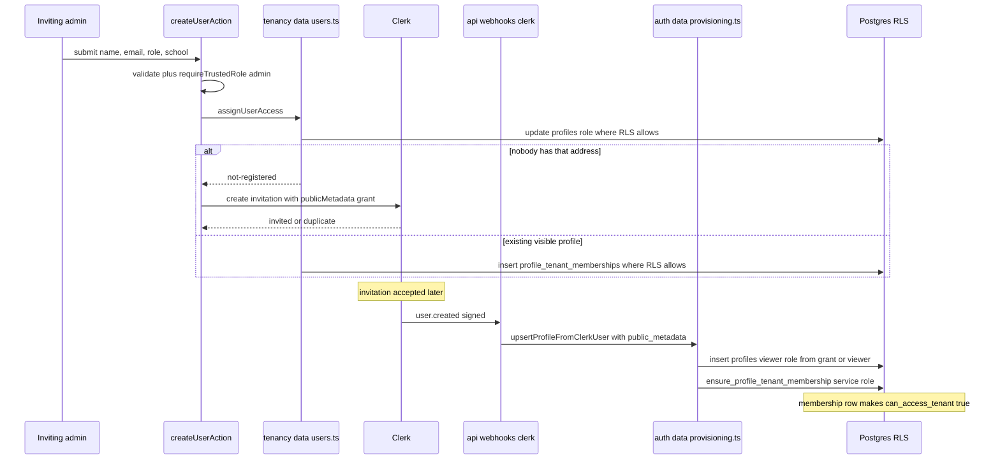

# Workflow: From Invitation to Seated Member

Access in this app is a two-part fact: a `profiles` row (identity exists) and a
`profile_tenant_memberships` row (identity can see a school). Neither alone reads anything —
`app_private.can_access_tenant()` resolves purely from the memberships table, so a profile with no
membership sees zero rows everywhere. This page follows the path from "nobody" to "seated member",
back out again, and what the app does with the person who is authenticated but belongs to nothing.

Two constraints shape it before any code does:

1. **`profiles.clerk_user_id` is `not null unique`** ([canonical
   migration](/supabase/migrations/20260528160300_create_tenant_scoped_schema.sql#L72-L81)), so a
   profile cannot exist before the person has a Clerk account. An admin inviting a stranger has no
   row to write a role onto.
2. **Every admission decision is RLS's.** The admin screens carry role checks, but
   [migration `20260904120000`](/supabase/migrations/20260904120000_add_user_admin_write_policies.sql)
   and [migration `20260906114735`](/supabase/migrations/20260906114735_add_school_registry_and_platform_admin.sql)
   are the boundary (rule 1). [Tenant Isolation and
   RLS](/openwiki/architecture/tenant-isolation-and-rls.md) owns the policies themselves; this page
   only says where they bite.

## The whole path

*The invitation is the only path that arrives already carrying a grant; every other sign-up lands
tenantless.*

## Entry points and who may use them

| Entry point | Actor | What it can do |
| --- | --- | --- |
<!-- openwiki: broken internal link [/app/(dashboard] file "/app/(dashboard" does not exist. Fix the href or restore the target, then delete this comment. -->
<!-- openwiki: broken internal link [/app/(dashboard] file "/app/(dashboard" does not exist. Fix the href or restore the target, then delete this comment. -->
| [`/users/new`](/app/(dashboard)/users/new/page.tsx) → [`createUserAction`](/app/(dashboard)/users/new/actions.ts) | tenant `admin` | seat an existing user, or invite a stranger |
<!-- openwiki: broken internal link [/app/(dashboard] file "/app/(dashboard" does not exist. Fix the href or restore the target, then delete this comment. -->
| [`/schools/new`](/app/(dashboard)/schools/new/actions.ts) | platform admin | create a school, then seat its first member by hand |
| [`app/api/webhooks/clerk/route.ts`](/app/api/webhooks/clerk/route.ts) | Clerk | insert a profile, repair a membership, deactivate |

`/users/new` renders *empty states* for every guard it cannot satisfy — no session, no profile,
`unconfigured`, `sync-failed`, non-admin, and an admin who belongs to no school
<!-- openwiki: broken internal link [/app/(dashboard] file "/app/(dashboard" does not exist. Fix the href or restore the target, then delete this comment. -->
([page.tsx L58-L131](/app/(dashboard)/users/new/page.tsx#L58-L131)) — so a denied operator never
gets a form whose only outcome is a denial. The sidebar hides the row for non-admins as usability
only ([`modules/shell/ui/Sidebar.tsx`](/modules/shell/ui/Sidebar.tsx#L97-L135)).

The action's gate is `resolveTrustedRole(profile.role)`, **never** `resolveRouteRole`, because the
latter honours a `?role=` preview override and the invitation branch has no RLS behind it at all
<!-- openwiki: broken internal link [/app/(dashboard] file "/app/(dashboard" does not exist. Fix the href or restore the target, then delete this comment. -->
([actions.ts L71-L75](/app/(dashboard)/users/new/actions.ts#L71-L75)). Every rejection is a
discriminated form state rather than a throw, so the admin sees which field or which guard failed
instead of an opaque digest.

## Step 1 — an assignment, resolved by lookup

`createUserAction` validates through `validateUserAccessDraft`
([`modules/tenancy/domain/userAccess.ts`](/modules/tenancy/domain/userAccess.ts#L114-L130)), passing
the caller's own tenant ids, then calls `assignUserAccess`
([`modules/tenancy/data/users.ts`](/modules/tenancy/data/users.ts#L353-L381)). That function
resolves the target by email first.

`findUserByEmail` uses `ilike` because the webhook stores Clerk's casing, then **re-checks exact
equality after normalizing** ([users.ts L147-L177](/modules/tenancy/data/users.ts#L147-L177)). This
is not search quality: whatever row comes back is the profile whose role is changed and whose school
is granted, so a wildcard match is a wrong-person-gets-access bug. `%`, `_` and `\` are escaped;
PostgREST rewrites `*` to `%` before Postgres sees the escape, so the equality check is what closes
that residue.

`not-registered` is deliberately ambiguous — "no row *this caller can see*" covers both a stranger
and someone who belongs to a school the caller cannot see. It is the branch into Step 2.

## Step 2 — an invitation that carries the grant

There is nothing in Postgres to write, so the grant is parked on the Clerk invitation's
`publicMetadata` — `tvicamsRole` and `tvicamsTenantId`
([`modules/auth/domain/invitationMetadata.ts`](/modules/auth/domain/invitationMetadata.ts#L39-L56))
— and [`inviteUser`](/modules/auth/data/invitations.ts#L64-L83) creates it. `redirectUrl` is derived
from `NEXT_PUBLIC_APP_URL` and omitted when absent, so Clerk falls back to the instance setting
rather than sending anyone to a wrong host.

`ignoreExisting` stays at its default `false`, so a second invitation for the same address surfaces
as `duplicate` instead of a second live link. Two pending invitations carrying *different* grants
would make which email the person opens decide their access — not a race an access-control flow
should have. The form's duplicate copy stays true in both readings of "already exists", because the
RLS-scoped lookup also reports `not-registered` for someone at a school the caller cannot see.

Clerk returns `400`/`duplicate_record` for that case. Any other failure is `failed` with the message
kept server-side (rule 6).

## Step 3 — `user.created` and insert-only provisioning

The webhook verifies the body with `verifyWebhook()` against `CLERK_WEBHOOK_SIGNING_SECRET` and
answers `400` on failure. It is unauthenticated by design: no session exists yet, so the handler
runs on the service-role client, the one path that bypasses RLS (rule 3).

`upsertProfileFromClerkUser` ([provisioning.ts L58-L106](/modules/auth/data/provisioning.ts#L58-L106))
branches on whether a profile already exists:

- **No row** → insert with `role: grant?.role ?? 'viewer'` and `is_active: true`. A self sign-up has
  no grant, so it lands as the least-privileged role with no membership. The membership RPC is called
  only when a grant parsed.
- **Row exists** → update `full_name`/`email` **only**. Role and `is_active` are absent from that
  column list, so no Clerk profile edit and no re-delivered `user.updated` can silently re-grant or
  change authority. Then, if a grant parses, `ensureTenantMembership` runs as a **repair**.

That repair narrows the invariant rather than holding it whole, so state it exactly: a membership is
written only when the profile holds *none*, so a grant can never add a second school or move someone
an admin already placed. What it permits is an admin authoring a grant onto a tenantless user through
Clerk's Backend API — the same actor and intent the invitation path already trusts.

### Why `public_metadata` is trusted

`publicMetadata` is readable and settable **only through the Backend API**
([the module's safety argument](/modules/auth/domain/invitationMetadata.ts#L18-L33)); the person
signing up cannot author or alter what arrives with them, and the grant bytes were written by
whatever holds the Clerk secret key. So it is the inviting admin's authority the webhook honours, not
the new user's — the one narrow exception to "provisioning never grants tenant access".

A grant is only trusted when it parses, and the parser is strict and all-or-nothing: keys are
namespaced, the role must be a member of `public.profile_role`, the tenant id must be a non-blank
string, and a half-formed grant yields `null`
([invitationMetadata.ts L58-L78](/modules/auth/domain/invitationMetadata.ts#L58-L78)). Failing costs
an admin one manual assignment; accepting half a grant could hand out access nobody authorised.

**The chain therefore has two seams.** (a) Namespaced keys, not a nested object: a stray `role` or
`theme` key on the same metadata bag is ignored
([`tests/unit/user-access.test.ts`](/tests/unit/user-access.test.ts#L142-L190)). (b) A grant is
applied only on insert *or* repair of an empty membership set, never as an overwrite. Anything that
touches `publicMetadata` is therefore a potential grant, and the strictness of the parser is the only
conservative part of it.

## Step 4 — the membership insert and its partial state

`ensureTenantMembership` calls the security-invoker RPC
[`ensure_profile_tenant_membership`](/supabase/migrations/20260906120000_ensure_invitation_membership_atomic.sql),
which locks the profile row with `for update`, returns if any membership exists, and otherwise
inserts with `is_default: true`
([20260906120000 L4-L35](/supabase/migrations/20260906120000_ensure_invitation_membership_atomic.sql#L4-L35)).

**The failure mode this migration was written against** is one it replaced: check-then-insert across
two round trips. Two concurrent deliveries for the same profile could both observe an empty
membership set, assign different default schools, and leave the person landing in whichever
`is_default` row happens to come back first. The locked row makes every call for that profile share
one serialization point, including calls proposing different tenants, and it also makes
`is_default: true` correct by construction — true is right exactly when there are no others.

The narrower partial state that remains, and the reasoning behind the helper's error handling, is
**a profile that exists with no membership**. Not an error the person can see, but the profile is
invisible to the same-tenant read policy and holds no data access. The `user.updated` repair path
exists because of it. Note the ordering consequence: for a `user.created` that succeeds at the insert
and then fails at the membership, the route answers `500`, Clerk retries, and the retry takes the
**existing-profile** branch — which is why the repair hangs off that branch and not the insert one.

A duplicate-key error (`23505`) is accepted rather than treated as failure: a writer outside this
helper may have inserted the same membership without holding the lock. Any other error is logged and
rethrown so Clerk retries
([provisioning.ts L131-L146](/modules/auth/data/provisioning.ts#L131-L146); pinned by
[`tests/unit/auth-provisioning.test.ts`](/tests/unit/auth-provisioning.test.ts#L57-L85)). Railing back
on that rethrow widens the partial state, but a `200` here would end it forever.

The RPC is granted to `service_role` only — no session exists in the webhook, so its `security
invoker` sits on the service role and RLS in the function never evaluates, which is safe only because
nothing but the webhook can reach it. `public.create_school` is the deliberate mirror image: also
`security invoker`, but granted to `authenticated`, so RLS *does* fire inside it
<!-- openwiki: broken internal link [/docs/adr/ADR-006-platform-admin-and-school-registry.md#L144-L154] heading anchor "L144-L154" does not exist in "/docs/adr/ADR-006-platform-admin-and-school-registry.md". Fix the href or restore the target, then delete this comment. -->
([ADR-006 P6](/docs/adr/ADR-006-platform-admin-and-school-registry.md#L144-L154)).

## Step 5 — seating an existing member, with compensation

The lookup path is the RLS-governed twin, and it is where the admin write policies do their work. An
admin may only grant a school they belong to themselves, and may only touch a profile that is
unassigned or shares a tenant with them
([20260904120000 policies 1–3](/supabase/migrations/20260904120000_add_user_admin_write_policies.sql#L36-L105)).
Two behaviours follow from how PostgREST reports RLS:

- A blocked UPDATE is not an error — zero rows come back, so `setTargetRole` selects the updated id
  and reads an empty result as `denied`, not success.
- A denied INSERT raises `42501`, which `writeFailureSnapshot` maps to `denied`; anything else is
  `sync-failed`.

`assignUserAccess` issues two statements, not a transaction, and ordering carries the safety: the
role UPDATE runs first because it is the safer half to stop after. If the membership INSERT then
fails, `restorePriorRole` compensates
([users.ts L279-L323](/modules/tenancy/data/users.ts#L279-L323)). That matters beyond tidiness —
policies 1 and 2 are keyed on `current_role()` and match profiles with *no* tenant, so a half-applied
promotion to `admin` can read and re-role the whole unassigned pool with no membership at all. The
restore is best effort and cannot itself be rolled back; a failed restore is logged and leaves the
state exactly as it would have been without the attempt.

The same RLS asymmetry forces `is_default: false` here. The admin client's membership read is scoped,
so an empty list means "none *this admin can see*", and trusting it would write a second default row
— the schema permits more than one. `mapProfileRow` falls back to `memberships[0]` when nothing is
flagged
([tenancy.ts L80-L97](/modules/tenancy/data/tenancy.ts#L80-L97)), so a single-school member still
lands somewhere; `true` is written only on the webhook path, where the service role can see the whole
truth.

Already-member is detected up front and returns `assigned` with `alreadyMember: true` so the banner
can say only the role changed instead of claiming a new grant.

## Step 6 — the platform admin and the first member

A freshly created school has no members, so it is satisfiable by nothing a tenant member holds. The
policy "Platform admins can seat a tenant's first members" supplies the missing capability, with two
predicates that both remain load-bearing: `profile_id <> current_profile_id()` (the operator seats
others, never themselves — otherwise one INSERT hands them everything `can_access_tenant()` gates)
and `not exists (… memberships for that tenant)`, so a school can only be staffed while empty. The
second predicate is racy under concurrent inserts; that is tolerable because the first holds anyway
and the worst case is two seated members rather than one
([20260906114735 L297-L349](/supabase/migrations/20260906114735_add_school_registry_and_platform_admin.sql#L297-L349)).
Guard 2's subquery is itself RLS-filtered, so narrowing the sibling "Platform admins can read tenant
memberships" SELECT policy silently weakens the INSERT policy.

There is no DELETE counterpart: revoking is the school admin's operation, and the operator seats the
first admin and steps back out. `/schools/new` does not perform a seating — it only calls
`create_school`; the seat is a follow-up write through the same membership table with
`is_platform_admin()` satisfied.

Read the policies in [Tenant Isolation and RLS](/openwiki/architecture/tenant-isolation-and-rls.md)
before changing either. Granting `is_platform_admin()` a compliance table, or letting the operator
seat itself into a tenant, is a boundary change that needs its own ADR (rule 30; ADR-006 P3).

## Step 7 — the tenantless state and how the route folds it

The workflow's payoff is the state it produces for a self sign-up that no admin has reached: a
profile, a `viewer` role, and no membership. Every RLS-scoped read then returns a *successful* empty
set, so the data itself cannot say "you belong to nothing" — rule 19's other states look identical.

Two helpers convert a profile read into a verdict instead of a query. `tenantAccessOf(profile)` is
pure and used by a page that already holds a scope; `deriveTenantAccess(profileSnapshot)` maps
`not-found` to `none` (a signed-in person with no profile row has no membership either way) and
`sync-failed`/`unconfigured` to `unknown`
([tenancy.ts L158-L178](/modules/tenancy/data/tenancy.ts#L158-L178)). `withTenantAccess` is the only
writer of the fourth state and replaces **only** an `ok` snapshot, so a real fetch failure is never
dressed up as "no school"
([`modules/tenancy/domain/access.ts`](/modules/tenancy/domain/access.ts#L53-L58)).

The route-level joins that feed it live in `app/` because they compose two modules' private `data/`:
`resolveTenantAccess()` for a verdict on its own, and `resolveRouteScope()`, which collapses the
profile snapshot into `ok` | `not-a-member` | `no-tenant-access` | `unknown`. The `/t/[tenantCode]`
segment layout renders the three non-`ok` arms, and every office page folds the verdict with its own
<!-- openwiki: broken internal link [/app/(dashboard] file "/app/(dashboard" does not exist. Fix the href or restore the target, then delete this comment. -->
fetch ([`tenant-scope.ts` L46-L52](/app/(dashboard)/tenant-scope.ts#L46-L52),
<!-- openwiki: broken internal link [/app/(dashboard] file "/app/(dashboard" does not exist. Fix the href or restore the target, then delete this comment. -->
[`layout.tsx` L26-L49](/app/(dashboard)/t/[tenantCode]/layout.tsx#L26-L49)). The dashboard layout
does not police it at all: on a failed read it just passes a `null` role and an empty tenant list to
the shell, which renders a smaller, honest menu
<!-- openwiki: broken internal link [/app/(dashboard] file "/app/(dashboard" does not exist. Fix the href or restore the target, then delete this comment. -->
([`layout.tsx` L24-L35](/app/(dashboard)/layout.tsx#L24-L35)).

Ordering is the fragile part — a `sync-failed` and a `no-tenant-access` both look like zero rows —
and [Module Boundaries and the Data Layer
Pattern](/openwiki/architecture/module-boundaries-and-data-pattern.md#guard-ordering) owns the fixed
guard order. The one rule that belongs here: the fold must run on the profile read, never on the rows.

## Failure modes

- **Profile created, membership never written.** Tenantless member, invisible to same-tenant reads.
  Recovered by the next `user.updated`; permanent only if nothing delivers one.
- **Two invitations for one address.** Prevented by keeping `ignoreExisting` false — otherwise which
  email is opened decides the grant.
- **Wildcard email match.** Would re-role and seat the wrong profile; closed by escaping plus the
  exact-equality re-check.
- **Role restored, membership not.** A `42501` on the INSERT is compensated; a failed restore is
  best-effort and logged only.
- **`500` from the route.** Terminal for that delivery — it is what makes Clerk deliver the repair
  path. Returning `200` on any error would make a partial state permanent.
- **Platform admin seating itself.** Impossible on the first-member policy alone, which is precisely
  why the two predicates must be counted, not just the policy's presence.
- **Viewer granted a membership.** Read-only is enforced server-side by the write policies, not by
  hiding buttons (rule 4).
- **Tenantless user told "no batches".** RLS answers empty; without the fold the screen would claim
  the school has no data. Guard order is the only defence.

## Tests and their limits

[`tests/unit/auth-provisioning.test.ts`](/tests/unit/auth-provisioning.test.ts) pins the RPC name and
arguments, the accepted `23505`, and the logged-then-rethrown other error.
[`tests/unit/user-access.test.ts`](/tests/unit/user-access.test.ts) pins the assignable role set
(`owner` excluded, no DB enum value), the `ILIKE` escaping, and the all-or-nothing grant parse.
[`tests/unit/tenant-access.test.ts`](/tests/unit/tenant-access.test.ts) pins the `not-found` → `none`
mapping and that the fold never rewrites a failure — the assertions that keep the tenantless state
honest. The RLS half — the admin write policies and both seating predicates — has no unit coverage
and rests on real Supabase; until those isolation tests exist it must be checked by reading the
migration (rule 35 — RLS tests run against real Supabase, no mocks).

Related: [Auth and Provisioning](/openwiki/modules/auth-and-provisioning.md) for the identity half,
[Tenancy](/openwiki/modules/tenancy.md) for the seat model, [Tenant Scoping and Role
Authority](/openwiki/workflows/tenant-scoping-and-role-authority.md) for which role column is
authority.
