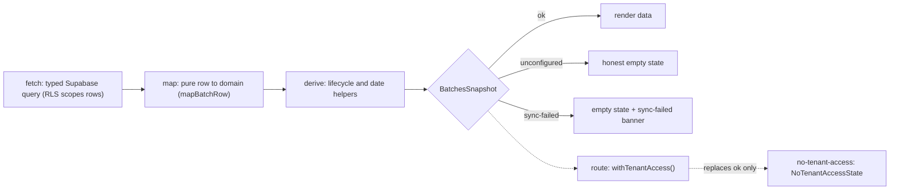

# Data Layer Pattern

`lib/data/batches.ts` (TES-30) is the **reference implementation** every entity contract must follow — three deliberately separated layers:

1. **fetch** — a typed Supabase query (`getBatches()`); **RLS scopes rows** — never manually filter by tenant in JS
2. **map** — a pure, I/O-free DB-row → domain translation (`mapBatchRow`), unit-testable against fixtures
3. **derive** — lifecycle/date helpers computed from the row

## Two type families, kept apart

- `lib/supabase/database.types.ts` — **generated** raw DB row shapes; regenerate after every migration
- `lib/data/types.ts` — the UI **domain** types (`Batch`, `DocRecord`, `DashboardMetrics`, …), the contract between components and data

**Rule: only `lib/data/*` may import `database.types`; components import domain types only.** This keeps DB churn out of the UI.

## The enum bridge lives here

`DB_TO_UI_STAGE` maps `training→train`, `assessment→assess`, `billing→bill`; UI `entre` is UI-only; DB `blocked` surfaces as UI `pending` ([[Batch Lifecycle]]). It is a **total map** — a new DB enum variant fails compilation until its UI treatment is chosen. The bridge stays in the mapper, never in components.

## Error shaping: discriminated snapshots

> Current behaviour: `unconfigured` renders an honest empty state, with no mock data, and `no-tenant-access` is folded in by the route, not produced by any query (see CLAUDE.md).

Data functions return discriminated unions (see `BatchesSnapshot`): **`ok`** / **`sync-failed`** / **`unconfigured`**, so Server Components map states straight to UI. `unconfigured` (no Supabase env) falls back to mock data silently; `sync-failed` (configured but errored) must surface the sync-failed banner. **Never leak raw Supabase/SQL errors, table names, or internal IDs to the UI.**

## DTO contract rules

- Frontend receives **friendly DTOs**, never raw DB payloads (no `tenant_id`, UUIDs, storage paths, table names)
- **Trainer DTOs omit** billing deadline, BSRS, NTP lag, billing preparation, and financial fields — server-side ([[Roles And Permissions]])
- Every screen with relative dates includes an exact **"data as of"** timestamp
- Mutations (Route Handlers / Server Actions) verify the session, authorize explicitly, write an `activity_log` event, and return friendly errors — RLS is the backstop, not the only check

## Migration workflow

Apply migration → regenerate `database.types.ts` → update affected mappers + domain types → run mapper unit tests + real-Supabase integration tests ([[Testing Strategy]]).

## Related

- [[Architecture Overview]]
- [[Database Schema]]
- [[Auth And Tenancy]]

Sources: [[TRD]] §4.4, §5 · [[MASTER_PRD_SRS]] §10–11
