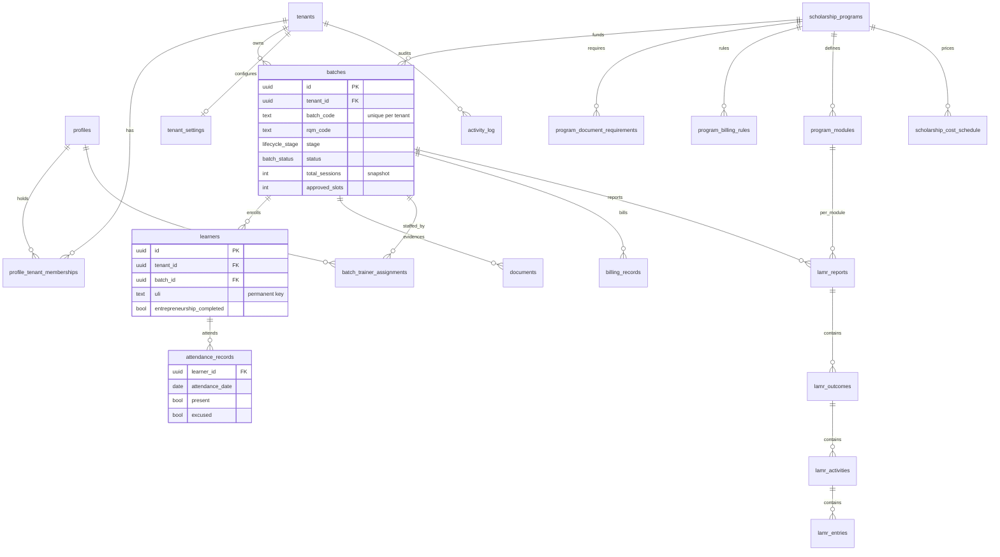

# Database Schema

The canonical schema is the single migration `supabase/migrations/20260528160300_create_tenant_scoped_schema.sql`; new migrations are **additive**. Every tenant-owned table carries `tenant_id`. After any migration: regenerate `database.types.ts`, then update mappers ([[Data Layer Pattern]]).

## Implemented tables (base migration)

> Simplified: shows the main relationships only. The live schema also has `learner_details`, `learner_identities`, `qualifications`, `tenant_qualifications`, `trainer_credentials` and `platform_admins`.

| Table | Purpose |
| --- | --- |
| `tenants` | Schools/TVIs (AKB, J3ED, NEN seeded) |
| `profiles` | App users linked to Clerk (`clerk_user_id`, role, active flag) |
| `profile_tenant_memberships` | Many-to-many user↔school — canonical over legacy `tenant_ids` arrays |
| `scholarship_programs` | Configurable programs (TWSP, CFSP seeded) |
| `program_document_requirements` | Required evidence per program → [[Document Checklist And Evidence]] |
| `program_billing_rules` | Billing threshold per program |
| `batches` | Main batch record; unique `(tenant_id, batch_code)` → [[Batch Lifecycle]] |
| `learners` | Roster; unique `(tenant_id, batch_id, learner_no)` |
| `documents` | Uploaded/linked evidence with status + verification metadata |
| `lamr_reports` / `lamr_outcomes` / `lamr_activities` / `lamr_entries` | → [[LAMR Evidence]] |
| `activity_log` | Immutable audit events (action enum, entity, summary, metadata) |
| Storage bucket `compliance-evidence` | Private, 50 MB limit, tenant-folder RLS |

## Enums

`profile_role` (admin/coordinator/trainer/viewer) · `lifecycle_stage` (aou…blocked) · `batch_status` (pending/ongoing/completed/blocked) · `document_status` (missing/pending/submitted/verified) · `document_audience` · `assessment_result` · `activity_action`

## ADR-001 additions (Phase 0.1 — required for first ship)

| New table | Purpose |
| --- | --- |
| `attendance_records` | Per learner per date, `time_in`/`time_out`; unique `(tenant, batch, learner, date)` → [[Attendance And Progress]] |
| `program_modules` | Fixed module list; drives one-LAMR-per-module |
| `batch_trainer_assignments` | Many-to-many trainer↔batch; drives `can_trainer_write_batch` |
| `scholarship_cost_schedule` | Seeded TESDA rates by program + qualification (no circular/effectivity cols — the snapshot lives on the batch) |
| `billing_records` | Versioned, append-only generation log → [[Billing Engine]] |
| `tenant_settings` | Signatories, letterhead, addressee, threshold overrides |
| `learner_identities` | Empty future seam → [[Learner Identity And Import]] |

**New batch columns:** RQM/NTP fields ([[RQM And NTP Authorization]]), `schedule_pattern`, `total_sessions`, snapshotted cost components, `entrepreneurship_delivered`. **New learner columns:** `uli` (indexed), `entrepreneurship_completed`. **`lamr_reports`:** `module_id` FK.

## Deferred (document only)

`alerts_log` ([[Alerts]] are computed on read), `batch_snapshots`, report/EGACE employment entities, standardized soft-delete/retention policy (define before real evidence data lands).

> Note: [[SUPABASE_SCHEMA_GUIDE]] is the original design walkthrough and predates the migration (it still shows `tenant_ids`/`assigned_batch_ids` on profiles). The migration + [[TRD]] §4 are canonical.

## Related

- [[Auth And Tenancy]] — the RLS layer over these tables
- [[Data Layer Pattern]] — how rows become domain objects

Sources: [[TRD]] §4 · [[MASTER_PRD_SRS]] §9 · [[ADR-001-billing-and-domain-model]] §11 · [[SUPABASE_SCHEMA_GUIDE]]
